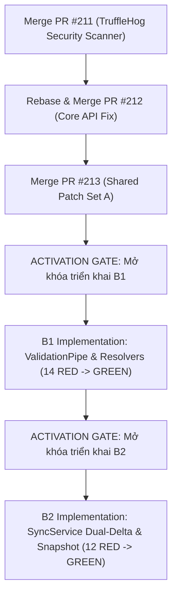

# B1 / B2 Acceptance Test Harness Handoff Manifest

> **Status:** `TEST PACK FROZEN / HANDOFF READY`  
> **Production Code Status:** `HOLD` (No production code modified)  
> **Target Subsystems:** `services/api` (Sync Engine, Claims, Stories), `packages/shared`  
> **Test-Only Branch:** [`test/b2-critical-red-acceptance-harness`](https://github.com/HIepNgoc2006/OmniNovel/tree/test/b2-critical-red-acceptance-harness)  
> **Date:** 2026-11-10  
> **Author:** OmniNovel Engineering Core  

---

## 1. Commit Baseline & Traceability

| Artifact | Commit SHA | Remote Reference | Purpose |
| :--- | :--- | :--- | :--- |
| **ADR-SYNC-07C-v2.2** | `b698ef7` | `origin/main` | Thiết kế kiến trúc đồng bộ v2.2 |
| **Shared Patch Set A (PR #213)** | `6e440e2` | `origin/feat/sync-adr-v22-patch-a` | Six-Domain Snapshot Contracts (Draft, Pending Merge) |
| **Core API Remediation (PR #212)** | `c440396` | `origin/fix/core-api-sync-data-integrity` | Conflict Resolver, getChanges boundary, textOffset (Draft, Pending Merge) |
| **B1 RED Harness Freeze** | `4c70cd8` | `origin/test/b1-http-red-acceptance-harness` | 17 tests: Receipt-First, JCS Immobility, JSON bounds |
| **B2 Latest Test-Only Head** | `28e9d8b` | `origin/test/b2-critical-red-acceptance-harness` | 17 tests: Dual-Delta, 6-Domain Keyset, HMAC Cursor, SnapshotDomainName |

---

## 2. Test Commands & File Locations

### 2.1 File Paths
- **B1 Acceptance Suite:** `services/api/test/b1-red-acceptance.e2e-spec.ts` (1099 lines, 17 tests)
- **B1 HTTP Probe:** `services/api/test/b1-http-reproduction.probe.ts` (1005 lines)
- **B2 Critical Acceptance Suite:** `services/api/test/b2-critical-red-acceptance.e2e-spec.ts` (1108 lines, 15 tests)
- **B2 GuestClaim Tombstone Suite:** `services/api/test/b2-guest-claim-bookmark-tombstone.e2e-spec.ts` (246 lines, 2 tests)
- **Errata Addendum:** `plans/ADR-SYNC-07C-v2.2-ERRATA-ADDENDUM.md`

### 2.2 Execution Commands (PowerShell / Windows)

```powershell
# Chạy bộ test B1 RED Acceptance (Kỳ vọng: 3 PASS / 14 RED)
cd services/api
$env:NODE_ENV='test'; $env:DB_PORT='55433'; $env:DB_USER='postgres'; $env:DB_PASSWORD='postgres_password_secure'; $env:DB_NAME='omninovel_test'; $env:DB_HOST='127.0.0.1'
npm.cmd run test:e2e -- --verbose test/b1-red-acceptance.e2e-spec.ts

# Chạy bộ test B2 RED Acceptance (Kỳ vọng: 5 PASS / 12 RED)
cd services/api
$env:NODE_ENV='test'; $env:DB_PORT='55433'; $env:DB_USER='postgres'; $env:DB_PASSWORD='postgres_password_secure'; $env:DB_NAME='omninovel_test'; $env:DB_HOST='127.0.0.1'
npm.cmd run test:e2e -- --verbose test/b2-critical-red-acceptance.e2e-spec.ts test/b2-guest-claim-bookmark-tombstone.e2e-spec.ts
```

---

## 3. Test Ownership & Acceptance Matrix

### 3.1 B1 Test Suite (`b1-red-acceptance.e2e-spec.ts` — 17 Tests: 3 PASS / 14 RED)

| Test ID | Module / Hạng mục | Baseline Result | Expected B1 Target Behavior |
| :--- | :--- | :---: | :--- |
| `REG-JCS-01` | Receipt-First Replay | **PASS** | Replay mutation cũ đã có receipt nhận `200 DEDUPLICATED` |
| `REG-JCS-02` | Receipt-First Replay | **RED** | Replay mutation legacy vi phạm Pipe B1 vẫn bypass Pipe nhận receipt |
| `REG-JCS-03` | Receipt-First Replay | **RED** | Durable `REJECTED_*` receipt giữ nguyên trạng thái từ chối gốc |
| `REG-JCS-04` | Idempotency Mismatch | **RED** | Khớp `(userId, clientId, mutationId)` nhưng khác payload trả 409 kèm `meta.mutationId` |
| `REG-JCS-05` | Canonical Strict Pipe | **RED** | Fresh mutation sai cấu trúc canonical bị từ chối 400 với 0 bản ghi DB |
| `REG-JCS-06` | Mixed Batch | **RED** | Batch `[Legacy replay, Fresh canonical]` trả `200 [DEDUPLICATED, APPLIED]` |
| `REG-JCS-07` | Mixed Batch Rollback | **RED** | Batch `[Valid Fresh, Invalid Fresh]` rollback 100% bản ghi DB |
| `REG-JCS-07B` | Mid-TX Rollback | **PASS** | Batch lỗi Idempotency ở Item 1 rollback 100% Item 0 |
| `REG-JCS-08` | JCS Immobility | **PASS** | Key reordering & negative zero (`-0`) cho ra hash đồng nhất |
| `REG-JCS-09A` | JSON Syntax Bounds | **RED** | Express JSON parsing lỗi / bare `NaN`/`Infinity` trả 400 (không sập 500) |
| `REG-JCS-09B` | Non-Finite Numbers | **RED** | `1e309` (Infinity) & lone surrogate bị chặn 400 tại Pipe |
| `REG-JCS-10` | Prototype Pollution | **RED** | Khóa `__proto__`, `constructor`, `prototype` bị chặn 400 fail-closed |
| `REG-JCS-11A` | Payload Size Limit | **RED** | Body > 2 MB trả chuẩn HTTP 413 `PAYLOAD_TOO_LARGE` |
| `REG-JCS-11B` | JSON Hardening | **RED** | Depth > 16, > 128 keys, string > 16KB, pref key > 64 chars bị từ chối 400 |
| `REG-JCS-12` | HISTORY DELETE 'all' | **RED** | Cấm fresh `'all'`; chỉ chấp nhận UUID sentinel; legacy `'all'` qua receipt-first |
| `PREF-HIST-01..03` | PREFERENCE Tombstone | **RED** | Kiểm tra tombstone ưu tiên trước whitelist/stale; cấm `.trim()` ngầm |
| `TOMB-PREC-01` | Tombstone Precedence | **RED** | `PROGRESS` thiếu epoch khi `effectiveEpoch > 0` bị từ chối sau tombstone guard |

---

### 3.2 B2 Test Suite (`b2-critical-red-acceptance` + `b2-guest-claim` — 17 Tests: 5 PASS / 12 RED)

| Test ID | Module / Hạng mục | Baseline Result | Expected B2 Target Behavior |
| :--- | :--- | :---: | :--- |
| `DUAL-DELTA-01` | Dual-Delta Commit | **RED** | Atomic commit `PROGRESS` ($r+1$) và `HISTORY` ($r+2$), receipt $r+2$ |
| `DUAL-DELTA-02` | Dual-Delta Replay | **RED** | Retry `PROGRESS` nhận receipt `assignedRevision = r+2` |
| `DUAL-DELTA-03` | Dual-Delta forceRewind | **RED** | `forceRewind = true` chỉ advance revision cho `PROGRESS`, không phát `HISTORY` |
| `SNAP-SIX-01` | Six-Domain Envelope | **RED** | Snapshot trả đủ 6 domains: bookmarks, progress, chapterReadStates, preferences, historyEpochs, tombstones |
| `SNAP-SIX-02` | REG-17 Keyset Pagination | **RED** | 11 DB rows thành 9 wire items qua 5 pages (limit=2), phân trang tuần tự qua ranh giới cả 6 domain |
| `SNAP-SIX-03` | REG-17 Subcase (limit=3) | **RED** | Không ngắt sớm khi page 1 dừng đúng ranh giới domain `PREFERENCE`; trả `hasMore: true` |
| `CUR-01` | HMAC Cursor Validation | **RED** | `mrev = '-1'` bị từ chối `400 CURSOR_INVALID_REVISION` |
| `CUR-02` | HMAC Cursor Validation | **RED** | `mrev` malformed (`'abc'`, `'1.5'`, `' 10 '`, numeric `10`) bị từ chối `400 CURSOR_INVALID_REVISION` |
| `CUR-03` | HMAC Cursor Validation | **RED** | `mrev` vượt PostgreSQL BIGINT max bị từ chối `400 CURSOR_INVALID_REVISION` |
| `CUR-04` | HMAC Cursor Watermark | **PASS** | Cursor với `mrev = '0'` được chấp nhận (HTTP 200); chữ ký bị tamper bị từ chối `400 CURSOR_SIGNATURE_INVALID` |
| `CUR-05` | Legacy v1 Cursor Upgrade | **RED** | Legacy v1 cursor thiếu `mrev` bị từ chối `409 SNAPSHOT_INVALIDATED` (`reason: 'CURSOR_WATERMARK_UPGRADE_REQUIRED'`) |
| `REG-18` | Concurrent GC Invalidation | **RED** | Khi GC nâng `min_active_revision > mrev`, request bị từ chối `409 SNAPSHOT_INVALIDATED` ngăn torn snapshot |
| `PROD-01` | Server Producer | **PASS** | `StoriesService.saveReadingProgress` gắn đúng `observedHistoryEpoch` |
| `PROD-02` | Server Producer | **PASS** | Canonical wire: HISTORY $\rightarrow$ `chapterId`, PROGRESS $\rightarrow$ `storyId` |
| `PROD-03` | Server Producer | **PASS** | `forceRewind` không ghi đè giảm `chapter_read_states.max_progress_percentage` |
| `GUEST-BM-01` | GuestClaim Isolation | **PASS** | `HISTORY` tombstone không chặn import bookmark của guest |
| `GUEST-BM-02` | GuestClaim Tombstone | **RED** | `BOOKMARK` tombstone trong cloud chặn auto-import bookmark của guest, chuyển sang conflict |

---

## 4. Điều Kiện Tiên Quyết Triển Khai (Prerequisites Before Implementation)

### 4.1 Response Serialization Prerequisite (`GlobalExceptionFilter`)
Tại `services/api/src/common/filters/http-exception.filter.ts`, mảng kiểm soát `PUBLIC_ERROR_META_FIELDS` bắt buộc phải được mở rộng fail-closed trước khi triển khai B1/B2:
```ts
const PUBLIC_ERROR_META_FIELDS = [
  'currentVersion',
  'expectedVersion',
  'reviewRevision',
  'materializedRevision',
  'retryAfter',
  // --- B1/B2 Sync Error Prerequisite Fields ---
  'mutationId',
  'reason',
  'minActiveRevision',
  'cursorMinActiveRevision',
  'currentServerRevision',
] as const;
```

### 4.2 Kiểu Dữ Liệu Phân Vùng Snapshot (`SnapshotDomainName`)
Tách rời hoàn toàn khỏi `SyncDomain` (dành cho mutation):
```ts
export type SnapshotDomainName =
  | 'BOOKMARK'
  | 'PROGRESS'
  | 'CHAPTER_READ_STATE'
  | 'PREFERENCE'
  | 'HISTORY_TOMBSTONE'
  | 'SYNC_TOMBSTONE';
```
Khẳng định: `FOLLOW` tuyệt đối không phải phân vùng snapshot hợp lệ.

### 4.3 Độc Lập Trọng Tài Kiểm Thử (Oracle Independence)
- `isSixDomainSyncSnapshotResponse` trong harness là trọng tài độc lập cục bộ, không thay thế cho `@omninovel/shared`.
- Sau khi PR #213 được merge vào `main`, một bước kiểm tra chéo (Cross-Validation) sẽ đối soát oracle này với guard authoritative của package shared.

---

## 5. Kế Hoạch Kích Hoạt (Activation Workflow)


