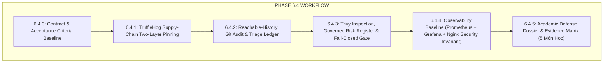

# 🛡️ Kế Hoạch Kỹ Thuật Phase 6.4: Security Hardening, Observability & Hồ Sơ Bảo Vệ 5 Môn Học

> **Trạng thái:** DRAFTING / ACTIVE  
> **Nguyên tắc cốt lõi:** Tuyệt đối không mở lại (reopen) Phase 6.3. Phase 6.3 đã CLOSED / FROZEN hợp lệ. Toàn bộ các hạng mục dưới đây là bước nâng cấp bảo mật, giám sát và chuẩn hóa hồ sơ cho Phase 6.4.  
> **Phương châm:** Acceptance gates phải chứng minh đúng điều định chứng minh trên cơ sở thực tế (Ground-Truth Evidence), không chấp nhận hình thức hoặc ngụy tín nhiệm.

---

## 📌 I. SÁU ĐIỀU CHỈNH HỢP ĐỒNG NGHIỆM THU (ACCEPTANCE CONTRACT AMENDMENTS - 6.4.0)

| STT | Vấn đề ban đầu | Rủi ro kỹ thuật | Giải pháp chuẩn hóa Phase 6.4 |
| :---: | :--- | :--- | :--- |
| **1** | Chỉ pin `uses: trufflesecurity/trufflehog@<commit-sha>` | Action có input `version: "latest"` mặc định, kéo `ghcr.io/trufflesecurity/trufflehog:${VERSION}` dẫn tới vẫn còn thành phần mutable. | **Khóa hai lớp (Two-Layer Pinning):** Ghim full commit SHA của Action + ghim tường minh `version: "3.88.16"` (hoặc tag cụ thể), loại bỏ triệt để tag mutable. |
| **2** | Dùng `--all-commits` để scan git history | Action chính thức dùng `base: ""` và `head: ${{ github.ref_name }}` để quét branch. Commit cũ `0c58746` bị rewrite thành dangling object, clone thông thường không thể chứng minh đã biến mất khỏi GitHub object store. | Định nghĩa chính xác phạm vi: **"All commits reachable from main"**. Khẳng định bằng chứng authoritative cho credential từng rò rỉ là **Revocation / Rotation Proof** (đã xác thực tại G00 & G08), không dựa vào deep-history scan. |
| **3** | Chỉ quét `--only-verified` trong audit | Bỏ sót các finding unverified/unknown cần đánh giá rủi ro trong hồ sơ An toàn thông tin. | **Tách bạch 2 tầng (Dual-mode):** - *CI Blocking Gate:* Tập trung vào verified/actionable secrets để tránh break build do false-positives. - *Audit & Triage Ledger:* Thu thập `verified,unknown,unverified`, lập bảng phân loại (disposition) tường minh trong hồ sơ bảo vệ. |
| **4** | Bật fail-closed (`exit-code: '1'`) trước rồi tạo `.trivyignore` | Dễ dẫn đến việc "ignore hàng loạt cho xanh CI" làm mất ý nghĩa kiểm soát bảo mật. | **Governed Exceptions có vòng đời:** 1. Chạy inspect & trích xuất đầy đủ finding hiện hành. 2. Lập file `.trivyignore` tối thiểu kèm **Risk Register riêng**: `CVE -> package -> reason -> exploitability -> compensating control -> owner -> expiry date`. 3. Sau khi triage xong mới kích hoạt `exit-code: '1'` với tham số `trivyignores: .trivyignore`. |
| **5** | Metric `http_request_duration_seconds` được mô tả sinh ra p50/p95/p99; thiếu chặn `/metrics` | Histogram chỉ lưu trữ buckets/count/sum, percentile phải do PromQL tính toán; `/metrics` lộ ra Internet gây rò rỉ thông tin hạ tầng. | - **Metric semantics:** Mô tả đúng bản chất Histogram và công thức `histogram_quantile()` trên Grafana. - **Security Invariant:** Endpoint `/metrics` nội bộ chỉ cho phép Prometheus scrape qua Docker network; Nginx reverse proxy chặn đứng truy cập từ Internet (HTTP 403 / 404). |
| **6** | Claim thành tích trên slide/tài liệu thiếu bằng chứng thực tế | Dễ bị phản biện khi bảo vệ đồ án nếu không truy vết được tới code/test. | **Ma trận Bằng chứng (Evidence Matrix):** Chỉ đưa claim có con trỏ thực chứng theo schema: `Claim ➔ Source File ➔ Test/Gate ➔ Hosted Run ➔ Commit SHA ➔ Trạng thái`. |

---

## 🎯 II. DANH MỤC CÁC ACCEPTANCE GATES CHI TIẾT

---

### Gate 6.4.1: TruffleHog Supply-Chain Two-Layer Pinning
- **Mục tiêu:** Khóa hai lớp chuỗi cung ứng của secret scanner: Action code immutable-pinned qua commit SHA; CLI version explicitly pinned, loại bỏ phụ thuộc vào `:latest` và giảm thiểu đáng kể tính khả biến (mutability) của chuỗi cung ứng.
- **Triển khai:**
  - Trong `.github/workflows/ci-cd.yml` (job `security-scan`):
    - `uses: trufflesecurity/trufflehog@c1f2e912239240108482d79ea01ab25d90b27ac7` (commit SHA tương ứng với bản phát hành ổn định v3.88.16).
    - Khóa tường minh input `version: "3.88.16"`.
- **Tiêu chuẩn nghiệm thu:**
  - Workflow chạy thành công với runner pull đúng image `ghcr.io/trufflesecurity/trufflehog:3.88.16`.
  - Action code và CLI container tag đều được ghim cụ thể, không phụ thuộc vào ref mutable `@main` hay tag động `:latest`.

---

### Gate 6.4.2: Reachable-History Git Audit & Triage Ledger
- **Mục tiêu:** Quét toàn diện lịch sử các commit truy cập được từ nhánh `main` (`all commits reachable from main`), đồng thời lập bảng phân loại rủi ro (triage disposition) cho toàn bộ finding.
- **Triển khai:**
  - **CI Workflow Blocking:**
    - Cấu hình TruffleHog: `base: ""` và `head: ${{ github.ref_name }}`.
    - Cờ blocking: `extra_args: --only-verified`.
  - **Audit Deep Triage Report (Hồ sơ An toàn thông tin):**
    - Chạy audit quét đa trạng thái (`--results=verified,unknown,unverified`) trên toàn bộ git tree reachable.
    - Lập bảng Disposition Ledger ghi rõ:
      - Finding ID / Type / Detector
      - File location / Commit hash
      - Trạng thái: Verified / Unverified / False Positive / Revoked
      - Technical justification & Disposition
    - Khẳng định rõ: Bằng chứng authoritative cho các secret trong commit dangling cũ là **Biên bản thu hồi & rotate thực tế (G00 & G08)**.

---

### Gate 6.4.3: Trivy Triage, Governed Risk Register & Fail-Closed Gate
- **Mục tiêu:** Chuyển Trivy từ audit informational sang blocking gate thực thụ (`exit-code: '1'`) mà không gây nghẽn CI bừa bãi hay ignore tùy tiện.
- **Quy trình triển khai 3 bước nghiêm ngặt:**
  1. **Bước 1 - Audit & Triage hiện trạng:**
     - Build 3 images production (`omninovel-api`, `omninovel-ai-worker`, `omninovel-nginx`).
     - Quét Trivy ở chế độ JSON/Table để trích xuất toàn bộ CVE CRITICAL/HIGH hiện hành (ví dụ `CVE-2026-4372` trong `transformers` hay packages Debian/Alpine base).
  2. **Bước 2 - Lập Risk Register & File `.trivyignore` hẹp:**
     - Tạo file `.trivyignore` tại root repository chỉ chứa các CVE IDs đã được đánh giá an toàn.
     - Lập tài liệu **Trivy Exception Risk Register** (`deploy/security/trivy-exception-register.md`) với cấu trúc:
       - `CVE ID`: Mã CVE chuẩn NIST/NVD.
       - `Target Image & Package`: Container và thư viện bị ảnh hưởng.
       - `CVSS Score & Vector`: Điểm số và mức độ nghiêm trọng.
       - `Exploitability in OmniNovel`: Đánh giá khả năng khai thác thực tế (VD: endpoint nội bộ, không nhận untrusted serialized model payload, v.v.).
       - `Compensating Controls`: Biện pháp bù đắp (Network isolation, non-root user UID 10001, token validation).
       - `Owner & Review Date`: Người chịu trách nhiệm và hạn rà soát/nâng cấp.
  3. **Bước 3 - Kích hoạt Blocking Mode trong CI:**
     - Chuyển `exit-code: '1'` cho cả 3 container scans trong `.github/workflows/ci-cd.yml`.
     - Chỉ định rõ tham số: `trivyignores: .trivyignore`.
     - Kiểm chứng CI workflow pass 100% với blocking gate có hiệu lực.

---

### Gate 6.4.4: Observability Baseline & Security Invariant
- **Mục tiêu:** Giám sát thời gian thực các chỉ số tài nguyên, độ trễ và hàng đợi; đồng thời bảo vệ endpoint `/metrics` khỏi truy cập trái phép từ Internet.
- **Triển khai Metrics:**
  - Core API (`services/api`): Tích hợp Prometheus client chuẩn.
    - `http_requests_total`: Counter (labels: `method`, `route`, `status_code`).
    - `http_request_duration_seconds`: Histogram (buckets chuẩn: `[0.01, 0.05, 0.1, 0.25, 0.5, 1, 2.5, 5, 10]`).
    - `bullmq_jobs_active`, `bullmq_jobs_waiting`, `bullmq_jobs_failed`: Gauges giám sát hàng đợi AI.
    - Process metrics: Memory RSS, Heap Used, Event Loop Lag.
- **Triển khai Dashboard & PromQL:**
  - Grafana dashboard JSON template tính toán độ trễ chuẩn:
    - $p_{50} = \text{histogram\_quantile}(0.50, \text{sum}(\text{rate}(\text{http\_request\_duration\_seconds\_bucket}[5m])) \text{ by } (le))$
    - $p_{95} = \text{histogram\_quantile}(0.95, \text{sum}(\text{rate}(\text{http\_request\_duration\_seconds\_bucket}[5m])) \text{ by } (le))$
    - $p_{99} = \text{histogram\_quantile}(0.99, \text{sum}(\text{rate}(\text{http\_request\_duration\_seconds\_bucket}[5m])) \text{ by } (le))$
- **Security Invariant (Bắt buộc kiểm thử tự động):**
  - Nginx cấu hình: Chặn tuyệt đối mọi request từ bên ngoài vào `/metrics` hoặc `/api/v1/metrics` (trả về HTTP 403 Forbidden hoặc HTTP 404 Not Found).
  - Prometheus scrape container chỉ truy cập qua mạng nội bộ Docker (`omninovel-internal`).
  - Viết test case tự động xác thực:
    - External probe vào `http://localhost/metrics` ➔ **Bị từ chối (403/404)**.
    - Internal probe qua mạng nội bộ ➔ **HTTP 200 OK kèm payload Prometheus valid**.

---

### Gate 6.4.5: Academic Defense Dossier & Evidence Matrix (5 Môn Học)
- **Mục tiêu:** Chuẩn bị hồ sơ kỹ thuật hoàn chỉnh, không có claim "suông", sẵn sàng cho buổi bảo vệ đồ án 5 môn.
- **Cấu trúc Ma trận Bằng chứng (Ground-Truth Evidence Matrix):**
  Mỗi phát biểu trong báo cáo/slide phải tuân theo cấu trúc truy vết:
  $$\text{Claim} \longrightarrow \text{Source File} \longrightarrow \text{Automated Test/Gate} \longrightarrow \text{Hosted Action Run} \longrightarrow \text{Commit SHA} \longrightarrow \text{Trạng thái}$$

  *Ví dụ:*
  | Môn học | Tuyên bố (Claim) | Tệp mã nguồn | Bài kiểm thử / Gate | Hosted Run / Evidence | Commit SHA | Trạng thái |
  | :--- | :--- | :--- | :--- | :--- | :--- | :---: |
  | **Kỹ năng lập trình nâng cao** | Caching đa tầng L1 In-Memory + L2 Redis 7 | `services/api/src/modules/cache/...` | `cache.service.spec.ts` | Run `36963197949` (Job 2) | `5425f3f` | **PASS** |
  | **Triển khai phần mềm** | Nginx độc lập, dynamic DNS re-resolve không reload | `deploy/nginx/nginx.conf` | Gate G12 (`test-acceptance-phase6-2.ts`) | Artifact Phase 6.2 report | `4ac5118` | **PASS** |
  | **An toàn thông tin** | Zero-leak Git tracking hygiene | `.github/workflows/ci-cd.yml` | Step `Verify Git Tracking Hygiene` | Run `36963197949` (Job 5) | `5425f3f` | **PASS** |

---

## 🗓️ III. THỨ TỰ THỰC THI (EXECUTION PHASING)

1. **Bước 1 (Hôm nay):** Khóa hợp đồng nghiệm thu 6.4.0 và cập nhật roadmap `phase_06_devops_final.md`.
2. **Bước 2 (Security Hardening):** Triển khai Gate 6.4.1 (TruffleHog 2-layer pin) & Gate 6.4.2 (Reachable audit) ➔ Triển khai Gate 6.4.3 (Trivy inspect, Risk Register & Fail-closed `exit-code: '1'`).
3. **Bước 3 (Observability):** Triển khai Gate 6.4.4 (Prometheus `/metrics` + PromQL + Nginx Security Gate).
4. **Bước 4 (Hồ Sơ Nghiệm Thu):** Triển khai Gate 6.4.5 (Ground-Truth Evidence Matrix & Slide Outline 5 môn).
