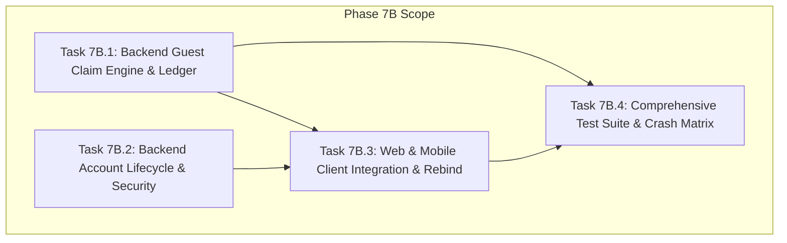

# 📋 Implementation Plan: Phase 7B — Account Claim & Lifecycle Protocol

> **Trạng thái:** `[ ] ĐANG CHỜ REVIEW & PHÊ DUYỆT (NO-GO TO CODE UNTIL FROZEN)`  
> **Căn cứ kỹ thuật:**
> - [plans/product/identity_and_ownership_model.md](product/identity_and_ownership_model.md) (SSoT số 1 đã amend)
> - [plans/product/guest_to_account_claim_protocol.md](product/guest_to_account_claim_protocol.md) (SSoT số 2 đã amend)
> - [plans/phase_07a_guest_identity_implementation_plan.md](phase_07a_guest_identity_implementation_plan.md) (Phase 7A Frozen Baseline)
> - Toàn bộ 10 Bất biến P0 đã thống nhất.

---

## 1. Mục Tiêu & 10 Bất Biến Bắt Buộc (P0 Invariants)

Phase 7B chịu trách nhiệm triển khai giao thức chuyển giao dữ liệu Khách sang Tài khoản (Claim Handover) 2 bước xác định, hoàn thiện toàn bộ vòng đời tài khoản người dùng (Account Lifecycle) và thực hiện tái liên kết dữ liệu lưu ngoại tuyến (Offline Metadata Rebinding).

### 10 Nguyên Tắc Bất Biến (P0 Hard Requirements)
1. **Claim Source Identity là `guest:<guestProfileId>`:**
   - Phiên khách được định danh bằng `guestProfileId` (UUIDv4).
   - `installationId` thuần túy là Device Identity (`device:<installationId>`), không bao giờ được dùng làm claim credential hay claim identity trong Network DTO.
2. **Durable Idempotency Trong PostgreSQL (Bảng `guest_claims`):**
   - Redis chỉ dùng làm distributed lock (`claim_lock:<claimId>`) và hot cache / rate limiting.
   - Trạng thái `COMMITTED` và bản tóm tắt kết quả (`result_summary`) **bắt buộc phải được ghi trong cùng Database Transaction** với toàn bộ thao tác gộp Bookmarks, Reading History và Reading Progress.
   - Sập ứng dụng, mất mạng hoặc mất Redis sau DB commit vẫn retry/truy vấn an toàn 100%.
3. **Ràng Buộc Nghiêm Ngặt Quyền Sở Hữu (Account Ownership Binding):**
   - Claim do `User A` tạo (prepare) chỉ có thể được truy vấn trạng thái hoặc commit bởi chính `User A` (`claim.user_id === req.user.id`).
   - `User B` cố tình gọi status/commit claim của `User A` sẽ nhận ngay mã `403 Forbidden` (hoặc `404 Not Found`).
4. **Bảo Vệ Chống TOCTOU & Stale-Preview Qua `stateFingerprint`:**
   - Không bịa số revision giả tạo.
   - Prepare tính `stateFingerprint` = SHA-256 từ snapshot trạng thái Cloud hiện tại (bookmarks, history, progress, tombstones) của các entity trong request.
   - Commit mở transaction, re-read Cloud state và đối soát fingerprint. Nếu phát hiện thay đổi (`currentFingerprint !== stateFingerprint`) -> rollback và trả về `409 Conflict` kèm mã `CLAIM_STALE_REPREPARE`.
5. **Bảo Tồn Toàn Vẹn Resume Tuple Đã Khóa Ở Phase 7A:**
   - DTO tiến độ đọc bắt buộc giữ đủ bộ 7 trường vị trí: `chapterVersionId`, `readingMode`, `pageIndex`, `scrollPosition`, `progressPercentage`, `anchorBlockId`, `textOffset`.
   - `pageIndex` (số nguyên >= 0) là bắt buộc cho chế độ đọc lật trang Manga/PDF/EPUB.
6. **Quy Chuẩn Lịch Sử Đọc (History Deduplication Semantics):**
   - Khớp 100% với snapshot model của Phase 7A: Khóa dedupe là cặp `(storyId, chapterId)`, không dựa vào "cùng ngày" hay client timestamp.
   - Trường `readAtClient` chỉ là diagnostic/hint.
   - Kiểm tra bảng tombstone: Truyện đã xóa khỏi lịch sử Cloud bị chặn tái sinh (**Anti-Resurrection**).
7. **Đầy Đủ 3 Điểm Cuối (Three-Endpoint Architecture):**
   - `POST /api/v1/account/guest-claims/prepare`: Thẩm định, tạo preview, ghi sổ cái `PREPARED`.
   - `POST /api/v1/account/guest-claims/:claimId/commit`: Thẩm định TOCTOU, merge nguyên tử trong DB transaction, ghi sổ cái `COMMITTED`.
   - `GET /api/v1/account/guest-claims/:claimId/status`: Truy vấn trạng thái ledger phục vụ crash recovery khi client timeout sau commit hoặc đột tử.
8. **Quyết Định Người Dùng Rõ Ràng (Explicit User Choice — Không Auto-Commit Ngầm):**
   - Sau khi login/register, Client kiểm tra dữ liệu khách. Nếu có, hiển thị Dialog/Modal xác nhận: **"Gộp vào tài khoản" (Claim)** hoặc **"Bỏ qua" (Skip)**.
   - Nếu Skip: Dữ liệu khách được chuyển sang trạng thái **Quarantine** (`quarantine:<guestProfileId>`), tuyệt đối không bị purge.
   - Dữ liệu khách nguồn chỉ bị purge và rebind offline metadata sau khi Server xác nhận bền vững `COMMITTED`.
9. **Phòng Chống Lạm Dụng Khắt Khe (Anti-Abuse Hardening Tại Prepare):**
   - Kiểm tra UUIDv4 chặt chẽ.
   - Giới hạn tải: tối đa 500 bookmarks, 1000 history items, 500 progress items, payload body tối đa 2MB.
   - Miền giá trị số hữu hạn (finite bounds): `progressPercentage` [0..100], `scrollPosition` >= 0, `pageIndex` >= 0, `textOffset` >= 0.
   - Server tự deduplicate payload trước khi xử lý.
   - Kiểm tra tính hợp lệ của Foreign Key và quyền truy cập (`chapterId` thuộc `storyId`, `chapterVersionId` thuộc `chapterId`, chương đang public/published).
   - Rate limit: 10 prepare requests / phút / user.
   - **Tuyệt đối zero Gamification side-effects (EXP, OmniCoin, Streak = 0)**.
10. **Ma Trận Kiểm Thử Sự Cố Toàn Diện (Crash & Replay Acceptance Matrix):**
    - Duplicate commit, Concurrent commit race, Client timeout recovery, Redis loss/restart, Stale cloud state (TOCTOU), Cross-account replay, Expired session, Account switch mid-flow, và Phase 7A.7 regression gate tiếp tục xanh 100%.

---

## 2. Kế Hoạch Phân Rã Công Việc Chi Tiết (WBS)



---

### Task 7B.1: Backend Guest Claim Engine & Durable Ledger APIs (`services/api`)

**Mục tiêu:** Xây dựng hệ thống tiếp nhận, thẩm định, lưu sổ cái và gộp nguyên tử dữ liệu từ phiên khách vào tài khoản người dùng theo giao thức 3 điểm cuối.

#### 1.1. Cấu Trúc Bảng CSDL PostgreSQL (`guest_claims`) & Migration TypeORM
- **Vị trí tệp:**
  - Entity: `services/api/src/modules/claims/entities/guest-claim.entity.ts`
  - Migration: `services/api/src/database/migrations/*-create-guest-claims.ts`
- **Schema Fields:**
  - `claim_id` (UUIDv4, Primary Key)
  - `user_id` (UUIDv4, Foreign Key -> `users.id`, Index, `ON DELETE CASCADE`)
  - `guest_profile_id` (UUIDv4, Not Null)
  - `payload_hash` (VARCHAR(64), Not Null - SHA-256 của normalized raw payload)
  - `state_fingerprint` (VARCHAR(64), Not Null - SHA-256 của snapshot Cloud entities liên quan)
  - `status` (`guest_claim_status`: `PREPARED`, `COMMITTED`, `ABORTED`, `EXPIRED`, Not Null)
  - `preview_data` (JSONB, Not Null - Danh sách items chấp nhận và xung đột)
  - `conflict_decisions` (JSONB, Nullable - Quyết định của người dùng gửi lên tại commit)
  - `result_summary` (JSONB, Nullable - Số lượng bản ghi đã thêm/gộp thực tế)
  - `expires_at` (TIMESTAMPTZ, Not Null, Index cho dọn dẹp)
  - `created_at` (TIMESTAMPTZ, Default NOW())
  - `committed_at` (TIMESTAMPTZ, Nullable)
  - `updated_at` (TIMESTAMPTZ, Default NOW())

#### 1.2. DTOs & Anti-Abuse Validation
- **Vị trí tệp:**
  - `services/api/src/modules/claims/dto/prepare-guest-claim.dto.ts`
  - `services/api/src/modules/claims/dto/commit-guest-claim.dto.ts`
  - `services/api/src/modules/claims/dto/guest-claim-response.dto.ts`
- **Ràng buộc kiểm tra (Class-Validator & Custom Pipe):**
  - `@IsUUID('4')` cho `guestProfileId`, `storyId`, `chapterId`, `chapterVersionId`.
  - `@ArrayMaxSize(500)` cho `bookmarks`, `@ArrayMaxSize(1000)` cho `history`, `@ArrayMaxSize(500)` cho `progress`.
  - Giới hạn số thực: `@Min(0)` `@Max(100)` cho `progressPercentage`; `@Min(0)` cho `scrollPosition`, `pageIndex`, `textOffset`.
  - Kiểm tra `Number.isFinite()` loại bỏ `NaN`, `Infinity`.
  - Custom Sanitize decorator: Loại bỏ các bản ghi trùng lặp trong cùng payload trước khi vào Service.

#### 1.3. Service Nghiệp Vụ (`GuestClaimService`)
- **Vị trí tệp:** `services/api/src/modules/claims/guest-claim.service.ts`
- **Phương thức 1: `prepareClaim(userId: string, dto: PrepareGuestClaimDto)`**
  1. Thẩm định Foreign Keys: Query database kiểm tra `chapterId` có thuộc về `storyId`, `chapterVersionId` có khớp, truyện và chương có đang `PUBLISHED`.
  2. Query Cloud state hiện tại của `userId`: Bookmarks hiện có, Reading History hiện có, Reading Progress hiện có, và các bản ghi trong `reading_history_tombstones`.
  3. Tính `stateFingerprint`:
     - Gom danh sách canonical IDs từ payload.
     - Lấy trạng thái hiện tại trên Cloud của các IDs này (hoặc tombstone tương ứng).
     - Tạo canonical string `JSON.stringify(sortedCloudState)` và hash SHA-256.
  4. Lập bản Diff & Phát hiện xung đột:
     - Bookmark: Additive (Bỏ qua truyện đã bookmark trên Cloud).
     - History: Dedupe theo `(storyId, chapterId)`. Nếu có tombstone -> loại bỏ (Anti-Resurrection).
     - Progress: So sánh `progressPercentage` và `chapterId`. Nếu lệch -> gắn cờ Conflict (chứa cả `cloudProgress` và `guestProgress` kèm `pageIndex`).
  5. Mở Transaction / Insert bản ghi `guest_claims` ở trạng thái `PREPARED` với TTL 15 phút.
  6. Ghi Redis cache `claim_meta:<claimId>` và áp dụng Rate Limit (10 req/min/user).
  7. Trả về `GuestClaimPreviewResponse`.
- **Phương thức 2: `commitClaim(userId: string, claimId: string, dto: CommitGuestClaimDto)`**
  1. Chiếm Redis Distributed Lock: `SET claim_lock:<claimId> <workerId> NX PX 5000`.
  2. Mở PostgreSQL Database Transaction (`queryRunner.startTransaction()`):
     - `SELECT * FROM guest_claims WHERE claim_id = :claimId FOR UPDATE`.
     - Kiểm tra tồn tại (`404 Not Found`).
     - **Kiểm tra quyền sở hữu:** Nếu `claim.user_id !== userId` -> Rollback, trả `403 Forbidden`.
     - Kiểm tra hạn sử dụng: Nếu `NOW() > claim.expires_at` -> Rollback, trả `410 Gone` (`CLAIM_EXPIRED`).
     - **Kiểm tra Idempotency:** Nếu `claim.status === 'COMMITTED'` -> Rollback, trả ngay `claim.result_summary` với mã `200 OK`.
     - **Kiểm tra TOCTOU:** Re-fetch Cloud state hiện tại và tính lại `currentFingerprint`. Nếu `currentFingerprint !== claim.state_fingerprint` hoặc `expectedStateFingerprint !== claim.state_fingerprint`: Rollback, trả `409 Conflict` (`CLAIM_STALE_REPREPARE`).
  3. Thực thi Merge trong cùng Transaction:
     - Gộp Bookmarks (`INSERT INTO bookmarks ... ON CONFLICT DO NOTHING`).
     - Gộp History (`INSERT INTO reading_history ... ON CONFLICT (user_id, story_id, chapter_id) DO UPDATE ...`).
     - Gộp Progress: Dựa trên `conflictDecisions` từ client hoặc áp dụng luật mặc định (giữ Cloud nếu không chọn).
     - **Tuyệt đối KHÔNG gọi bất kỳ hàm cấp phát Gamification nào (EXP, Coin, Streak = 0)**.
  4. Cập nhật Sổ cái:
     - `UPDATE guest_claims SET status = 'COMMITTED', result_summary = :stats, committed_at = NOW() WHERE claim_id = :claimId`.
  5. Commit PostgreSQL Transaction (`await queryRunner.commitTransaction()`).
  6. Giải phóng Redis Lock và cập nhật hot cache.
  7. Trả về `GuestClaimCommitResponse`.
- **Phương thức 3: `getClaimStatus(userId: string, claimId: string)`**
  1. Truy vấn `SELECT * FROM guest_claims WHERE claim_id = :claimId`.
  2. Nếu không có -> trả `404 Not Found`.
  3. Kiểm tra sở hữu: Nếu `claim.user_id !== userId` -> trả `403 Forbidden`.
  4. Trả về `GuestClaimStatusResponse` (hỗ trợ client crash recovery).

#### 1.4. Controller & Routing
- **Vị trí tệp:** `services/api/src/modules/claims/guest-claim.controller.ts`
- **Endpoints:**
  - `POST /api/v1/account/guest-claims/prepare` (Guarded by `JwtAuthGuard`)
  - `POST /api/v1/account/guest-claims/:claimId/commit` (Guarded by `JwtAuthGuard`)
  - `GET /api/v1/account/guest-claims/:claimId/status` (Guarded by `JwtAuthGuard`)

---

### Task 7B.2: Backend Account Lifecycle & Security Management (`services/api`)

**Mục tiêu:** Cung cấp đầy đủ các endpoint hoàn thiện vòng đời tài khoản người dùng, bảo mật đăng nhập, quản lý phiên và tuân thủ quyền riêng tư dữ liệu (GDPR/CCPA).

#### 2.1. Quên & Đặt Lại Mật Khẩu (Forgot / Reset Password)
- **Vị trí tệp:**
  - `services/api/src/modules/auth/auth.controller.ts`
  - `services/api/src/modules/auth/auth.service.ts`
- **Endpoints:**
  - `POST /api/v1/auth/forgot-password`:
    - Nhận `{ email: string }`.
    - Sinh mã OTP ngẫu nhiên 6 chữ số có mật mã bảo vệ (Crypto Secure Random) hoặc reset token với TTL 15 phút, lưu vào Redis `pwd_reset:<token>`.
    - Tích hợp email dispatch (stub logger hoặc mail service).
    - Rate limit: 3 requests / 15 phút / email.
  - `POST /api/v1/auth/reset-password`:
    - Nhận `{ token: string, newPassword: string }`.
    - Validate password strength (tối thiểu 8 ký tự, có số, chữ hoa, ký tự đặc biệt).
    - So khớp token trong Redis. Nếu khớp: băm mật khẩu mới bằng Argon2/Bcrypt, cập nhật CSDL.
    - Hủy toàn bộ Refresh Token hiện hữu của người dùng (Global Session Revocation).

#### 2.2. Đổi Mật Khẩu Đang Đăng Nhập (Change Password)
- **Endpoint:** `POST /api/v1/auth/change-password` (Bảo vệ bởi `JwtAuthGuard`).
- **Body:** `{ currentPassword: string, newPassword: string }`.
- **Nghiệp vụ:**
  - Xác thực mật khẩu cũ.
  - Ngăn chặn đặt mật khẩu mới trùng mật khẩu cũ.
  - Cập nhật mật khẩu mới, giữ phiên hiện tại hoặc hủy các phiên khác.

#### 2.3. Quản Lý Phiên Thiết Bị (Device Session Management)
- **Vị trí tệp:** `services/api/src/modules/account/account-sessions.controller.ts`
- **Endpoints:**
  - `GET /api/v1/account/sessions`: Trả về danh sách thiết bị đang đăng nhập (IP, User-Agent, lastActiveAt, isCurrentSession).
  - `DELETE /api/v1/account/sessions/:sessionId`: Đăng xuất thiết bị cụ thể từ xa (thu hồi refresh token tương ứng).
  - `DELETE /api/v1/account/sessions/other`: Đăng xuất toàn bộ các thiết bị khác.

#### 2.4. Quyền Riêng Tư & Xóa Tài Khoản (GDPR Data Export & Account Deletion)
- **Endpoints:**
  - `GET /api/v1/account/export-data`:
    - Xuất toàn bộ dữ liệu người dùng (Profile, Bookmarks, History, Progress, Gamification, Translation contributions) dạng tệp JSON nén có mã hóa hoặc tải trực tiếp.
  - `DELETE /api/v1/account`:
    - Xác nhận lại mật khẩu trước khi xóa.
    - Thực hiện Soft Delete hoặc Hard Cascade Delete: Thu hồi toàn bộ JWT tokens, xóa session, ẩn profile, vô hiệu hóa tài khoản và dọn dẹp các liên kết liên quan.

---

### Task 7B.3: Web & Mobile Client Integration, Explicit Claim Dialog & Offline Rebind

**Mục tiêu:** Tích hợp luồng xác thực phía Client để phát hiện dữ liệu khách sau khi đăng nhập/đăng ký, hiển thị Dialog xác nhận rõ ràng (Claim vs Skip), quản lý Quarantine, xử lý xung đột tiến độ và rebind metadata offline.

#### 3.1. Web Client (`apps/web`)
- **Vị trí tệp:**
  - Hook & Controller: `apps/web/src/lib/claim/use-guest-claim-coordinator.ts`
  - Dialog Component: `apps/web/src/components/claim/guest-claim-dialog.tsx`
  - Quarantine Storage: `apps/web/src/lib/storage/guest-quarantine-store.ts`
- **Quy trình hoạt động:**
  1. `ActiveScopeCoordinator` chuyển sang `ACCOUNT`:
     - Lấy `guestProfileId` hiện tại.
     - Kiểm tra nếu `IndexedDB` của `guest:<guestProfileId>` có dữ liệu (bookmarks > 0 hoặc progress > 0 hoặc history > 0).
  2. Tự động gọi `POST /api/v1/account/guest-claims/prepare`:
     - Gửi đủ 7 trường resume tuple: `chapterVersionId`, `readingMode`, `pageIndex`, `scrollPosition`, `progressPercentage`, `anchorBlockId`, `textOffset`.
     - Nhận về `GuestClaimPreviewResponse`.
  3. Hiển thị `GuestClaimDialog`:
     - Người dùng thấy số lượng truyện được thêm, lịch sử được gộp.
     - Nếu có xung đột tiến độ đọc: Hiển thị bảng so sánh (tiến độ khách vs tiến độ cloud) cho phép chọn `USE_GUEST` hoặc `KEEP_CLOUD`.
  4. Nếu Người dùng bấm **Bỏ qua (Skip)**:
     - Gọi `quarantineGuestScope(guestProfileId)`: Di chuyển dữ liệu sang namespace `quarantine:<guestProfileId>`, **tuyệt đối không purge**.
     - Đóng dialog, chuyển sang phiên tài khoản bình thường.
  5. Nếu Người dùng bấm **Xác nhận gộp (Confirm Claim)**:
     - Gửi `POST /api/v1/account/guest-claims/:claimId/commit` kèm `expectedStateFingerprint` và các lựa chọn.
     - Nếu nhận `409 Conflict`: Thông báo dữ liệu máy chủ đã thay đổi, tự động prepare lại.
     - Nếu nhận `200 OK`:
       - Xóa partition nguồn `guest:<guestProfileId>` (`IndexedDB`).
       - Cập nhật kho dữ liệu tài khoản `account:<userId>`.
       - Hiển thị thông báo thành công.
  6. **Crash Recovery Hook:**
     - Lưu `pendingClaimId` vào `localStorage`.
     - Khi ứng dụng khởi động lại với tài khoản đang đăng nhập, nếu phát hiện `pendingClaimId`: gọi `GET /status`. Nếu đã `COMMITTED` -> dọn dẹp partition nguồn và xóa `pendingClaimId`.

#### 3.2. Mobile Client (`apps/mobile`)
- **Vị trí tệp:**
  - Service: `apps/mobile/lib/core/claim/guest_claim_service.dart`
  - Bloc / State: `apps/mobile/lib/features/claim/bloc/guest_claim_bloc.dart`
  - Dialog Widget: `apps/mobile/lib/features/claim/presentation/guest_claim_dialog.dart`
  - DAO Rebind: `apps/mobile/lib/core/storage/local_library_dao.dart`
- **Quy trình hoạt động:**
  1. Tương tự Web: Quét SQLite `local_library_bookmarks`, `local_reading_progress`, `local_reading_history` với `WHERE owner_scope = 'guest:<guestProfileId>'`.
  2. Gửi request `prepare` với đầy đủ resume tuple (`pageIndex`, `scrollPosition`, `progressPercentage`...).
  3. Hiển thị BottomSheet hoặc Dialog hỏi người dùng:
     - "Phát hiện dữ liệu đọc trên thiết bị. Bạn có muốn đồng bộ vào tài khoản?"
     - Tùy chọn: [Gộp vào tài khoản] hoặc [Bỏ qua].
  4. Nếu Bỏ qua: Cập nhật SQLite `UPDATE ... SET owner_scope = 'quarantine:<guestProfileId>' WHERE owner_scope = 'guest:<guestProfileId>'`.
  5. Nếu Gộp dữ liệu:
     - Gửi request `commit`.
     - Khi nhận được `200 OK (COMMITTED)`:
       - **Offline Metadata Rebind:** Cập nhật manifest và database offline:
         ```sql
         UPDATE local_library_bookmarks SET owner_scope = 'account:<userId>' WHERE owner_scope = 'guest:<guestProfileId>';
         UPDATE local_reading_progress SET owner_scope = 'account:<userId>' WHERE owner_scope = 'guest:<guestProfileId>';
         UPDATE local_reading_history SET owner_scope = 'account:<userId>' WHERE owner_scope = 'guest:<guestProfileId>';
         ```
       - Rebind các tệp JSON manifest trong `offline_storage_paths.dart` sang `user_<userId>_chapter_<id>.json`.
  6. Xử lý Crash / Offline: Lưu `pending_claim_id` trong SharedPreferences; nếu mở lại app thấy pending, gọi `GET /status` kiểm tra để hoàn tất rebind nếu server đã commit xong.

---

### Task 7B.3.1: Đóng Gói Shared Contracts & DTOs (`packages/shared`)

**Mục tiêu:** Định nghĩa hợp đồng dữ liệu chuẩn hóa dùng chung cho cả Web Client, Mobile Client và Core API, tránh phân mảnh schema.

- **Vị trí tệp:**
  - `packages/shared/src/types/claim.types.ts`
  - `packages/shared/src/dto/guest-claim.dto.ts`
- **Các kiểu dữ liệu xuất khẩu:**
  - `GuestClaimStatus = 'PREPARED' | 'COMMITTED' | 'ABORTED' | 'EXPIRED'`
  - `PrepareGuestClaimPayload`
  - `CommitGuestClaimPayload`
  - `GuestClaimPreviewResult`
  - `GuestClaimCommitResult`
  - `GuestClaimStatusResult`
  - `ConflictResolution = 'KEEP_CLOUD' | 'USE_GUEST'`

---

### Task 7B.4: Comprehensive Test Suite, Crash Matrix & Zero-Gamification Verification

**Mục tiêu:** Viết bài kiểm thử tự động toàn diện kiểm chứng 10 kịch bản sự cố trong ma trận chấp nhận, chống gian lận kinh tế ảo và bảo đảm không thoái lui Phase 7A.

#### 4.1. Bộ Kiểm Thử Core API E2E & Unit Test (`services/api`)
- **Tệp:** `services/api/src/modules/claims/guest-claim.service.spec.ts`
- **Tệp E2E:** `services/api/test/guest-claim-lifecycle.e2e-spec.ts`
- **Các ca kiểm thử bắt buộc:**
  1. `prepare`: Validate UUID, bound check, reject payload quá 500 items, reject negative scroll/progress, check unpublished chapter.
  2. `prepare`: Tính đúng `stateFingerprint` dựa trên SHA-256 của Cloud state.
  3. `commit`: Idempotency - gọi commit 2 lần với cùng payload -> lần 2 trả 200 OK từ ledger `guest_claims`, không duplicate insert.
  4. `commit`: Concurrency - 2 requests đồng thời chạy race -> Redis lock + DB `FOR UPDATE` xử lý tuần tự an toàn.
  5. `commit`: TOCTOU Protection - mock dữ liệu Cloud thay đổi giữa prepare và commit -> trả `409 Conflict (CLAIM_STALE_REPREPARE)`.
  6. `commit`: Security Ownership - User B dùng token của mình gọi commit `claimId` do User A prepare -> trả `403 Forbidden`.
  7. `commit`: Expired session - gọi commit sau 15 phút -> trả `410 Gone`.
  8. `status`: Check claim status trả đúng thông tin cho crash recovery; User B gọi status của User A -> trả `403 Forbidden`.
  9. **Zero Gamification Verification:** Kiểm tra số dư EXP, OmniCoin, Streak của người dùng trước và sau khi commit 500 chương -> hoàn toàn bằng nhau (Delta = 0).

#### 4.2. Bộ Kiểm Thử Web Client (`apps/web`)
- **Tệp:** `apps/web/src/lib/claim/guest-claim-coordinator.spec.ts`
- **Các ca kiểm thử:**
  1. Tự động phát hiện guest data và trigger prepare sau khi đăng nhập.
  2. Người dùng chọn Skip -> dữ liệu được chuyển sang `quarantine:<guestProfileId>`, không bị purge.
  3. Người dùng chọn Claim -> commit thành công -> partition khách được dọn dẹp sạch sẽ.
  4. Crash recovery: Có `pendingClaimId`, query status nhận `COMMITTED` -> dọn dẹp local partition an toàn.

#### 4.3. Bộ Kiểm Thử Mobile Client (`apps/mobile`)
- **Tệp:** `apps/mobile/test/core/claim/guest_claim_flow_test.dart`
- **Các ca kiểm thử:**
  1. Quét đúng `guest:<guestProfileId>` từ SQLite DAO.
  2. Quy trình rebind SQLite metadata từ `guest:<guestProfileId>` sang `account:<userId>` sau khi commit.
  3. Quy trình quarantine khi người dùng bấm Skip.
  4. Khôi phục từ crash qua `pending_claim_id`.

#### 4.4. Cổng Kiểm Soát Không Thoái Lui (Phase 7A.7 Regression Gate)
- Toàn bộ 48 test files Web (635 Vitest tests + 31 Playwright tests) tiếp tục pass 100%.
- Toàn bộ unit tests Flutter Mobile (`flutter test`) tiếp tục pass 100%.
- Toàn bộ suite bảo mật Trivy và linting tiếp tục pass không có lỗ hổng mới.

---

## 3. Thứ Tự Triển Khai Thực Tế & Kế Hoạch Từng Bước

Sau khi kế hoạch này được **REVIEW & FREEZE** bởi người dùng, quy trình triển khai sẽ tuân thủ nghiêm ngặt thứ tự sau:

| Bước | Nội Dung Thực Hiện | Trạng Thái |
|---|---|---|
| **Step 0** | **Review, Chỉnh sửa & Đóng băng Kế hoạch (Freeze Plan Signoff)** | `[/] Đang làm` |
| **Step 1** | **Tạo Shared Contracts (`packages/shared`)** (DTOs, Types, Enums) | `[ ] Chờ Step 0` |
| **Step 2** | **Task 7B.1 Backend API Engine & PostgreSQL Ledger** (Entity, Migration, Service, Controller, Redis Lock) | `[ ] Chờ Step 1` |
| **Step 3** | **Task 7B.2 Backend Account Lifecycle APIs** (Change Password, Forgot/Reset, Sessions, Delete, Export) | `[ ] Chờ Step 2` |
| **Step 4** | **Task 7B.3 Web Client Integration** (Dialog, Quarantine, Hook, IndexedDB Rebind) | `[ ] Chờ Step 2` |
| **Step 5** | **Task 7B.3 Mobile Client Integration** (Dialog, SQLite Rebind, Quarantine, Crash Recovery) | `[ ] Chờ Step 2` |
| **Step 6** | **Task 7B.4 Test Automation & Crash Matrix Verification** (E2E tests, Unit tests, 7A regression gate) | `[ ] Chờ Step 4,5` |
| **Step 7** | **Hosted CI Verification & Phase 7B Freeze Signoff** (Đẩy git commit, kiểm tra GitHub Actions Run xanh 7/7 jobs) | `[ ] Chờ Step 6` |

---

## 4. Bảng Kiểm Tra Sẵn Sàng (Readiness Checklist)

- [x] Đã cập nhật SSoT 1 (`identity_and_ownership_model.md`) loại bỏ triệt để `guest:<installationId>`.
- [x] Đã cập nhật SSoT 2 (`guest_to_account_claim_protocol.md`) với bảng ledger `guest_claims` PostgreSQL, 3 endpoint, TOCTOU fingerprinting, đầy đủ resume tuple, anti-abuse và ma trận crash replay.
- [x] Đã cập nhật lộ trình tổng quan Phase 7 (`phase_07_product_completion.md`).
- [x] Đã tạo chi tiết bản kế hoạch thực thi `phase_07b_account_claim_implementation_plan.md`.
- [ ] Người dùng xem xét, thảo luận và ký duyệt đóng băng kế hoạch (Freeze Signoff).
- [ ] Bắt đầu viết mã nguồn cho Step 1 & Step 2.
