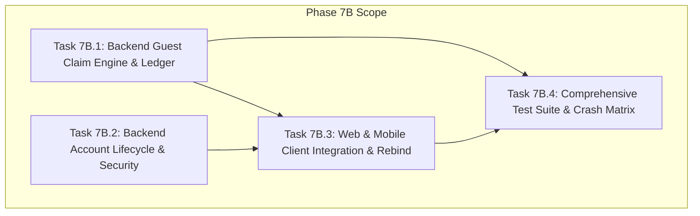

# 📋 Implementation Plan: Phase 7B — Account Claim & Lifecycle Protocol

> **Trạng thái:** `[ ] ĐANG CHỜ REVIEW & PHÊ DUYỆT (NO-GO TO CODE UNTIL FROZEN)`  
> **Căn cứ kỹ thuật:**
> - [plans/product/identity_and_ownership_model.md](product/identity_and_ownership_model.md) (SSoT số 1 đã amend)
> - [plans/product/guest_to_account_claim_protocol.md](product/guest_to_account_claim_protocol.md) (SSoT số 2 đã amend)
> - [plans/phase_07a_guest_identity_implementation_plan.md](phase_07a_guest_identity_implementation_plan.md) (Phase 7A Frozen Baseline)
> - Toàn bộ 13 Bất biến P0, 8 Ràng buộc Ground-Truth và Quy chuẩn Hai Pha Xóa Tài Khoản đã thống nhất.

---

## 1. Mục Tiêu & 13 Bất Biến Bắt Buộc (P0 Invariants)

Phase 7B chịu trách nhiệm triển khai giao thức chuyển giao dữ liệu Khách sang Tài khoản (Claim Handover) 2 bước xác định, hoàn thiện toàn bộ vòng đời tài khoản người dùng (Account Lifecycle) và thực hiện tái liên kết dữ liệu lưu ngoại tuyến (Offline Metadata Rebinding).

### 13 Nguyên Tắc Bất Biến (P0 Hard Requirements)
1. **Claim Source Identity là `guest:<guestProfileId>`:**
   - Phiên khách được định danh bằng `guestProfileId` (UUIDv4).
   - `installationId` thuần túy là Device Identity (`device:<installationId>`), không bao giờ được dùng làm claim credential hay claim identity trong Network DTO.
2. **Durable Idempotency Trong PostgreSQL (Bảng `guest_claims`) & Best-Effort Redis Lock:**
   - **PostgreSQL là Single Source of Truth và Correctness Authority duy nhất** cho trạng thái claim qua bảng sổ cái `guest_claims`.
   - Redis Lock (`claim_lock:<claimId>`) chỉ là tầng tối ưu giảm tải tranh chấp (Best-effort concurrency optimization). Nếu Redis gặp sự cố, timeout hoặc restart, hệ thống **bắt buộc fallback mượt mà** tiếp tục xử lý an toàn bằng cơ chế khóa hàng PostgreSQL (`SELECT ... FOR UPDATE`), tuyệt đối không biến Redis thành hard dependency làm gián đoạn commit bền vững.
   - Bảng `guest_claims` thiết kế khóa ngoại `user_id UUID NULL REFERENCES users(id) ON DELETE SET NULL` kèm `anonymized_subject_hash CHAR(64) NULL` để hỗ trợ bảo tồn kiểm toán và GDPR Soft Delete không xung đột schema.
   - Trạng thái `COMMITTED` và bản tóm tắt kết quả (`result_summary`) **bắt buộc phải được ghi trong cùng Database Transaction** với toàn bộ thao tác gộp Bookmarks, Read States và Reading Progress.
   - Sập ứng dụng, mất mạng hoặc mất Redis sau DB commit vẫn retry/truy vấn an toàn 100%.
3. **Thứ Tự Kiểm Tra Commit (Idempotency First):**
   - Khi commit, thứ tự kiểm tra bắt buộc:
     `load + FOR UPDATE ➔ ownership check ➔ if COMMITTED => return stored 200 result immediately ➔ if ABORTED => reject ➔ if PREPARED and expired => mark/return EXPIRED ➔ ensure counter row + domain locks & fingerprint check ➔ merge`.
   - Trạng thái `COMMITTED` có hiệu lực idempotent vĩnh viễn theo chính sách lưu trữ sổ cái, **hoàn toàn độc lập với TTL 15 phút của prepare**.
4. **Bảo Vệ Chống TOCTOU & Stale-Preview Qua `stateFingerprint` & Domain Row Locking:**
   - Không bịa số revision giả tạo.
   - Prepare tính `stateFingerprint` = SHA-256 từ snapshot trạng thái Cloud hiện tại (`bookmarks`, `chapter_read_states`, `reading_progress`, `reading_history_tombstones`) của các entity trong request.
   - Commit mở transaction, **ensure row counter** (`INSERT INTO reading_history_epoch_counters ... ON CONFLICT DO NOTHING`), khóa `reading_history_epoch_counters FOR UPDATE`, khóa transactional user advisory lock `SELECT pg_advisory_xact_lock(hashtext('user_claim:' || :userId))`, và **khóa cứng các domain rows liên quan** (`SELECT ... FOR UPDATE` trên `reading_progress`, `chapter_read_states`, `bookmarks`, `reading_history_tombstones`).
   - Tính lại `currentFingerprint` trên dữ liệu đã khóa. Nếu phát hiện thay đổi (`currentFingerprint !== stateFingerprint`) ➔ Rollback và trả về `409 Conflict` kèm mã `CLAIM_STALE_REPREPARE`.
   - Nhờ việc giữ các khóa này đến khi transaction commit, loại bỏ 100% race window giữa fingerprint check và merge.
5. **Bảo Tồn Toàn Vẹn Resume Tuple — 1-based `pageIndex >= 1`:**
   - DTO tiến độ đọc bắt buộc giữ đủ bộ 7 trường vị trí: `chapterVersionId`, `readingMode`, `pageIndex`, `scrollPosition`, `progressPercentage`, `anchorBlockId`, `textOffset`.
   - **`pageIndex` bắt buộc là số nguyên 1-based (`pageIndex >= 1`, minimum = 1)** trên toàn bộ API DTO, DB schema và Shared Contracts.
   - 0-based index của Flutter chỉ được phép tồn tại nội bộ trong runtime UI và phải convert (`pageIndex = flutterPageIndex + 1`) trước khi đưa vào DTO mạng hoặc SQLite canonical resume tuple.
6. **Khớp Hoàn Toàn Schema Backend Thực Tế (Không Bịa Bảng `reading_history` hay `user_library_bookmarks`):**
   - Backend hiện tại dùng:
     * `reading_progress` (PK: `user_id, story_id`) — vị trí đọc tiếp (resume pointer) của truyện.
     * `chapter_read_states` (PK: `user_id, chapter_id`) — lịch sử và trạng thái đọc của từng chương.
     * `reading_history_tombstones` (PK: `user_id, story_id`) — dấu vết xóa lịch sử theo story.
     * `bookmarks` (PK: `user_id, story_id`) — danh sách bookmark của user (khai báo `@Entity('bookmarks')`).
   - Gộp Bookmarks ➔ upsert `bookmarks (user_id, story_id)`.
   - Gộp Lịch sử/Chương đã đọc ➔ upsert `chapter_read_states (user_id, chapter_id)`.
   - Gộp Tiến độ đọc ➔ upsert `reading_progress (user_id, story_id)`.
7. **Read-State Có Nguồn Duy Nhất Từ `history[]` & Tombstone Anti-Resurrection Bất Biến:**
   - Bỏ hoàn toàn `readChapterIds[]` khỏi `progress[]`. Mảng `history[]` (với `progressPercentage: number` bắt buộc) là **nguồn duy nhất** để upsert vào `chapter_read_states`.
   - Nếu story có bản ghi trong `reading_history_tombstones` trên Cloud:
     * Toàn bộ guest history / read states của story đó bị chặn import (`IGNORED_TOMBSTONE`).
     * Toàn bộ guest reading progress của story đó bị chặn import (`IGNORED_TOMBSTONE`).
     * Tuyệt đối không tái sinh bất kỳ phần nào của reading state đã bị xóa trên Cloud của story đó.
8. **So Sánh Xung Đột Tiến Độ Đọc Nhận Biết Chế Độ Đọc (Mode-Aware Conflict Resolution):**
   - So sánh dựa trên reading mode canonical (`WEBTOON | PAGED | NOVEL`):
     * `PAGED` ➔ so sánh `pageIndex` (1-based). Khác trang = CONFLICT.
     * `WEBTOON` ➔ so sánh `scrollPosition` (ngưỡng 50px) VÀ `progressPercentage` (ngưỡng 5%).
     * `NOVEL` ➔ so sánh `anchorBlockId` VÀ `textOffset` (ngưỡng 100 ký tự).
     * Khác readingMode hoặc không chắc chắn tương đương ➔ Phân loại CONFLICT (mặc định an toàn `KEEP_CLOUD`), người dùng quyết định.
9. **Luồng Chuyển Trạng Thái Scope Phía Client (Strict TRANSITIONING State):**
   - Khi đăng nhập/đăng ký thành công, client giữ nguyên trạng thái `TRANSITIONING`.
   - Quét dữ liệu khách cục bộ: nếu có, gửi request prepare và mở hộp thoại Claim vs Skip trong khi **vẫn ở `TRANSITIONING`**, tuyệt đối không cho phép mutation của account hoạt động trước khi kết thúc claim.
   - Nếu người dùng chọn "Bỏ qua" (Skip): Thêm `guestProfileId` vào danh sách marker `quarantineGuestScope`, giữ nguyên partition vật lý `guest:<guestProfileId>`, rồi mới chuyển sang `ACCOUNT`.
   - Nếu người dùng chọn "Gộp" (Claim): Commit thành công, dọn partition khách, rồi mới chuyển sang `ACCOUNT`.
10. **Mobile Rebind Bằng Transactional Local Merge (Tránh Collision Primary Key):**
    - SQLite có PK `(owner_scope, story_id)`. Tuyệt đối không blind `UPDATE ... SET owner_scope = 'account:<userId>'` vì sẽ văng lỗi UNIQUE constraint nếu tài khoản đã có bookmark/progress của truyện đó.
    - Rebind phải là **Transactional Local Merge**:
      `BEGIN TRANSACTION` ➔ `INSERT OR IGNORE` cho bookmarks ➔ merge read states và progress theo luật ưu tiên ➔ `DELETE` partition khách nguồn ➔ `COMMIT`.
11. **Quản Lý Phiên Đăng Nhập Ổn Định (`sid` in Access Token & `req.user.sessionId`):**
    - `accessToken` payload bổ sung claim `sid: familyId`.
    - `JwtStrategy.validate()` trả về `sessionId: payload.sid` trên `req.user` (`req.user.sessionId`).
    - Lưu metadata phiên trên Redis: `auth_session:<userId>:<familyId>` chứa `{ sessionId, createdAt, lastActiveAt, ip, userAgent, currentJti }`.
    - `GET /account/sessions` đối soát `session.sessionId === req.user.sessionId` để đánh dấu `isCurrentSession: true`.
    - `DELETE /account/sessions/other` thu hồi toàn bộ sessions ngoại trừ `req.user.sessionId`.
    - `POST /auth/change-password` giữ lại `req.user.sessionId`, thu hồi các sessions khác.
12. **Bảo Mật Vòng Đời Mật Khẩu, Register Auto-Login & Quy Chuẩn Hai Pha Xóa Tài Khoản (Two-Phase Deletion):**
    - Reset password token: Lưu **HASH** (SHA-256) trong Redis, không lưu raw token.
    - Forgot password: Phản hồi chuẩn hóa giống hệt nhau (chống Account Enumeration).
    - **Register Auto-Login Semantics (Khóa Option A):** Endpoint `POST /api/v1/auth/register` tự động cấp session và tokens (kèm claim `sid: familyId` và httpOnly cookie `refreshToken`) tương đương `login()`, cho phép client sở hữu phiên hợp lệ trong trạng thái `TRANSITIONING` để chạy Guest Claim ngay.
    - **Quy Chuẩn Hai Pha Xóa Tài Khoản (Two-Phase Soft Delete ↔ Grace Period ↔ Final Purge):**
      * **Pha 1 — Day 0 Soft Delete (`DELETE /api/v1/account`):**
        - Yêu cầu xác nhận mật khẩu hiện tại.
        - Cập nhật bảng `users`: `is_active = false, is_deleted = true, deleted_at = NOW(), scheduled_purge_at = NOW() + INTERVAL '30 days'` (migration thêm `scheduled_purge_at TIMESTAMPTZ NULL`).
        - Thu hồi TOÀN BỘ sessions/tokens trên Redis (`revokeAllUserSessions(userId)`).
        - **BẢO TỒN NGUYÊN VẸN ATTRIBUTIONS & TIẾN ĐỘ (Zero Irreversible Mutations tại Day 0):** `chapter_versions.created_by` GIỮ NGUYÊN, `stories.created_by` GIỮ NGUYÊN, `story_members` GIỮ NGUYÊN, `guest_claims.user_id` GIỮ NGUYÊN, bookmarks/progress/history GIỮ NGUYÊN.
      * **Khôi Phục Tài Khoản Trong Grace Period (`POST /api/v1/auth/reactivate-account`):**
        - Endpoint chuyên biệt: nhận `{ identifier: string, password: string }`.
        - **Nếu user row không tồn tại (đã purge vĩnh viễn hoặc sai identifier):** Xử lý đồng nhất theo chính sách anti-enumeration ➔ trả generic `401 Unauthorized` (không hứa hẹn `410` sau khi user row đã bị xóa hoàn toàn).
        - **Nếu user row còn tồn tại nhưng `is_deleted = true` VÀ `NOW() >= scheduled_purge_at` (hết grace period nhưng purge worker chưa kịp chạy):** Account không còn được phép khôi phục ➔ trả ngay `410 Gone / ACCOUNT_PURGED` (hoặc `ACCOUNT_PURGE_DUE`).
        - **Nếu user row tồn tại, `is_deleted = true` VÀ `NOW() < scheduled_purge_at` (còn trong grace period):**
          + Xác thực mật khẩu cũ bằng Argon2/Bcrypt. Nếu sai ➔ trả generic `401 Unauthorized`.
          + Nếu mật khẩu hợp lệ: Khôi phục cờ `is_active = true, is_deleted = false, deleted_at = NULL, scheduled_purge_at = NULL`. Cấp session và token mới, trả `AuthResponse`. Toàn bộ dữ liệu, vai trò và bản dịch được khôi phục 100% không tổn thất.
      * **Pha 2 — Day 30 Final Purge (Scheduled Background Job):**
        - Khóa dứt khoát: **Day-30 = hard-delete `users` row sau khi anonymize durable audit ledger** (không dùng "hoặc").
        - Khi `is_deleted = true AND NOW() >= scheduled_purge_at`:
          1. **Node.js Crypto Hash:** Tính `const anonymizedHash = crypto.createHash('sha256').update(userId).digest('hex')` (không phụ thuộc extension DB `pgcrypto`).
          2. **Anonymize Các Sổ Cái Bền Vững (`guest_claims` & `reward_transactions`):**
             - `UPDATE guest_claims SET anonymized_subject_hash = :anonymizedHash, user_id = NULL WHERE user_id = :userId;`
             - `UPDATE reward_transactions SET anonymized_subject_hash = :anonymizedHash, user_id = NULL WHERE user_id = :userId;`
             (Bảo toàn vĩnh viễn tính toàn vẹn của sổ cái kinh tế và kiểm toán chống gian lận mà không lưu PII; migration chuẩn hóa `reward_transactions.user_id` sang nullable với FK `ON DELETE SET NULL` và thêm `anonymized_subject_hash CHAR(64) NULL`).
          3. **Hard-Delete User Row:** `DELETE FROM users WHERE id = :userId;` (xóa dứt điểm bản ghi, không còn FK RESTRICT nào chặn, loại bỏ triệt để rủi ro credential rỗng).
          4. **Ground-Truth Foreign Keys Thực Thi Tự Động:**
             - `ON DELETE SET NULL` (Public Attribution & Audit Exhaustive List): `stories.created_by`, `chapter_versions.created_by`, `translation_projects.created_by`, `translation_jobs.created_by`, `chapter_error_reports.reporter_id`, `chapter_error_reports.resolved_by`, `audit_logs.actor_user_id`, `guest_claims.user_id`, `reward_transactions.user_id`.
             - `ON DELETE CASCADE` (Private Data & Reading Metadata Exhaustive List — loại bỏ phantom `reading_history`): `bookmarks`, `reading_progress`, `chapter_read_states`, `reading_history_tombstones`, `reading_history_epoch_counters`, `user_progression`, `story_members`, `upload_sessions`, `daily_checkins`, `user_claimed_level_rewards`. Toàn bộ reading-state metadata được dọn sạch 100%.
13. **Chuẩn Hóa Kiến Trúc Shared Contracts Cho Flutter & Canonical ReadingMode:**
    - `packages/shared` là **canonical TypeScript network contracts** cho API và Web.
    - Canonical `readingMode` chỉ nhận đúng 3 giá trị: `'WEBTOON' | 'PAGED' | 'NOVEL'`. Mobile chuẩn hóa `MANGA_PAGED` $\rightarrow$ `PAGED` trước khi gửi lên API.
    - Mobile Flutter sử dụng **mirror contract bằng Dart models**, được kiểm chứng chống drift qua **JSON Fixture / Conformance Tests**.

---

## 2. Kế Hoạch Phân Rã Công Việc Chi Tiết (WBS)



---

### Task 7B.1: Backend Guest Claim Engine & Durable Ledger APIs (`services/api`)

**Mục tiêu:** Xây dựng hệ thống tiếp nhận, thẩm định, lưu sổ cái và gộp nguyên tử dữ liệu từ phiên khách vào tài khoản người dùng theo giao thức 3 điểm cuối, tuân thủ chặt chẽ schema thực tế và các bất biến P0.

#### 1.1. Cấu Trúc Bảng CSDL PostgreSQL (`guest_claims`) & Migration TypeORM
- **Vị trí tệp:**
  - Entity: `services/api/src/modules/claims/entities/guest-claim.entity.ts`
  - Migration: `services/api/src/database/migrations/*-create-guest-claims.ts`
- **Schema DDL:**
  ```sql
  CREATE TYPE guest_claim_status AS ENUM ('PREPARED', 'COMMITTED', 'ABORTED', 'EXPIRED');

  CREATE TABLE guest_claims (
      claim_id UUID PRIMARY KEY,
      user_id UUID NULL REFERENCES users(id) ON DELETE SET NULL,
      anonymized_subject_hash CHAR(64) NULL,
      guest_profile_id UUID NOT NULL,
      payload_hash VARCHAR(64) NOT NULL,
      state_fingerprint VARCHAR(64) NOT NULL,
      status guest_claim_status NOT NULL DEFAULT 'PREPARED',
      preview_data JSONB NOT NULL,
      conflict_decisions JSONB,
      result_summary JSONB,
      expires_at TIMESTAMPTZ NOT NULL,
      created_at TIMESTAMPTZ NOT NULL DEFAULT NOW(),
      committed_at TIMESTAMPTZ,
      updated_at TIMESTAMPTZ NOT NULL DEFAULT NOW()
  );

  CREATE INDEX idx_guest_claims_user_id_status ON guest_claims(user_id, status);
  CREATE INDEX idx_guest_claims_expires_at ON guest_claims(expires_at) WHERE status = 'PREPARED';
  ```

#### 1.2. DTOs & Anti-Abuse Validation
- **Vị trí tệp:**
  - `services/api/src/modules/claims/dto/prepare-guest-claim.dto.ts`
  - `services/api/src/modules/claims/dto/commit-guest-claim.dto.ts`
  - `services/api/src/modules/claims/dto/guest-claim-response.dto.ts`
- **Cấu hình Payload Limit:**
  - Thêm cấu hình tường minh tại `services/api/src/main.ts`:
    `app.use(json({ limit: '2mb' })); app.use(urlencoded({ extended: true, limit: '2mb' }));`
- **Ràng buộc kiểm tra (Class-Validator):**
  - `@IsUUID('4')` cho `guestProfileId`, `storyId`, `chapterId`, `chapterVersionId`.
  - `@ArrayMaxSize(500)` cho `bookmarks`, `@ArrayMaxSize(1000)` cho `history`, `@ArrayMaxSize(500)` cho `progress`.
  - **Canonical readingMode:** `@IsEnum(ReadingMode, { message: 'readingMode phải là WEBTOON, PAGED hoặc NOVEL' })`.
  - **1-based `pageIndex`:** `@IsInt()` `@Min(1, { message: 'pageIndex không được nhỏ hơn 1' })`.
  - **Bắt buộc trong history:** `progressPercentage` `@IsNumber()` `@Min(0)` `@Max(100)`.
  - Loại bỏ hoàn toàn `readChapterIds` khỏi `progress`.

#### 1.3. Service Nghiệp Vụ (`GuestClaimService`)
- **Vị trí tệp:** `services/api/src/modules/claims/guest-claim.service.ts`
- **Phương thức 1: `prepareClaim(userId: string, dto: PrepareGuestClaimDto)`**
  1. Thẩm định Foreign Keys: Query database kiểm tra `chapterId` có thuộc về `storyId`, `chapterVersionId` có khớp, truyện và chương có đang `PUBLISHED`.
  2. Query Cloud state hiện tại của `userId`:
     - Bookmarks: `SELECT story_id FROM bookmarks WHERE user_id = $1`.
     - Read states: `SELECT chapter_id, max_progress_percentage FROM chapter_read_states WHERE user_id = $1`.
     - Reading progress: `SELECT story_id, chapter_id, reading_mode, page_index, scroll_position, progress_percentage, anchor_block_id, text_offset FROM reading_progress WHERE user_id = $1`.
     - Tombstones: `SELECT story_id, epoch FROM reading_history_tombstones WHERE user_id = $1`.
  3. Tính `stateFingerprint`:
     - Gom danh sách canonical IDs từ payload.
     - Lấy trạng thái hiện tại trên Cloud của các IDs này (kèm tombstones).
     - Tạo canonical string `JSON.stringify(sortedCloudState)` và hash SHA-256.
  4. Lập bản Diff & Phát hiện xung đột (Mode-Aware Comparator):
     - Bookmark: Additive (Bỏ qua truyện đã bookmark trên Cloud).
     - **Tombstone check:** Nếu `storyId` có trong tombstone ➔ Bỏ qua toàn bộ guest read states và progress của truyện đó (`readStatesIgnoredAntiResurrectionCount++`).
     - Read states: Dedupe theo `(storyId, chapterId)` từ `history[]`.
     - Progress: So sánh nhận biết chế độ (PAGED so sánh `pageIndex >= 1`, WEBTOON so sánh `scrollPosition` + `progressPercentage`, NOVEL so sánh `anchorBlockId` + `textOffset`). Nếu khác ➔ gắn cờ Conflict (chứa cả `cloudProgress` và `guestProgress`).
  5. Insert bản ghi `guest_claims` ở trạng thái `PREPARED` với TTL 15 phút.
  6. Ghi Redis cache `claim_meta:<claimId>` và áp dụng Rate Limit (10 req/min/user).
  7. Trả về `GuestClaimPreviewResponse`.
- **Phương thức 2: `commitClaim(userId: string, claimId: string, dto: CommitGuestClaimDto)`**
  1. **Thử chiếm Redis Distributed Lock (Best-effort):**
     - `try { await redisLock.acquire('claim_lock:' + claimId, 5000); } catch (e) { logger.warn('Redis lock unavailable, fallback to DB row lock: ' + e.message); }`
  2. Mở PostgreSQL Database Transaction (`queryRunner.startTransaction()`):
     - `SELECT * FROM guest_claims WHERE claim_id = :claimId FOR UPDATE`.
     - Kiểm tra tồn tại (`404 Not Found`).
     - **Kiểm tra quyền sở hữu:** Nếu `claim.user_id !== userId` ➔ Rollback, trả `403 Forbidden`.
     - **Kiểm tra Idempotency First:** Nếu `claim.status === 'COMMITTED'` ➔ Trả ngay kết quả đã lưu trong `claim.result_summary` với mã `200 OK` (hiệu lực vĩnh viễn theo retention policy, không phụ thuộc TTL 15 phút).
     - **Kiểm tra Aborted:** Nếu `claim.status === 'ABORTED'` ➔ Rollback, trả `400 Bad Request`.
     - **Kiểm tra Expired:** Nếu `claim.status === 'PREPARED'` VÀ `NOW() > claim.expires_at` ➔ Cập nhật `status = 'EXPIRED'`, commit ledger, trả `410 Gone (CLAIM_EXPIRED)`.
     - **Khóa Domain Rows để triệt tiêu TOCTOU race window:**
       * Khóa user advisory lock: `SELECT pg_advisory_xact_lock(hashtext('user_claim:' || :userId));`.
       * **Ensure epoch counter row:**
         ```sql
         INSERT INTO reading_history_epoch_counters (user_id, epoch, updated_at)
         VALUES ($1, 0, NOW())
         ON CONFLICT (user_id) DO NOTHING;
         ```
       * Khóa epoch counter: `SELECT epoch FROM reading_history_epoch_counters WHERE user_id = :userId FOR UPDATE;`.
       * Khóa existing rows: `reading_progress`, `reading_history_tombstones`, `chapter_read_states`, `bookmarks` của user cho các story/chapter trong request bằng `FOR UPDATE`.
     - **Kiểm tra TOCTOU:** Re-fetch Cloud state đã khóa, tính lại `currentFingerprint`. Nếu `currentFingerprint !== claim.state_fingerprint` hoặc `expectedStateFingerprint !== claim.state_fingerprint`: Rollback, trả `409 Conflict (CLAIM_STALE_REPREPARE)`.
  3. Thực thi Merge trong cùng Transaction:
     - Gộp Bookmarks (`INSERT INTO bookmarks (user_id, story_id, created_at) VALUES ($1, $2, NOW()) ON CONFLICT (user_id, story_id) DO NOTHING`).
     - Gộp Read states từ `history[]` (`INSERT INTO chapter_read_states (user_id, chapter_id, max_progress_percentage, completed_at, last_read_at) VALUES (...) ON CONFLICT (user_id, chapter_id) DO UPDATE SET max_progress_percentage = GREATEST(...), last_read_at = NOW()`). Loại trừ các story có tombstone.
     - Gộp Progress: Dựa trên `conflictDecisions` hoặc giữ Cloud. Upsert vào `reading_progress (user_id, story_id, ...) ON CONFLICT (user_id, story_id) DO UPDATE SET ...` với `page_index` 1-based (`>= 1`). Loại trừ các story có tombstone.
     - **Tuyệt đối KHÔNG cấp phát bất kỳ điểm thưởng nào (EXP, Coin, Streak = 0)**.
  4. Cập nhật Sổ cái:
     - `UPDATE guest_claims SET status = 'COMMITTED', result_summary = :stats, committed_at = NOW() WHERE claim_id = :claimId`.
  5. Commit PostgreSQL Transaction (`await queryRunner.commitTransaction()`).
  6. Giải phóng Redis Lock (nếu có).
  7. Trả về `GuestClaimCommitResponse`.
- **Phương thức 3: `getClaimStatus(userId: string, claimId: string)`**
  1. Truy vấn `SELECT * FROM guest_claims WHERE claim_id = :claimId`.
  2. Nếu không có ➔ trả `404 Not Found`.
  3. Kiểm tra sở hữu: Nếu `claim.user_id !== userId` ➔ trả `403 Forbidden`.
  4. Trả về `GuestClaimStatusResponse` (hỗ trợ client crash recovery).

#### 1.4. Controller & Routing
- **Vị trí tệp:** `services/api/src/modules/claims/guest-claim.controller.ts`
- **Endpoints:**
  - `POST /api/v1/account/guest-claims/prepare` (Guarded by `JwtAuthGuard`)
  - `POST /api/v1/account/guest-claims/:claimId/commit` (Guarded by `JwtAuthGuard`)
  - `GET /api/v1/account/guest-claims/:claimId/status` (Guarded by `JwtAuthGuard`)

---

### Task 7B.2: Backend Account Lifecycle & Security Management (`services/api`)

**Mục tiêu:** Cung cấp đầy đủ các endpoint hoàn thiện vòng đời tài khoản người dùng, bảo mật đăng nhập, quản lý phiên ổn định với access token session claim, register auto-login và quy chuẩn hai pha xóa tài khoản.

#### 2.1. Register Auto-Login & Access Token Session Claim
- **Vị trí tệp:**
  - `services/api/src/modules/auth/auth.controller.ts`
  - `services/api/src/modules/auth/auth.service.ts`
  - `services/api/src/modules/auth/strategies/jwt.strategy.ts`
- **Nghiệp vụ Register Auto-Login (Option A):**
  1. Cập nhật `POST /api/v1/auth/register`: Sau khi lưu user mới vào database, tự động sinh `familyId`, tạo Access Token (kèm `sid: familyId`) và Refresh Token cookie (7 ngày) giống `login()`.
  2. Response trả về: `{ message: 'Đăng ký tài khoản thành công.', user, accessToken, refreshToken }`.
  3. Client nhận kết quả ngay lập tức chuyển sang trạng thái `TRANSITIONING` với token hợp lệ để thực thi Guest Claim.
- **Session Claim Contract:**
  1. `JwtPayload` mở rộng:
     ```typescript
     export interface JwtPayload {
       sub: string;
       username: string;
       role: string;
       sid: string; // Session / Family ID ổn định
       jti?: string;
     }
     ```
  2. `auth.service.ts` đưa `sid = familyId` vào cả Access Token và Refresh Token khi register/login/refresh.
  3. `jwt.strategy.ts` validate token và expose `sessionId: payload.sid` trên `req.user` (`req.user.sessionId`).

#### 2.2. Quên & Đặt Lại Mật Khẩu (Forgot / Reset Password)
- **Vị trí tệp:**
  - `services/api/src/modules/auth/auth.controller.ts`
  - `services/api/src/modules/auth/auth.service.ts`
- **Endpoints:**
  - `POST /api/v1/auth/forgot-password`:
    - Nhận `{ email: string }`.
    - Rate limit: 3 requests / 15 phút / IP hoặc email.
    - **Anti-Enumeration Invariant:** Luôn trả về HTTP 200 `{ "success": true, "message": "Nếu email tồn tại trong hệ thống, hướng dẫn đặt lại mật khẩu đã được gửi." }` bất kể email có trong CSDL hay không.
    - Nếu email tồn tại: Sinh cryptographically secure token (64-character hex), băm SHA-256 rồi lưu vào Redis `pwd_reset:<sha256(token)>` với TTL 15 phút kèm `userId`. Gửi token raw qua email.
  - `POST /api/v1/auth/reset-password`:
    - Nhận `{ token: string, newPassword: string }`.
    - Validate password strength (tối thiểu 8 ký tự, có số, chữ hoa, ký tự đặc biệt).
    - Băm SHA-256 token gửi lên và so khớp key trong Redis `pwd_reset:<sha256(token)>`. Nếu không tìm thấy hoặc hết hạn ➔ `400 Bad Request (INVALID_OR_EXPIRED_TOKEN)`.
    - Băm mật khẩu mới bằng Argon2/Bcrypt, cập nhật CSDL `users`.
    - Xóa token khỏi Redis.
    - **Global Session Revocation:** Thu hồi toàn bộ Refresh Token / Session hiện có của người dùng trên Redis (`revokeAllUserSessions(userId)`).

#### 2.3. Đổi Mật Khẩu Đang Đăng Nhập (Change Password)
- **Endpoint:** `POST /api/v1/auth/change-password` (Bảo vệ bởi `JwtAuthGuard`).
- **Body:** `{ currentPassword: string, newPassword: string }`.
- **Nghiệp vụ:**
  - Xác thực mật khẩu cũ bằng Argon2/Bcrypt.
  - Ngăn chặn đặt mật khẩu mới trùng mật khẩu cũ.
  - Cập nhật mật khẩu mới vào CSDL.
  - **Khóa chính sách Revocation:** **Giữ nguyên current session (`req.user.sessionId`), thu hồi toàn bộ phiên khác** (`revoke all other familyIds in user_sessions:<userId>`).

#### 2.4. Quản Lý Phiên Thiết Bị Ổn Định (Device Session Management)
- **Kiến trúc Session Metadata trên Redis:**
  - `auth_session:<userId>:<familyId>` lưu JSON:
    ```json
    {
      "sessionId": "<familyId>",
      "createdAt": "<ISO-8601>",
      "lastActiveAt": "<ISO-8601>",
      "ip": "<client-ip>",
      "userAgent": "<user-agent>",
      "currentJti": "<latest-jti>"
    }
    ```
  - `user_sessions:<userId>`: Redis Set chứa danh sách các `familyId` đang hoạt động (TTL 7 ngày).
  - Khi Login/Register: Tạo `familyId`, ghi `auth_session`, thêm vào `user_sessions`.
  - Khi Refresh Token: Cập nhật `lastActiveAt`, cập nhật `currentJti`, cập nhật `session:${user.id}:${newJti}`, **giữ nguyên `familyId`**.
- **Endpoints (`services/api/src/modules/account/account-sessions.controller.ts`):**
  - `GET /api/v1/account/sessions`: Đọc `user_sessions:<userId>`, lấy metadata từ `auth_session:<userId>:<familyId>`, so sánh `familyId === req.user.sessionId` để trả về cờ `isCurrentSession: true`.
  - `DELETE /api/v1/account/sessions/:sessionId`: Đăng xuất thiết bị cụ thể từ xa (thu hồi toàn bộ token family của `sessionId`, xóa key khỏi Redis).
  - `DELETE /api/v1/account/sessions/other`: Đăng xuất toàn bộ các thiết bị khác ngoại trừ `req.user.sessionId`.

#### 2.5. Quy Chuẩn Hai Pha Xóa Tài Khoản & Khôi Phục (Account Deletion & Reactivation)
- **Pha 1 — Day 0 Soft Delete (`DELETE /api/v1/account`):**
  - Body: `{ currentPassword: string }` (Bảo vệ bởi `JwtAuthGuard`).
  - Xác thực mật khẩu hiện tại bằng Argon2/Bcrypt.
  - Migration TypeORM:
    * Thêm cột `scheduled_purge_at TIMESTAMPTZ NULL` vào bảng `users`.
    * Chuẩn hóa bảng `reward_transactions` (Bảo toàn Immutable Economic Ledger):
      - Cột `user_id`: đổi sang nullable (`ALTER TABLE reward_transactions ALTER COLUMN user_id DROP NOT NULL`).
      - Cập nhật Foreign Key constraint từ `ON DELETE RESTRICT` sang `ON DELETE SET NULL`.
      - Bổ sung cột `anonymized_subject_hash CHAR(64) NULL`.
      - Cập nhật Entity `RewardTransaction`: `userId: string | null`, `anonymizedSubjectHash: string | null`, `@ManyToOne(() => User, { onDelete: 'SET NULL', nullable: true })`.
  - Cập nhật bảng `users`: `is_active = false, is_deleted = true, deleted_at = NOW(), scheduled_purge_at = NOW() + INTERVAL '30 days'`.
  - Thu hồi toàn bộ sessions/tokens trên Redis (`revokeAllUserSessions(userId)`).
  - **BẢO TỒN NGUYÊN VẸN ATTRIBUTIONS & TIẾN ĐỘ (Zero Irreversible Mutations tại Day 0):**
    * `chapter_versions.created_by` GIỮ NGUYÊN.
    * `stories.created_by` GIỮ NGUYÊN.
    * `story_members` GIỮ NGUYÊN.
    * `guest_claims.user_id` GIỮ NGUYÊN.
    * `reward_transactions.user_id` GIỮ NGUYÊN.
    * `bookmarks`, `reading_progress`, `chapter_read_states`, `user_progression` GIỮ NGUYÊN trong 30 ngày.
- **Khôi Phục Tài Khoản Trong Grace Period (`POST /api/v1/auth/reactivate-account`):**
  - Body: `{ identifier: string, password: string }`.
  - Rate limit: 5 requests / 15 phút / IP.
  - Tra cứu user theo `(email = :identifier OR username = :identifier)`.
  - **Phân nhánh xử lý nghiêm ngặt (Strict Contract Branches):**
    1. **User row không tồn tại (đã purge vĩnh viễn hoặc identifier không đúng):**
       - Xử lý đồng nhất theo chính sách chống Account Enumeration ➔ trả generic `401 Unauthorized`.
       - Không hứa hẹn trả `410` sau khi user row và credentials đã bị hard-delete khỏi CSDL.
    2. **User row tồn tại nhưng đã quá hạn (`is_deleted = true AND NOW() >= scheduled_purge_at`):**
       - Trường hợp deadline 30 ngày đã trôi qua nhưng background purge worker chưa kịp quét: Tài khoản không còn được phép khôi phục ➔ trả ngay `410 Gone / ACCOUNT_PURGED` (hoặc `ACCOUNT_PURGE_DUE`).
    3. **User row tồn tại trong grace period (`is_deleted = true AND NOW() < scheduled_purge_at`):**
       - Xác thực mật khẩu cũ bằng Argon2/Bcrypt. Nếu sai ➔ trả `401 Unauthorized`.
       - Nếu mật khẩu hợp lệ: Khôi phục cờ `is_active = true, is_deleted = false, deleted_at = NULL, scheduled_purge_at = NULL`.
       - Cấp phát phiên mới: sinh `familyId`, tạo Access Token (có `sid`) + Refresh Token cookie, lưu `auth_session` trên Redis.
       - Trả về `AuthResponse`. Toàn bộ dữ liệu, vai trò và bản dịch được khôi phục 100% không bị tổn thất.
- **Pha 2 — Day 30 Final Purge (Scheduled Background Job / Cron Worker):**
  - Chạy định kỳ quét các tài khoản `is_deleted = true AND NOW() >= scheduled_purge_at`.
  - Khóa hợp đồng duy nhất: **Day-30 = hard-delete `users` row sau khi anonymize durable audit ledger** (loại bỏ hoàn toàn lựa chọn mở "anonymize hoặc purge").
  - Thứ tự thực thi nguyên tử:
    1. **Node.js SHA-256 Hash:**
       ```typescript
       const anonymizedHash = crypto.createHash('sha256').update(userId).digest('hex');
       ```
    2. **Anonymize Các Sổ Cái Bền Vững (`guest_claims` & `reward_transactions`):**
       ```sql
       -- Anonymize Guest Claims Ledger
       UPDATE guest_claims
       SET anonymized_subject_hash = :anonymizedHash,
           user_id = NULL
       WHERE user_id = :userId;

       -- Anonymize Economic Reward Transactions Ledger (Bảo toàn lịch sử giao dịch kinh tế/audit trail)
       UPDATE reward_transactions
       SET anonymized_subject_hash = :anonymizedHash,
           user_id = NULL
       WHERE user_id = :userId;
       ```
       (Bảo toàn vĩnh viễn tính toàn vẹn của sổ cái kiểm toán chuyển giao và giao dịch kinh tế mà không lưu trữ PII; xóa sạch liên kết trực tiếp tới UUID người dùng).
    3. **Hard-Delete Bản Ghi `users`:**
       ```sql
       DELETE FROM users WHERE id = :userId;
       ```
       (Dòng user bị xóa hoàn toàn khỏi DB. Do `reward_transactions` đã được chuyển sang `ON DELETE SET NULL` và gỡ bỏ `user_id` ở bước 2, không còn bất kỳ FK `RESTRICT` nào chặn việc hard-delete; loại bỏ triệt để rủi ro tồn tại pseudo-user với `password_hash = ''` làm gãy verify credential).
    4. **Tận Dụng Cơ Chế Ground-Truth Foreign Keys (FK Execution):**
       - **`ON DELETE SET NULL` (Public Attribution & Audit — Exhaustive List):**
         * `stories.created_by` ➔ `NULL`
         * `chapter_versions.created_by` ➔ `NULL`
         * `translation_projects.created_by` ➔ `NULL`
         * `translation_jobs.created_by` ➔ `NULL`
         * `chapter_error_reports.reporter_id` ➔ `NULL`
         * `chapter_error_reports.resolved_by` ➔ `NULL`
         * `audit_logs.actor_user_id` ➔ `NULL`
         * `guest_claims.user_id` ➔ `NULL`
         * `reward_transactions.user_id` ➔ `NULL`
       - **`ON DELETE CASCADE` (Private Data & Reading Metadata — Exhaustive List, loại bỏ phantom `reading_history`):**
         * `bookmarks`
         * `reading_progress`
         * `chapter_read_states`
         * `reading_history_tombstones`
         * `reading_history_epoch_counters`
         * `user_progression`
         * `story_members`
         * `upload_sessions`
         * `daily_checkins`
         * `user_claimed_level_rewards`
- **Endpoints:**
  - `POST /api/v1/auth/reactivate-account`: Khôi phục tài khoản trong grace period.
  - `DELETE /api/v1/account`: Kích hoạt Day 0 Soft Delete.
  - `GET /api/v1/account/export-data`: Xuất toàn bộ dữ liệu người dùng dạng JSON (Profile, Bookmarks, History, Progress, Translations).

---

### Task 7B.3: Web & Mobile Client Integration, Explicit Claim Dialog & Offline Rebind

**Mục tiêu:** Tích hợp luồng xác thực phía Client để phát hiện dữ liệu khách sau khi đăng nhập/đăng ký, giữ nguyên trạng thái `TRANSITIONING` trong suốt quá trình claim pending, hiển thị Dialog xác nhận rõ ràng (Claim vs Skip), quản lý Quarantine dạng marker list, xử lý xung đột tiến độ và rebind metadata offline an toàn bằng Transactional Local Merge.

#### 3.1. Web Client (`apps/web`)
- **Vị trí tệp:**
  - Hook & Controller: `apps/web/src/lib/claim/use-guest-claim-coordinator.ts`
  - Dialog Component: `apps/web/src/components/claim/guest-claim-dialog.tsx`
  - Quarantine Storage: Sử dụng `quarantineGuestScope(guestProfileId)` từ `GuestProfileIdentityProvider`.
- **Quy trình hoạt động:**
  1. Khi Đăng nhập/Đăng ký thành công: `ActiveScopeCoordinator` chuyển sang `TRANSITIONING`.
  2. Trong trạng thái `TRANSITIONING`:
     - Kiểm tra nếu `IndexedDB` của `guest:<guestProfileId>` có dữ liệu.
     - Nếu không có: Chuyển thẳng `activeScope = account:<userId>` (`ACCOUNT`).
     - Nếu có: Tự động gọi `POST /api/v1/account/guest-claims/prepare` (gửi đủ resume tuple, 1-based `pageIndex >= 1`, canonical `readingMode`).
     - Mở `GuestClaimDialog` hỏi người dùng. **Trong lúc này scope vẫn ở `TRANSITIONING`**, mọi hành động ghi/mutate dữ liệu của account đều bị chặn để bảo vệ tính toàn vẹn.
  3. Nếu Người dùng bấm **Bỏ qua (Skip)**:
     - Gọi `quarantineGuestScope(guestProfileId)`: Thêm `guestProfileId` vào danh sách `omninovel_quarantined_guest_profiles` trong `localStorage`. **Giữ nguyên partition vật lý `guest:<guestProfileId>`, tuyệt đối không rename namespace**.
     - Chuyển `activeScope = account:<userId>` (`ACCOUNT`), hoàn tất đăng nhập.
  4. Nếu Người dùng bấm **Xác nhận gộp (Confirm Claim)**:
     - Gửi `POST /api/v1/account/guest-claims/:claimId/commit` kèm `expectedStateFingerprint` và các lựa chọn.
     - Nếu nhận `409 Conflict`: Báo dữ liệu máy chủ đã thay đổi, tự động prepare lại.
     - Nếu nhận `200 OK`:
       * Dọn dẹp an toàn partition nguồn `guest:<guestProfileId>` trong `IndexedDB`.
       * Rebind metadata offline cache sang `account:<userId>`.
       * Chuyển `activeScope = account:<userId>` (`ACCOUNT`), hiển thị thông báo thành công.
  5. **Crash Recovery Hook:**
     - Lưu `pendingClaimId` vào `localStorage`.
     - Khởi động app: nếu có `pendingClaimId`, gọi `GET /status`. Nếu `COMMITTED` ➔ dọn dẹp partition khách và chuyển sang `ACCOUNT`.

#### 3.2. Mobile Client (`apps/mobile`)
- **Vị trí tệp:**
  - Service: `apps/mobile/lib/core/claim/guest_claim_service.dart`
  - Bloc / State: `apps/mobile/lib/features/claim/bloc/guest_claim_bloc.dart`
  - Dialog Widget: `apps/mobile/lib/features/claim/presentation/guest_claim_dialog.dart`
  - DAO Rebind: `apps/mobile/lib/core/storage/local_library_dao.dart`
- **Quy trình hoạt động:**
  1. Tương tự Web: Khi login/register thành công, chuyển sang `TRANSITIONING`.
  2. Quét SQLite `local_library_bookmarks`, `local_reading_progress`, `local_reading_history` với `WHERE owner_scope = 'guest:<guestProfileId>'`.
  3. Gửi request `prepare` với 1-based `pageIndex` (`flutterPageIndex + 1 >= 1`) và canonical `readingMode` (`MANGA_PAGED` được normalize thành `PAGED`).
  4. Hiển thị BottomSheet/Dialog hỏi người dùng (trong khi scope vẫn `TRANSITIONING`).
  5. Nếu Bỏ qua: Gọi `quarantineGuestScope(guestProfileId)`, lưu ID vào danh sách quarantined SharedPreferences. **Không đổi tên partition trong SQLite**. Chuyển `activeScope = account:<userId>`.
  6. Nếu Gộp dữ liệu:
     - Gửi request `commit`.
     - Khi nhận được `200 OK (COMMITTED)`:
       - **Transactional Local Merge Trong SQLite (Tránh Collision PK):**
         ```dart
         await db.transaction((txn) async {
           // 1. Bookmarks: INSERT OR IGNORE
           await txn.execute('''
             INSERT OR IGNORE INTO local_library_bookmarks (owner_scope, story_id, title, slug, cover_url, created_at)
             SELECT 'account:' || ?, story_id, title, slug, cover_url, created_at
             FROM local_library_bookmarks
             WHERE owner_scope = 'guest:' || ?
           ''', [userId, guestProfileId]);

           // 2. Reading history: INSERT OR REPLACE với GREATEST progress
           await txn.execute('''
             INSERT INTO local_reading_history (owner_scope, story_id, chapter_id, chapter_version_id, story_title, story_slug, story_cover_url, chapter_number, chapter_title, progress_percentage, last_read_at)
             SELECT 'account:' || ?, story_id, chapter_id, chapter_version_id, story_title, story_slug, story_cover_url, chapter_number, chapter_title, progress_percentage, last_read_at
             FROM local_reading_history
             WHERE owner_scope = 'guest:' || ?
             ON CONFLICT(owner_scope, story_id, chapter_id) DO UPDATE SET
               progress_percentage = MAX(local_reading_history.progress_percentage, EXCLUDED.progress_percentage),
               last_read_at = MAX(local_reading_history.last_read_at, EXCLUDED.last_read_at)
           ''', [userId, guestProfileId]);

           // 3. Reading progress merge theo conflictDecisions hoặc insert
           // 4. Purge partition nguồn
           await txn.delete('local_library_bookmarks', where: 'owner_scope = ?', whereArgs: ['guest:$guestProfileId']);
           await txn.delete('local_reading_progress', where: 'owner_scope = ?', whereArgs: ['guest:$guestProfileId']);
           await txn.delete('local_reading_history', where: 'owner_scope = ?', whereArgs: ['guest:$guestProfileId']);
         });
         ```
       - Rebind các tệp JSON manifest trong `offline_storage_paths.dart` sang `user_<userId>_chapter_<id>.json`.
       - Chuyển `activeScope = account:<userId>`.

---

### Task 7B.3.1: Đóng Gói Shared Contracts & DTOs (`packages/shared`)

**Mục tiêu:** Định nghĩa hợp đồng mạng chuẩn TypeScript dùng chung cho Core API và Web Client; cung cấp Dart Mirror Contract & Conformance Tests cho Mobile Flutter để chống drift schema.

- **Vị trí tệp:**
  - TypeScript Canonical:
    * `packages/shared/src/types/claim.types.ts`
    * `packages/shared/src/dto/guest-claim.dto.ts`
  - Dart Mirror Models & JSON Conformance Tests:
    * `apps/mobile/lib/core/claim/models/guest_claim_models.dart`
    * `apps/mobile/test/core/claim/models/guest_claim_models_test.dart`
- **Các kiểu dữ liệu chuẩn:**
  - `GuestClaimStatus = 'PREPARED' | 'COMMITTED' | 'ABORTED' | 'EXPIRED'`
  - `ReadingMode = 'WEBTOON' | 'PAGED' | 'NOVEL'` (Canonical enum)
  - `PrepareGuestClaimPayload` (1-based `pageIndex >= 1`, history có `progressPercentage` bắt buộc)
  - `CommitGuestClaimPayload`
  - `GuestClaimPreviewResult`
  - `GuestClaimCommitResult`
  - `GuestClaimStatusResult`
  - `ConflictResolution = 'KEEP_CLOUD' | 'USE_GUEST'`

---

### Task 7B.4: Comprehensive Test Suite, Crash Matrix & Zero-Gamification Verification

**Mục tiêu:** Viết bài kiểm thử tự động toàn diện kiểm chứng 11 kịch bản sự cố trong ma trận chấp nhận, chống gian lận kinh tế ảo, kiểm thử crash recovery và bảo đảm không thoái lui Phase 7A.

#### 4.1. Bộ Kiểm Thử Core API E2E & Unit Test (`services/api`)
- **Tệp:** `services/api/src/modules/claims/guest-claim.service.spec.ts`
- **Tệp E2E:** `services/api/test/guest-claim-lifecycle.e2e-spec.ts`
- **Các ca kiểm thử bắt buộc:**
  1. `prepare`: Validate UUID, bound check, reject `pageIndex < 1`, reject invalid `readingMode`, reject payload quá 500 items, check unpublished chapter.
  2. `prepare`: Mode-aware progress conflict detection (PAGED, WEBTOON, NOVEL).
  3. `prepare`: Tombstone check chặn toàn bộ progress và read states của truyện tombstone.
  4. `commit`: Idempotency first — gọi commit 2 lần -> lần 2 trả 200 OK ngay từ ledger `guest_claims`, không duplicate insert, bất kể quá hạn TTL 15 phút.
  5. `commit`: Redis loss fallback — mock Redis unavailable -> commit vẫn hoàn tất thành công 100% nhờ PostgreSQL row locks.
  6. `commit`: TOCTOU Protection & Domain Row Locking — verify `reading_history_epoch_counters` được ensure row và khóa `FOR UPDATE`; verify `bookmarks`, `chapter_read_states`, `reading_progress` bị khóa `FOR UPDATE`; mock dữ liệu Cloud thay đổi giữa prepare và commit -> trả `409 Conflict (CLAIM_STALE_REPREPARE)`.
  7. `commit`: Security Ownership — User B dùng token của mình gọi commit `claimId` do User A prepare -> trả `403 Forbidden`.
  8. `commit`: Expired session — gọi commit sau 15 phút khi claim đang `PREPARED` -> cập nhật `EXPIRED` và trả `410 Gone`.
  9. `status`: Check claim status trả đúng thông tin cho crash recovery; User B gọi status của User A -> trả `403 Forbidden`.
  10. **Zero Gamification Verification:** Snapshot bảng thực tế `user_progression` trước và sau commit (`total_exp`, `omnicoin_balance`, `current_streak`, `max_streak`) -> Assert Delta = 0 trên toàn bộ các trường này!
  11. **Account Lifecycle & Two-Phase Deletion Tests:**
      - Register auto-login: verify `POST /auth/register` trả token và set cookie `refreshToken`.
      - Forgot password anti-enumeration: verify response cố định cho email tồn tại và không tồn tại.
      - Reset password: hash token SHA-256 check.
      - Change password: verify giữ nguyên `req.user.sessionId`, thu hồi các session khác.
      - Day 0 Soft Delete: verify `is_deleted = true`, nhưng `stories.created_by`, `chapter_versions.created_by`, `story_members`, `guest_claims.user_id` và `reward_transactions.user_id` VẪN NGUYÊN VẸN.
      - Reactivate Account: verify 3 nhánh phân xử (trong grace period verify mật khẩu thành công khôi phục 100%, quá hạn chưa purge trả 410 ACCOUNT_PURGED, sau khi hard-delete trả generic 401 anti-enumeration).
      - Day 30 Purge: verify background purge dùng Node.js SHA-256 anonymize các ledgers (`guest_claims`, `reward_transactions`), hard-delete `users` row, và kích hoạt FK SET NULL / CASCADE dọn sạch 100% private reading-state, tombstones và epoch counters.

#### 4.2. Bộ Kiểm Thử Web Client (`apps/web`)
- **Tệp:** `apps/web/src/lib/claim/guest-claim-coordinator.spec.ts`
- **Các ca kiểm thử:**
  1. Giữ trạng thái `TRANSITIONING` trong suốt thời gian claim pending, chặn mọi mutation ghi đè lên account.
  2. Người dùng chọn Skip -> thêm ID vào danh sách quarantine marker, giữ nguyên partition `guest:<guestProfileId>`, chuyển sang `ACCOUNT`.
  3. Người dùng chọn Claim -> commit thành công -> partition khách được dọn dẹp sạch sẽ, chuyển sang `ACCOUNT`.
  4. Crash recovery: Có `pendingClaimId`, query status nhận `COMMITTED` -> dọn dẹp local partition an toàn.

#### 4.3. Bộ Kiểm Thử Mobile Client (`apps/mobile`)
- **Tệp:** `apps/mobile/test/core/claim/guest_claim_flow_test.dart`
- **Các ca kiểm thử:**
  1. Quét đúng `guest:<guestProfileId>` từ SQLite DAO với 1-based `pageIndex` và canonical `readingMode`.
  2. Quy trình Transactional Local Merge trong SQLite: verify không bị lỗi Primary Key collision khi account đã có bookmark cùng `storyId`.
  3. Quy trình quarantine khi người dùng bấm Skip: marker-based, không đổi tên partition.
  4. Khôi phục từ crash qua `pending_claim_id`.

#### 4.4. Cổng Kiểm Soát Không Thoái Lui (Phase 7A.7 Regression Gate)
- Toàn bộ 48 test files Web (635 Vitest tests + 31 Playwright tests) tiếp tục pass 100%.
- Toàn bộ unit tests Flutter Mobile (`flutter test`) tiếp tục pass 100%.
- Toàn bộ suite bảo mật Trivy và linting tiếp tục pass không có lỗ hổng mới.

---

## 3. Thứ Tự Triển Khai Thực Tế & Kế Hoạch Từng Bước

Sau khi kế hoạch này được **REVIEW & FREEZE** bởi người dùng, quy trình triển khai sẽ tuân thủ nghiêm ngặt thứ tự sau:

| Bước | Nội Dung Thực Hiện | Trạng Thái |
|---|---|---|
| **Step 0** | **Review, Chỉnh sửa & Đóng băng Kế hoạch (Freeze Plan Signoff)** | `[x] Đã hoàn thành (User Signoff 7e817ad)` |
| **Step 1** | **Tạo Shared Contracts (`packages/shared`) & Dart Mirror Models** (DTOs, Types, Enums, 1-based pageIndex, canonical readingMode) | `[x] Đã hoàn thành (Commit 89e29c5, CI Run #417 Green)` |
| **Step 2** | **Task 7B.1 Backend API Engine & PostgreSQL Ledger** (Entity, Migration, Service, Controller, Ensure Epoch Row, Bookmarks Table, Mode-Aware Conflict) | `[x] Đã hoàn thành (17/17 Unit Tests Green)` |
| **Step 3** | **Task 7B.2 Backend Account Lifecycle APIs** (Register Auto-Login, sid in Access Token, Forgot Hash/Anti-Enum, Change Pwd Revoke Others, Stable Sessions, Reactivate Endpoint, Two-Phase Purge với Node SHA-256) | `[/] Đang làm` |
| **Step 4** | **Task 7B.3 Web Client Integration** (Transitioning Scope Flow, Dialog, Marker Quarantine, Hook, IndexedDB Rebind) | `[ ] Chờ Step 3` |
| **Step 5** | **Task 7B.3 Mobile Client Integration** (Transitioning Scope Flow, Dialog, SQLite Transactional Merge, Marker Quarantine, Crash Recovery) | `[ ] Chờ Step 3` |
| **Step 6** | **Task 7B.4 Test Automation & Crash Matrix Verification** (E2E tests, Unit tests, user_progression assertion, 7A regression gate) | `[ ] Chờ Step 4,5` |
| **Step 7** | **Hosted CI Verification & Phase 7B Freeze Signoff** (Đẩy git commit, kiểm tra GitHub Actions Run xanh 7/7 jobs) | `[ ] Chờ Step 6` |

---

## 4. Bảng Kiểm Tra Sẵn Sàng (Readiness Checklist)

- [x] Đã cập nhật SSoT 1 (`identity_and_ownership_model.md`): marker quarantine, transactional rebind, không đổi tên namespace.
- [x] Đã cập nhật SSoT 2 (`guest_to_account_claim_protocol.md`): bảng `bookmarks`, `chapter_read_states`, `reading_progress`, `reading_history_tombstones`, nullable `user_id` với `anonymized_subject_hash` (Node SHA-256 hash), ensure row counter trước khi khóa `FOR UPDATE`, 1-based `pageIndex >= 1`, canonical `readingMode`, `history[]` là nguồn read-state duy nhất, scope giữ `TRANSITIONING`, snapshot `user_progression`, register auto-login semantics.
- [x] Đã cập nhật kế hoạch thực thi `phase_07b_account_claim_implementation_plan.md` với đầy đủ 13 P0 Invariants, Register Auto-Login, Stable Session Identity (`sid` in Access Token & `req.user.sessionId`), mật khẩu hash & anti-enumeration, Quy chuẩn Hai Pha Xóa Tài Khoản (Day 0 Soft Delete bảo tồn attributions ↔ `POST /auth/reactivate-account` 3 nhánh chặt chẽ ↔ Day 30 Final Purge hard-delete `users` row + Anonymize Ledgers `guest_claims`/`reward_transactions` + FK SET NULL / CASCADE + Node crypto hash ledger), SQLite transactional merge, và Dart mirror contract wording.
- [ ] Người dùng xem xét, thảo luận và ký duyệt đóng băng kế hoạch (Freeze Signoff).
- [ ] Bắt đầu viết mã nguồn cho Step 1 & Step 2.
