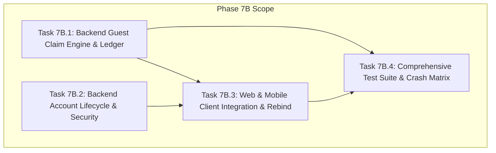

# 📋 Implementation Plan: Phase 7B — Account Claim & Lifecycle Protocol

> **Trạng thái:** `[ ] ĐANG CHỜ REVIEW & PHÊ DUYỆT (NO-GO TO CODE UNTIL FROZEN)`  
> **Căn cứ kỹ thuật:**
> - [plans/product/identity_and_ownership_model.md](product/identity_and_ownership_model.md) (SSoT số 1 đã amend)
> - [plans/product/guest_to_account_claim_protocol.md](product/guest_to_account_claim_protocol.md) (SSoT số 2 đã amend)
> - [plans/phase_07a_guest_identity_implementation_plan.md](phase_07a_guest_identity_implementation_plan.md) (Phase 7A Frozen Baseline)
> - Toàn bộ 13 Bất biến P0 đã thống nhất.

---

## 1. Mục Tiêu & 13 Bất Biến Bắt Buộc (P0 Invariants)

Phase 7B chịu trách nhiệm triển khai giao thức chuyển giao dữ liệu Khách sang Tài khoản (Claim Handover) 2 bước xác định, hoàn thiện toàn bộ vòng đời tài khoản người dùng (Account Lifecycle) và thực hiện tái liên kết dữ liệu lưu ngoại tuyến (Offline Metadata Rebinding).

### 13 Nguyên Tắc Bất Biến (P0 Hard Requirements)
1. **Claim Source Identity là `guest:<guestProfileId>`:**
   - Phiên khách được định danh bằng `guestProfileId` (UUIDv4).
   - `installationId` thuần túy là Device Identity (`device:<installationId>`), không bao giờ được dùng làm claim credential hay claim identity trong Network DTO.
2. **Durable Idempotency Trong PostgreSQL (Bảng `guest_claims`) & Best-Effort Redis Lock:**
   - **PostgreSQL là Single Source of Truth và Correctness Authority duy nhất** cho trạng thái claim qua bảng sổ cái `guest_claims`.
   - Redis Lock (`claim_lock:<claimId>`) chỉ là tầng tối ưu giảm tải tranh chấp (Best-effort concurrency optimization). Nếu Redis gặp sự cố, timeout hoặc restart, hệ thống **bắt buộc fallback mượt mà** tiếp tục xử lý an toàn bằng cơ chế khóa hàng PostgreSQL (`SELECT ... FOR UPDATE`), tuyệt đối không biến Redis thành hard dependency làm gián đoạn commit bền vững.
   - Trạng thái `COMMITTED` và bản tóm tắt kết quả (`result_summary`) **bắt buộc phải được ghi trong cùng Database Transaction** với toàn bộ thao tác gộp Bookmarks, Read States và Reading Progress.
   - Sập ứng dụng, mất mạng hoặc mất Redis sau DB commit vẫn retry/truy vấn an toàn 100%.
3. **Thứ Tự Kiểm Tra Commit (Idempotency First):**
   - Khi commit, thứ tự kiểm tra bắt buộc:
     `load + FOR UPDATE ➔ ownership check ➔ if COMMITTED => return stored 200 result immediately ➔ if ABORTED => reject ➔ if PREPARED and expired => mark/return EXPIRED ➔ domain locks & fingerprint check ➔ merge`.
   - Trạng thái `COMMITTED` có hiệu lực idempotent vĩnh viễn theo chính sách lưu trữ sổ cái, **hoàn toàn độc lập với TTL 15 phút của prepare**.
4. **Bảo Vệ Chống TOCTOU & Stale-Preview Qua `stateFingerprint` & Domain Row Locking:**
   - Không bịa số revision giả tạo.
   - Prepare tính `stateFingerprint` = SHA-256 từ snapshot trạng thái Cloud hiện tại (`user_library_bookmarks`, `chapter_read_states`, `reading_progress`, `reading_history_tombstones`) của các entity trong request.
   - Commit mở transaction, **khóa cứng các domain rows liên quan** (`SELECT ... FOR UPDATE`), khóa `reading_history_epoch_counters FOR UPDATE` và khóa transactional user advisory lock `SELECT pg_advisory_xact_lock(hashtext('user_claim:' || :userId))` để tuần tự hóa triệt để.
   - Tính lại `currentFingerprint` trên dữ liệu đã khóa. Nếu phát hiện thay đổi (`currentFingerprint !== stateFingerprint`) ➔ Rollback và trả về `409 Conflict` kèm mã `CLAIM_STALE_REPREPARE`.
   - Nhờ việc giữ các khóa này đến khi transaction commit, loại bỏ 100% race window giữa fingerprint check và merge.
5. **Bảo Tồn Toàn Vẹn Resume Tuple — 1-based `pageIndex >= 1`:**
   - DTO tiến độ đọc bắt buộc giữ đủ bộ 7 trường vị trí: `chapterVersionId`, `readingMode`, `pageIndex`, `scrollPosition`, `progressPercentage`, `anchorBlockId`, `textOffset`.
   - **`pageIndex` bắt buộc là số nguyên 1-based (`pageIndex >= 1`, minimum = 1)** trên toàn bộ API DTO, DB schema và Shared Contracts.
   - 0-based index của Flutter chỉ được phép tồn tại nội bộ trong runtime UI và phải convert (`pageIndex = flutterPageIndex + 1`) trước khi đưa vào DTO mạng hoặc SQLite canonical resume tuple.
6. **Khớp Hoàn Toàn Schema Backend Thực Tế (Không Bịa Bảng `reading_history`):**
   - Backend hiện tại dùng:
     * `reading_progress` (PK: `user_id, story_id`) — vị trí đọc tiếp (resume pointer) của truyện.
     * `chapter_read_states` (PK: `user_id, chapter_id`) — lịch sử và trạng thái đọc của từng chương.
     * `reading_history_tombstones` (PK: `user_id, story_id`) — dấu vết xóa lịch sử theo story.
   - Gộp Lịch sử/Chương đã đọc ➔ upsert `chapter_read_states`.
   - Gộp Tiến độ đọc ➔ upsert `reading_progress`.
   - Tuyệt đối không tạo semantics của bảng `reading_history` không tồn tại.
7. **Tombstone Anti-Resurrection Bất Biến (Chặn Cả Progress Lẫn Read Chapters):**
   - Nếu story có bản ghi trong `reading_history_tombstones` trên Cloud:
     * Toàn bộ guest history / read chapters của story đó bị chặn import (`IGNORED_TOMBSTONE`).
     * Toàn bộ guest reading progress của story đó bị chặn import (`IGNORED_TOMBSTONE`).
     * Tuyệt đối không tái sinh bất kỳ phần nào của reading state đã bị xóa trên Cloud của story đó.
8. **So Sánh Xung Đột Tiến Độ Đọc Nhận Biết Chế Độ Đọc (Mode-Aware Conflict Resolution):**
   - Không so sánh đơn giản `abs(diff) < 5%`.
   - So sánh dựa trên reading mode:
     * `PAGED` ➔ so sánh `pageIndex` (1-based). Khác trang = CONFLICT.
     * `WEBTOON` ➔ so sánh `scrollPosition` (ngưỡng 50px) VÀ `progressPercentage` (ngưỡng 5%).
     * `NOVEL` ➔ so sánh `anchorBlockId` VÀ `textOffset` (ngưỡng 100 ký tự).
     * Khác readingMode hoặc không chắc chắn tương đương ➔ Phân loại CONFLICT (mặc định an toàn `KEEP_CLOUD`), người dùng quyết định.
9. **Quarantine Lưu Theo Dạng Marker List (Giữ Nguyên Partition Vật Lý):**
   - Khi người dùng chọn "Bỏ qua" (Skip): Client chỉ thêm `guestProfileId` vào danh sách `omninovel_quarantined_guest_profiles` thông qua primitive Phase 7A `quarantineGuestScope(guestProfileId)`.
   - Giữ nguyên partition vật lý `guest:<guestProfileId>`, **tuyệt đối không rename namespace** thành `quarantine:<guestProfileId>`.
   - Dữ liệu khách nguồn chỉ bị purge sau khi Server xác nhận bền vững `COMMITTED`.
10. **Mobile Rebind Bằng Transactional Local Merge (Tránh Collision Primary Key):**
    - SQLite có PK `(owner_scope, story_id)`. Tuyệt đối không blind `UPDATE ... SET owner_scope = 'account:<userId>'` vì sẽ văng lỗi UNIQUE constraint nếu tài khoản đã có bookmark/progress của truyện đó.
    - Rebind phải là **Transactional Local Merge**:
      `BEGIN TRANSACTION` ➔ `INSERT OR IGNORE` cho bookmarks ➔ merge read states và progress theo luật ưu tiên ➔ `DELETE` partition khách nguồn ➔ `COMMIT`.
11. **Quản Lý Phiên Đăng Nhập Ổn Định (Stable Session Identity & Rotation):**
    - Coi `familyId` trong refresh token rotation là `sessionId` ổn định.
    - Lưu metadata phiên trên Redis: `auth_session:<userId>:<familyId>` chứa `{ sessionId, createdAt, lastActiveAt, ip, userAgent, currentJti }`.
    - Refresh token thay đổi `jti` và `lastActiveAt`, nhưng **giữ nguyên `familyId`**. Remote revoke thu hồi toàn bộ token family của `familyId` đó.
12. **Bảo Mật Vòng Đời Mật Khẩu & Chính Sách Xóa Tài Khoản Duy Nhất:**
    - Reset password token: Lưu **HASH** (SHA-256) trong Redis, không lưu raw token.
    - Forgot password: Phản hồi chuẩn hóa giống hệt nhau (chống Account Enumeration).
    - Change password: Giữ nguyên current session của thiết bị đang gọi, thu hồi toàn bộ các sessions khác.
    - Account deletion: Khóa chính sách duy nhất: **Soft Delete + 30-Day Grace Period** (ẩn danh hóa đóng góp dịch truyện, thu hồi toàn bộ sessions, giữ và ẩn danh hóa ledger).
13. **Chuẩn Hóa Kiến Trúc Shared Contracts Cho Flutter:**
    - `packages/shared` là **canonical TypeScript network contracts** cho API và Web.
    - Mobile Flutter sử dụng **mirror contract bằng Dart models**, được kiểm chứng chống drift qua **JSON Fixture / Conformance Tests**.

---

## 2. Kế Hoạch Phân Rã Công Việc Chi Tiết (WBS)



---

### Task 7B.1: Backend Guest Claim Engine & Durable Ledger APIs (`services/api`)

**Mục tiêu:** Xây dựng hệ thống tiếp nhận, thẩm định, lưu sổ cái và gộp nguyên tử dữ liệu từ phiên khách vào tài khoản người dùng theo giao thức 3 điểm cuối, tuân thủ chặt chẽ schema thực tế và các bất biến P0.

#### 1.1. Cấu Trúc Bảng CSDL PostgreSQL (`guest_claims`) & Migration TypeORM
- **Vị trí tệp:**
  - Entity: `services/api/src/modules/claims/entities/guest-claim.entity.ts`
  - Migration: `services/api/src/database/migrations/*-create-guest-claims.ts`
- **Schema Fields:**
  - `claim_id` (UUIDv4, Primary Key)
  - `user_id` (UUIDv4, Foreign Key -> `users.id`, Index, `ON DELETE CASCADE`)
  - `guest_profile_id` (UUIDv4, Not Null)
  - `payload_hash` (VARCHAR(64), Not Null - SHA-256 của normalized raw payload)
  - `state_fingerprint` (VARCHAR(64), Not Null - SHA-256 của snapshot Cloud entities liên quan)
  - `status` (`guest_claim_status`: `PREPARED`, `COMMITTED`, `ABORTED`, `EXPIRED`, Not Null)
  - `preview_data` (JSONB, Not Null - Danh sách items chấp nhận và xung đột)
  - `conflict_decisions` (JSONB, Nullable - Quyết định của người dùng gửi lên tại commit)
  - `result_summary` (JSONB, Nullable - Số lượng bản ghi đã thêm/gộp thực tế)
  - `expires_at` (TIMESTAMPTZ, Not Null, Index cho dọn dẹp)
  - `created_at` (TIMESTAMPTZ, Default NOW())
  - `committed_at` (TIMESTAMPTZ, Nullable)
  - `updated_at` (TIMESTAMPTZ, Default NOW())

#### 1.2. DTOs & Anti-Abuse Validation
- **Vị trí tệp:**
  - `services/api/src/modules/claims/dto/prepare-guest-claim.dto.ts`
  - `services/api/src/modules/claims/dto/commit-guest-claim.dto.ts`
  - `services/api/src/modules/claims/dto/guest-claim-response.dto.ts`
- **Ràng buộc kiểm tra (Class-Validator & Custom Pipe):**
  - `@IsUUID('4')` cho `guestProfileId`, `storyId`, `chapterId`, `chapterVersionId`.
  - `@ArrayMaxSize(500)` cho `bookmarks`, `@ArrayMaxSize(1000)` cho `history`, `@ArrayMaxSize(500)` cho `progress`.
  - **1-based `pageIndex`:** `@IsInt()` `@Min(1, { message: 'pageIndex không được nhỏ hơn 1' })` cho `pageIndex`.
  - Giới hạn số thực: `@Min(0)` `@Max(100)` cho `progressPercentage`; `@Min(0)` cho `scrollPosition`, `textOffset`.
  - Kiểm tra `Number.isFinite()` loại bỏ `NaN`, `Infinity`.
  - Custom Sanitize decorator: Loại bỏ các bản ghi trùng lặp trong cùng payload trước khi vào Service.

#### 1.3. Service Nghiệp Vụ (`GuestClaimService`)
- **Vị trí tệp:** `services/api/src/modules/claims/guest-claim.service.ts`
- **Phương thức 1: `prepareClaim(userId: string, dto: PrepareGuestClaimDto)`**
  1. Thẩm định Foreign Keys: Query database kiểm tra `chapterId` có thuộc về `storyId`, `chapterVersionId` có khớp, truyện và chương có đang `PUBLISHED`.
  2. Query Cloud state hiện tại của `userId`:
     - Bookmarks: `SELECT story_id FROM user_library_bookmarks WHERE user_id = $1`.
     - Read states: `SELECT chapter_id, max_progress_percentage FROM chapter_read_states WHERE user_id = $1`.
     - Reading progress: `SELECT story_id, chapter_id, reading_mode, page_index, scroll_position, progress_percentage, anchor_block_id, text_offset FROM reading_progress WHERE user_id = $1`.
     - Tombstones: `SELECT story_id, epoch FROM reading_history_tombstones WHERE user_id = $1`.
  3. Tính `stateFingerprint`:
     - Gom danh sách canonical IDs từ payload.
     - Lấy trạng thái hiện tại trên Cloud của các IDs này (kèm tombstones).
     - Tạo canonical string `JSON.stringify(sortedCloudState)` và hash SHA-256.
  4. Lập bản Diff & Phát hiện xung đột (Mode-Aware Comparator):
     - Bookmark: Additive (Bỏ qua truyện đã bookmark trên Cloud).
     - **Tombstone check:** Nếu `storyId` có trong tombstone ➔ Bỏ qua toàn bộ guest read states và progress của truyện đó (`readStatesIgnoredAntiResurrectionCount++`).
     - Read states: Dedupe theo `(storyId, chapterId)`.
     - Progress: So sánh nhận biết chế độ (PAGED so sánh `pageIndex >= 1`, WEBTOON so sánh `scrollPosition` + `progressPercentage`, NOVEL so sánh `anchorBlockId` + `textOffset`). Nếu khác ➔ gắn cờ Conflict (chứa cả `cloudProgress` và `guestProgress`).
  5. Insert bản ghi `guest_claims` ở trạng thái `PREPARED` với TTL 15 phút.
  6. Ghi Redis cache `claim_meta:<claimId>` và áp dụng Rate Limit (10 req/min/user).
  7. Trả về `GuestClaimPreviewResponse`.
- **Phương thức 2: `commitClaim(userId: string, claimId: string, dto: CommitGuestClaimDto)`**
  1. **Thử chiếm Redis Distributed Lock (Best-effort):**
     - `try { await redisLock.acquire('claim_lock:' + claimId, 5000); } catch (e) { logger.warn('Redis lock unavailable, fallback to DB row lock: ' + e.message); }`
  2. Mở PostgreSQL Database Transaction (`queryRunner.startTransaction()`):
     - `SELECT * FROM guest_claims WHERE claim_id = :claimId FOR UPDATE`.
     - Kiểm tra tồn tại (`404 Not Found`).
     - **Kiểm tra quyền sở hữu:** Nếu `claim.user_id !== userId` ➔ Rollback, trả `403 Forbidden`.
     - **Kiểm tra Idempotency First:** Nếu `claim.status === 'COMMITTED'` ➔ Rollback/Commit ngay, trả kết quả đã lưu trong `claim.result_summary` với mã `200 OK` (hiệu lực vĩnh viễn theo retention policy, không phụ thuộc TTL 15 phút).
     - **Kiểm tra Aborted:** Nếu `claim.status === 'ABORTED'` ➔ Rollback, trả `400 Bad Request`.
     - **Kiểm tra Expired:** Nếu `claim.status === 'PREPARED'` VÀ `NOW() > claim.expires_at` ➔ Cập nhật `status = 'EXPIRED'`, commit ledger, trả `410 Gone (CLAIM_EXPIRED)`.
     - **Khóa Domain Rows để triệt tiêu TOCTOU race window:**
       * Khóa user advisory lock: `SELECT pg_advisory_xact_lock(hashtext('user_claim:' || :userId));`.
       * Khóa user epoch counter: `SELECT epoch FROM reading_history_epoch_counters WHERE user_id = :userId FOR UPDATE;`.
       * Khóa existing rows: `reading_progress`, `reading_history_tombstones`, `chapter_read_states`, `user_library_bookmarks` của user cho các story/chapter trong request bằng `FOR UPDATE`.
     - **Kiểm tra TOCTOU:** Re-fetch Cloud state đã khóa, tính lại `currentFingerprint`. Nếu `currentFingerprint !== claim.state_fingerprint` hoặc `expectedStateFingerprint !== claim.state_fingerprint`: Rollback, trả `409 Conflict (CLAIM_STALE_REPREPARE)`.
  3. Thực thi Merge trong cùng Transaction:
     - Gộp Bookmarks (`INSERT INTO user_library_bookmarks (user_id, story_id, created_at) ... ON CONFLICT (user_id, story_id) DO NOTHING`).
     - Gộp Read states (`INSERT INTO chapter_read_states (user_id, chapter_id, last_version_id, max_progress_percentage, completed_at, last_read_at) ... ON CONFLICT (user_id, chapter_id) DO UPDATE SET max_progress_percentage = GREATEST(...), last_read_at = NOW()`). Loại trừ các story có tombstone.
     - Gộp Progress: Dựa trên `conflictDecisions` hoặc giữ Cloud. Upsert vào `reading_progress (user_id, story_id, ...) ON CONFLICT (user_id, story_id) DO UPDATE SET ...` với `page_index` 1-based (`>= 1`). Loại trừ các story có tombstone.
     - **Tuyệt đối KHÔNG gọi bất kỳ hàm cấp phát Gamification nào (EXP, Coin, Streak = 0)**.
  4. Cập nhật Sổ cái:
     - `UPDATE guest_claims SET status = 'COMMITTED', result_summary = :stats, committed_at = NOW() WHERE claim_id = :claimId`.
  5. Commit PostgreSQL Transaction (`await queryRunner.commitTransaction()`).
  6. Giải phóng Redis Lock (nếu có).
  7. Trả về `GuestClaimCommitResponse`.
- **Phương thức 3: `getClaimStatus(userId: string, claimId: string)`**
  1. Truy vấn `SELECT * FROM guest_claims WHERE claim_id = :claimId`.
  2. Nếu không có ➔ trả `404 Not Found`.
  3. Kiểm tra sở hữu: Nếu `claim.user_id !== userId` ➔ trả `403 Forbidden`.
  4. Trả về `GuestClaimStatusResponse` (hỗ trợ client crash recovery).

#### 1.4. Controller & Routing
- **Vị trí tệp:** `services/api/src/modules/claims/guest-claim.controller.ts`
- **Endpoints:**
  - `POST /api/v1/account/guest-claims/prepare` (Guarded by `JwtAuthGuard`)
  - `POST /api/v1/account/guest-claims/:claimId/commit` (Guarded by `JwtAuthGuard`)
  - `GET /api/v1/account/guest-claims/:claimId/status` (Guarded by `JwtAuthGuard`)

---

### Task 7B.2: Backend Account Lifecycle & Security Management (`services/api`)

**Mục tiêu:** Cung cấp đầy đủ các endpoint hoàn thiện vòng đời tài khoản người dùng, bảo mật đăng nhập, quản lý phiên ổn định và chính sách xóa tài khoản duy nhất.

#### 2.1. Quên & Đặt Lại Mật Khẩu (Forgot / Reset Password)
- **Vị trí tệp:**
  - `services/api/src/modules/auth/auth.controller.ts`
  - `services/api/src/modules/auth/auth.service.ts`
- **Endpoints:**
  - `POST /api/v1/auth/forgot-password`:
    - Nhận `{ email: string }`.
    - Rate limit: 3 requests / 15 phút / IP hoặc email.
    - **Anti-Enumeration Invariant:** Luôn trả về HTTP 200 `{ "success": true, "message": "Nếu email tồn tại trong hệ thống, hướng dẫn đặt lại mật khẩu đã được gửi." }` bất kể email có trong CSDL hay không.
    - Nếu email tồn tại: Sinh cryptographically secure token (64-character hex), băm SHA-256 rồi lưu vào Redis `pwd_reset:<sha256(token)>` với TTL 15 phút kèm `userId`. Gửi token raw qua email.
  - `POST /api/v1/auth/reset-password`:
    - Nhận `{ token: string, newPassword: string }`.
    - Validate password strength (tối thiểu 8 ký tự, có số, chữ hoa, ký tự đặc biệt).
    - Băm SHA-256 token gửi lên và so khớp key trong Redis `pwd_reset:<sha256(token)>`. Nếu không tìm thấy hoặc hết hạn ➔ `400 Bad Request (INVALID_OR_EXPIRED_TOKEN)`.
    - Băm mật khẩu mới bằng Argon2/Bcrypt, cập nhật CSDL `users`.
    - Xóa token khỏi Redis.
    - **Global Session Revocation:** Thu hồi toàn bộ Refresh Token / Session hiện có của người dùng trên Redis (`revokeAllUserSessions(userId)`).

#### 2.2. Đổi Mật Khẩu Đang Đăng Nhập (Change Password)
- **Endpoint:** `POST /api/v1/auth/change-password` (Bảo vệ bởi `JwtAuthGuard`).
- **Body:** `{ currentPassword: string, newPassword: string }`.
- **Nghiệp vụ:**
  - Xác thực mật khẩu cũ bằng Argon2/Bcrypt.
  - Ngăn chặn đặt mật khẩu mới trùng mật khẩu cũ.
  - Cập nhật mật khẩu mới vào CSDL.
  - **Khóa chính sách Revocation:** **Giữ nguyên phiên hiện tại, thu hồi toàn bộ phiên khác** (`preserve current familyId, revoke all other familyIds in user_sessions:<userId>`).

#### 2.3. Quản Lý Phiên Thiết Bị Ổn Định (Device Session Management)
- **Kiến trúc Session Metadata trên Redis:**
  - `auth_session:<userId>:<familyId>` lưu JSON:
    ```json
    {
      "sessionId": "<familyId>",
      "createdAt": "<ISO-8601>",
      "lastActiveAt": "<ISO-8601>",
      "ip": "<client-ip>",
      "userAgent": "<user-agent>",
      "currentJti": "<latest-jti>"
    }
    ```
  - `user_sessions:<userId>`: Redis Set chứa danh sách các `familyId` đang hoạt động (TTL 7 ngày).
  - Khi Login/Register: Tạo `familyId`, ghi `auth_session`, thêm vào `user_sessions`.
  - Khi Refresh Token: Cập nhật `lastActiveAt`, cập nhật `currentJti`, cập nhật `session:${user.id}:${newJti}`, **giữ nguyên `familyId`**.
- **Endpoints (`services/api/src/modules/account/account-sessions.controller.ts`):**
  - `GET /api/v1/account/sessions`: Đọc `user_sessions:<userId>`, lấy metadata từ `auth_session:<userId>:<familyId>`, so sánh `familyId === req.user.familyId` để trả về cờ `isCurrentSession: true`.
  - `DELETE /api/v1/account/sessions/:sessionId`: Đăng xuất thiết bị cụ thể từ xa (thu hồi toàn bộ token family của `sessionId`, xóa key khỏi Redis).
  - `DELETE /api/v1/account/sessions/other`: Đăng xuất toàn bộ các thiết bị khác ngoại trừ `req.user.familyId`.

#### 2.4. Quyền Riêng Tư & Chính Sách Xóa Tài Khoản Duy Nhất (GDPR / Account Deletion)
- **Khóa chính sách duy nhất: Soft Delete + 30-Day Grace Period:**
  1. `users` table: Cập nhật `status = 'DEACTIVATED'`, `deleted_at = NOW()`, `scheduled_purge_at = NOW() + INTERVAL '30 days'`.
  2. Sessions: Thu hồi TOÀN BỘ sessions/tokens trên Redis ngay lập tức.
  3. Login trong 30 ngày: Trả về trạng thái tài khoản đang chờ xóa, cung cấp endpoint reactivate.
  4. Đóng góp dịch thuật (Translations): Giữ nguyên chapter/version để không làm gãy truyện, nhưng **ẩn danh hóa (Anonymize)**: set `contributor_id = null`, hiển thị tác giả `"Anonymous Contributor"`.
  5. Đánh giá & Bình luận (Reviews/Comments): Đặt `is_hidden = true`, ẩn khỏi public.
  6. Sổ cái Claim (`guest_claims`): Giữ lại bản ghi nhưng **ẩn danh hóa `user_id`** (thay bằng hash) phục vụ kiểm toán hệ thống.
  7. Sau 30 ngày: Cron worker purge vĩnh viễn reading progress, bookmarks, private profile.
- **Endpoints:**
  - `GET /api/v1/account/export-data`: Xuất toàn bộ dữ liệu người dùng dạng JSON (Profile, Bookmarks, History, Progress, Translations).
  - `DELETE /api/v1/account`: Xác nhận lại mật khẩu (`{ currentPassword: string }`), kích hoạt quy trình Soft Delete 30 ngày.

---

### Task 7B.3: Web & Mobile Client Integration, Explicit Claim Dialog & Offline Rebind

**Mục tiêu:** Tích hợp luồng xác thực phía Client để phát hiện dữ liệu khách sau khi đăng nhập/đăng ký, hiển thị Dialog xác nhận rõ ràng (Claim vs Skip), quản lý Quarantine dạng marker list, xử lý xung đột tiến độ và rebind metadata offline an toàn bằng Transactional Local Merge.

#### 3.1. Web Client (`apps/web`)
- **Vị trí tệp:**
  - Hook & Controller: `apps/web/src/lib/claim/use-guest-claim-coordinator.ts`
  - Dialog Component: `apps/web/src/components/claim/guest-claim-dialog.tsx`
  - Quarantine Storage: Sử dụng `quarantineGuestScope(guestProfileId)` từ `GuestProfileIdentityProvider`.
- **Quy trình hoạt động:**
  1. `ActiveScopeCoordinator` chuyển sang `ACCOUNT`:
     - Kiểm tra nếu `IndexedDB` của `guest:<guestProfileId>` có dữ liệu (bookmarks > 0 hoặc progress > 0 hoặc history > 0).
  2. Tự động gọi `POST /api/v1/account/guest-claims/prepare`:
     - Gửi đủ 7 trường resume tuple: `chapterVersionId`, `readingMode`, `pageIndex` (1-based >= 1), `scrollPosition`, `progressPercentage`, `anchorBlockId`, `textOffset`.
     - Nhận về `GuestClaimPreviewResponse`.
  3. Hiển thị `GuestClaimDialog`:
     - Hiển thị tóm tắt: bookmarks thêm, read states gộp.
     - Hiển thị bảng so sánh conflict (nếu có) cho phép chọn `USE_GUEST` hoặc `KEEP_CLOUD`.
  4. Nếu Người dùng bấm **Bỏ qua (Skip)**:
     - Gọi `quarantineGuestScope(guestProfileId)`: Thêm `guestProfileId` vào danh sách `omninovel_quarantined_guest_profiles` trong `localStorage`. **Giữ nguyên partition vật lý `guest:<guestProfileId>`, tuyệt đối không rename namespace**.
     - Đóng dialog, hoàn tất đăng nhập.
  5. Nếu Người dùng bấm **Xác nhận gộp (Confirm Claim)**:
     - Gửi `POST /api/v1/account/guest-claims/:claimId/commit` kèm `expectedStateFingerprint` và các lựa chọn.
     - Nếu nhận `409 Conflict`: Báo dữ liệu máy chủ đã thay đổi, tự động prepare lại.
     - Nếu nhận `200 OK`:
       * Dọn dẹp an toàn partition nguồn `guest:<guestProfileId>` trong `IndexedDB`.
       * Rebind metadata offline cache sang `account:<userId>`.
       * Hiển thị thông báo thành công.
  6. **Crash Recovery Hook:**
     - Lưu `pendingClaimId` vào `localStorage`.
     - Khởi động app: nếu có `pendingClaimId`, gọi `GET /status`. Nếu `COMMITTED` ➔ dọn dẹp partition khách và clear pending.

#### 3.2. Mobile Client (`apps/mobile`)
- **Vị trí tệp:**
  - Service: `apps/mobile/lib/core/claim/guest_claim_service.dart`
  - Bloc / State: `apps/mobile/lib/features/claim/bloc/guest_claim_bloc.dart`
  - Dialog Widget: `apps/mobile/lib/features/claim/presentation/guest_claim_dialog.dart`
  - DAO Rebind: `apps/mobile/lib/core/storage/local_library_dao.dart`
- **Quy trình hoạt động:**
  1. Quét SQLite `local_library_bookmarks`, `local_reading_progress`, `local_reading_history` với `WHERE owner_scope = 'guest:<guestProfileId>'`.
  2. Gửi request `prepare` với 1-based `pageIndex` (`flutterPageIndex + 1 >= 1`).
  3. Hiển thị BottomSheet/Dialog hỏi người dùng: [Gộp vào tài khoản] hoặc [Bỏ qua].
  4. Nếu Bỏ qua: Gọi `quarantineGuestScope(guestProfileId)`, lưu ID vào danh sách quarantined SharedPreferences. **Không đổi tên partition trong SQLite**.
  5. Nếu Gộp dữ liệu:
     - Gửi request `commit`.
     - Khi nhận được `200 OK (COMMITTED)`:
       - **Transactional Local Merge Trong SQLite (Tránh Collision PK):**
         ```dart
         await db.transaction((txn) async {
           // 1. Bookmarks: INSERT OR IGNORE
           await txn.execute('''
             INSERT OR IGNORE INTO local_library_bookmarks (owner_scope, story_id, title, slug, cover_url, created_at)
             SELECT 'account:' || ?, story_id, title, slug, cover_url, created_at
             FROM local_library_bookmarks
             WHERE owner_scope = 'guest:' || ?
           ''', [userId, guestProfileId]);

           // 2. Reading history: INSERT OR REPLACE với GREATEST progress
           await txn.execute('''
             INSERT INTO local_reading_history (owner_scope, story_id, chapter_id, chapter_version_id, story_title, story_slug, story_cover_url, chapter_number, chapter_title, progress_percentage, last_read_at)
             SELECT 'account:' || ?, story_id, chapter_id, chapter_version_id, story_title, story_slug, story_cover_url, chapter_number, chapter_title, progress_percentage, last_read_at
             FROM local_reading_history
             WHERE owner_scope = 'guest:' || ?
             ON CONFLICT(owner_scope, story_id, chapter_id) DO UPDATE SET
               progress_percentage = MAX(local_reading_history.progress_percentage, EXCLUDED.progress_percentage),
               last_read_at = MAX(local_reading_history.last_read_at, EXCLUDED.last_read_at)
           ''', [userId, guestProfileId]);

           // 3. Reading progress merge theo conflictDecisions hoặc insert
           // 4. Purge partition nguồn
           await txn.delete('local_library_bookmarks', where: 'owner_scope = ?', whereArgs: ['guest:$guestProfileId']);
           await txn.delete('local_reading_progress', where: 'owner_scope = ?', whereArgs: ['guest:$guestProfileId']);
           await txn.delete('local_reading_history', where: 'owner_scope = ?', whereArgs: ['guest:$guestProfileId']);
         });
         ```
       - Rebind các tệp JSON manifest trong `offline_storage_paths.dart` sang `user_<userId>_chapter_<id>.json`.
  6. Crash Recovery: Lưu `pending_claim_id` trong SharedPreferences; nếu mở lại app thấy pending, gọi `GET /status` kiểm tra để hoàn tất rebind nếu server đã commit xong.

---

### Task 7B.3.1: Đóng Gói Shared Contracts & DTOs (`packages/shared`)

**Mục tiêu:** Định nghĩa hợp đồng mạng chuẩn TypeScript dùng chung cho Core API và Web Client; cung cấp Dart Mirror Contract & Conformance Tests cho Mobile Flutter để chống drift schema.

- **Vị trí tệp:**
  - TypeScript Canonical:
    * `packages/shared/src/types/claim.types.ts`
    * `packages/shared/src/dto/guest-claim.dto.ts`
  - Dart Mirror Models & JSON Conformance Tests:
    * `apps/mobile/lib/core/claim/models/guest_claim_models.dart`
    * `apps/mobile/test/core/claim/models/guest_claim_models_test.dart` (đối soát JSON serialization với shared schema)
- **Các kiểu dữ liệu chuẩn:**
  - `GuestClaimStatus = 'PREPARED' | 'COMMITTED' | 'ABORTED' | 'EXPIRED'`
  - `PrepareGuestClaimPayload` (1-based `pageIndex >= 1`)
  - `CommitGuestClaimPayload`
  - `GuestClaimPreviewResult`
  - `GuestClaimCommitResult`
  - `GuestClaimStatusResult`
  - `ConflictResolution = 'KEEP_CLOUD' | 'USE_GUEST'`

---

### Task 7B.4: Comprehensive Test Suite, Crash Matrix & Zero-Gamification Verification

**Mục tiêu:** Viết bài kiểm thử tự động toàn diện kiểm chứng 11 kịch bản sự cố trong ma trận chấp nhận, chống gian lận kinh tế ảo, kiểm thử crash recovery và bảo đảm không thoái lui Phase 7A.

#### 4.1. Bộ Kiểm Thử Core API E2E & Unit Test (`services/api`)
- **Tệp:** `services/api/src/modules/claims/guest-claim.service.spec.ts`
- **Tệp E2E:** `services/api/test/guest-claim-lifecycle.e2e-spec.ts`
- **Các ca kiểm thử bắt buộc:**
  1. `prepare`: Validate UUID, bound check, reject `pageIndex < 1`, reject payload quá 500 items, check unpublished chapter.
  2. `prepare`: Mode-aware progress conflict detection (PAGED, WEBTOON, NOVEL).
  3. `prepare`: Tombstone check chặn toàn bộ progress và read states của truyện tombstone.
  4. `commit`: Idempotency first — gọi commit 2 lần -> lần 2 trả 200 OK ngay từ ledger `guest_claims`, không duplicate insert, bất kể quá hạn TTL 15 phút.
  5. `commit`: Redis loss fallback — mock Redis unavailable -> commit vẫn hoàn tất thành công 100% nhờ PostgreSQL row locks.
  6. `commit`: TOCTOU Protection & Domain Row Locking — verify domain rows và epoch counter bị khóa `FOR UPDATE`; mock dữ liệu Cloud thay đổi giữa prepare và commit -> trả `409 Conflict (CLAIM_STALE_REPREPARE)`.
  7. `commit`: Security Ownership — User B dùng token của mình gọi commit `claimId` do User A prepare -> trả `403 Forbidden`.
  8. `commit`: Expired session — gọi commit sau 15 phút khi claim đang `PREPARED` -> cập nhật `EXPIRED` và trả `410 Gone`.
  9. `status`: Check claim status trả đúng thông tin cho crash recovery; User B gọi status của User A -> trả `403 Forbidden`.
  10. **Zero Gamification Verification:** Kiểm tra số dư EXP, OmniCoin, Streak của người dùng trước và sau khi commit 500 chương -> hoàn toàn bằng nhau (Delta = 0).
  11. Account lifecycle: Forgot password anti-enumeration, reset token SHA-256 hash check, change password keep current session & revoke others, session management with `auth_session` metadata, soft-delete 30-day grace period.

#### 4.2. Bộ Kiểm Thử Web Client (`apps/web`)
- **Tệp:** `apps/web/src/lib/claim/guest-claim-coordinator.spec.ts`
- **Các ca kiểm thử:**
  1. Tự động phát hiện guest data và trigger prepare sau khi đăng nhập.
  2. Người dùng chọn Skip -> thêm ID vào danh sách quarantine marker, giữ nguyên partition `guest:<guestProfileId>`, không bị purge.
  3. Người dùng chọn Claim -> commit thành công -> partition khách được dọn dẹp sạch sẽ.
  4. Crash recovery: Có `pendingClaimId`, query status nhận `COMMITTED` -> dọn dẹp local partition an toàn.

#### 4.3. Bộ Kiểm Thử Mobile Client (`apps/mobile`)
- **Tệp:** `apps/mobile/test/core/claim/guest_claim_flow_test.dart`
- **Các ca kiểm thử:**
  1. Quét đúng `guest:<guestProfileId>` từ SQLite DAO với 1-based `pageIndex`.
  2. Quy trình Transactional Local Merge trong SQLite: verify không bị lỗi Primary Key collision khi account đã có bookmark cùng `storyId`.
  3. Quy trình quarantine khi người dùng bấm Skip: marker-based, không đổi tên partition.
  4. Khôi phục từ crash qua `pending_claim_id`.

#### 4.4. Cổng Kiểm Soát Không Thoái Lui (Phase 7A.7 Regression Gate)
- Toàn bộ 48 test files Web (635 Vitest tests + 31 Playwright tests) tiếp tục pass 100%.
- Toàn bộ unit tests Flutter Mobile (`flutter test`) tiếp tục pass 100%.
- Toàn bộ suite bảo mật Trivy và linting tiếp tục pass không có lỗ hổng mới.

---

## 3. Thứ Tự Triển Khai Thực Tế & Kế Hoạch Từng Bước

Sau khi kế hoạch này được **REVIEW & FREEZE** bởi người dùng, quy trình triển khai sẽ tuân thủ nghiêm ngặt thứ tự sau:

| Bước | Nội Dung Thực Hiện | Trạng Thái |
|---|---|---|
| **Step 0** | **Review, Chỉnh sửa & Đóng băng Kế hoạch (Freeze Plan Signoff)** | `[/] Đang làm` |
| **Step 1** | **Tạo Shared Contracts (`packages/shared`) & Dart Mirror Models** (DTOs, Types, Enums, 1-based pageIndex) | `[ ] Chờ Step 0` |
| **Step 2** | **Task 7B.1 Backend API Engine & PostgreSQL Ledger** (Entity, Migration, Service, Controller, Row Lock, Mode-Aware Conflict) | `[ ] Chờ Step 1` |
| **Step 3** | **Task 7B.2 Backend Account Lifecycle APIs** (Forgot Hash/Anti-Enum, Change Pwd Revoke Others, Stable Sessions, Soft Delete 30d) | `[ ] Chờ Step 2` |
| **Step 4** | **Task 7B.3 Web Client Integration** (Dialog, Marker Quarantine, Hook, IndexedDB Rebind) | `[ ] Chờ Step 2` |
| **Step 5** | **Task 7B.3 Mobile Client Integration** (Dialog, SQLite Transactional Merge, Marker Quarantine, Crash Recovery) | `[ ] Chờ Step 2` |
| **Step 6** | **Task 7B.4 Test Automation & Crash Matrix Verification** (E2E tests, Unit tests, 7A regression gate) | `[ ] Chờ Step 4,5` |
| **Step 7** | **Hosted CI Verification & Phase 7B Freeze Signoff** (Đẩy git commit, kiểm tra GitHub Actions Run xanh 7/7 jobs) | `[ ] Chờ Step 6` |

---

## 4. Bảng Kiểm Tra Sẵn Sàng (Readiness Checklist)

- [x] Đã cập nhật SSoT 1 (`identity_and_ownership_model.md`): marker quarantine, transactional rebind, không đổi tên namespace.
- [x] Đã cập nhật SSoT 2 (`guest_to_account_claim_protocol.md`): schema `chapter_read_states`, `reading_progress`, `reading_history_tombstones`, 1-based `pageIndex >= 1`, idempotency check trước expiry, best-effort Redis lock, domain row locking chống TOCTOU race, mode-aware progress conflict, tombstone anti-resurrection toàn diện.
- [x] Đã cập nhật kế hoạch thực thi `phase_07b_account_claim_implementation_plan.md` với đầy đủ 13 P0 Invariants, Stable Session Identity (`auth_session`), mật khẩu hash & anti-enumeration, soft-delete 30-day grace period, SQLite transactional merge, và Dart mirror contract wording.
- [ ] Người dùng xem xét, thảo luận và ký duyệt đóng băng kế hoạch (Freeze Signoff).
- [ ] Bắt đầu viết mã nguồn cho Step 1 & Step 2.
