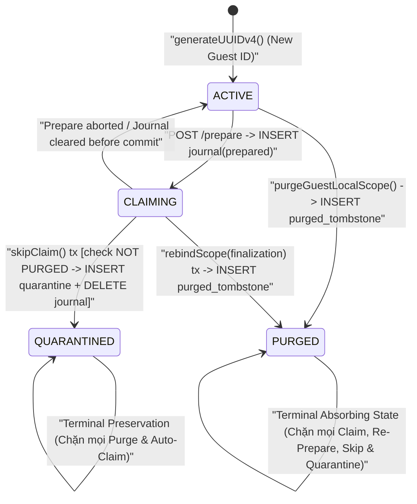

# 🏛️ ADR-07C4-001: Architecture Decision Proposal — Guest Quarantine/Purge Atomicity, Lifecycle Eligibility Contract & Production DI Proof

> **Mã tài liệu:** `ADR-07C4-001` *(Bản cập nhật Stage 1 Final Safety Remediation)*  
> **Thuộc Phase:** OmniNovel Mobile Sync Engine — Phase 7C.4 Stage 1  
> **Trạng thái ADR:** `PROPOSED — PENDING GATE APPROVAL FOR SQLite v6 CONTROLLED UNLOCK`  
> **Trạng thái Stage 1:** **`PENDING GATE REVIEW`** *(Chưa cấp `READY`, chưa cấp `FROZEN CLEAN`, PR [`#209`](https://github.com/HIepNgoc2006/OmniNovel/pull/209) giữ nguyên Draft)*  
> **Phạm vi Đã Sửa Trong Stage 1 (`v5`):** Khắc phục xong **`R-02`** & **`R-03`** trong [`SyncStorageDal`](file:///e:/Workspace2/Doctruyen_project_7c4_mobile/apps/mobile/lib/core/sync/storage/sync_storage_dal.dart#L2400-L2684); giữ nguyên [`OfflineDatabase.databaseVersion = 5`](file:///e:/Workspace2/Doctruyen_project_7c4_mobile/apps/mobile/lib/core/storage/offline_database.dart#L8) và **0 sửa đổi** đối với mọi frozen modules.  
> **Cảnh báo An toàn Trọng tâm:** **R-01 vẫn là OPEN RESIDUAL RISK trên SQLite `v5`** cho tới khi Hội đồng phê duyệt mở khóa migration `v6`.

---

## 1. Tóm tắt Điều hành & Hiện trạng Sau Stage 1 Final Safety Remediation

Sau vòng kiểm toán từ baseline `a17495a` và chỉ đạo của Hội đồng (chấp thuận hướng SQLite SSoT về nguyên tắc nhưng **chưa phê duyệt nâng `v5 -> v6`** tại đợt này), nhóm thực thi đã tách rành mạch hai lớp xử lý:

1. **Đã Khắc phục Trực tiếp Trong Stage 1 (`v5` — Không đụng Frozen Modules):**
   - **R-02 — Đã đóng (`REMEDIATED IN STAGE 1`):** [`SyncStorageDal.purgeGuestLocalScope`](file:///e:/Workspace2/Doctruyen_project_7c4_mobile/apps/mobile/lib/core/sync/storage/sync_storage_dal.dart#L2580-L2684) áp đặt ánh xạ đơn trị 1-1:
     - `GuestLifecyclePurgeReason.userClearedGuestData` **CHỈ** chấp nhận `GuestLocalWriteAdmission`.
     - `GuestLifecyclePurgeReason.verifiedUnusedGuestEviction` **CHỈ** chấp nhận `UnusedGuestEvictionAdmission` (từ chối tuyệt đối `GuestLocalWriteAdmission`, đồng thời kiểm tra cả `!snap.isAuthenticated || snap.scopeState == ActiveScopeState.guest` với persisted `currentGuestId`).
   - **R-03 — Đã đóng (`REMEDIATED IN STAGE 1`):** [`SyncStorageDal.purgeAccountScope`](file:///e:/Workspace2/Doctruyen_project_7c4_mobile/apps/mobile/lib/core/sync/storage/sync_storage_dal.dart#L2400-L2472) áp đặt mặc định `discardUnsyncedMutations = false` (fail-closed):
     - Kiểm tra `pending_mutations` & `quarantined_mutations` **trong SQLite transaction cả trước khi xóa và ngay trước khi commit** (`assertAccountPurgeSafe(txn)`), ném `PurgeProhibitedError('... UNSYNCED_MUTATIONS_PRESENT')` và rollback 100% toàn bộ 8 bảng nếu phát hiện dữ liệu chưa đồng bộ.
     - Cho phép xóa sạch khi truyền tường minh `discardUnsyncedMutations: true` (chỉ khi policy xóa có xác nhận và cấm tuyệt đối trên `AccountPurgeReason.fullResyncReset`).

2. **Vấn đề Tồn dư Chờ Phê duyệt Mở khóa `v6` (`R-01`, `R-04`) & Stage 2 (`R-05`):**
   - **R-01 (`P0` — Open Residual Risk ở `v5`):** [`GuestProfileIdentityProvider`](file:///e:/Workspace2/Doctruyen_project_7c4_mobile/apps/mobile/lib/core/identity/guest_profile_identity_provider.dart#L4-L67) và [`GuestClaimCoordinator`](file:///e:/Workspace2/Doctruyen_project_7c4_mobile/apps/mobile/lib/core/claim/guest_claim_coordinator.dart#L532-L585) vẫn đang ghi quarantine vào **`SharedPreferences`** ngoài ranh giới SQLite `v5`. Tài liệu ADR này phân tích đầy đủ cả hai chiều **`quarantine-before-purge` lẫn `purge-before-quarantine`**, định nghĩa **Lifecycle Eligibility Contract** để chặn claim/quarantine một Guest đã bị purge, và chứng minh vì sao **SQLite lock một mình KHÔNG bảo đảm toàn bộ vòng đời an toàn**.
   - **R-05 (Stage 2 Production DI):** Làm rõ `@visibleForTesting` + rule `analysis_options.yaml` chỉ là **static guard**, KHÔNG phải **runtime proof**, và đề xuất cơ chế cưỡng chế runtime bắt buộc cho `SyncStorageDal.bound(...)` và `clientId` SSoT.

---

## 2. Phân tích Chuyên sâu R-01: Cả Hai Thứ Tự Thực Thi & Vì Sao SQLite Lock Một Mình Là Không Đủ

> [!IMPORTANT]
> **Tuyên bố Kiến trúc Bắt buộc (Anti-Overclaim Principle):**
> **SQLite write lock (`WAL` / `BEGIN IMMEDIATE` / `db.transaction`) một mình TUYỆT ĐỐI KHÔNG bảo đảm toàn bộ vòng đời Guest Quarantine / Claim / Purge an toàn.**
> SQLite lock chỉ tuần tự hóa được các thao tác DB **trùng lặp tại cùng thời điểm vật lý**. Trong vòng đời thực tế của Mobile App, an toàn bị phá vỡ bởi 4 yếu tố nằm ngoài một lệnh lock SQLite đơn lẻ:
> 1. **Khoảng cách Thời gian Tuần tự (`Sequential Non-Overlapping Transactions`):** Nếu Transaction $T_1$ (`purge`) kết thúc và **nhả SQLite lock**, sau đó Transaction $T_2$ (`quarantine` hoặc `claim`) mới chạy, SQLite lock không hề xảy ra tranh chấp để chặn $T_2$ trừ phi có **trạng thái bền vững đơn điệu (`PURGED` tombstone)** được ghi lại và kiểm chứng trong Eligibility Contract.
> 2. **Cửa sổ Mạng Bất đồng bộ (`Cross-Network Async Window`):** Trong [`GuestClaimCoordinator.checkAndPrepareClaim`](file:///e:/Workspace2/Doctruyen_project_7c4_mobile/apps/mobile/lib/core/claim/guest_claim_coordinator.dart#L177-L239) và `confirmClaim`, ứng dụng gửi HTTP `POST /prepare` hoặc `POST /commit` ở **giữa** hai lần chạm DB. **Nghiêm cấm tuyệt đối** giữ SQLite transaction/write lock qua I/O mạng (gây treo UI & ANR), nên giữa bước đọc pre-HTTP và bước ghi post-HTTP luôn tồn tại khoảng trống thời gian.
> 3. **Dual-Store Boundary ở `v5`:** Hiện tại `SharedPreferences` nằm hoàn toàn ngoài SQLite `BEGIN IMMEDIATE` — mọi ghi vào `'omninovel_quarantined_guest_profiles'` không bị ràng buộc bởi transaction SQLite của `purgeGuestLocalScope` hoặc `guest_claim_recovery_journal`.
> 4. **Đa Actor & Điều phối Bộ nhớ (`AuthScopeBridge` / Isolate / UI State):** Việc mở hoặc khóa `ActiveScopeState.transitioning`, tăng `transitionGeneration`, và kiểm định `SyncWriteAdmission` 4 hàng rào phải đồng bộ với SSoT SQLite chứ không thể giao phó hoàn toàn cho một khóa bảng SQLite.

### 2.1 Phân tích Hai Thứ Tự Thực Thi: `quarantine-before-purge` vs `purge-before-quarantine`

#### Chiều A: `quarantine-before-purge` ($T_{\text{quarantine/claim}} \prec T_{\text{purge}}$ hoặc Xen kẽ Song song)
*Kịch bản:* Người dùng đăng nhập -> [`GuestClaimCoordinator.checkAndPrepareClaim`](file:///e:/Workspace2/Doctruyen_project_7c4_mobile/apps/mobile/lib/core/claim/guest_claim_coordinator.dart#L143) tạo `guest_claim_recovery_journal` (`prepared` -> `committing` -> `committedServer`) hoặc người dùng bấm Skip -> [`skipClaim`](file:///e:/Workspace2/Doctruyen_project_7c4_mobile/apps/mobile/lib/core/claim/guest_claim_coordinator.dart#L532) đưa `guestProfileId` vào quarantine; sau đó (hoặc song song từ isolate/worker dọn rác) `purgeGuestLocalScope` cố gắng xóa 4 bảng `local_*` của `guest:g1`.

- **Lỗ hổng tại Stage 1 (`v5` hiện hành — Open Residual Risk):**
  1. Trong `skipClaim()` ([`guest_claim_coordinator.dart#L560-L571`](file:///e:/Workspace2/Doctruyen_project_7c4_mobile/apps/mobile/lib/core/claim/guest_claim_coordinator.dart#L560-L571)), ghi `SharedPreferences` (dòng `562`) và `sqlite.delete('guest_claim_recovery_journal')` (dòng `566`) là **2 bước tách rời**. Crash giữa 2 dòng hoặc multi-isolate cache lệch RAM dẫn tới trạng thái không đồng nhất.
  2. Trong `purgeGuestLocalScope()` ([`sync_storage_dal.dart#L2650-L2683`](file:///e:/Workspace2/Doctruyen_project_7c4_mobile/apps/mobile/lib/core/sync/storage/sync_storage_dal.dart#L2650-L2683)), dẫu đã kiểm tra kép trước xóa và trước khi callback return (dòng `2681`), khoảng thời gian từ lúc Dart callback kết thúc tới lúc native SQLite hoàn tất `COMMIT` vật lý vẫn mở cho một thao tác `quarantineGuestScope` ghi vào `SharedPreferences` thành công mà SQLite **không thể hủy `COMMIT`**.
- **Giải pháp khi mở khóa `v6`:** Chuyển quarantine SSoT vào bảng SQLite `guest_quarantined_scopes`, gộp `skipClaim()` vào **1 transaction nguyên tử**, và dùng SQL `DELETE FROM local_* ... AND NOT EXISTS (SELECT 1 FROM guest_quarantined_scopes ...) AND NOT EXISTS (SELECT 1 FROM guest_claim_recovery_journal ...)` kết hợp pre-commit check để write lock giữ xuyên suốt tới tận sau `COMMIT` vật lý.

#### Chiều B: `purge-before-quarantine` / `purge-before-claim` ($T_{\text{purge}} \prec T_{\text{quarantine/claim}}$ hoặc Xen kẽ Qua HTTP)
*Kịch bản (thường bị bỏ sót nếu chỉ phân tích lock!):*
1. **Tình huống Tuần tự (`T1` commit xong -> `T2` đến sau):** `purgeGuestLocalScope` (`userClearedGuestData` hoặc `verifiedUnusedGuestEviction`) hoặc `LocalLibraryDao.rebindScope` (`commitClaim` hoàn tất) đã **xóa sạch toàn bộ dữ liệu của `guest:g1` và `COMMIT`** tại $T_1$. SQLite lock đã được nhả hoàn toàn. Tại $T_2 > T_1$, một tác vụ trễ — ví dụ stale callback từ UI cũ gọi `skipClaim()`/`quarantineGuestScope(g1)`, worker phục hồi đọc cache cũ, hoặc luồng restore backup — yêu cầu cách ly hoặc mở lại claim cho `g1`.
   - **Vì sao SQLite lock một mình thất bại?** Khi $T_2$ bắt đầu, $T_1$ đã kết thúc từ lâu nên SQLite lock cấp ngay cho $T_2$. Nếu DB chỉ xóa trắng 4 bảng `local_*` mà **không để lại dấu vết (`PURGED` tombstone)**, $T_2$ tưởng `g1` vẫn bình thường -> ghi bậy vào `guest_quarantined_scopes(g1)` (tạo *zombie quarantine*) hoặc khởi tạo claim journal cho một Guest đã bị hủy vĩnh viễn!
2. **Tình huống Xen kẽ qua HTTP trong `checkAndPrepareClaim()`:**
   - Tại $T_0$, [`checkAndPrepareClaim`](file:///e:/Workspace2/Doctruyen_project_7c4_mobile/apps/mobile/lib/core/claim/guest_claim_coordinator.dart#L177-L239) đọc `hasData = true` trên `guest:g1`, rồi nhả SQLite lock để gọi `await _apiClient.post('/guest-claim/prepare')`.
   - Giả sử có bất kỳ biến cố hoặc transition nào khiến `guest:g1` bị `purgeGuestLocalScope` (hoặc claimed bởi session/cơ chế khác) tại $T_1$ trong lúc `POST /prepare` đang bay qua mạng.
   - Tại $T_2$, HTTP trả `200 OK`, dòng `225` ghi `guest_claim_recovery_journal(phase='prepared')` vào SQLite! Nếu chỉ giữ `isSessionValid()` trên RAM mà **không kiểm tra `guest_purged_tombstones` & `guest_quarantined_scopes` bên trong transaction SQLite lúc ghi journal**, hệ thống sinh **claim journal mồ côi cho Guest đã purge**.

---

## 3. Lifecycle Eligibility Contract (Hợp đồng Hợp lệ Toàn Vòng Đời cho `v6`)

Để chặn triệt để cả **chiều `quarantine-before-purge`**, **chiều `purge-before-quarantine`**, lẫn **claim lại một Guest đã bị purge**, thiết kế `v6` định nghĩa **Máy trạng thái Đơn điệu 4 Trạng thái** làm SSoT trên từng `guestProfileId`:



### 3.1 Schema Bổ sung Đề xuất cho SQLite `v6` (2 Bảng Additive Thuần túy)

```sql
-- 1. SSoT Cách ly Guest đã Skip Claim (Chặn Purge vĩnh viễn)
CREATE TABLE IF NOT EXISTS guest_quarantined_scopes (
  guest_profile_id TEXT PRIMARY KEY,
  quarantined_at_ms INTEGER NOT NULL,
  source_user_id TEXT,
  reason TEXT NOT NULL DEFAULT 'SKIP_CLAIM'
);

-- 2. SSoT Tombstone Hủy Guest (Chặn Claim & Quarantine sau Purge — Absorbing State)
CREATE TABLE IF NOT EXISTS guest_purged_tombstones (
  guest_profile_id TEXT PRIMARY KEY,
  purged_at_ms INTEGER NOT NULL,
  purge_reason TEXT NOT NULL
    CHECK (purge_reason IN (
      'USER_CLEARED_GUEST_DATA',
      'VERIFIED_UNUSED_GUEST_EVICTION',
      'CLAIMED_AND_REBOUND'
    )),
  purged_by_user_id TEXT
);
```

*Ghi chú bất biến:* Do `GuestProfileIdentityProvider.rotateGuestProfileId()` luôn sinh **UUIDv4 mới tinh** sau mỗi lần logout, mỗi `guestProfileId` là **duy nhất 1 lần đời (`single-use lifetime`)**. Việc tách bảng tombstone nhỏ gọn `guest_purged_tombstones` giúp lưu lại trạng thái `PURGED` vĩnh viễn không cần giữ dữ liệu `local_*`. *(Chính sách cắt tỉa/retention tombstone dài hạn chỉ xem xét sau ≥ 180 ngày và chỉ khi chắc chắn không còn claim journal/legacy backup nào tham chiếu UUID cũ.)*

### 3.2 Quy tắc Eligibility & Invariants theo Từng Nghiệp vụ (`Contract Matrix`)

| Nghiệp vụ / Điểm Gọi | Trạng thái Yêu cầu (Precondition Trong SQLite Tx) | Hành động Nguyên tử (Atomic Write) | Điều kiện Từ chối Fail-Closed |
|---|---|---|---|
| **1. Đọc / Ghi Local Guest** (`LocalLibraryDao`, `putGuestLocalPreference`) | **`ACTIVE`** (`NOT IN purged_tombstones`, `NOT IN quarantined_scopes`, coordinator ở `guest` đúng scope) | Đọc / ghi 4 bảng `local_*` với `GuestLocalWriteAdmission`. | Nếu đã `PURGED` hoặc `QUARANTINED` (khi không còn là `currentGuestId`) hoặc đang `transitioning` -> từ chối ghi. |
| **2. Bắt đầu Claim (`checkAndPrepareClaim`)** | **`ACTIVE`** (`NOT IN purged_tombstones` AND `NOT IN quarantined_scopes` AND `NOT EXISTS journal`) | - **Pre-HTTP:** Check DB `isGuestEligibleForClaim(gId)` + `hasData`. Nếu đã `PURGED`/`QUARANTINED` -> **KHÔNG gọi `POST /prepare`**, cho phép `resolveToAccount`.<br>- **Post-HTTP:** Trước khi ghi `guest_claim_recovery_journal('prepared')`, mở `db.transaction`, đọc lại `guest_purged_tombstones` & `guest_quarantined_scopes` -> nếu bị `PURGED`/`QUARANTINED` trong lúc chờ HTTP -> rollback, **KHÔNG ghi journal**. | Ném/ghi nhận trạng thái bị từ chối claim (`GUEST_ALREADY_PURGED` / `GUEST_QUARANTINED`), không để kẹt account transition. |
| **3. Skip Claim (`skipClaim`)** | **`ACTIVE` hoặc `CLAIMING(phase='prepared')`** (`NOT IN purged_tombstones` AND `journal.phase NOT IN ('committing','committedServer')`) | Trong **1 `db.transaction` duy nhất**:<br>1) Khẳng định `NOT EXISTS` trong `guest_purged_tombstones`;<br>2) `INSERT OR IGNORE INTO guest_quarantined_scopes`;<br>3) `DELETE FROM guest_claim_recovery_journal` -> `COMMIT` -> mới `resolveToAccount`. | Nếu đã có trong `guest_purged_tombstones` -> **ROLLBACK & `throw StateError('PURGE_ELIGIBILITY_VIOLATION: Cannot quarantine purged guest')`**.<br>Nếu journal ở `committing`/`committedServer` -> `throw StateError('Cannot skip claim once commit has started')`. |
| **4. Confirm Claim (`rebindScope` với `finalization != null`)** | **`CLAIMING(phase='committedServer')`** (`NOT IN purged_tombstones`) | Trong **1 `db.transaction` duy nhất**:<br>Rebind dữ liệu sang `account:<userId>` -> xóa `local_*` của guest -> xóa `guest_claim_recovery_journal` -> **`INSERT OR IGNORE INTO guest_purged_tombstones(..., reason='CLAIMED_AND_REBOUND')`**. | Nếu `guest_purged_tombstones` đã tồn tại từ trước -> fail-closed (hoặc idempotent nếu trùng chính `claim_id` đang recovery), cấm resurrect dữ liệu đã xóa sạch. |
| **5. Quarantine trực tiếp (`quarantineGuestScope`)** | **`ACTIVE` hoặc `CLAIMING(prepared)`** (`NOT IN purged_tombstones`) | `INSERT INTO guest_quarantined_scopes` trong transaction kiểm tra `NOT EXISTS (SELECT 1 FROM guest_purged_tombstones ...)`. | Nếu đã `PURGED` -> ném `GuestLifecycleStateError('GUEST_ALREADY_PURGED')`. **CẤM** tạo quarantine cho scope đã purge! |
| **6. Purge Guest (`purgeGuestLocalScope`)** | **`ACTIVE`** (`NOT IN quarantined_scopes` AND `NOT IN journal` AND 4-Barrier `GuestPurgeAdmission` + Bijection R-02) | Trong `db.transaction`:<br>1) Pre-delete check 2 bảng chặn;<br>2) `DELETE FROM local_* WHERE owner_scope = ? AND NOT EXISTS(quarantine) AND NOT EXISTS(journal)`;<br>3) **`INSERT OR REPLACE INTO guest_purged_tombstones(...)`**;<br>4) Re-check `quarantine`/`journal` & Barrier 4 trước commit. | Nếu tồn tại trong `guest_quarantined_scopes` hoặc `guest_claim_recovery_journal` -> ném **`PurgeProhibitedError`** & rollback 100%. (Lưu ý: nếu User chọn xóa data của `currentGuestId` đang active via `userClearedGuestData`, nên xoay luôn sang `rotateGuestProfileId()` mới ở tầng coordinator sau commit để tách ID đã `PURGED` khỏi phiên tiếp theo!) |
| **7. Crash Recovery (`checkCrashRecovery`)** | Journal tồn tại -> kiểm tra đối chiếu `guest_purged_tombstones` & `guest_quarantined_scopes` | Nếu journal `committing`/`committedServer` -> vẫn ưu tiên hỏi `/status` hoàn tất rebind nếu server đã commit (bảo toàn quyền user), còn nếu journal `prepared` mà guest đã `PURGED` -> dọn journal mồ côi fail-closed, không mở modal claim dữ liệu rỗng. | Ngăn UI mở modal Claim cho Guest không còn dữ liệu cục bộ. |

---

## 4. Đánh giá Chi tiết So sánh Phương án, Migration, Crash Recovery & Đường Ghi `SharedPreferences` Cũ

### 4.1 Đánh giá So sánh Kiến trúc Cho `v6`

| Tiêu chí Đánh giá | **Option A (KHUYẾN NGHỊ): SQLite v6 SSoT (`guest_quarantined_scopes` + `guest_purged_tombstones`) + Eligibility Contract** | **Option B: Pure Dart Serialization / Lifecycle Mutex (giữ `SharedPreferences`)** | **Option C: Dual-Write / Two-Phase Coordinator trên 2 Store** |
|---|---|---|---|
| **Triệt tiêu Post-Callback COMMIT Race** | **Có** trên SQLite Engine (`DELETE ... NOT EXISTS` giữ write lock tới sau `COMMIT`). | **Không** (vẫn hở giữa Dart isolate & crash). | **Không hoàn toàn** (không có rollback nguyên tử trên XML `SharedPreferences`). |
| **Chặn `purge-before-quarantine` & Claim Guest Đã Purge** | **Có** qua `guest_purged_tombstones` + Pre/Post-HTTP Eligibility Contract. | **Không** nếu giữ nguyên mô hình không tombstone hoặc crash giữa 2 store. | **Rất phức tạp**, nguy cơ Split-Brain cao giữa SQLite và `SharedPreferences`. |
| **Bảo vệ Multi-Isolate / Background Worker** | **Có** (WAL + file lock + `PRAGMA busy_timeout = 5000`). | **Không** (Dart mutex chỉ sống trong 1 isolate RAM). | **Không** (`SharedPreferences` cache RAM lệch giữa các isolate). |
| **Crash Atomicity cho `skipClaim()` & `purgeGuestLocalScope()`** | **Có** (`INSERT` + `DELETE` chung 1 `db.transaction`). | **Không** (half-state khi kill app giữa `prefs.setStringList` và `sqlite.delete`). | **Không** (crash sau khi ghi `SharedPreferences` trước khi `COMMIT` SQLite vẫn lỗi). |

### 4.2 Đường Ghi `SharedPreferences` Cũ (`v5` Hiện tại vs `v6` Tương lai) & Rủi ro Tương tác

Kiểm tra tại [`GuestProfileIdentityProvider`](file:///e:/Workspace2/Doctruyen_project_7c4_mobile/apps/mobile/lib/core/identity/guest_profile_identity_provider.dart#L5-L66):
- **Tại Stage 1 (`SQLite v5` — Hiện hành):**
  - Đường ghi `'omninovel_quarantined_guest_profiles'` trong `SharedPreferences` vẫn là **đường ghi sống (live write path)** duy nhất của `quarantineGuestScope()` vì 3 frozen modules chưa được mở khóa.
  - Do đó, trong `v5`, **R-01 và R-04 còn tồn đọng như Open Residual Risks đã nhận diện minh bạch** (được giảm nhẹ tạm thời nhờ `SyncStorageDal.purgeGuestLocalScope` kiểm tra 3 lớp & R-02 khóa nhầm admission, nhưng chưa đóng kín hoàn toàn ở biên giới SQLite/OS crash/multi-isolate và chưa có `guest_purged_tombstones`).
- **Khi Phê duyệt `v6` (Ngừng hoàn toàn đường ghi mới vào `SharedPreferences`):**
  1. **`quarantineGuestScope()` không còn ghi vào `SharedPreferences`**: Chuyển sang ghi trực tiếp vào `guest_quarantined_scopes` trong SQLite `v6` (nhận optional `Transaction? txn` để `skipClaim()` chạy chung 1 transaction).
  2. **Legacy key `'omninovel_quarantined_guest_profiles'` chuyển sang trạng thái `READ-ONLY SHADOW`:**
     - **Tuyệt đối không xóa vội key cũ** ở phiên bản `v6.0` (để bảo toàn dữ liệu nếu môi trường dev/staging downgrade schema hoặc crash trong lúc nâng cấp).
     - Tuy nhiên, mọi đường code `v6+` **KHÔNG BAO GIỜ** ghi thêm phần tử mới vào `omninovel_quarantined_guest_profiles`.
  3. **Xung đột Cloud Backup (Android Auto Backup / iCloud) & Dual-Read Fallback:**
     - Nếu người dùng khôi phục thiết bị làm `SharedPreferences` chứa danh sách cũ (chưa có flag `omninovel_quarantined_profiles_migrated_v6`) trong khi file `.db` đã chạy tới `v6`:
       - Khi `migrateLegacyQuarantinesToSqlite()` chạy (`AppBootstrap.run()` trước auth/worker, hoặc lazy fallback khi `listQuarantinedGuestScopes()` được gọi nếu chưa migrate), câu SQL di trú bắt buộc phải là:
         ```sql
         INSERT OR IGNORE INTO guest_quarantined_scopes(guest_profile_id, quarantined_at_ms, source_user_id, reason)
         SELECT ?, ?, NULL, 'LEGACY_PREFS_MIGRATED'
         WHERE NOT EXISTS (
           SELECT 1 FROM guest_purged_tombstones WHERE guest_profile_id = ?
         );
         ```
       - **Ưu tiên bất biến:** **`PURGED` tombstone luôn thắng legacy `SharedPreferences`**! Nghĩa là nếu ID `g-old` đã bị purge hợp lệ và được ghi nhận trong `guest_purged_tombstones`, quá trình hydrate từ `SharedPreferences` cũ **không được phép** resurrect nó thành `QUARANTINED`. Ngược lại, nếu ID chưa bị purge, nó được bảo toàn 100% sang `guest_quarantined_scopes` trước khi bật marker `migrated_v6 = true`.
     - Trong thời gian `migrated_v6 != true` (khi hàm `listQuarantinedGuestScopes()` bị gọi trước bootstrap hoàn tất), `listQuarantinedGuestScopes()` trả về `(SQLite UNION legacyPrefs) \ SQLite_Purged_Tombstones`. Khi `migrated_v6 == true`, chỉ đọc duy nhất từ SQLite SSoT (0 phụ thuộc `SharedPreferences` cache RAM đa isolate).

### 4.3 Ma trận Phục hồi Sự cố (`Crash Recovery Matrix` Mở rộng)

| Điểm Process Crash / Interleaving | Trạng thái SQLite & Prefs Sau Restart | Cơ chế Tự phục hồi | Kết quả Toàn vẹn |
|---|---|---|---|
| **1. Crash trong `skipClaim()` trước `COMMIT`** (`v6`) | SQLite rollback: chưa có `guest_quarantined_scopes`, journal `prepared` nguyên vẹn, `local_*` nguyên vẹn. | `checkCrashRecovery` thấy `prepared` -> mở lại modal Claim; mọi `purge` vẫn bị journal chặn. | **0% split-state, 0% mất dữ liệu.** |
| **2. Crash trong `purgeGuestLocalScope()` giữa `DELETE local_*` và `INSERT guest_purged_tombstones`** (`v6`) | SQLite rollback nguyên tử: 4 bảng `local_*` giữ nguyên, chưa có `PURGED` tombstone. | Guest giữ trạng thái `ACTIVE`, lần sau người dùng/worker quyết định lại sạch sẽ. | **Không có Guest mất data một nửa mà chưa mang tombstone.** |
| **3. Crash ngay sau `purgeGuestLocalScope()` `COMMIT`, trước khi caller kế tiếp đọc kết quả** | `local_*` đã sạch, `guest_purged_tombstones` đã bền vững trên đĩa. | Mọi luồng `skipClaim()`/`checkAndPrepareClaim()`/`quarantineGuestScope()` khởi động lại đều thấy `PURGED` tombstone -> **từ chối tạo zombie quarantine/claim**. | **Chặn tuyệt đối `purge-before-quarantine` zombie.** |
| **4. Crash giữa HTTP `POST /guest-claim/prepare` và ghi `guest_claim_recovery_journal`** | Chưa ghi journal; nếu luồng khác đã `purge` trong khi đợi mạng -> đã có `guest_purged_tombstones`. | Khi resume, `checkAndPrepareClaim` chạy lại; nếu thấy `PURGED` -> không claim; nếu còn `ACTIVE` -> prepare an toàn. | **An toàn không cần giữ SQLite lock qua HTTP.** |
| **5. Crash giữa Migration `SharedPreferences -> v6` (trước hoặc sau SQLite `COMMIT`, trước lúc đặt `migrated_v6`)** | Trước `COMMIT`: SQLite giữ v5/rỗng, `SharedPreferences` nguyên vẹn. Sau `COMMIT`: SQLite đã có dữ liệu (nhưng tôn trọng `guest_purged_tombstones`), chưa có marker `migrated_v6`. | Lần khởi động kế tiếp chạy lại `migrateLegacyQuarantinesToSqlite()` hoàn toàn idempotent (`INSERT OR IGNORE ... WHERE NOT EXISTS purged`), sau đó đặt `migrated_v6 = true`. | **0% thất thoát dữ liệu quarantine từ bản v5.** |
| **6. Downgrade APK `v6 -> v5`** | `OfflineDatabase` không cấu hình `onDowngrade` (`onDatabaseDowngradeDelete` bị cấm). | `sqflite` ném `DatabaseException` fail-closed, không xóa `.db`; legacy `omninovel_quarantined_guest_profiles` vẫn tồn tại dạng read-only shadow. | **0% phá hủy dữ liệu khi rollback binary.** |

### 4.4 Đánh giá Tác động Mở khóa Frozen Modules Cho `v6`

Khi Hội đồng phê duyệt đợt mở khóa có kiểm soát cho `v6` (cần làm gọn trong **1 đợt mở khóa tách biệt**, không làm ngoài phạm vi):
1. **[`OfflineDatabase`](file:///e:/Workspace2/Doctruyen_project_7c4_mobile/apps/mobile/lib/core/storage/offline_database.dart#L8-L125):** Nâng `databaseVersion` `5 -> 6`; thêm `guest_quarantined_scopes` và `guest_purged_tombstones` (additive 100%, giữ nguyên 14 bảng `v2–v5`). Cần cập nhật assertion version cứng tại `offline_database_v5_migration_test.dart#L42,L566`.
2. **[`GuestProfileIdentityProvider`](file:///e:/Workspace2/Doctruyen_project_7c4_mobile/apps/mobile/lib/core/identity/guest_profile_identity_provider.dart#L11-L66):** Bổ sung `OfflineDatabase? offlineDatabase` (giữ optional cho compatibility hơn 25 test cũ, bắt buộc non-null trong `AppBootstrap`), bổ sung `{Transaction? txn, String? sourceUserId, String reason}` cho `quarantineGuestScope`, thêm `recordGuestPurgedTombstone(...)`, `isGuestPurged(...)`, `migrateLegacyQuarantinesToSqlite()`.
3. **[`GuestClaimCoordinator`](file:///e:/Workspace2/Doctruyen_project_7c4_mobile/apps/mobile/lib/core/claim/guest_claim_coordinator.dart#L143-L585) & [`LocalLibraryDao.rebindScope`](file:///e:/Workspace2/Doctruyen_project_7c4_mobile/apps/mobile/lib/core/storage/local_library_dao.dart#L565-L595):**
   - `skipClaim()` chạy trọn trong `_offlineDb.database.transaction(...)` (kiểm tra journal & `guest_purged_tombstones` -> `INSERT quarantine` -> `DELETE journal`). Cần cập nhật [`guest_claim_coordinator_test.dart#L492`](file:///e:/Workspace2/Doctruyen_project_7c4_mobile/apps/mobile/test/core/claim/guest_claim_coordinator_test.dart#L492) kiểm tra qua SQLite/provider thay vì chỉ đọc thẳng `prefs.getStringList(...)`.
   - `checkAndPrepareClaim()` kiểm tra eligibility trước HTTP và trước khi ghi journal sau HTTP.
   - `LocalLibraryDao.rebindScope()` (khi `finalization != null`) ghi nhận `CLAIMED_AND_REBOUND` vào `guest_purged_tombstones` trong chính transaction rebind.
4. **[`AppBootstrap.run()`](file:///e:/Workspace2/Doctruyen_project_7c4_mobile/apps/mobile/lib/app/bootstrap.dart#L81-L97):** Đưa `offlineDatabase.initialize()` lên trước `GuestProfileIdentityProvider`, truyền non-null `offlineDatabase` và `await guestProfileProvider.migrateLegacyQuarantinesToSqlite()` **trước** `authService.initializeAuth()`.

---

## 5. Rà soát Production DI: Vì Sao Static Guard Không Phải Runtime Proof & Kiến trúc Cưỡng chế Thực thi

> [!WARNING]
> **Ranh giới Thẩm định Chính thức (`Static Guard` $\neq$ `Runtime Proof`):**
> Annotation **`@visibleForTesting`** kết hợp rule **`invalid_use_of_visible_for_testing_member: error`** trong [`analysis_options.yaml`](file:///e:/Workspace2/Doctruyen_project_7c4_mobile/apps/mobile/analysis_options.yaml#L8-L16) **CHỈ LÀ HÀNG RÀO PHÂN TÍCH TĨNH (`STATIC GUARD`), TUYỆT ĐỐI KHÔNG PHẢI LÀ BẰNG CHỨNG RUNTIME (`RUNTIME PROOF`)**.
> 1. Bất kỳ tệp nào trong `lib/` đều có thể lách `flutter analyze` bằng `// ignore: invalid_use_of_visible_for_testing_member` hoặc `// ignore_for_file: ...`.
> 2. Tear-off, helper wrapper trả kiểu dynamic, hoặc fallback `SyncClientIdentityProvider?` nullable vẫn có thể chạy ở runtime mà analyzer không chặn được.
> 3. `assert(...)` trong Dart **bị biên dịch bỏ hoàn toàn** ở bản `--release`, nên không thể dùng `assert` làm bằng chứng an toàn cho production binary.

### 5.1 Cơ chế 4 Tầng Cưỡng chế Runtime (`Production Runtime Enforcement` cho Stage 2)

Hiện trạng Stage 1: Constructor [`SyncStorageDal(...)`](file:///e:/Workspace2/Doctruyen_project_7c4_mobile/apps/mobile/lib/core/sync/storage/sync_storage_dal.dart#L41-L91) vẫn đang public với `clientIdentityProvider` nullable để phục vụ bộ test Stage 1, và `AppBootstrap.run()` chưa khởi tạo `SyncStorageDal`. Khi mở **Stage 2 (Wiring & Repositories)**, phải triển khai đồng thời đủ 4 tầng cưỡng chế runtime sau:

#### Tầng 1: Khóa Private Constructor + `kReleaseMode` Runtime Kill-Switch (Không phụ thuộc Analyzer)
Chuyển constructor generative không bound thành **private** `SyncStorageDal._(...)`, chỉ giữ 2 factory public:
1. **`SyncStorageDal.bound(...)`**: Con đường production duy nhất — nhận `required SyncClientIdentityProvider clientIdentityProvider` và `required GuestProfileIdentityProvider guestProfileProvider` non-null; gán `_isProductionBound = true`.
2. **`SyncStorageDal.forTesting(...)`** (gắn `@visibleForTesting`):
   - Thực thi **runtime kill-switch không thể tắt ở release** (`package:flutter/foundation.dart` `kReleaseMode`):
     ```dart
     @visibleForTesting
     factory SyncStorageDal.forTesting({
       OfflineDatabase? offlineDatabase,
       Database? customDb,
       Future<Database> Function()? asyncDatabaseProvider,
       Duration busyRetryTimeout = defaultBusyRetryTimeout,
       SyncClientIdentityProvider? clientIdentityProvider,
       GuestProfileIdentityProvider? guestProfileProvider,
     }) {
       if (kReleaseMode) {
         throw UnsupportedError(
           'SECURITY_VIOLATION: SyncStorageDal.forTesting is strictly prohibited in release runtime; use SyncStorageDal.bound(...).',
         );
       }
       return SyncStorageDal._(
         offlineDatabase: offlineDatabase,
         customDb: customDb,
         asyncDatabaseProvider: asyncDatabaseProvider,
         busyRetryTimeout: busyRetryTimeout,
         clientIdentityProvider: clientIdentityProvider,
         guestProfileProvider: guestProfileProvider,
         isProductionBound: false,
       );
     }
     ```
   - Kể cả khi một dev dùng `// ignore:` qua mặt `flutter analyze`, app build `--release` sẽ fail cứng ngay lập tức ở runtime nếu đụng vào `forTesting(...)`!

#### Tầng 2: Fail-Closed Runtime Assertion (`StateError`) Tại Mọi Consumer & `AppBootstrap` (Không dùng `assert`)
1. Bổ sung getter `bool get hasBoundClientIdentity => _isProductionBound && _clientIdentityProvider != null && _guestProfileProvider != null;` trên [`SyncStorageDal`](file:///e:/Workspace2/Doctruyen_project_7c4_mobile/apps/mobile/lib/core/sync/storage/sync_storage_dal.dart#L91).
2. Toàn bộ các consumer của Stage 2 (`SyncRepository`, `SyncWorker`, `DeltaPullEngine`, `MutationPushEngine`, UI library adapters) và chính `AppBootstrap.run()` **BẮT BUỘC** thực thi câu lệnh runtime thường trực (không bọc trong `assert(...)`):
   ```dart
   if (!syncStorageDal.hasBoundClientIdentity) {
     throw StateError(
       'PRODUCTION_DI_VIOLATION: SyncStorageDal must be wired via SyncStorageDal.bound(...) with non-null SyncClientIdentityProvider and GuestProfileIdentityProvider.',
     );
   }
   ```
   -> Ngăn chặn 100% trường hợp test helper `SyncStorageDal.forTesting()` lọt vào dependency graph thật trong debug/profile/integration runtime!

#### Tầng 3: Single-Origin `InstallationIdentityProvider` SSoT & Runtime Identity Cross-Check
Trong [`AppBootstrap.run()`](file:///e:/Workspace2/Doctruyen_project_7c4_mobile/apps/mobile/lib/app/bootstrap.dart#L81-L198):
1. Khởi tạo **duy nhất 1 instance** [`InstallationIdentityProvider`](file:///e:/Workspace2/Doctruyen_project_7c4_mobile/apps/mobile/lib/app/bootstrap.dart#L81-L84) từ `customSecureStorage` + `rawPrefs` (đối chiếu [`SyncClientIdentityProvider`](file:///e:/Workspace2/Doctruyen_project_7c4_mobile/apps/mobile/lib/core/sync/authority/sync_client_identity_provider.dart#L37-L100)).
2. Nối cùng instance đó vào **cả `ActiveScopeCoordinator` lẫn `SyncClientIdentityProvider`** -> truyền `SyncClientIdentityProvider` vào **`SyncStorageDal.bound(...)`**:
   ```text
   InstallationIdentityProvider (1 Singleton Instance SSoT)
     ├─► ActiveScopeCoordinator.getDeviceScope()  == "device:<installId>"
     └─► SyncClientIdentityProvider
           ├─► SyncStorageDal.bound(clientIdentityProvider: ..., guestProfileProvider: ...)
           └─► SyncMutationFactory(clientIdentityProvider: ...)
   ```
3. Kiểm chứng đối xứng ngay lúc bootstrap trước khi trả `BootstrapResult`:
   - `final clientId = await syncClientIdentityProvider.getOrCreateClientId();`
   - `final deviceScope = await activeScopeCoordinator.getDeviceScope();`
   - Nếu `'device:$clientId' != deviceScope` (case-insensitive check đã normalize UUIDv4 lowercase) -> ném `StateError('CLIENT_ID_SSOT_MISMATCH')` (fail-closed trước khi vào router!).
4. Cung cấp `syncStorageDal`, `syncClientIdentityProvider` và `syncMutationFactory` qua `BootstrapResult` + `MultiProvider` trong `OmniNovelApp`. Feature/UI/Repository chỉ gọi `SyncMutationFactory`, không bao giờ truyền `clientId` thô bằng chuỗi thủ công; và ở mọi thao tác queue/quarantine/requeue, [`SyncStorageDal._assertBoundClientIdentityIfConfigured`](file:///e:/Workspace2/Doctruyen_project_7c4_mobile/apps/mobile/lib/core/sync/storage/sync_storage_dal.dart#L254-L284) tiếp tục đối chiếu byte-to-byte với `InstallationIdentityProvider` SSoT và từ chối va chạm `userId`, `guestProfileId`, JWT `sid`.

#### Tầng 4: Runtime E2E DI Proof Test + Static CI Gate (Defense-in-Depth)
- **Runtime E2E Proof trên `AppBootstrap.run()` thật:** Kiểm chứng:
  1. `result.syncStorageDal.hasBoundClientIdentity == true`;
  2. `'device:${await result.syncClientIdentityProvider.getOrCreateClientId()}' == await result.activeScopeCoordinator.getDeviceScope()`;
  3. Gọi thử `result.syncStorageDal.enqueuePendingMutation(...)` với một `clientId` UUIDv4 ngẫu nhiên khác `InstallationIdentityProvider` ngay trên instance lấy từ `AppBootstrap.run()` -> **bắt buộc ném `InvalidClientIdentityException`** (`CLIENT_ID_IDENTITY_MISMATCH`)!
  4. Cố tình tiêm `SyncStorageDal.forTesting(...)` (unbound) vào `SyncWorker` / `SyncRepository` -> **bắt buộc ném `StateError('PRODUCTION_DI_VIOLATION')`** ngay khi khởi tạo (không phải `assert`, chạy cả ở release-like profile)!
- **Static Defense-in-Depth bổ trợ:** Giữ `@visibleForTesting` trên `SyncStorageDal.forTesting`, bật `invalid_use_of_visible_for_testing_member: error` trong `analysis_options.yaml`, và thêm unit test quét `apps/mobile/lib/**` cấm sự xuất hiện của `SyncStorageDal.forTesting` và `// ignore.*visible_for_testing`.

---

## 6. Kiểm chứng Đã Thực hiện Trong Stage 1 (`R-02` & `R-03`) & Ma trận Kiểm thử `v6` Tiếp theo

### 6.1 Kiểm thử Đã Triển khai & PASS Trong Đợt Sửa Này (Trên SQLite `v5`)
- **R-02 (`sync_storage_dal.dart` + `sync_authority_remediation_test.dart`):**
  - Chặn `verifiedUnusedGuestEviction` nếu nhận `GuestLocalWriteAdmission` (kể cả admission hợp lệ của Active Guest đang đọc truyện hay admission giả của guest khác).
  - Chặn `verifiedUnusedGuestEviction` khi `AuthStatus.pendingVerification` hoặc coordinator lệch trạng thái với `currentGuestId` persisted.
  - Chặn `userClearedGuestData` nếu nhận `UnusedGuestEvictionAdmission`.
  - Chứng minh bảo toàn 100% 4 bảng `local_*` (`local_library_bookmarks`, `local_reading_progress`, `local_reading_history`, `local_preferences`), scopes khác và `offline_chapters`.
- **R-03 (`sync_storage_dal.dart` + `sync_authority_remediation_test.dart` + `sync_storage_dal_test.dart`):**
  - `signOutReset` & `accountDeleted` mặc định (`discardUnsyncedMutations = false`) từ chối với `PurgeProhibitedError('UNSYNCED_MUTATIONS_PRESENT')` khi chỉ có `pending_mutations`, khi chỉ có `quarantined_mutations`, hoặc khi có cả hai.
  - Chứng minh **SQLite transaction guard & 100% rollback** qua `onBeforeCommitHook(txn)`: xóa hết 8 bảng tài khoản rồi bơm 1 dòng `pending_mutations` (cho `signOutReset`) hoặc 1 dòng `quarantined_mutations` (cho `accountDeleted`) ngay trước commit -> `PurgeProhibitedError` ném ra và **cả 8 bảng + 2 bảng queue phục hồi nguyên trạng 100%**.
  - Cô lập scope: `account:A` còn pending/quarantined không chặn `signOutReset` trên `account:B` vốn sạch hàng đợi; luôn bảo toàn `offline_chapters`, `download_tasks`, `offline_deletion_tombstones`, `guest_claim_recovery_journal`.
  - Cấm `discardUnsyncedMutations: true` trên `AccountPurgeReason.fullResyncReset`.

### 6.2 Ma trận Kiểm thử Bắt buộc Khi Mở khóa `v6` & Stage 2 DI

| Nhóm Kiểm thử | Các Kịch bản Bắt buộc Phủ Kín |
|---|---|
| **1. Dual-Order Atomicity & Concurrency (`v6`)** | - **`quarantine-before-purge` & Multi-Connection Race:** 2 `OfflineDatabase(singleInstance: false)` tranh chấp `skipClaim()` (giữ transaction `guest_quarantined_scopes`) vs `purgeGuestLocalScope()` trên cùng file WAL.<br>- **50-Iteration Concurrent Stress:** Chạy đua `skipClaim()` vs `purgeGuestLocalScope()` -> bất biến: không bao giờ có cặp `(in guest_quarantined_scopes && local_* bị xóa)`.<br>- **`purge-before-quarantine` & Zombie Claim Rejection:** Chạy xong `purgeGuestLocalScope` (hoặc `rebindScope`) tạo `guest_purged_tombstones` -> sau đó gọi `quarantineGuestScope`, `skipClaim`, hoặc `checkAndPrepareClaim` (kể cả xen vào giữa HTTP `POST /prepare` và ghi journal) -> **bị từ chối 100%**, không sinh row quarantine hay journal.<br>- **Cross-Isolate (`Isolate.spawn`):** Hai isolate cùng thao tác DB file thật kiểm chứng WAL + `busy_timeout`. |
| **2. Crash Recovery Matrix (`v6`)** | - Crash trong `skipClaim()` giữa `INSERT quarantine` và `DELETE journal` -> restart thấy journal `prepared`, quarantine rỗng, `local_*` còn đủ.<br>- Crash trong `purgeGuestLocalScope()` giữa `DELETE local_*` và `INSERT tombstone` -> restart thấy `local_*` còn đủ, chưa có tombstone.<br>- Crash giữa migration `SharedPreferences -> v6` (cả trước commit và sau commit trước flag `migrated_v6`) -> restart idempotent 100%.<br>- Restart kiểm tra journal `prepared` cho một guest đã `PURGED` -> dọn journal fail-closed, không mở claim rỗng. |
| **3. Migration `v5 -> v6` & Backup Conflict** | - Fresh `v6` (`16` bảng gồm 14 bảng `v5` + `guest_quarantined_scopes` + `guest_purged_tombstones`).<br>- Additive upgrade `v2/v3/v4/v5 -> v6` giữ 100% dữ liệu cũ.<br>- `SharedPreferences` chứa `['g-1', 'g-2', '', '  ', 'g-1', 'g-already-purged']` (với `g-already-purged` nằm trong `guest_purged_tombstones`) -> migrate tạo đúng `g-1`, `g-2`, **tuyệt đối không resurrect `g-already-purged`**, đọc lại không phụ thuộc cache RAM sau `migrated_v6 = true`.<br>- Downgrade `v6 -> v5`: `DatabaseException` fail-closed, không mất `.db` và còn shadow key cũ. |
| **4. Runtime Production DI Proof (Stage 2)** | - Test `AppBootstrap.run()` thực thụ: `hasBoundClientIdentity == true`, `clientId == deviceScope`, chặn `clientId` ngẫu nhiên trên instance DI thật.<br>- Test tiêm `SyncStorageDal.forTesting(...)` vào Stage 2 repo/worker -> ném `StateError('PRODUCTION_DI_VIOLATION')` ngay trong runtime (không dùng `assert`).<br>- Static scan test cấm `SyncStorageDal.forTesting(` & `// ignore.*visible_for_testing` trong `apps/mobile/lib/**`. |

---

## 7. Tổng hợp Trạng thái Rủi ro & Đề xuất Gate Review Stage 1

### 7.1 Bảng Đánh giá Rủi ro Cập nhật

| Mã Rủi ro | Mô tả Rủi ro | Mức độ | Trạng thái Hiện tại | Biện pháp / Đề xuất |
|---|---|---|---|---|
| **R-02** | `verifiedUnusedGuestEviction` truyền nhầm `GuestLocalWriteAdmission` xóa Active Guest | **`P0` (Critical)** | **`CLOSED — REMEDIATED IN STAGE 1`** | Ánh xạ 1-1 `reason <-> admission` + check `!isAuthenticated || scopeState == guest` tại [`sync_storage_dal.dart#L2588-L2632`](file:///e:/Workspace2/Doctruyen_project_7c4_mobile/apps/mobile/lib/core/sync/storage/sync_storage_dal.dart#L2588-L2632) + regression test `R-02`. |
| **R-03** | `signOutReset`/`accountDeleted` xóa `pending_mutations`/`quarantined_mutations` chưa ACK | **`P0/P1` (High)** | **`CLOSED — REMEDIATED IN STAGE 1`** | Default `discardUnsyncedMutations = false` + pre-delete & pre-commit SQLite tx guard (`UNSYNCED_MUTATIONS_PRESENT`) + rollback test 8 bảng `R-03` tại [`sync_storage_dal.dart#L2400-L2472`](file:///e:/Workspace2/Doctruyen_project_7c4_mobile/apps/mobile/lib/core/sync/storage/sync_storage_dal.dart#L2400-L2472). |
| **R-01** | Cross-store race `SharedPreferences` vs SQLite & thiếu `PURGED` tombstone (`purge-before-quarantine` / crash `skipClaim`) | **`P0` (Critical)** | **`OPEN RESIDUAL RISK (v5)`** *(Chưa được phép sửa frozen modules)* | Chờ Hội đồng phê duyệt **Controlled Unlock `v6`** cho `OfflineDatabase`, `GuestProfileIdentityProvider`, `GuestClaimCoordinator`, `LocalLibraryDao.rebindScope` theo ADR Mục 3–4. |
| **R-04** | Rơi rớt hoặc xung đột danh sách quarantine `SharedPreferences` khi nâng cấp `v5 -> v6` / cloud backup | **`P1` (High)** | **`OPEN PENDING v6 UNLOCK`** | Di trú 2 pha trong `AppBootstrap.run()`, ưu tiên `guest_purged_tombstones` thắng legacy prefs, giữ key cũ read-only shadow. |
| **R-05** | Bypass `SyncStorageDal.bound(...)` ở Stage 2 | **`P1` (High)** | **`DEFERRED TO STAGE 2 DI`** | Private `SyncStorageDal._`, `kReleaseMode` kill-switch trên `forTesting`, runtime `!hasBoundClientIdentity` `StateError` ở consumers & `AppBootstrap.run()`, test E2E. |
| **R-06** | Downgrade APK `v6 -> v5` làm hỏng DB hoặc mất dữ liệu | **`P2` (Medium)** | **`MITIGATED BY DESIGN`** | Giữ fail-closed default `sqflite` (cấm `onDatabaseDowngradeDelete`) + test strict reject downgrade khi mở `v6`. |

### 7.2 Đề xuất Quyết định Gate cho Stage 1

Do Hội đồng chưa mở khóa migration `v6` trong đợt này, nhóm thực thi **không yêu cầu cấp `READY` hay `FROZEN CLEAN` cho Stage 1 nếu thiếu xử lý R-01**, mà trình Hội đồng 1 trong 2 phương án quyết định rõ ràng:
- **Phương án 1 (Khuyến nghị — Controlled Unlock `Stage 1B` trước khi `FROZEN CLEAN`):** Chấp thuận sửa có kiểm soát 4 hạng mục tối thiểu (`OfflineDatabase` v5 -> v6, `GuestProfileIdentityProvider`, `GuestClaimCoordinator`, `LocalLibraryDao.rebindScope` + 2 dòng thứ tự trong `AppBootstrap.run()`) để đóng kín triệt để **R-01, R-04, R-06**, chạy đủ 4 nhóm test Mục 6.2 rồi mới đóng băng `FROZEN CLEAN` cho toàn bộ Stage 1 & chuyển Stage 2.
- **Phương án 2 (Conditional Stage 1 Storage DAL Acceptance):** Ghi nhận **R-02 & R-03 đã đóng sạch trong `SyncStorageDal`**, chấp nhận phần `SyncStorageDal` Storage Foundation (`v5`), và lập **Mandatory Blocker Gate Item trước Stage 3 Background Worker** cho R-01/R-04 (`v6`) và trước Stage 2 DI Integration cho R-05 (tuyệt đối chưa nối `purgeGuestLocalScope` tự động từ `SharedPreferences` sang worker nền khi chưa lên `v6`).
