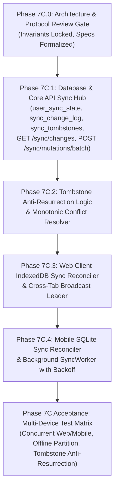

# 🏛️ OmniNovel Architecture Gate: Phase 7C.0 — Unified Multi-Device Sync Engine
> **Document Status:** CANONICAL SPECIFICATION & ARCHITECTURAL INVARIANT LOCK  
> **Milestone:** Phase 7C — Task 7C.0  
> **Target Subsystems:** `services/api`, `packages/shared`, `apps/web`, `apps/mobile`  
> **Date:** 2026-10-28  
> **Author:** OmniNovel Engineering Core

---

## 1. Executive Summary & Design Philosophy

OmniNovel phục vụ trải nghiệm đọc truyện đa phương thức (Webtoon, Manga, Light Novel) đồng thời trên Trình duyệt Web (Next.js) và Thiết bị Di động (Flutter). Khi người dùng sở hữu nhiều thiết bị (hoặc mở nhiều tab trình duyệt), trạng thái thư viện cá nhân (đánh dấu trang, lịch sử, tiến độ đọc từng trang/từng block, cài đặt đọc) phải đạt trạng thái **Eventually Consistent** tin cậy, không mất mát dữ liệu, và không bị sai lệch khi môi trường mạng chập chờn hoặc ngoại tuyến (offline).

```
                  ┌─────────────────────────────────────────────────────────┐
                  │                 Core API (PostgreSQL SSoT)               │
                  │   user_sync_state (current_sync_revision = 10425)       │
                  │   sync_change_log (Server Revisions 1..10425)           │
                  │   sync_tombstones (Tombstone Horizon: 90 Days)          │
                  └────────────────────────────┬────────────────────────────┘
                                               │
                               Bi-Directional Delta Protocol
                          (Pull /changes ── Push /mutations/batch)
                                               │
                       ┌───────────────────────┴───────────────────────┐
                       ▼                                               ▼
         ┌───────────────────────────┐                   ┌───────────────────────────┐
         │     Next.js Web Client    │                   │     Flutter Mobile App    │
         │   Local IndexedDB Replica │                   │    Local SQLite Replica   │
         │   clientId: uuid-web-tab1 │                   │   clientId: uuid-mob-ph1  │
         │   lastRevision: 10425     │                   │   lastRevision: 10425     │
         │   BroadcastChannel Leader │                   │   Background SyncWorker   │
         └───────────────────────────┘                   └───────────────────────────┘
```

---

## 2. Khóa 5 Bất Biến Cốt Lõi (5 Non-Negotiable Invariants)

| # | Trụ cột (Pillar) | Định nghĩa & Bất biến kỹ thuật | Cơ chế bảo vệ (Guard Mechanism) |
|---|---|---|---|
| **P1** | **Monotonic Server Ordering** | Server là cơ quan phân giải trật tự thời gian logic duy nhất. Mọi biến đổi được gán một số nguyên `BIGINT` tăng đơn điệu (`revision`). Tuyệt đối **không tin tưởng đồng hồ thiết bị (Zero Wall-Clock Dependency)** để quyết định trật tự sự kiện. | `user_sync_state.current_sync_revision` được cấp phát nguyên tử qua `FOR UPDATE` / `pg_advisory_xact_lock`. |
| **P2** | **Strict Idempotency** | Mọi mutation từ client được định danh duy nhất bởi bộ ba `(userId, clientId, mutationId)`. Khi mạng rớt khiến client retry nhiều lần, server nhận diện và trả kết quả đã xử lý (deduplicated), không bao giờ lặp side-effects. | Ràng buộc duy nhất PostgreSQL: `UNIQUE (user_id, client_id, mutation_id)`. Trả mã `DEDUPLICATED` kèm assigned revision ban đầu. |
| **P3** | **Domain-Specific Convergence** | Xung đột không giải quyết chung chung kiểu mù quáng; mỗi miền dữ liệu (`BOOKMARK`, `PROGRESS`, `HISTORY`, `PREFERENCE`, `FOLLOW`) tuân thủ quy tắc riêng biệt về tính bảo toàn tiến độ và ý định người dùng. | State machine phân giải xung đột tại Backend: Monotonic Forward Progress, Commutative History Accumulation, Mode-Aware Anchor Matching. |
| **P4** | **Device Identity & Topology** | Tách bạch 3 khái niệm định danh: (1) `userId` (chủ sở hữu dữ liệu); (2) `sessionId` (phiên đăng nhập JWT/Redis); (3) `clientId` (bản sao lưu trữ cục bộ độc lập). Trên Web, các tab phối hợp qua `BroadcastChannel` hoặc Web Lock để tránh xung đột nội bộ. | Sinh `clientId` UUIDv4 một lần khi khởi tạo kho lưu trữ cục bộ. Lưu `clientId` bền vững tại client storage (`meta` store / `sync_metadata`). |
| **P5** | **Tombstones & Anti-Resurrection** | Khi một thực thể bị xóa, server ghi nhận một Tombstone với revision tương ứng. Thiết bị cũ/ngoại tuyến gửi lại snapshot cũ không bao giờ được phép làm "sống lại" thực thể đã xóa. Khách hàng quá hạn (> 90 ngày) buộc phải Full Resync. | Rà soát `sync_tombstones` trước mọi `UPSERT`: nếu `tombstone.revision > mutation.baseServerRevision` ➔ Lập tức từ chối `REJECTED_TOMBSTONE`. |

---

## 3. Chi Tiết Kiến Trúc 5 Trụ Cột

### 3.1. Trụ Cột 1: Thứ Tự & Cấp Phát Phiên Bản Tuần Tự (Ordering & Server Revision)

#### Bản chất kỹ thuật:
- Đồng hồ thiết bị (Client Wall Clock) luôn có sai số (Clock Skew, người dùng chỉnh giờ thủ công, timezone lệch). Do đó, `clientCreatedAt` và `deviceTimestamp` chỉ có giá trị **audit/telemetry**, tuyệt đối **không dùng để xác định bản ghi nào mới hơn**.
- Mỗi người dùng có một dãy số phiên bản độc lập: `current_sync_revision` bắt đầu từ `0`.
- Khi client gửi lên một batch mutations:
  1. Transaction mở và khóa hàng của user trong bảng `user_sync_state`:
     ```sql
     SELECT current_sync_revision FROM user_sync_state WHERE user_id = $1 FOR UPDATE;
     ```
  2. Với mỗi mutation hợp lệ được chấp nhận (không bị deduplicate hoặc reject):
     - `current_sync_revision = current_sync_revision + 1`
     - Lưu bản ghi vào `sync_change_log` với `revision = current_sync_revision`.
     - Cập nhật bảng dữ liệu thực tế (`bookmarks`, `reading_progress`, v.v.).
  3. Cập nhật lại `user_sync_state.current_sync_revision` và commit transaction.

#### Tính nhân quả (Causality Tracking via `baseServerRevision`):
- Khi client tạo mutation, nó bắt buộc phải đính kèm `baseServerRevision` (số revision mới nhất mà client đó đã kéo về từ server trước thời điểm sinh mutation).
- Server dùng `baseServerRevision` để xác định ngữ cảnh của client khi đưa ra quyết định:
  - Nếu `baseServerRevision == serverRevision`: Zero-lag mutation (áp dụng trơn tru).
  - Nếu `baseServerRevision < serverRevision`: Concurrent mutation (server kiểm tra xem giữa `baseServerRevision` và `serverRevision` có mutation nào xung đột trên cùng `entityId` không).

---

### 3.2. Trụ Cột 2: Tính Khả Trùng & Khả Năng Thử Lại (Idempotency & Replay Safety)

#### Định danh Mutation:
```typescript
export interface ClientMutation {
  clientId: string;           // UUIDv4 định danh instance client (vd: thiết bị A, tab B)
  mutationId: string;         // UUIDv4 do client sinh cho duy nhất một hành động
  domain: 'BOOKMARK' | 'PROGRESS' | 'HISTORY' | 'PREFERENCE' | 'FOLLOW';
  entityId: string;           // Định danh thực thể (vd: storyId hoặc storyId:chapterId)
  operation: 'UPSERT' | 'DELETE';
  baseServerRevision: number; // Server revision mới nhất client đã biết
  payload: Record<string, any>;
  clientCreatedAt: string;    // ISO-8601 (Chỉ dùng cho Audit Log)
}
```

#### Xử lý Lặp (Deduplication Logic):
Khi nhận một mutation có `(user_id, client_id, mutation_id)` đã tồn tại trong `sync_change_log`:
1. Server không thực hiện lại câu lệnh cập nhật dữ liệu nghiệp vụ.
2. Server tra cứu bản ghi cũ trong `sync_change_log` để lấy `assignedRevision` và kết quả ban đầu.
3. Trả về kết quả trong batch response:
   ```json
   {
     "mutationId": "b18f0a3e-...",
     "status": "DEDUPLICATED",
     "assignedRevision": 10420
   }
   ```
4. Client nhận status `DEDUPLICATED` sẽ xóa mutation này ra khỏi hàng đợi ngoại tuyến (`pending_mutations`), tương tự như khi nhận `APPLIED`.

---

### 3.3. Trụ Cột 3: Quy Tắc Phân Giải Xung Đột Theo Từng Miền (Domain-Specific Conflict Resolution)

#### A. Miền `BOOKMARK` (Đánh dấu truyện yêu thích)
- **Đặc tính:** Set membership (Thuộc hoặc Không thuộc tập hợp).
- **Thực thể:** `entityId = storyId`.
- **Quy tắc phân giải:**
  - `DELETE` luôn tạo Tombstone trong `sync_tombstones` và `sync_change_log`.
  - `UPSERT`:
    - Nếu có Tombstone cho `(user_id, 'BOOKMARK', storyId)` với `tombstone.revision > baseServerRevision`:
      ➔ **TỪ CHỐI TÁI SINH**: Trả về `REJECTED_TOMBSTONE`. Không thêm bookmark. Client nhận lệnh này sẽ xóa bookmark cục bộ.
    - Nếu không có Tombstone hoặc `baseServerRevision >= tombstone.revision`:
      ➔ Chấp nhận `UPSERT`. Xóa Tombstone cũ (nếu có). Lưu vào `bookmarks`. Trả về `APPLIED`.

#### B. Miền `PROGRESS` (Tiến độ đọc chương và trang)
- **Đặc tính:** Monotonic Forward Reading with Explicit Rewind.
- **Thực thể:** `entityId = storyId`.
- **Payload:**
  - `chapterId`: UUID chapter đang đọc.
  - `chapterIndex` / `chapterNumber`: Thứ tự chương trong truyện.
  - `pageIndex`: Trang đọc hiện tại (1-based, áp dụng Manga Paged).
  - `progressPercentage`: Phần trăm đọc (0.0 - 100.0).
  - `scrollPosition`: Tọa độ cuộn tính theo pixel (Webtoon).
  - `anchorBlockId` & `textOffset`: Neo đoạn văn (Light Novel).
  - `readingMode`: `WEBTOON` | `MANGA_PAGED` | `NOVEL`.
  - `forceRewind`: `boolean` (mặc định `false`).
- **Quy tắc phân giải:**
  - **Khác chương (Different Chapters):**
    - Nếu client gửi mutation chương cũ hơn chương đã lưu trên Cloud (ví dụ: Cloud đã đọc Chapter 20, Client ngoại tuyến gửi Chapter 15) và `forceRewind === false`:
      ➔ Trả về `CONFLICT_MERGED`: Cloud giữ nguyên tiến độ Chapter 20, nhưng vẫn ghi nhận Chapter 15 vào lịch sử đọc (`chapter_read_states`).
    - Nếu `forceRewind === true` (người dùng cố tình bấm "Đọc lại từ đầu / Đọc lại chương cũ"):
      ➔ Chấp thuận cập nhật về Chapter cũ.
  - **Cùng chương (Same Chapter):**
    - Nếu cùng một chương: Áp dụng quy tắc giá trị lớn hơn cho tiến độ (`MAX(incoming.progressPercentage, cloud.progressPercentage)` hoặc `MAX(incoming.pageIndex, cloud.pageIndex)`).
    - Đồng thời giữ nguyên metadata định vị tương ứng với reading mode (anchorBlockId cho Novel, scrollPosition cho Webtoon).

#### C. Miền `HISTORY` (Lịch sử đọc theo chương)
- **Đặc tính:** Commutative Append-Only Event Log.
- **Thực thể:** `entityId = storyId:chapterId`.
- **Quy tắc phân giải:**
  - Mọi sự kiện đọc chương hợp lệ đều cập nhật `chapter_read_states`.
  - Nếu đã có bản ghi đọc chương đó: Cập nhật `max_progress_percentage = MAX(current, incoming)`, `last_read_at = NOW()`.
  - Nếu `progressPercentage >= 95.0%` hoặc trang cuối: Cập nhật `completed_at` (giữ nguyên timestamp hoàn thành đầu tiên, không ghi đè).

#### D. Miền `PREFERENCE` (Cài đặt hiển thị & Đọc)
- **Đặc tính:** Key-Value Config (theme, reader mode, text size, font family).
- **Thực thể:** `entityId = preferenceKey` (vd: `reader.font_size`).
- **Quy tắc phân giải:**
  - Last-Write-Wins (LWW) dựa trên Server Revision tiếp nhận.

#### E. Miền `FOLLOW` (Theo dõi nhận thông báo)
- **Đặc tính:** Set membership với notification flag.
- **Thực thể:** `entityId = storyId`.
- **Quy tắc phân giải:**
  - Tương tự `BOOKMARK`, bảo vệ bằng Tombstone để tránh thiết bị ngoại tuyến tự động bật lại thông báo cho truyện đã unfollow.

---

### 3.4. Trụ Cột 4: Định Danh Thiết Bị & Cấu Trúc Bản Sao (Device Identity & Topology)

```
User Account (userId: UUID)
    ├── Auth Session 1 (sessionId / sid: UUID) ── Mobile Device (clientId: UUID)
    │                                              └── SQLite Replica (v4)
    └── Auth Session 2 (sessionId / sid: UUID) ── Web Browser Profile (clientId: UUID)
                                                   ├── Tab 1 (Follower)
                                                   ├── Tab 2 (BroadcastChannel Leader)
                                                   └── IndexedDB Replica (v2)
```

1. **Sinh và Lưu Trữ `clientId`:**
   - Mỗi cài đặt ứng dụng (Mobile App) hoặc profile trình duyệt (Web Storage) sinh một `clientId` ngẫu nhiên chuẩn UUIDv4 trong lần chạy đầu tiên.
   - `clientId` được lưu trữ vĩnh viễn trong:
     - Web: IndexedDB bảng `sync_meta` key `client_instance_id`.
     - Mobile: SQLite bảng `sync_metadata` key `client_instance_id`.
2. **Điều Phối Đa Tab Trên Web (Cross-Tab Concurrency):**
   - Khi mở nhiều tab trên cùng một trình duyệt, tất cả các tab chia sẻ chung một cơ sở dữ liệu IndexedDB và cùng một `clientId`.
   - Để tránh tình trạng 5 tab cùng lúc gửi 5 request push mutation giống nhau:
     - Sử dụng `navigator.locks.request('omninovel_sync_leader', ...)` hoặc kênh `BroadcastChannel('omninovel_sync_channel')`.
     - Tab Leader duy nhất chịu trách nhiệm kích hoạt network sync (pull/push).
     - Khi Leader sync thành công và cập nhật IndexedDB, nó phát tin nhắn broadcast để các tab còn lại re-render UI.
3. **Phân Tách Quyền Lực (Security Boundaries):**
   - API xác thực người dùng qua JWT `req.user.id`.
   - Server kiểm tra: Mọi mutation trong batch gửi lên phải thuộc về `req.user.id`. Nếu mutation có `userId` không khớp với JWT ➔ Lập tức trả lỗi `403 Forbidden`.

---

### 3.5. Trụ Cột 5: Cơ Chế Tombstone, Chống Tái Sinh & Dọn Dẹp Định Kỳ (Tombstone Retention & GC Horizon)

#### 1. Lỗi Cổ Điển: Zombie Data Resurrection (Phục Sinh Dữ Liệu Rác)
Nếu một thiết bị Android bị tắt nguồn trong 3 tháng, trong thời gian đó người dùng xóa 50 truyện khỏi thư viện trên máy tính. Khi bật lại điện thoại, nếu không có cơ chế chặn, ứng dụng sẽ gửi 50 truyện này lên server và biến toàn bộ thao tác xóa của người dùng thành vô nghĩa.

#### 2. Kiến Trúc Bảng `sync_tombstones`:
```sql
CREATE TABLE sync_tombstones (
    user_id UUID NOT NULL REFERENCES users(id) ON DELETE CASCADE,
    domain VARCHAR(32) NOT NULL,
    entity_id VARCHAR(128) NOT NULL,
    deleted_at_revision BIGINT NOT NULL,
    created_at TIMESTAMP WITH TIME ZONE DEFAULT CURRENT_TIMESTAMP,
    PRIMARY KEY (user_id, domain, entity_id)
);

CREATE INDEX idx_sync_tombstones_revision ON sync_tombstones(user_id, deleted_at_revision ASC);
```

#### 3. Cửa Sổ Giữ Lệnh Xóa (Tombstone Retention Horizon):
- OmniNovel quy định **Tombstone Retention Window = 90 ngày**.
- Toàn bộ tombstones được bảo lưu tối thiểu 90 ngày. Sau 90 ngày, một cronjob tự động dọn dẹp các tombstone cũ hơn 90 ngày và tính toán lại `min_active_sync_revision` cho hệ thống.

#### 4. Xử Lý Thiết Bị Ngoại Tuyến Quá Hạn (Expired Client Protocol):
- Khi client gửi `GET /api/v1/sync/changes?after=:revision`:
  - Server kiểm tra: Nếu `:revision < user_sync_state.min_active_revision` (nghĩa là client đã ngoại tuyến lâu hơn cửa sổ bảo vệ của Tombstone):
    ➔ Server trả về mã lỗi HTTP `410 Gone` với body:
    ```json
    {
      "statusCode": 410,
      "errorCode": "SYNC_REVISION_EXPIRED",
      "message": "Client sync revision is older than tombstone retention horizon. Full resync required.",
      "minActiveRevision": 8500,
      "currentServerRevision": 10425
    }
    ```
- **Quy trình phục hồi của Client khi gặp `SYNC_REVISION_EXPIRED`:**
  1. Client tạm thời phong tỏa hàng đợi `pending_mutations`.
  2. Xóa sạch dữ liệu cache thư viện cục bộ (local replica cache).
  3. Kéo toàn bộ Cloud Snapshot mới nhất về lưu vào local storage.
  4. Lấy các mutation còn sót lại trong `pending_mutations`, gán lại `baseServerRevision = currentServerRevision`, và đẩy lại lên server.

---

## 4. Đặc Tả Lược Đồ Cơ Sở Dữ Liệu PostgreSQL

```sql
-- 1. Quản lý trạng thái revision tổng của từng người dùng
CREATE TABLE IF NOT EXISTS user_sync_state (
    user_id UUID PRIMARY KEY REFERENCES users(id) ON DELETE CASCADE,
    current_sync_revision BIGINT NOT NULL DEFAULT 0,
    min_active_revision BIGINT NOT NULL DEFAULT 0,
    last_synced_at TIMESTAMP WITH TIME ZONE DEFAULT CURRENT_TIMESTAMP,
    created_at TIMESTAMP WITH TIME ZONE DEFAULT CURRENT_TIMESTAMP
);

-- 2. Nhật ký thay đổi để kéo Delta (Sync Change Log)
CREATE TABLE IF NOT EXISTS sync_change_log (
    id BIGSERIAL PRIMARY KEY,
    user_id UUID NOT NULL REFERENCES users(id) ON DELETE CASCADE,
    revision BIGINT NOT NULL,
    client_id VARCHAR(64) NOT NULL,
    mutation_id UUID NOT NULL,
    domain VARCHAR(32) NOT NULL, -- 'BOOKMARK', 'PROGRESS', 'HISTORY', 'PREFERENCE', 'FOLLOW'
    entity_id VARCHAR(128) NOT NULL,
    operation VARCHAR(16) NOT NULL, -- 'UPSERT', 'DELETE'
    payload JSONB NOT NULL DEFAULT '{}'::jsonb,
    created_at TIMESTAMP WITH TIME ZONE DEFAULT CURRENT_TIMESTAMP,
    CONSTRAINT uq_sync_change_log_user_revision UNIQUE (user_id, revision),
    CONSTRAINT uq_sync_change_log_user_mutation UNIQUE (user_id, client_id, mutation_id)
);

CREATE INDEX IF NOT EXISTS idx_sync_change_log_pull 
    ON sync_change_log(user_id, revision ASC);

-- 3. Bảng Tombstone bảo vệ chống phục sinh dữ liệu
CREATE TABLE IF NOT EXISTS sync_tombstones (
    user_id UUID NOT NULL REFERENCES users(id) ON DELETE CASCADE,
    domain VARCHAR(32) NOT NULL,
    entity_id VARCHAR(128) NOT NULL,
    deleted_at_revision BIGINT NOT NULL,
    created_at TIMESTAMP WITH TIME ZONE DEFAULT CURRENT_TIMESTAMP,
    PRIMARY KEY (user_id, domain, entity_id)
);

CREATE INDEX IF NOT EXISTS idx_sync_tombstones_user_rev 
    ON sync_tombstones(user_id, deleted_at_revision ASC);
```

---

## 5. Đặc Tả Hợp Đồng Mạng & DTOs (TypeScript Contracts)

### 5.1. `POST /api/v1/sync/mutations/batch`

#### Request Body (`PushMutationsBatchDto`):
```typescript
export interface ClientMutationDto {
  clientId: string;           // UUIDv4 format
  mutationId: string;         // UUIDv4 format
  domain: 'BOOKMARK' | 'PROGRESS' | 'HISTORY' | 'PREFERENCE' | 'FOLLOW';
  entityId: string;           // String 1..128 chars
  operation: 'UPSERT' | 'DELETE';
  baseServerRevision: number; // Non-negative integer
  payload: Record<string, any>;
  clientCreatedAt: string;    // ISO-8601 date string
}

export interface PushMutationsBatchDto {
  mutations: ClientMutationDto[]; // Max 100 mutations per batch
}
```

#### Response Body (`PushMutationsBatchResponseDto`):
```typescript
export type MutationExecutionStatus = 
  | 'APPLIED'              // Áp dụng thành công, sinh revision mới
  | 'DEDUPLICATED'         // Đã từng xử lý trước đó, trả lại revision cũ
  | 'REJECTED_TOMBSTONE'   // Bị chặn vì đã có lệnh xóa mới hơn trên Cloud
  | 'CONFLICT_MERGED';     // Tiến độ được hòa trộn theo luật miền nghiệp vụ

export interface MutationResultItem {
  mutationId: string;
  status: MutationExecutionStatus;
  assignedRevision: number;
  message?: string;
}

export interface PushMutationsBatchResponseDto {
  processedCount: number;
  newServerRevision: number;
  results: MutationResultItem[];
}
```

---

### 5.2. `GET /api/v1/sync/changes`

#### Query Parameters:
- `after`: `number` (Bắt buộc, non-negative integer, ví dụ `10420`).
- `limit`: `number` (Tùy chọn, mặc định `100`, tối đa `500`).

#### Response Body (`SyncChangesResponseDto`):
```typescript
export interface SyncChangeItemDto {
  revision: number;
  domain: 'BOOKMARK' | 'PROGRESS' | 'HISTORY' | 'PREFERENCE' | 'FOLLOW';
  entityId: string;
  operation: 'UPSERT' | 'DELETE';
  payload: Record<string, any>;
  createdAt: string;
}

export interface SyncChangesResponseDto {
  currentServerRevision: number;
  hasMore: boolean;
  minActiveRevision: number;
  changes: SyncChangeItemDto[];
}
```

---

## 6. Trình Tự Thực Thi & Ma Trận Kiểm Thử (Phase 7C Implementation Plan)



### Tiêu Chuẩn Nghiệm Thu Kỹ Thuật (Acceptance Criteria Gate):
1. **Zero Data Loss on Concurrent Edits:** Khi thiết bị A đọc tiếp trang 20 và thiết bị B xóa bookmark trong lúc cả hai ngoại tuyến, sau khi kết nối lại, bookmark bị xóa và tiến độ trang 20 được bảo toàn.
2. **Anti-Resurrection Proof:** 100% các kịch bản stale client gửi `UPSERT` sau khi thực thể đã bị `DELETE` trên Cloud đều nhận `REJECTED_TOMBSTONE` và client tự làm sạch local replica.
3. **Idempotent Network Retries:** Khi gửi 10 lần cùng một payload `PushMutationsBatchDto` do giả lập rớt mạng HTTP, chỉ có 1 lần duy nhất sinh revision mới, 9 lần sau trả về `DEDUPLICATED` với số revision gốc.
4. **Clock Skew Resilience:** Cố tình chỉnh đồng hồ client chạy trước 1 năm hoặc chạy chậm 10 năm, hệ thống vẫn đồng bộ chính xác 100% dựa trên Server Revision.

---

> **Kết luận Phê Duyệt:** Tài liệu này là căn cứ tối cao (SSoT) để triển khai toàn bộ các Task của Phase 7C. Mọi mã nguồn tại backend (`services/api`), shared contracts (`packages/shared`), web (`apps/web`) và mobile (`apps/mobile`) đều bắt buộc phải tuân thủ nghiêm ngặt các bất biến và hợp đồng mạng đã định nghĩa ở trên.
