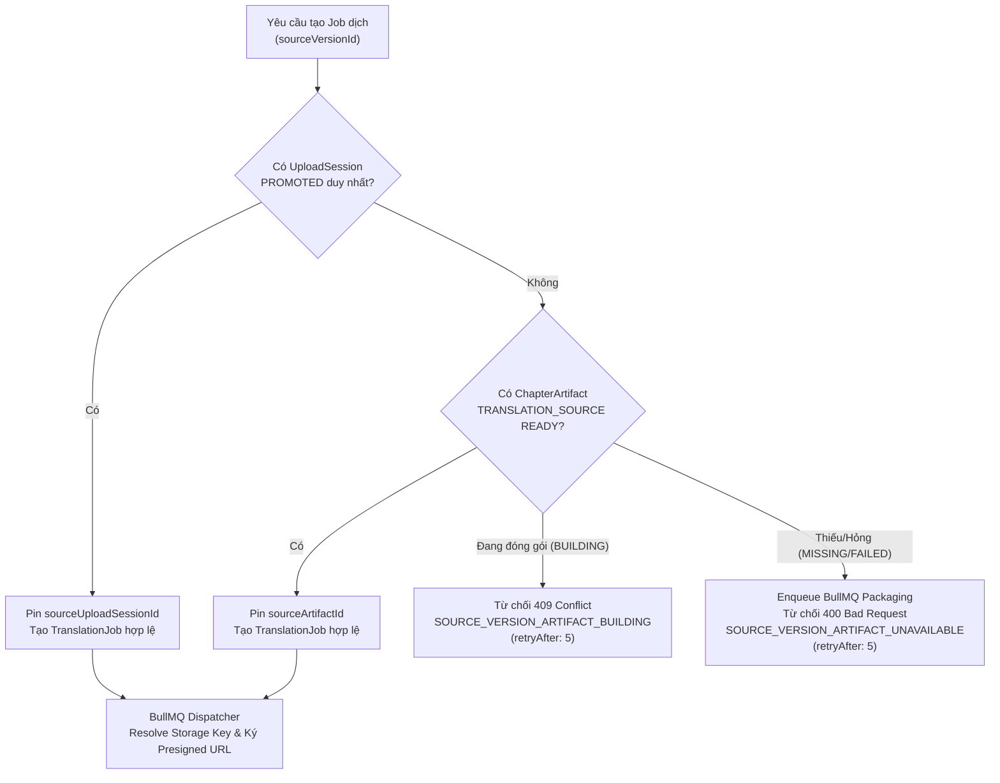

# 📱 Phase 5D: Lưu Trữ Offline (MOB-012) & Hoàn Thiện Nghiệm Thu — Kế Hoạch Kỹ Thuật Chi Tiết (Amended Baseline)

> **Trạng thái:** APPROVED / FROZEN BASELINE (Amended với 3 P0 + 2 P1)  
> **Tài liệu cha:** [plans/phases/phase_05_mobile_app.md](file:///e:/Workspace%202/Doctruyen_project/plans/phases/phase_05_mobile_app.md)  
> **Master Tracker:** [GitHub Issue #192](https://github.com/HIepNgoc2006/OmniNovel/issues/192)  
> **Backend Prerequisite:** [GitHub Issue #190](https://github.com/HIepNgoc2006/OmniNovel/issues/190) — *Canonical Reverse Packaging*  
> **Mobile Feature:** MOB-012 — *Offline Download Manager & Reader Storage Engine*  

---

## 1. TỔNG QUAN & MỤC TIÊU (EXECUTIVE SUMMARY)

Phase 5D là chặng cuối cùng của **Phase 5: Ứng dụng Di động OmniNovel (Flutter Android-First)**. Mục tiêu cốt lõi:
1. **Backend Core API ([Issue #190](https://github.com/HIepNgoc2006/OmniNovel/issues/190)):** Triển khai *Canonical Reverse Packaging Service* thông qua hàng đợi BullMQ bền vững (`chapter-packaging`) để tổng hợp các `MediaAsset`s rời rạc của các `ChapterVersion` cũ (legacy upload) thành các gói artifact chuẩn lưu trên MinIO/S3 qua `StorageService`. Giải quyết triệt để rào cản `#165` cho Translation Worker bằng cách thay thế nguồn fail-closed hợp lệ (không tạo dead jobs) và cung cấp endpoint tải gói offline cho Mobile.
2. **Mobile Client (MOB-012):** Xây dựng hạ tầng *Durable Download Manager* và *Offline Storage Engine* trên Flutter, cho phép độc giả tải chương truyện về máy, lưu trữ an toàn trong sandbox ứng dụng, và tự động chuyển đổi sang chế độ đọc ngoại tuyến (Offline Reader Mode) mượt mà 120Hz khi không có mạng Internet.
3. **Hardware Acceptance Gate:** Thực hiện nghiệm thu đo đạc phần cứng thực địa trên thiết bị Android vật lý (RAM 2–3GB và 4–6GB) nhằm chốt chuẩn RAM RSS $< 150\text{ MB}$ và Frame Budget 120Hz/90Hz/60Hz trước khi chuyển giao sang Phase 6.

---

## 2. SÁU BẤT BIẾN KIẾN TRÚC BẮT BUỘC (6 CORE AMENDED INVARIANTS)

```
┌───────────────────────────────────────────────────────────────────────────────────┐
│                      6 CORE AMENDED ARCHITECTURAL INVARIANTS                      │
├─────────────────────────┬─────────────────────────┬───────────────────────────────┤
│ 1. Exact-Version Bind   │ 2. Canonical Manifest   │ 3. Durable BullMQ Lifecycle   │
│ • chapterVersionId SSoT │ • Zero presigned URLs   │ • Queue 'chapter-packaging'   │
│ • Content SHA-256 hash  │ • Raw NOVEL_HTML SSoT   │ • Deterministic BullMQ jobId  │
│ • StorageService Bucket │ • Relative img src      │ • Ownership token + renewLease│
├─────────────────────────┼─────────────────────────┼───────────────────────────────┤
│ 4. Atomic Publish &     │ 5. DB / File Boundary   │ 6. Queue State Machine        │
│    Bidirectional Reconc │ • SQLite metadata only  │ • QUEUED➔DOWNLOADING➔VERIFYING│
│ • Upload S3 ➔ Atomic DB │ • App-Private Sandbox   │ • Crash recovery & idempotency│
│ • Staging➔Rename➔Commit │ • 120Hz Zero-CPU decrypt│ • Cancel purges .part & stage │
└─────────────────────────┴─────────────────────────┴───────────────────────────────┘
```

### Invariant 1: Exact-Version Artifact Identity & Storage Resolution
- Mọi gói artifact đóng gói (cả `TRANSLATION_SOURCE` và `OFFLINE_BUNDLE`) **BẮT BUỘC bind trực tiếp vào `chapterVersionId` (bất biến)**, tuyệt đối **KHÔNG bind vào `chapter.activeVersionId` (khả biến)**.
- Khi người dùng hoặc Editor cập nhật/thay đổi phiên bản active của chapter, các gói offline đã tải của version cũ vẫn toàn vẹn về mặt dữ liệu.
- Định danh tệp trên MinIO/S3 được chuẩn hóa:
  - Mobile Offline Bundle: `artifacts/chapters/:chapterId/versions/:chapterVersionId/offline-bundle.zip`
  - Translation Source: `artifacts/chapters/:chapterId/versions/:chapterVersionId/source-package.zip`
- **Tích hợp StorageService:** Tuyệt đối không tự khởi tạo S3 client riêng lẻ. Toàn bộ thao tác upload, presigned URL và resolve bucket phải thông qua `StorageService`. Bucket được phân giải tất định (`mangaBucket` cho Comic/Manga vs `novelBucket` cho Novel) dựa trên `story.mediaFormat`.
- Mỗi artifact hoàn chỉnh phải có **SHA-256 hash** và **kích thước byte chính xác (`fileSizeBytes`)** được lưu cố định trong CSDL.

### Invariant 2: Canonical Manifest & Raw HTML SSoT (Không Có Parser Thứ Hai)
- Tệp `manifest.json` nằm tại thư mục gốc bên trong gói ZIP offline.
- **Ràng buộc nghiêm ngặt:** Tuyệt đối **KHÔNG chứa Signed URLs có hạn sử dụng** bên trong bundle offline! Mọi tệp tin hình ảnh/nội dung đều được tham chiếu theo **đường dẫn tương đối cục bộ (relative path)** bên trong tệp nén (`pages/001.webp`, `content.html`, `illustrations/img_01.webp`).
- **Tiểu thuyết (Novel) — Không dùng parser Backend thứ hai:**
  - Backend **KHÔNG tự sinh `NovelAnchorBlock[]`** trong manifest để tránh phân mảnh logic và lệch chuẩn với parser mobile.
  - Bundle Novel chứa tệp gốc **`content.html`** chuẩn canonical.
  - Khi đóng gói, Backend chỉ quét và viết lại (rewrite) các đường dẫn ảnh minh họa `` sang đường dẫn tương đối nội bộ `illustrations/...` đã được nén kèm trong ZIP.
  - Mobile Offline Reader sử dụng **chính `NovelContentParser` hiện hữu** trên file `content.html` cục bộ để sinh anchor blocks, bảo toàn 100% ruby, inline image, và typography semantics khi bật Airplane Mode.
- Cấu trúc chuẩn của `manifest.json` (Schema Version 1):
  ```json
  {
    "schemaVersion": 1,
    "bundleType": "OFFLINE_READER",
    "chapterId": "c0a80123-4567-89ab-cdef-0123456789ab",
    "chapterVersionId": "d0b90123-4567-89ab-cdef-0123456789cd",
    "storyId": "a0a10123-4567-89ab-cdef-0123456789ef",
    "storyTitle": "Thần Đạo Đan Tôn",
    "chapterNumber": "150",
    "chapterTitle": "Đột phá Cảnh giới",
    "mediaFormat": "COMIC",
    "publicationFormat": "WEBTOON",
    "language": "vi",
    "versionNumber": 2,
    "versionType": "HUMAN_EDITED",
    "createdAt": "2026-09-24T14:00:00.000Z",
    "files": [
      {
        "path": "pages/001.webp",
        "assetId": "e0c10123-4567-89ab-cdef-0123456789aa",
        "mimeType": "image/webp",
        "size": 245100,
        "sha256": "e3b0c44298fc1c149afbf4c8996fb92427ae41e4649b934ca495991b7852b855",
        "sortOrder": 1,
        "width": 1080,
        "height": 2400
      }
    ],
    "novelMetadata": null
  }
  ```

### Invariant 3: Durable BullMQ Packaging & Concurrency Correctness
- **Durable BullMQ Work (Không dùng Background Promise):**
  - Tác vụ đóng gói được quản lý qua hàng đợi bền vững: queue name `chapter-packaging` với processor `ChapterPackagingProcessor`.
  - **Deterministic Job ID:** `jobId = pkg:${chapterVersionId}:${artifactType}`. BullMQ tự động từ chối trùng lặp job đang chờ/đang chạy.
  - Job options: `attempts: 3`, `backoff: { type: 'exponential', delay: 5000 }`, `removeOnComplete: true`.
- **Single-Flight & Ownership-Safe Lock:**
  - Nguồn sự thật duy nhất (SSoT) về tính duy nhất là **DB Unique Constraint `(chapter_version_id, artifact_type)`** kết hợp **BullMQ Deterministic Job ID**.
  - Redis lock (`lock:package:${chapterVersionId}:${artifactType}`) được sử dụng làm early guard với token ngẫu nhiên `uuidv4()`.
  - Worker duy trì heartbeat gia hạn lock (`renewLock/extendLease`) mỗi 30 giây trong suốt quá trình nén và upload file nặng. Khi hoàn tất hoặc lỗi, giải phóng lock bằng atomic compare-and-delete Lua script.
- **Phục hồi Trạng thái `BUILDING` Mồ Côi (Stall / Crash Recovery):**
  - Nếu worker hoặc pod chết bất ngờ giữa lúc đóng gói:
    - Bất kỳ bản ghi nào có trạng thái `BUILDING` nhưng `updated_at < NOW() - INTERVAL '15 minutes'` được coi là quá hạn (stale).
    - Bộ lắng nghe `onFailed / onStalled` của BullMQ hoặc request API tiếp theo sẽ tự động chuyển trạng thái `BUILDING` quá hạn này thành `FAILED` hoặc tự động tái kích hoạt đóng gói, tuyệt đối không để kẹt `BUILDING` vĩnh viễn.
- **Thống nhất Phản hồi API `POST /package`:**
  - Nếu trạng thái đã là `READY`: Trả về ngay `200 OK` kèm thông tin artifact (idempotent).
  - Nếu mới enqueue HOẶC tác vụ đang trong tiến trình `BUILDING`: Trả về ngay `202 Accepted` kèm `{ status: "BUILDING", retryAfter: 5 }`.
  - **Loại bỏ mã lỗi 409 Conflict** khi artifact đang được đóng gói hợp lệ.

### Invariant 4: Atomic Publish & Bidirectional Mobile Startup Reconciliation
- **Backend Atomic Publish:**
  1. Tổng hợp tệp từ S3 qua `StorageService` vào tệp ZIP tạm thời trên đĩa worker.
  2. Tính toán mã băm SHA-256 và kích thước byte thực tế.
  3. Upload tệp ZIP lên MinIO/S3 theo đúng canonical key.
  4. Thực hiện transaction CSDL chuyển trạng thái `chapter_artifacts` sang `READY` kèm `storageKey`, `sha256`, `fileSizeBytes`.
  5. Xóa tệp tạm thời trên worker.
  6. Nếu xảy ra lỗi: chuyển trạng thái `FAILED`, ghi rõ `errorMessage`, dọn sạch tệp mồ côi.
- **Mobile Atomic Promotion:**
  1. Stream tải gói về tệp tạm: `downloads/tmp/<chapterVersionId>.part`.
  2. Đối chiếu SHA-256 và `fileSizeBytes` với thông tin do Backend cung cấp. Nếu sai lệch: xóa tệp `.part` và ném lỗi `CHECKSUM_MISMATCH`.
  3. Giải nén vào thư mục staging: `offline/staging/<chapterVersionId>/`.
  4. Kiểm tra tệp `manifest.json` và SHA-256 các tệp con.
  5. **Atomic Rename/Promote:** Đổi tên thư mục staging thành thư mục chính thức `offline/installed/<chapterVersionId>/`.
  6. Thực thi transaction SQLite ghi nhận chương đã sẵn sàng (`status = 'READY'`).
  7. Xóa tệp `.part`.
- **Phục hồi Khởi Động Hai Chiều (Bidirectional Startup Reconciliation):**
  - Để đối phó với trường hợp app bị kill/crash **sau bước Rename nhưng trước khi SQLite commit**:
    1. *Thư mục `installed/<id>/` tồn tại nhưng SQLite KHÔNG có bản ghi `offline_chapters`:*
       Quét và verify tính toàn vẹn của `manifest.json` + SHA-256 các file con trong thư mục đó. Nếu hợp lệ $\rightarrow$ tự động phục hồi ghi vào SQLite (`status = 'READY'`); nếu tệp hỏng hoặc thiếu $\rightarrow$ xóa sạch thư mục mồ côi.
    2. *Bản ghi trong SQLite báo `READY` nhưng thư mục `installed/<id>/` hoặc tệp bên trong bị thiếu:*
       Thực thi fail-closed $\rightarrow$ lập tức xóa bản ghi `READY` khỏi SQLite để Reader không bị crash khi truy xuất.
    3. *Thư mục `staging/` hoặc tệp `.part` dở dang:*
       Tự động dọn dẹp sạch sẽ khi app khởi động lại.

### Invariant 5: Offline DB / File Boundary & Security Architecture
- **Ranh giới CSDL vs Hệ thống Tệp:**
  - **CSDL SQLite (`sqflite`):** Lưu trữ metadata cấu trúc, chỉ mục tìm kiếm offline, lịch sử đọc checkpoint offline, hàng đợi tải (`download_tasks`), và bảng map `(assetId, relativePath)`.
  - **Hệ thống tệp (Filesystem):** Lưu trữ tệp ảnh WebP, tệp JSON manifest, tệp HTML truyện chữ.
- **Bộ nhớ Sandbox & Chuẩn Bảo Mật:**
  - Toàn bộ nội dung ngoại tuyến được lưu trữ trong **Internal App-Private Storage Directory** (`context.filesDir` / `data/user/0/<package>/files/offline/`).
  - Phân quyền hệ điều hành `0700` ngăn chặn 100% các ứng dụng khác truy cập.
  - Phân vùng tự động được bảo vệ bởi Hardware File-Based Encryption (FBE) ở cấp OS/Keystore khi thiết bị khóa màn hình.
  - **Zero-CPU Decryption Overhead:** Đọc trực tiếp tệp ảnh từ App-Private Storage qua `FileImage` mà không phải gánh chi phí CPU giải mã AES theo từng frame cuộn, đảm bảo giữ vững **Frame Budget $< 8.33\text{ ms}$** (120Hz) và RAM working-set $< 150\text{ MB}$.

### Invariant 6: Queue State Machine & Crash Recovery
- Hàng đợi tải chương Mobile quản lý qua State Machine:
  $$\text{QUEUED} \longrightarrow \text{DOWNLOADING} \longrightarrow \text{VERIFYING} \longrightarrow \text{READY}$$
  Kèm các trạng thái ngắt/kết thúc: $\text{PAUSED}$, $\text{FAILED}$, $\text{CANCELLED}$.
- **Phục hồi sau Crash/Tắt App:**
  - Quét CSDL SQLite: các task đang ở `DOWNLOADING` hoặc `VERIFYING` chuyển sang `PAUSED`.
  - Cho phép tiếp tục tải (resume) qua HTTP `Range` header nếu máy chủ hỗ trợ.
- **Thao tác Hủy (Cancel):**
  - Kích hoạt Dio `CancelToken.cancel()`.
  - Xóa ngay lập tức file `.part` và thư mục staging tương ứng.
  - Cập nhật bản ghi trong SQLite thành `CANCELLED`.
- **Thử lại (Retry):**
  - Tái sử dụng ID task cũ, reset số byte đã tải về 0, chuyển trạng thái về `QUEUED`, không sinh trùng lặp bản ghi.

---

## 3. THAY THẾ NGUỒN FAIL-CLOSED #165 & QUẢN LÝ TRANSLATION JOBS

> [!IMPORTANT]
> **Quy Tắc Bất Biến:** Tuyệt đối **KHÔNG gỡ bỏ chốt chặn fail-closed của #165**, mà **thay thế nguồn hợp lệ** để không bao giờ tạo "dead jobs" bị rỗng `sourceDownloadUrl`.

### 3.1. Ràng Buộc Nguồn Hợp Lệ Duy Nhất (Canonical Source Mutual Exclusion)
Bảng `translation_jobs` được bổ sung trường `source_artifact_id UUID NULL REFERENCES chapter_artifacts(id)`.
Thiết lập Check Constraint đảm bảo **chính xác một nguồn artifact hợp lệ duy nhất**:
```sql
ALTER TABLE translation_jobs
  ADD COLUMN source_artifact_id UUID NULL REFERENCES chapter_artifacts(id) ON DELETE SET NULL;

ALTER TABLE translation_jobs
  ADD CONSTRAINT chk_translation_jobs_canonical_source
  CHECK (
    (source_upload_session_id IS NOT NULL AND source_artifact_id IS NULL) OR
    (source_upload_session_id IS NULL AND source_artifact_id IS NOT NULL) OR
    (source_upload_session_id IS NULL AND source_artifact_id IS NULL) -- Tương thích dữ liệu cũ
  );
```

### 3.2. Luồng Khởi Tạo Translation Job (`TranslationService.createJob()`)


- **Quy trình xử lý:**
  1. Nếu phiên bản nguồn có `UploadSession` trạng thái `PROMOTED` $\rightarrow$ Gán `sourceUploadSessionId`, khởi tạo `TranslationJob`.
  2. Nếu không có `UploadSession`, kiểm tra bảng `chapter_artifacts` với `artifact_type = 'TRANSLATION_SOURCE'`:
     - Nếu đã `READY` $\rightarrow$ Gán `sourceArtifactId`, khởi tạo `TranslationJob`.
     - Nếu đang `BUILDING` $\rightarrow$ Ném lỗi `ConflictException` với mã `SOURCE_VERSION_ARTIFACT_BUILDING`, meta `{ retryAfter: 5 }`.
     - Nếu `MISSING` hoặc `FAILED` $\rightarrow$ Tự động đưa tác vụ đóng gói vào hàng đợi BullMQ `chapter-packaging`, và ném lỗi `BadRequestException` với mã `SOURCE_VERSION_ARTIFACT_UNAVAILABLE`, meta `{ retryAfter: 5 }`.
  3. **Tuyệt đối KHÔNG tạo bản ghi `TranslationJob`** khi chưa có nguồn artifact đã `READY`.
  4. Trong `TranslationProcessor`: khi giải phóng context thực thi, processor đọc `sourceUploadSessionId` HOẶC `sourceArtifactId` để lấy canonical `storageKey`, sau đó gọi `StorageService.createInternalDownloadUrl()` ký presigned URL 3600s cung cấp cho AI Worker.

---

## 4. THIẾT KẾ CƠ SỞ DỮ LIỆU & LƯỢC ĐỒ (SCHEMA DESIGN)

### 4.1. Backend PostgreSQL: Bảng `chapter_artifacts` (Migration 17)
```sql
-- Migration: 1700000000017-AddChapterArtifactsAndJobSource.ts

CREATE TYPE chapter_artifact_type_enum AS ENUM ('OFFLINE_BUNDLE', 'TRANSLATION_SOURCE');
CREATE TYPE chapter_artifact_status_enum AS ENUM ('MISSING', 'BUILDING', 'READY', 'FAILED');

CREATE TABLE chapter_artifacts (
    id UUID PRIMARY KEY DEFAULT gen_random_uuid(),
    chapter_version_id UUID NOT NULL REFERENCES chapter_versions(id) ON DELETE CASCADE,
    artifact_type chapter_artifact_type_enum NOT NULL,
    status chapter_artifact_status_enum NOT NULL DEFAULT 'MISSING',
    storage_key VARCHAR(255) NULL,
    file_size_bytes BIGINT NULL,
    sha256_hash VARCHAR(64) NULL,
    manifest_metadata JSONB NULL,
    error_message TEXT NULL,
    created_at TIMESTAMPTZ NOT NULL DEFAULT NOW(),
    updated_at TIMESTAMPTZ NOT NULL DEFAULT NOW(),
    CONSTRAINT uq_chapter_version_artifact_type UNIQUE (chapter_version_id, artifact_type)
);

CREATE INDEX idx_chapter_artifacts_version_lookup ON chapter_artifacts(chapter_version_id, artifact_type);

-- Cập nhật translation_jobs ràng buộc canonical source
ALTER TABLE translation_jobs
  ADD COLUMN source_artifact_id UUID NULL REFERENCES chapter_artifacts(id) ON DELETE SET NULL;

ALTER TABLE translation_jobs
  ADD CONSTRAINT chk_translation_jobs_canonical_source
  CHECK (
    (source_upload_session_id IS NOT NULL AND source_artifact_id IS NULL) OR
    (source_upload_session_id IS NULL AND source_artifact_id IS NOT NULL) OR
    (source_upload_session_id IS NULL AND source_artifact_id IS NULL)
  );
```

### 4.2. Mobile SQLite: Lược đồ Lưu Trữ Ngoại Tuyến (Local SQLite Schema v1)
```sql
-- Quản lý các chương đã tải thành công
CREATE TABLE offline_chapters (
    chapter_version_id TEXT PRIMARY KEY,
    chapter_id TEXT NOT NULL,
    story_id TEXT NOT NULL,
    story_title TEXT NOT NULL,
    chapter_number TEXT NOT NULL,
    chapter_title TEXT,
    media_format TEXT NOT NULL, -- 'COMIC' | 'NOVEL'
    publication_format TEXT,
    installed_dir TEXT NOT NULL, -- Đường dẫn tương đối trong App-Private storage
    total_files INTEGER NOT NULL,
    total_bytes INTEGER NOT NULL,
    installed_at INTEGER NOT NULL, -- Epoch ms
    last_read_at INTEGER,          -- Epoch ms (phục vụ LRU eviction)
    manifest_json TEXT NOT NULL    -- Raw manifest backup
);

-- Quản lý tiến trình hàng đợi tải xuống
CREATE TABLE download_tasks (
    task_id TEXT PRIMARY KEY,
    chapter_version_id TEXT NOT NULL,
    chapter_id TEXT NOT NULL,
    story_id TEXT NOT NULL,
    story_title TEXT NOT NULL,
    chapter_number TEXT NOT NULL,
    media_format TEXT NOT NULL,
    status TEXT NOT NULL, -- 'QUEUED' | 'DOWNLOADING' | 'VERIFYING' | 'READY' | 'PAUSED' | 'FAILED' | 'CANCELLED'
    downloaded_bytes INTEGER NOT NULL DEFAULT 0,
    total_bytes INTEGER NOT NULL DEFAULT 0,
    progress_fraction REAL NOT NULL DEFAULT 0.0,
    download_url TEXT,
    sha256_hash TEXT,
    error_message TEXT,
    created_at INTEGER NOT NULL,
    updated_at INTEGER NOT NULL
);

-- Chỉ mục tối ưu truy vấn
CREATE INDEX idx_offline_chapters_story ON offline_chapters(story_id);
CREATE INDEX idx_offline_chapters_last_read ON offline_chapters(last_read_at);
CREATE INDEX idx_download_tasks_status ON download_tasks(status);
```

---

## 5. ĐẶC TẢ HỢP ĐỒNG API (API CONTRACTS & PROTOCOL)

### 5.1. Kiểm Tra Trạng Thái & Lấy URL Tải Về Artifact
- **Endpoint:** `GET /api/v1/chapters/:chapterId/versions/:versionId/artifact`
- **Query Params:** `?type=OFFLINE_BUNDLE` (mặc định) hoặc `?type=TRANSLATION_SOURCE`
- **Bảo mật:** `OptionalJwtAuthGuard` (hoặc `JwtAuthGuard` đối với private/draft chapter).
- **Phản hồi 200 OK (Artifact đã sẵn sàng):**
  ```json
  {
    "status": "READY",
    "artifactReady": true,
    "artifactType": "OFFLINE_BUNDLE",
    "chapterVersionId": "d0b90123-4567-89ab-cdef-0123456789cd",
    "downloadUrl": "https://storage.omninovel.local/omninovel-media/artifacts/chapters/...?X-Amz-Signature=...",
    "fileSizeBytes": 14502390,
    "sha256": "3a7b8c...",
    "expiresAt": "2026-09-24T15:00:00.000Z"
  }
  ```
- **Phản hồi 200 OK (Đang đóng gói hoặc chưa có):**
  ```json
  {
    "status": "BUILDING", // hoặc "MISSING" | "FAILED"
    "artifactReady": false,
    "artifactType": "OFFLINE_BUNDLE",
    "chapterVersionId": "d0b90123-4567-89ab-cdef-0123456789cd",
    "downloadUrl": null,
    "fileSizeBytes": null,
    "sha256": null,
    "retryAfter": 5
  }
  ```

### 5.2. Yêu Cầu Kích Hoạt Đóng Gói (Trigger Packaging)
- **Endpoint:** `POST /api/v1/chapters/:chapterId/versions/:versionId/package`
- **Headers:** `Authorization: Bearer <token>`
- **Body:** `{ "artifactType": "OFFLINE_BUNDLE" }`
- **Phản hồi:**
  - `200 OK`: Nếu artifact đã `READY` (idempotent), trả về thông tin artifact.
  - `202 Accepted`: Nếu mới enqueue HOẶC tác vụ đang trong tiến trình `BUILDING`, trả về `{ "status": "BUILDING", "retryAfter": 5 }`.
  - Tuyệt đối không ném `409 Conflict` chỉ vì tác vụ đang chạy.

### 5.3. Cập Nhật API Studio Chapter Versions ([Issue #190](https://github.com/HIepNgoc2006/OmniNovel/issues/190))
- **Endpoint:** `GET /api/v1/studio/chapters/:id/versions`
- Cập nhật DTO `StudioChapterVersionSummaryDto`:
  ```typescript
  export interface StudioChapterVersionSummaryDto {
    id: string;
    chapterId: string;
    versionNumber: number;
    versionType: ChapterVersionType;
    language: string;
    isPublished: boolean;
    sourceVersionId: string | null;
    createdAt: IsoDateString;
    artifactReady: boolean;
    artifactStatus: 'MISSING' | 'BUILDING' | 'READY' | 'FAILED';
  }
  ```

---

## 6. KẾ HOẠCH TRIỂN KHAI PHÂN RÃ (SUB-PHASES 5D.0 ➔ 5D.8)

### 📌 Phase 5D.0: Contract Freeze & DTO Parity
- [ ] Cập nhật `packages/shared/src/index.ts`: Bổ sung `ChapterArtifactType`, `ChapterArtifactStatus`, `ChapterArtifactDto`, `manifest.json` TypeScript interfaces.
- [ ] Bổ sung trường `artifactReady` và `artifactStatus` vào `StudioChapterVersionSummaryDto`.
- [ ] Định nghĩa mã lỗi chuẩn hóa: `ARTIFACT_NOT_READY`, `ARTIFACT_BUILD_FAILED`, `SOURCE_VERSION_ARTIFACT_BUILDING`, `SOURCE_VERSION_ARTIFACT_UNAVAILABLE`, `CHECKSUM_MISMATCH`, `STORAGE_QUOTA_EXCEEDED`.

### 📌 Phase 5D.1: Canonical Reverse Packaging ([Issue #190](https://github.com/HIepNgoc2006/OmniNovel/issues/190) - Core Backend API)
- [ ] **Migration 17:** Tạo bảng `chapter_artifacts`, cập nhật `translation_jobs` bổ sung `source_artifact_id` và check constraint canonical source.
- [ ] Tạo Entity TypeORM `ChapterArtifact` trong `services/api/src/modules/chapters/entities/chapter-artifact.entity.ts`.
- [ ] Thiết lập BullMQ Queue `chapter-packaging` và `ChapterPackagingProcessor`:
  - Deterministic `jobId = pkg:${chapterVersionId}:${artifactType}`.
  - Tích hợp `RedisService` atomic lock với ownership token + heartbeat `renewLock` mỗi 30s.
  - Gom các `MediaAsset`s theo thứ tự `sortOrder ASC`.
  - Tải stream qua `StorageService` (resolve đúng manga/novel bucket), đóng gói tệp ZIP chuẩn hóa kèm `manifest.json` (Comic) hoặc `content.html` rewrite relative img src (Novel).
  - Tính SHA-256 hash và kích thước byte. Upload qua `StorageService`.
  - Atomic update trạng thái `READY` trong PostgreSQL.
  - Cơ chế dọn dẹp `BUILDING` mồ côi (stale recovery > 15 phút).
- [ ] Cập nhật `TranslationService.createJob()`: Thay thế nguồn fail-closed hợp lệ (UploadSession hoặc READY ChapterArtifact), không bao giờ tạo dead jobs.
- [ ] Cập nhật `TranslationProcessor`: Hỗ trợ resolve `sourceArtifactId` để sinh `sourceDownloadUrl`.

### 📌 Phase 5D.2: Artifact Download & Readiness API
- [ ] Bổ sung endpoint `GET /api/v1/chapters/:chapterId/versions/:versionId/artifact` trả về URL presigned có chữ ký bảo mật từ `StorageService`.
- [ ] Bổ sung endpoint `POST /api/v1/chapters/:chapterId/versions/:versionId/package` enqueue BullMQ job và trả về 200/202 chuẩn hóa.
- [ ] Cập nhật `findVersionsForStudio` trong `ChaptersService` truy vấn trạng thái `chapter_artifacts` để trả về `artifactReady`.
- [ ] Bộ kiểm thử Unit & Integration Tests cho Backend Packaging (đạt 100% test coverage cho lifecycle `MISSING -> BUILDING -> READY`).

### 📌 Phase 5D.3: Mobile Durable Download Manager (Flutter Engine)
- [ ] Cập nhật `apps/mobile/pubspec.yaml`: Bổ sung `sqflite`, `path_provider`, `archive`, `crypto`, `path`.
- [ ] Khởi tạo CSDL SQLite `omninovel_offline.db` trong `core/storage/` với bảng `offline_chapters` và `download_tasks`.
- [ ] Xây dựng `DownloadQueueManager`:
  - Quản lý State Machine (`QUEUED -> DOWNLOADING -> VERIFYING -> READY`).
  - Hỗ trợ tải nền qua Dio stream tệp `.part`.
  - Hỗ trợ Pause, Resume, Cancel dọn sạch tệp tạm thời.
  - Tự động khôi phục hàng đợi khi app khởi động lại sau crash/kill.

### 📌 Phase 5D.4: Offline Bundle Installation & Bidirectional Integrity Verification
- [ ] Xây dựng `BundleInstaller`:
  - Kiểm tra mã băm SHA-256 của tệp `.part` trước khi giải nén.
  - Giải nén trong background Isolate (`compute`) chống đơ giao diện UI.
  - Xác thực cấu trúc tệp và `manifest.json`.
  - Thao tác Atomic Promotion (rename thư mục `staging` sang `installed`).
  - Ghi nhận trạng thái `READY` vào bảng `offline_chapters` trong SQLite transaction.
  - **Khởi động phục hồi 2 chiều:** Dọn thư mục mồ côi chưa commit và loại bỏ record rỗng file.

### 📌 Phase 5D.5: Reader Offline Resolution (Tích Hợp Trình Đọc)
- [ ] Cập nhật `WebtoonReader`: Khi chapter đã có trong `offline_chapters`, nạp trực tiếp danh sách tệp từ `FileImage(File(pagePath))`, bỏ qua gọi API presigned URL.
- [ ] Cập nhật `MangaPagedReader`: Tương thích hoàn toàn với chế độ đọc offline từ local storage.
- [ ] Cập nhật `NovelReader`: Nạp raw `content.html` từ offline storage vào chính `NovelContentParser` hiện hữu, nạp ảnh minh họa cục bộ.
- [ ] Đồng bộ tiến độ đọc offline: Lưu checkpoint ngoại tuyến và tự động đẩy lên Core API khi có mạng.

### 📌 Phase 5D.6: Quản Lý Dung Lượng, Eviction & Cách Ly Người Dùng
- [ ] Giới hạn dung lượng bộ nhớ tải về (Storage Quota): Cảnh báo khi bộ nhớ thiết bị còn trống dưới 200MB.
- [ ] Tính năng Xóa thủ công từng chương hoặc toàn bộ bộ truyện đã tải.
- [ ] Chiến lược LRU Eviction: Tùy chọn tự động dọn dẹp các chương cũ nhất khi chạm trần dung lượng người dùng thiết lập.
- [ ] Cô lập người dùng: Phân vùng dữ liệu tải theo `userId` (hoặc cấu hình dùng chung giữa các user trên cùng thiết bị nhưng bảo vệ bookmark cá nhân).

### 📌 Phase 5D.7: Studio Quick-Approval Action Sheet (Polish - Non-blocking)
- [ ] Xây dựng Bottom Sheet / Dialog xác nhận duyệt nhanh bản dịch AI cho Editor/Owner khi job dịch hoàn tất.
- [ ] Cho phép xem nhanh so sánh bản dịch gốc và kích hoạt ghi đè bản dịch mà không cần mở toàn bộ Web Studio.

### 📌 Phase 5D.8: Nghiệm Thu Thiết Bị Vật Lý & Hoàn Tất Phase 5
- [ ] Chạy ma trận kiểm thử tương thích Android (Android 7.0 Nougat $\rightarrow$ Android 16).
- [ ] Tiến hành đo đạc thực địa trên thiết bị Android vật lý (Low-End 2–3GB RAM & Mid-Range 4–6GB RAM).
- [ ] Lập báo cáo đo đạc phần cứng `phase_5d_hardware_evidence.md` xác nhận RAM RSS $< 150\text{ MB}$, Frame Budget 120Hz/90Hz/60Hz.
- [ ] Khóa chính thức Baseline hoàn thành **Phase 5 Mobile App**.

---

## 7. TIÊU CHUẨN NGHIỆM THU THEO CÁC GATES (8 VERIFICATION GATES)

| Gate | Tiêu Chí Kiểm Tra (Acceptance Criteria) | Công Cụ Xác Minh |
| :--- | :--- | :--- |
| **Gate 1: Schema & Migration** | Migration 17 chạy up/down không lỗi; bảng `chapter_artifacts` có unique key `(chapter_version_id, artifact_type)` và check constraint canonical source trên `translation_jobs`. | TypeORM Migration CLI + Jest |
| **Gate 2: Exact-Version Identity** | Bundle bind đúng `chapterVersionId`; khi `activeVersionId` của chapter thay đổi, artifact của version cũ không bị ghi đè hay mất dữ liệu; bucket được resolve đúng qua `StorageService`. | Backend Integration Tests |
| **Gate 3: Durable BullMQ Single-Flight** | 5 requests đóng gói đồng thời trên cùng 1 version chỉ tạo đúng 1 BullMQ job (`jobId` trùng lặp được deduplicate), cả 5 callers đều nhận phản hồi hợp lệ (200 hoặc 202); không phát sinh 409 Conflict. | BullMQ Test Suite + Supertest |
| **Gate 4: Atomic Promotion & Crash Points** | Giả lập crash giữa lúc rename thư mục `staging ➔ installed` và SQLite commit: khi khởi động lại, phục hồi 2 chiều tự động verify và dọn dẹp hoặc sync bản ghi; mã băm SHA-256 sai lệch lập tức bị từ chối; không có trạng thái "READY giả". | Mobile Unit & Isolation Tests |
| **Gate 5: App-Private Sandbox** | Tệp tải về nằm hoàn toàn trong internal storage (`files/offline`), không lưu bừa bãi ra Public External Storage; phân quyền an toàn `0700`. | Flutter Tests & Android Inspect |
| **Gate 6: Offline Reader Resolution** | Bật Airplane Mode (ngắt toàn bộ mạng); mở các chương đã tải: Webtoon/Manga/Novel hiển thị 100% nội dung (kể cả ảnh minh họa tiểu thuyết), 0 request mạng; `NovelContentParser` hoạt động chuẩn xác. | Mock Network & Integration Tests |
| **Gate 7: Queue State & Recovery** | Giả lập crash app khi đang tải: khởi động lại app chuyển trạng thái `PAUSED`, hủy task dọn sạch `.part` và thư mục staging. | Mobile State Machine Tests |
| **Gate 8: Physical Hardware Metrics** | Đo đạc trên thiết bị Android thật: RAM working-set $< 150\text{ MB}$, P90 Frame time đạt chuẩn tần số quét màn hình. | ADB dumpsys meminfo & GFXInfo |
