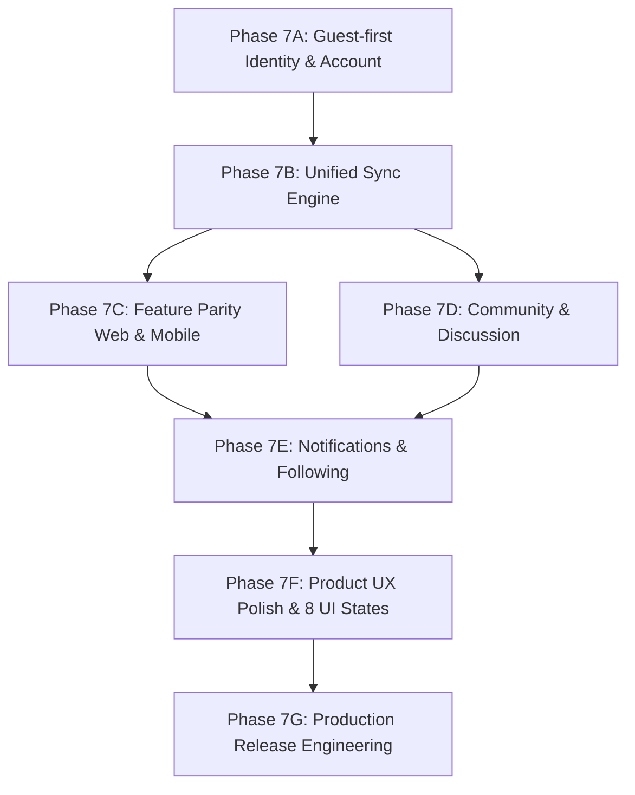

# 🚀 Phase 7: OmniNovel Product Completion Roadmap

> **Chuyển dịch mục tiêu:** Đóng lại phạm vi đồ án học thuật cũ (Phase 1 → Phase 6 đã hoàn thành các mục tiêu chấm điểm). Chính thức mở **Phase 7** với tư cách là **Roadmap Hoàn Thiện Sản Phẩm Thực Tế (Commercial-Grade Product)**.

---

## 🏛️ 1. Kiến Trúc 3 Tầng Quyền Sử Dụng (Tiered Access Architecture)

OmniNovel phân tách 3 lớp quyền rõ ràng:

| Quyền hạn | Đọc & Tìm kiếm | Bookmark / Lịch sử / Tiến độ | Đồng bộ Web ↔ App | Gamification / Thưởng | Studio Dịch AI / Admin |
|---|---|---|---|---|---|
| **Guest (Khách)** | ✅ Miễn phí | ✅ Local-first (SQLite / IndexedDB) | ❌ Không | ❌ Hoặc preview local | ❌ |
| **Account (Thành viên)** | ✅ Miễn phí | ✅ PostgreSQL Canonical SSoT | ✅ Đa thiết bị realtime/background | ✅ Tích luỹ OmniCoin, Missions | Theo RBAC gán quyền |
| **Editor / Admin** | ✅ | ✅ SSoT | ✅ | ✅ | ✅ Studio Pipeline & Quản trị |

### 💡 Nguyên tắc then chốt: Guest KHÔNG tạo DB User rác
- Không tạo user nặc danh vào bảng `users` của PostgreSQL khi khách ghé thăm website hoặc mở app lần đầu (tránh bot, crawler, duyệt web ẩn danh làm rác database).
- **Guest = Local-first**:
  - Web: Lưu trữ qua IndexedDB / LocalStorage với Repository pattern trừu tượng (`LocalLibraryRepository`).
  - Mobile: Lưu trữ qua SQLite / SharedPreferences cục bộ.
- Khi người dùng bấm Đăng ký hoặc Đăng nhập, client kích hoạt luồng **Guest State Migration**:
  - Gọi endpoint: `POST /api/v1/account/import-guest-state`
  - Merge dữ liệu an toàn theo quy tắc Deterministic Conflict Resolution (LWW - Last-Write-Wins dựa trên `updatedAt` / Epoch Monotonic). Sau khi merge xong, tài khoản trên cloud chính thức trở thành SSoT (Single Source of Truth).

---

## 🗺️ 2. Danh Mục Các Phân Đoạn (Phase 7A → Phase 7G)

---

## 📦 Phase 7A — Guest-first Identity & Account Lifecycle
**Mục tiêu:** Mở rộng hệ thống Auth hiện có thành vòng đời tài khoản toàn diện, hỗ trợ Guest Mode và cơ chế di chuyển dữ liệu Guest → Account.

- [ ] **7A.1. Shared Contracts & DTOs (`@omninovel/shared`)**
  - [ ] Schema `GuestStateExportDto`: Bookmarks, ReadingProgress, ReadingHistory, ReaderPreferences, RecentSearches.
  - [ ] Schema `ImportGuestStateResponseDto`: Số lượng mục đã merge, xung đột đã giải quyết, timestamp đồng bộ mới nhất.
  - [ ] Định nghĩa quy tắc merge LWW (`guest.updatedAt > server.updatedAt` -> guest thắng, giữ nguyên anti-resurrection epoch).
- [ ] **7A.2. Backend Core API Migration Endpoint (`services/api`)**
  - [ ] Thêm `POST /api/v1/account/import-guest-state` (bảo vệ bởi `JwtAuthGuard`).
  - [ ] Service thực hiện idempotent merge vào PostgreSQL (`ReadingProgress`, `Bookmark`, `ReadingHistory`).
  - [ ] Thêm các endpoint quản lý tài khoản còn thiếu:
    - [ ] `POST /api/v1/auth/change-password`
    - [ ] `POST /api/v1/auth/forgot-password` & `POST /api/v1/auth/reset-password`
    - [ ] `GET /api/v1/account/sessions` & `DELETE /api/v1/account/sessions/:id` (Quản lý thiết bị đăng nhập)
    - [ ] `DELETE /api/v1/account` (Quyền xóa tài khoản theo chuẩn GDPR/CCPA)
    - [ ] `GET /api/v1/account/export-data` (Xuất toàn bộ dữ liệu cá nhân dạng JSON)
- [ ] **7A.3. Web Client Guest-first Engine (`apps/web`)**
  - [ ] `LocalLibraryRepository` sử dụng IndexedDB/LocalStorage độc lập với Auth state.
  - [ ] Cập nhật Reader (`novel-reader`, `manga-reader`) đọc và ghi tiến độ vào `LocalLibraryRepository` khi chưa đăng nhập.
  - [ ] Hook tự động trigger `import-guest-state` ngay sau khi `login()` hoặc `register()` thành công, xoá/đánh dấu dữ liệu local đã merge.
  - [ ] Trang Settings: Đổi mật khẩu, xem phiên đăng nhập, export/xóa tài khoản.
- [ ] **7A.4. Mobile App Guest-first Engine (`apps/mobile`)**
  - [ ] Cho phép vào thẳng màn hình Home (`Continue as Guest`) mà không chặn ở Login.
  - [ ] Đồng bộ logic `LocalLibraryRepository` sang SQLite.
  - [ ] Trigger merge dữ liệu local lên cloud khi user bấm đăng nhập trong Settings/Profile.

---

## 🔄 Phase 7B — Unified Sync Engine
**Mục tiêu:** Đảm bảo trải nghiệm liền mạch: đọc truyện trên Web tới đâu, mở App trên điện thoại thấy ngay tới đó.

- [ ] **7B.1. Canonical Sync Protocol (`@omninovel/shared`)**
  - [ ] Đồng bộ chi tiết Novel Reader: `storyId`, `chapterId`, `anchorBlockId`, `textOffset`, `progressPercentage`.
  - [ ] Đồng bộ chi tiết Manga/Webtoon Reader: `storyId`, `chapterId`, `pageIndex`, `scrollOffset`.
  - [ ] Đồng bộ Reader Preferences: Font family, font size, line height, reading direction (RTL/LTR/Vertical), background theme.
- [ ] **7B.2. Backend Sync Hub (`services/api`)**
  - [ ] `GET /api/v1/sync/state` — Lấy snapshot toàn bộ trạng thái thư viện và preferences của user.
  - [ ] `POST /api/v1/sync/reconcile` — Gửi batch delta updates từ client khi online trở lại.
- [ ] **7B.3. Client Background Reconcilers**
  - [ ] Web: BroadcastChannel / ServiceWorker sync giữa các tab và đồng bộ lên server định kỳ (debounced).
  - [ ] Mobile: Reconcile background worker khi thiết bị có mạng trở lại mà không giật lag UI.

---

## ⚖️ Phase 7C — Feature Parity giữa Web và Mobile
**Mục tiêu:** Đồng bộ tính năng tương đương giữa hai nền tảng (không bắt buộc UI giống hệt, tôn trọng trải nghiệm riêng của từng nền tảng).

- [ ] **7C.1. Ma trận chức năng (Capability Matrix Audit)**
  - [ ] Rà soát toàn bộ các màn hình: Home, Search/Filter, Story Detail, Novel Reader, Manga Reader, Webtoon Reader, Bookmark, History.
  - [ ] Web Offline Cache: Triển khai Service Worker Cache API / IndexedDB lưu chương đọc dở offline trên trình duyệt.
  - [ ] Mobile Quick Approval & Studio Viewer: Cho phép Editor duyệt bản dịch AI ngay trên di động.

---

## 💬 Phase 7D — Community & Discussion (Xóa bỏ UI Prototype)
**Mục tiêu:** Chuyển đổi tính năng Thảo luận/Bình luận từ UI Prototype sang hệ thống Persistence API production hoàn chỉnh.

- [ ] **7D.1. Database Schema & Migration**
  - [ ] Tạo bảng `comments`: `id`, `story_id`, `chapter_id`, `user_id`, `parent_id` (nested reply), `content`, `is_spoiler`, `like_count`, `created_at`, `updated_at`, `deleted_at`.
  - [ ] Tạo bảng `comment_reactions`: `user_id`, `comment_id`, `reaction_type` (LIKE, HEART, LAUGH).
  - [ ] Tạo bảng `comment_reports`: Báo cáo vi phạm nội dung / spam.
- [ ] **7D.2. Backend Discussion Module (`services/api`)**
  - [ ] API CRUD comments, phân trang cursor-based, rate limiting chống spam.
  - [ ] Guest: Cho phép xem danh sách bình luận (Public Read).
  - [ ] Account: Yêu cầu đăng nhập để tạo bình luận, like, spoiler tag, report.
- [ ] **7D.3. Frontend & Mobile Integration**
  - [ ] Thay thế hoàn toàn Mock data trên `apps/web` bằng REST API thật.
  - [ ] Tích hợp Discussion Sheet trên `apps/mobile`.

---

## 🔔 Phase 7E — Notifications & Following
**Mục tiêu:** Giữ chân người đọc với thông báo tự động khi truyện theo dõi có chương mới.

- [ ] **7E.1. Story Following Engine**
  - [ ] `POST /api/v1/stories/:id/follow` (Bật/tắt chuông thông báo cho từng truyện).
- [ ] **7E.2. Notification Dispatcher**
  - [ ] Event `chapter.published` kích hoạt worker tạo notification cho tất cả followers.
  - [ ] Web In-App Notification Center (Bell icon, dropdown, đánh dấu đã đọc).
  - [ ] Mobile In-App Notifications (sẵn sàng tích hợp FCM khi build production).

---

## ✨ Phase 7F — Product UX Polish & Audit 8 Trạng Thái UI
**Mục tiêu:** Hoàn thiện từng chi tiết vi mô, đảm bảo mọi màn hình xử lý mượt mà 8 trạng thái.

- [ ] **7F.1. Audit 8 Trạng Thái Toàn Hệ Thống (Mọi màn hình Web & Mobile)**
  1. `Loading` (Skeleton đồng bộ, không layout shift).
  2. `Error` (Thông báo rõ ràng, có nút Thử lại).
  3. `Empty` (Gợi ý khám phá truyện mới, không để khoảng trắng vô hồn).
  4. `Offline` (Hiển thị badge ngoại tuyến, chỉ truy cập nội dung đã cache).
  5. `Unauthorized` (Gợi ý đăng nhập nhẹ nhàng, không chặn đọc truyện).
  6. `Forbidden` (Quyền hạn không đủ, giải thích rõ lý do).
  7. `Expired Session` (Tự động refresh token âm thầm, không văng app đột ngột).
  8. `Partial Data` (Hiển thị phần đã tải, tải bù phần còn lại).
- [ ] **7F.2. Micro-interactions & Ergonomics**
  - [ ] Web: Phím tắt bàn phím (A/D đổi trang, ArrowUp/Down scroll, F toàn màn hình).
  - [ ] Mobile: Haptic feedback khi lật trang/bookmark, chế độ AMOLED Black tiết kiệm pin, giữ sáng màn hình khi đọc (Wakelock).

---

## 🚢 Phase 7G — Production Release Engineering
**Mục tiêu:** Đóng gói, kiểm tra bảo mật, sao lưu dự phòng và sẵn sàng triển khai công chúng.

- [ ] **7G.1. Mobile Production Build**
  - [ ] Keystore Signing, App Bundle (AAB), ProGuard rules, Versioning `1.0.0+1`.
- [ ] **7G.2. Web Production Readiness**
  - [ ] OpenGraph dynamic meta tags, Sitemap XML, Robots.txt, Web App Manifest (PWA).
- [ ] **7G.3. Disaster Recovery & Backend Reliability**
  - [ ] Kịch bản sao lưu & phục hồi tự động PostgreSQL định kỳ (`pg_dump`).
  - [ ] Script kiểm tra liveness và graceful shutdown cho toàn bộ service containers.
