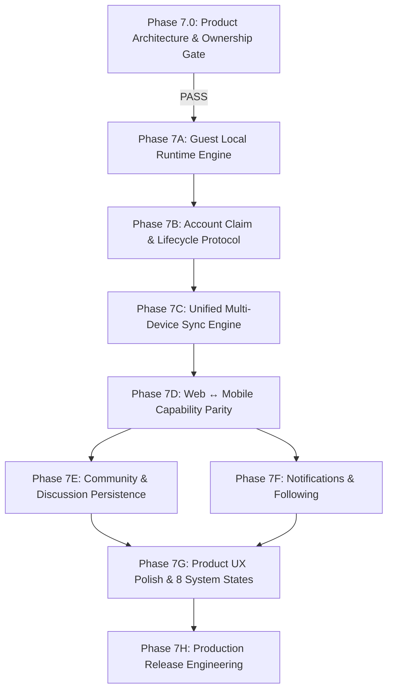

# 🚀 Phase 7: OmniNovel Commercial Product Completion Roadmap

> **Chuyển dịch mục tiêu:** Đóng lại phạm vi đồ án học thuật cũ (Phase 1 → Phase 6 đã hoàn thành các mục tiêu chấm điểm). Chính thức mở **Phase 7** với tư cách là **Roadmap Hoàn Thiện Sản Phẩm Thương Mại (Commercial-Grade Product)**.

---

## 🏛️ 1. Bộ Tài Liệu Thiết Kế Nền Tảng (Phase 7.0 Design Gate)

Trước khi viết bất kỳ dòng mã nào, hệ sinh thái kiến trúc và ranh giới dữ liệu đã được khóa chặt trong 4 tài liệu Canonical SSoT tại thư mục `plans/product/`:

1. 🛡️ [**Identity & Ownership Model**](../product/identity_and_ownership_model.md): Phân định 3 tầng quyền; `installationId` (UUIDv4) chỉ tồn tại client; cô lập namespace `guest:<id>` và `account:<id>`; cấm tuyệt đối việc biến account cache thành guest data khi logout; mô hình sở hữu tệp tải ngoại tuyến (Offline Rebind).
2. 🤝 [**Guest-to-Account Claim Protocol**](../product/guest_to_account_claim_protocol.md): Giao thức chuyển giao dữ liệu 1 chiều 2 bước (`prepare` & `commit`); loại bỏ hoàn toàn timestamp client khỏi logic trọng tài; ma trận hợp nhất chuyên biệt từng domain; chặn đứng exploit điểm thưởng (Gamification Anti-Exploit).
3. 🔄 [**Unified Sync Protocol**](../product/unified_sync_protocol.md): Giao thức đồng bộ đa thiết bị dựa trên Server Revisions, hàng đợi biến đổi client (Mutations Queue), Tombstones và cơ chế chống hồi sinh (Anti-Resurrection).
4. 📱💻 [**Web ↔ Mobile Capability Parity Matrix**](../product/web_mobile_capability_matrix.md): Ma trận năng lực tính năng, chuẩn hóa 8 trạng thái hệ thống (Loading, Error, Empty, Offline, Unauthorized, Forbidden, Expired Session, Partial Data) trên nền **Next.js 16.3.3 / React 19.2** và **Flutter / Dart**.

---

## 🗺️ 2. Luồng Phụ Thuộc Các Phân Đoạn (Phase 7.0 → Phase 7H)

---

## 📋 3. Chi Tiết Các Phân Đoạn Thực Thi

### Phase 7.0 — Product Architecture & Data Ownership Design Gate `[x] Hoàn thành (100%)`
- [x] Khóa tài liệu [identity_and_ownership_model.md](../product/identity_and_ownership_model.md).
- [x] Khóa tài liệu [guest_to_account_claim_protocol.md](../product/guest_to_account_claim_protocol.md).
- [x] Khóa tài liệu [unified_sync_protocol.md](../product/unified_sync_protocol.md).
- [x] Khóa tài liệu [web_mobile_capability_matrix.md](../product/web_mobile_capability_matrix.md).

---

### Phase 7A — Guest Local Runtime (Local-First Engine) `[x] Đã Hoàn Thành`
**Mục tiêu:** Cho phép người dùng mở Web hoặc cài App và đọc truyện, đánh dấu trang, lưu lịch sử và tiến độ hoàn toàn cục bộ mà không phụ thuộc vào Backend JWT hay tạo tài khoản.
- [x] **7A.1. Web Client IndexedDB Primary Store (`apps/web`)**
  - [x] Khởi tạo IndexedDB database `omninovel_local_v2` (sử dụng Dexie.js / IDB wrapper).
  - [x] Phân vùng lưu trữ `guest:<guestProfileId>`.
  - [x] Đọc/ghi Bookmarks, Reading Progress, Reading History vào IndexedDB độc lập với Auth state.
  - [x] `localStorage` chỉ lưu các cấu hình phần cứng nhỏ (`theme_mode`, `ui_density`) gắn với `device:<installationId>`.
- [x] **7A.2. Mobile Client SQLite `owner_scope` Adapter (`apps/mobile`)**
  - [x] Tích hợp cột `owner_scope` vào hạ tầng SQLite hiện hữu (không tạo silo DB mới).
  - [x] Tự sinh và quản lý `installationId` (UUIDv4) trong SecureStorage và `guestProfileId` trong SharedPreferences.
  - [x] Triển khai `GuestLibraryRepository` trên SQLite.
- [x] **7A.3. Tách Biệt Reader Khỏi JWT Guard**
  - [x] Đảm bảo Web Reader và Mobile Reader đọc chương công khai mà không gửi Bearer token rác.
  - [x] Lưu tiến độ đọc cục bộ có hỗ trợ `anchorBlockId` (Novel) và `scrollPosition`, `pageIndex` (Manga/Webtoon).

---

### Phase 7B — Account Claim & Lifecycle Protocol `[ ] Đang Lập Kế Hoạch (Chờ Freeze)`
**Mục tiêu:** Triển khai quy trình chuyển giao dữ liệu Khách sang Tài khoản 2 bước xác định và hoàn thiện toàn bộ vòng đời tài khoản người dùng theo 13 bất biến P0.
- [ ] **7B.1. Backend Two-Step Claim APIs & Durable Ledger (`services/api`)**
  - [ ] `POST /api/v1/account/guest-claims/prepare`:
    - Nhận danh sách canonical IDs (`storyId`, `chapterId`, `chapterVersionId`, đầy đủ resume tuple với 1-based `pageIndex >= 1`).
    - Tính toán chênh lệch (Diff) với CSDL PostgreSQL (`user_library_bookmarks`, `chapter_read_states`, `reading_progress`, `reading_history_tombstones`).
    - Tombstone Anti-Resurrection: Truyện có tombstone bị chặn import cả read chapters lẫn progress.
    - So sánh xung đột tiến độ đọc theo chế độ (Mode-Aware: PAGED `pageIndex`, WEBTOON `scrollPosition` + `progressPercentage`, NOVEL `anchorBlockId` + `textOffset`).
    - Tính `stateFingerprint`, lưu durable ledger `guest_claims` vào PostgreSQL và cache Redis (TTL 15 phút).
  - [ ] `POST /api/v1/account/guest-claims/:claimId/commit`:
    - Thử chiếm Redis lock (Best-effort concurrency optimization, fallback về PostgreSQL row lock nếu Redis lỗi).
    - Mở PostgreSQL transaction: `SELECT ... FOR UPDATE` ledger `guest_claims`.
    - Thứ tự chuẩn: verify ownership ➔ nếu `COMMITTED` trả ngay kết quả 200 OK (Idempotent vĩnh viễn theo retention policy) ➔ nếu `ABORTED` reject ➔ nếu `PREPARED` quá hạn trả 410 EXPIRED.
    - Khóa các domain rows liên quan bằng `FOR UPDATE` + user advisory lock để triệt tiêu 100% TOCTOU race window.
    - Re-check `stateFingerprint` trên dữ liệu đã khóa (trả `409 CLAIM_STALE_REPREPARE` nếu đổi).
    - Merge vào `user_library_bookmarks`, `chapter_read_states`, `reading_progress`. Ghi `COMMITTED` trong cùng transaction. Zero Gamification side-effects.
  - [ ] `GET /api/v1/account/guest-claims/:claimId/status`:
    - Phục vụ crash recovery cho client sau commit timeout / app crash.
- [ ] **7B.2. Backend Account Lifecycle APIs (`services/api`)**
  - [ ] `POST /api/v1/auth/forgot-password` (Anti-enumeration response chuẩn hóa, mã hóa hash token SHA-256 trên Redis).
  - [ ] `POST /api/v1/auth/reset-password` (Kiểm tra hash token, băm mật khẩu mới, thu hồi toàn bộ sessions).
  - [ ] `POST /api/v1/auth/change-password` (Giữ nguyên phiên hiện tại, thu hồi toàn bộ các phiên khác).
  - [ ] `GET /api/v1/account/sessions` & `DELETE /api/v1/account/sessions/:id` (Quản lý session metadata ổn định `auth_session` qua `familyId`: IP, User-Agent, lastActiveAt, isCurrentSession).
  - [ ] `DELETE /api/v1/account` (Khóa chính sách duy nhất: Soft Delete + 30-Day Grace Period, ẩn danh hóa đóng góp dịch truyện, ẩn danh hóa ledger).
  - [ ] `GET /api/v1/account/export-data` (Xuất toàn bộ dữ liệu cá nhân dạng JSON).
- [ ] **7B.3. Client Explicit Claim Dialog, Marker Quarantine & Transactional Rebind**
  - [ ] Web & Mobile kích hoạt luồng `prepare` tự động sau login/register nhưng **yêu cầu quyết định rõ ràng từ người dùng (Claim vs Skip)**.
  - [ ] Nếu người dùng Skip: Thêm vào danh sách marker `quarantineGuestScope(guestProfileId)`, **giữ nguyên partition vật lý `guest:<guestProfileId>`, không đổi tên namespace**, tuyệt đối không tự ý xóa.
  - [ ] Nếu Claim Commit thành công: Mobile thực hiện **Transactional Local Merge** trong SQLite (tránh xung đột Primary Key `[ownerScope, storyId]`), rebind offline manifest, dọn dẹp partition nguồn.
  - [ ] Khi Đăng Xuất (Logout): Lập tức detach cache của tài khoản, xoay sang fresh `guest:<newGuestProfileId>`, **không bao giờ biến dữ liệu tài khoản thành dữ liệu khách**.
- [ ] **7B.3.1. Shared Contracts Architecture (`packages/shared` & Mobile Dart Mirror)**
  - [ ] Canonical TypeScript network contracts cho API và Web.
  - [ ] Mirror models bằng Dart kèm JSON conformance tests cho Mobile Flutter để chống drift schema.

---

### Phase 7C — Unified Multi-Device Sync Engine `[ ] Chưa làm`
**Mục tiêu:** Đồng bộ trạng thái tức thì giữa Web và Mobile dựa trên Server Revisions, không phụ thuộc đồng hồ thiết bị.
- [ ] **7C.1. Cơ Sở Dữ Liệu Đồng Bộ (`services/api`)**
  - [ ] Tạo bảng `sync_change_log` có đánh số tuần tự `revision` và khóa duy nhất `(user_id, client_id, mutation_id)`.
  - [ ] Bảng `user_sync_state` quản lý `current_sync_revision`.
  - [ ] Bảng `sync_tombstones` lưu vết thực thể đã xóa kèm revision để triệt tiêu lỗi hồi sinh dữ liệu cũ (Anti-Resurrection).
- [ ] **7C.2. Sync Hub Endpoints**
  - [ ] `GET /api/v1/sync/changes?after=:revision`: Kéo delta các thay đổi mới phát sinh.
  - [ ] `POST /api/v1/sync/mutations/batch`: Nhận danh sách các mutation ngoại tuyến và áp dụng tuần tự.
- [ ] **7C.3. Client Background Reconcilers**
  - [ ] Web: IndexedDB `pending_mutations` + Service Worker Background Sync / BroadcastChannel.
  - [ ] Mobile: SQLite `pending_sync_mutations` + SyncWorker chạy nền với thuật toán Exponential Backoff.

---

### Phase 7D — Web ↔ Mobile Capability Parity `[ ] Chưa làm`
**Mục tiêu:** Đảm bảo tính tương đương về năng lực đọc và quản lý nội dung giữa hai nền tảng.
- [ ] **7D.1. Web Offline Reading Cache**
  - [ ] Tích hợp Service Worker Cache API / IndexedDB lưu trữ an toàn các chương đang đọc dở trên trình duyệt khi mất mạng.
- [ ] **7D.2. Mobile Studio Viewer**
  - [ ] Tích hợp màn hình xem trước và duyệt nhanh (Quick Approval) các bản dịch AI trực tiếp trên ứng dụng di động.

---

### Phase 7E — Community & Discussion (Production Persistence) `[ ] Chưa làm`
**Mục tiêu:** Xóa bỏ hoàn toàn Mock UI, đưa hệ thống Thảo luận/Bình luận vào CSDL PostgreSQL thật.
- [ ] **7E.1. Database Schema & Migration**
  - [ ] Bảng `comments`: `story_id`, `chapter_id`, `user_id`, `parent_id` (nested reply), `content`, `is_spoiler`, `like_count`, `created_at`.
  - [ ] Bảng `comment_reactions`: `user_id`, `comment_id`, `reaction_type`.
  - [ ] Bảng `comment_reports`: Báo cáo vi phạm nội dung và spam.
- [ ] **7E.2. Backend Discussion Module (`services/api`)**
  - [ ] API CRUD comments, phân trang cursor-based, rate limiting chống spam.
  - [ ] Guest: Cho phép xem danh sách bình luận (Public Read).
  - [ ] Account: Yêu cầu đăng nhập để bình luận, thả cảm xúc, gắn thẻ spoiler, báo cáo.
- [ ] **7E.3. Client Integration**
  - [ ] Thay thế hoàn toàn Mock data trên `apps/web` bằng REST API thật.
  - [ ] Tích hợp Discussion Bottom Sheet trên `apps/mobile`.

---

### Phase 7F — Notifications & Following `[ ] Chưa làm`
**Mục tiêu:** Giữ chân độc giả với thông báo tức thì khi truyện theo dõi ra mắt chương mới.
- [ ] **7F.1. Tách Biệt Theo Dõi Truyện (Story Following)**
  - [ ] `POST /api/v1/stories/:id/follow` (Bật/tắt thông báo cho từng bộ truyện, tách riêng với Bookmark).
- [ ] **7F.2. Trung Tâm Thông Báo (In-App Notification Center)**
  - [ ] Event `chapter.published` kích hoạt dispatcher tạo thông báo cho toàn bộ followers.
  - [ ] Web In-App Notification Center (Biểu tượng chuông, dropdown, đánh dấu đã đọc).
  - [ ] Mobile In-App Notifications (sẵn sàng tích hợp FCM khi build release).

---

### Phase 7G — Product UX Polish & 8 System States Audit `[ ] Chưa làm`
**Mục tiêu:** Rà soát và hoàn thiện trải nghiệm thị giác và tương tác trên từng điểm chạm.
- [ ] **7G.1. Audit 8 Trạng Thái Hệ Thống (Loading, Error, Empty, Offline, Unauthorized, Forbidden, Expired Session, Partial Data)** trên 100% màn hình Web và Mobile.
- [ ] **7G.2. Micro-interactions & Ergonomics**
  - [ ] Web: Hệ thống phím tắt bàn phím toàn diện.
  - [ ] Mobile: Haptic feedback khi lật trang, chế độ AMOLED Black tiết kiệm pin, giữ sáng màn hình khi đọc (Wakelock).

---

### Phase 7H — Production Release Engineering `[ ] Chưa làm`
**Mục tiêu:** Sẵn sàng cho triển khai thương mại thực tế và vận hành bền vững.
- [ ] **7H.1. Mobile Production Release**
  - [ ] Keystore Signing, App Bundle (AAB), ProGuard rules, Versioning `1.0.0+1`.
- [ ] **7H.2. Web Production Readiness**
  - [ ] OpenGraph dynamic meta tags, Sitemap XML, Robots.txt, Web App Manifest (PWA).
- [ ] **7H.3. Disaster Recovery & Backend Reliability**
  - [ ] Kịch bản sao lưu & phục hồi tự động PostgreSQL định kỳ (`pg_dump`).
  - [ ] Diễn tập phục hồi thảm họa (Disaster Recovery Drill) và xác thực tính toàn vẹn dữ liệu.
