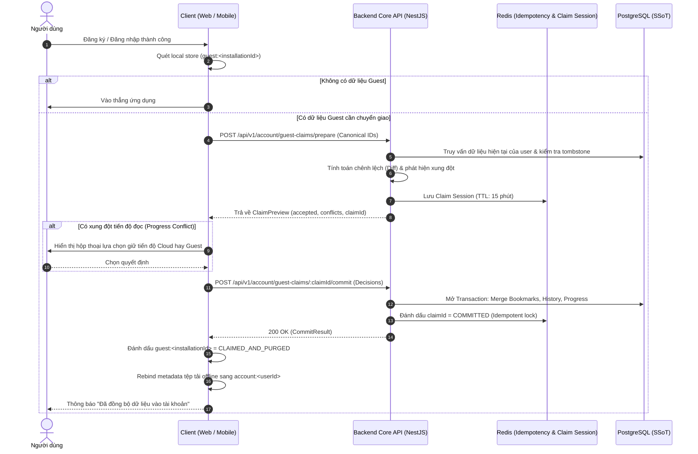

# 🤝 OmniNovel Architecture: Guest-to-Account Claim Protocol

> **Tài liệu Canonical SSoT số 2** thuộc **Phase 7.0 — Product Architecture & Data Ownership Design Gate**.  
> Thiết lập giao thức chuyển giao dữ liệu Khách sang Tài khoản (Claim Protocol) 2 bước xác định, đảm bảo tính toàn vẹn, chống tấn công giả mạo phần thưởng và không làm mất dữ liệu người dùng.

---

## 1. Triết Lý Cốt Lõi: Claim Không Phải Là Sync

1. **Giao thức một lần (One-Time Handover):**
   - Chuyển giao dữ liệu từ Guest sang Account diễn ra khi người dùng quyết định định danh chính mình (Đăng ký mới hoặc Đăng nhập tài khoản cũ).
   - Đây không phải là luồng đồng bộ định kỳ hay liên tục. Luồng đồng bộ liên tục đa thiết bị sẽ do **Phase 7C: Unified Sync Protocol** đảm nhiệm sau khi tài khoản đã được xác thực.
2. **Tuyệt đối không dùng Timestamp Client làm trọng tài:**
   - Đồng hồ giữa trình duyệt Web, điện thoại Android/iOS và Server luôn có độ lệch (clock skew).
   - Quy tắc generic LWW (`guest.updatedAt > server.updatedAt`) bị loại bỏ hoàn toàn. Quyền quyết định thuộc về **Server-Authoritative Anti-Resurrection Logic**, trạng thái `dirty` cục bộ và luật chuyên biệt của từng miền dữ liệu.
3. **Không tin tưởng Metadata từ Client:**
   - Payload gửi từ Guest không được chứa tiêu đề (`title`), hình ảnh (`coverUrl`), hay tên chương (`chapterTitle`).
   - Client chỉ gửi các định danh chính thống (`storyId`, `chapterId`, `chapterVersionId`). Server tự kiểm tra sự tồn tại trong CSDL PostgreSQL, trạng thái xuất bản (`isPublished`) và quyền truy cập.
4. **Bảo mật Kinh tế Ảo (Gamification Hardening - P0 Anti-Exploit):**
   - **Tuyệt đối không cấp phát điểm thưởng (EXP, OmniCoin, Streak) thông qua Guest Claim.**
   - Nếu cho phép import lịch sử để nhận thưởng, kẻ tấn công có thể giả lập 10.000 lượt đọc của Guest trong 1 giây để trục lợi coin sau khi đăng ký.
   - Thưởng chỉ được tính khi người đọc thực hiện hành động hợp lệ trực tiếp trên phiên có xác thực hoặc qua quy trình xác minh đọc thực tế trên thiết bị.

---

## 2. Giao Thức 2 Bước (Two-Step Claim Protocol)

Để người dùng và client luôn kiểm soát được dữ liệu được gộp, giao thức được chia thành 2 giai đoạn: **Prepare (Chuẩn bị & So khớp)** và **Commit (Áp dụng nguyên tử)**.



---

## 3. Quy Tắc Hợp Nhất Chuyên Biệt Theo Từng Miền (Domain Merge Matrix)

Không áp dụng một thuật toán chung cho tất cả. Mỗi miền dữ liệu có bản chất nghiệp vụ riêng:

| Miền Dữ Liệu (Domain) | Dữ Liệu Client Gửi Lên | Quy Tắc Hợp Nhất Vào Tài Khoản (Merge Semantics) | Cơ Chế Xử Lý Xung Đột (Conflict Handling) |
|---|---|---|---|
| **Bookmarks (Đánh dấu)** | Danh sách `storyId` đang active | **Additive Only (Cộng dồn):** Thêm các truyện Guest đánh dấu vào tài khoản. | Khách **không được phép xóa** bookmark đã có trên Cloud. Việc xóa trên Cloud chỉ diễn ra qua Sync có tombstone ở Phase 7C. |
| **Reading History (Lịch sử)** | Danh sách `(storyId, chapterId, readAt)` | **Union & Dedupe:** Gộp danh sách lịch sử. Nếu trùng lặp cùng một chương trong cùng một ngày, giữ bản ghi có tiến độ cao hơn. | Kiểm tra bảng `reading_history_tombstones`. Nếu truyện đã bị user xóa khỏi lịch sử trên Cloud trước đó, **từ chối import lại (Anti-Resurrection)**. |
| **Read Chapters (Chương đã đọc)** | Mảng `readChapterIds` | **Monotonic Union:** Tập hợp hợp nhất `Array.from(new Set([...cloud, ...guest]))`. | Đơn điệu tăng dần, không có xung đột. |
| **Reading Progress (Tiến độ)** | `(storyId, chapterId, scrollPos, progressPct, anchorBlockId, textOffset)` | Xem bảng ma trận chi tiết bên dưới. | Bảo toàn vị trí Cloud, cho phép lưu Guest candidate làm điểm khôi phục dự phòng. |
| **Reader Preferences** | `fontSize`, `theme`, `readingDirection` | Ưu tiên cài đặt đã có của Cloud. Nếu Cloud chưa có, lấy của Guest. | Thiết lập cục bộ theo từng thiết bị (`device:*`) được ưu tiên áp dụng cho trải nghiệm nhìn. |
| **Recent Searches (Tìm kiếm)** | *Không gửi* | **Strictly Local:** Giữ cục bộ trên thiết bị, không chuyển giao lên Cloud. | Loại trừ khỏi Claim Protocol để giảm thiểu bề mặt tấn công và độ phức tạp không đáng có. |
| **Gamification / Rewards** | *Không gửi* | **Strictly Server-Only:** Bỏ qua hoàn toàn. | Nghiêm cấm nhận thưởng từ dữ liệu nặc danh. |

---

## 4. Xử Lý Xung Đột Tiến Độ Đọc (Reading Progress Resolution)

Tiến độ đọc là phần phức tạp nhất vì người dùng có thể đang đọc dở trên điện thoại khi chưa đăng nhập, trong khi tài khoản web trước đó đã đọc tới một vị trí khác:

```text
Tình huống A: Tài khoản mới tạo
└─► Toàn bộ tiến độ đọc của Guest trở thành tiến độ đọc chính thức trên Cloud.

Tình huống B: Tài khoản cũ nhưng chưa từng đọc truyện này trên Cloud
└─► Tiến độ của Guest được lưu thẳng vào Cloud.

Tình huống C: Tài khoản cũ đã đọc cùng truyện, cùng chapter và cùng vị trí tương đương (chênh lệch < 5%)
└─► Tự động gộp mượt mà (Trivial Merge).

Tình huống D: Tài khoản cũ đã đọc truyện này nhưng ở vị trí/chương khác nhau
┌─► Mặc định Server giữ vị trí của Cloud làm CANONICAL POSITION (Tránh ghi đè ngoài ý muốn).
├─► Trả về Conflict trong ClaimPreview:
│     {
│       storyId: "story-123",
│       cloudPosition: { chapterId: "chap-37", progressPercentage: 15 },
│       guestPosition: { chapterId: "chap-20", progressPercentage: 80 }
│     }
└─► Client cung cấp tùy chọn: Người dùng có thể bấm "Dùng vị trí từ thiết bị này" hoặc "Giữ vị trí Cloud".
```

---

## 5. Đặc Tả DTO & API Endpoints

### 5.1. Bước 1: Prepare Claim
- **Endpoint:** `POST /api/v1/account/guest-claims/prepare`
- **Headers:** `Authorization: Bearer <accessToken>`
- **Request Body (`PrepareGuestClaimDto`):**
```typescript
export interface PrepareGuestClaimDto {
  installationId: string;
  bookmarks: Array<{
    storyId: string;
  }>;
  progress: Array<{
    storyId: string;
    chapterId: string;
    chapterVersionId?: string | null;
    readingMode?: string;
    progressPercentage: number;
    scrollPosition: number;
    anchorBlockId?: string | null;
    textOffset?: number;
    readChapterIds?: string[];
  }>;
  history: Array<{
    storyId: string;
    chapterId: string;
    readAtClient: string;
  }>;
  preferences?: {
    readingDirection?: 'LTR' | 'RTL' | 'VERTICAL';
    theme?: 'DARK' | 'LIGHT' | 'SEPIA' | 'AMOLED';
  };
}
```

- **Response Body (`200 OK` - `GuestClaimPreviewResponse`):**
```typescript
export interface GuestClaimPreviewResponse {
  claimId: string; // UUIDv4 lưu trong Redis với TTL 15 phút
  serverSnapshotRevision: number;
  summary: {
    bookmarksToAddCount: number;
    bookmarksIgnoredCount: number; // Đã có sẵn trên Cloud
    historyToAddCount: number;
    historyIgnoredAntiResurrectionCount: number; // Trùng tombstone
    progressAcceptedCount: number;
    progressConflictsCount: number;
  };
  conflicts: Array<{
    storyId: string;
    cloudProgress: {
      chapterId: string;
      progressPercentage: number;
      updatedAt: string;
    };
    guestProgress: {
      chapterId: string;
      progressPercentage: number;
    };
  }>;
}
```

### 5.2. Bước 2: Commit Claim
- **Endpoint:** `POST /api/v1/account/guest-claims/:claimId/commit`
- **Headers:** `Authorization: Bearer <accessToken>`
- **Request Body (`CommitGuestClaimDto`):**
```typescript
export interface CommitGuestClaimDto {
  // Lựa chọn của người dùng đối với các xung đột (nếu có)
  conflictDecisions?: Array<{
    storyId: string;
    resolution: 'KEEP_CLOUD' | 'USE_GUEST';
  }>;
}
```

- **Response Body (`200 OK` - `GuestClaimCommitResponse`):**
```typescript
export interface GuestClaimCommitResponse {
  claimId: string;
  status: 'COMMITTED';
  committedAt: string;
  newServerRevision: number;
  appliedStats: {
    bookmarksAdded: number;
    historyMerged: number;
    progressSaved: number;
  };
}
```

---

## 6. Tính Bất Biến Idempotency & Phục Hồi Lỗi (Failure Recovery)

1. **Chống Lặp Lại Do Mạng Lag (Network Timeout / Double Submit):**
   - Khi client gửi Commit nhưng bị rớt mạng trước khi nhận được response: client gửi lại chính xác `POST /api/v1/account/guest-claims/:claimId/commit`.
   - Backend kiểm tra khóa Redis `claim_committed:<userId>:<claimId>`: nếu đã commit xong, trả ngay kết quả cũ với mã `200 OK`, không thực hiện ghi trùng vào CSDL.
2. **Xử Lý Treo Máy / Đột Tử Ứng Dụng (App Crash sau Commit):**
   - Khi mở lại ứng dụng: Client kiểm tra trạng thái local `guest:<installationId>`. Nếu chưa nhận được confirm, gửi truy vấn `GET /api/v1/account/guest-claims/:claimId/status`.
   - Nếu server báo đã `COMMITTED`: Client lập tức chạy quy trình dọn dẹp cục bộ và rebind offline metadata.
3. **Claim Quá Hạn (Expired TTL):**
   - Sau 15 phút không commit, Claim Session trong Redis tự hủy.
   - Client nhận mã lỗi `410 GONE / CLAIM_EXPIRED` và tự động kích hoạt lại Bước 1 (Prepare).
