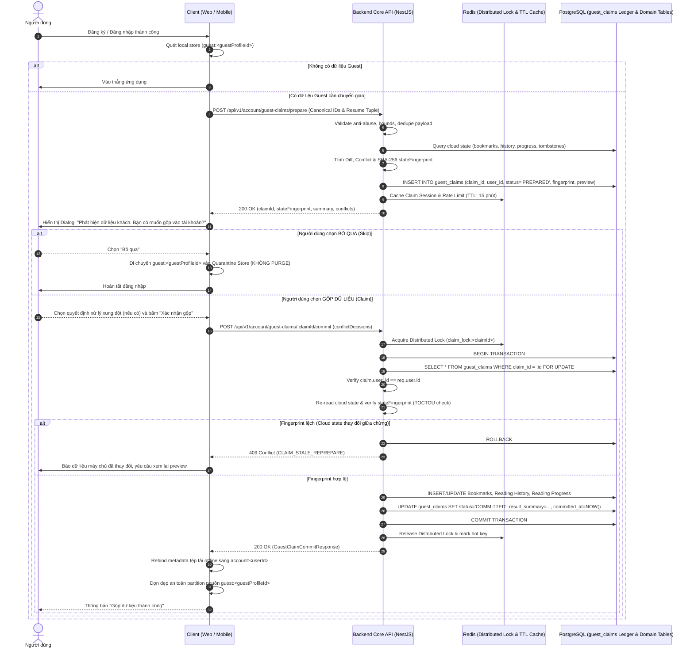

# 🤝 OmniNovel Architecture: Guest-to-Account Claim Protocol

> **Tài liệu Canonical SSoT số 2** thuộc **Phase 7.0 — Product Architecture & Data Ownership Design Gate** (Amended cho Phase 7B).  
> Thiết lập giao thức chuyển giao dữ liệu Khách sang Tài khoản (Claim Protocol) 2 bước xác định, đảm bảo tính bền vững (Durable Idempotency in PostgreSQL), chống xung đột dữ liệu (TOCTOU & State Fingerprint Protection), kiểm soát quyền sở hữu nghiêm ngặt, bảo vệ kinh tế ảo và cung cấp cơ chế phục hồi lỗi (Crash Recovery).

---

## 1. Triết Lý Cốt Lõi: Claim Không Phải Là Sync

1. **Giao thức một lần (One-Time Handover):**
   - Chuyển giao dữ liệu từ Guest sang Account diễn ra khi người dùng định danh chính mình (Đăng ký mới hoặc Đăng nhập tài khoản cũ).
   - Đây không phải là luồng đồng bộ định kỳ hay liên tục. Luồng đồng bộ liên tục đa thiết bị sẽ do **Phase 7C: Unified Sync Protocol** đảm nhiệm sau khi tài khoản đã được xác thực.
2. **Quyền quyết định thuộc về Người dùng (Explicit User Choice — Không Auto-Commit Ngầm):**
   - Sau khi đăng nhập/đăng ký thành công, client có thể tự động kiểm tra và chuẩn bị dữ liệu (`prepare`), nhưng **tuyệt đối không được tự ý commit ngầm**.
   - Người dùng phải được hiển thị hộp thoại xác nhận rõ ràng: **"Gộp dữ liệu vào tài khoản" (Claim)** hoặc **"Bỏ qua" (Skip)**.
   - Nếu người dùng chọn **Skip**: Dữ liệu khách được chuyển sang trạng thái **Quarantine** (`quarantine:<guestProfileId>`), **tuyệt đối không bị xóa (purge)**.
   - Dữ liệu khách nguồn chỉ được phép purge và rebind sau khi máy chủ xác nhận trạng thái bền vững `COMMITTED`.
3. **Claim Source Identity là `guest:<guestProfileId>`, không phải `installationId`:**
   - `installationId` thuần túy là định danh thiết bị vật lý (`device:<installationId>`). Network DTO không bao giờ sử dụng `installationId` làm claim credential hay claim identity.
   - Nguồn claim duy nhất được định danh bằng `guestProfileId` (UUIDv4) thuộc về phiên khách cụ thể.
4. **Idempotency Bền Vững Trong PostgreSQL (Durable Ledger In DB):**
   - Redis chỉ đóng vai trò phân tán khóa (`claim_lock:<claimId>`) và hot cache / rate limiting.
   - **PostgreSQL là Single Source of Truth duy nhất** cho trạng thái claim thông qua bảng sổ cái `guest_claims`.
   - Trạng thái `COMMITTED` và kết quả gộp dữ liệu (`result_summary`) bắt buộc phải được ghi nhận trong **cùng một Database Transaction** với toàn bộ thao tác gộp Bookmarks, Reading History và Reading Progress.
   - Mọi sự cố sập ứng dụng (App Crash), mất mạng (Client Timeout) hoặc sự cố mất dữ liệu Redis (Redis Loss) sau khi DB transaction đã commit đều có thể được phục hồi an toàn tuyệt đối qua cơ chế tra cứu bền vững.
5. **Ràng Buộc Nghiêm Ngặt Quyền Sở Hữu Tài Khoản (Account Ownership Binding):**
   - Một Claim Session được prepare bởi `userId` nào thì **chỉ duy nhất `userId` đó** mới có quyền kiểm tra trạng thái (`GET /status`) hoặc thực thi commit (`POST /commit`).
   - Nếu User B cố gắng truy cập hoặc commit claim của User A (kể cả khi biết trước `claimId`), hệ thống lập tức từ chối với mã lỗi `403 Forbidden` (hoặc `404 Not Found`).
6. **Chống TOCTOU & Stale-Preview Dựa Trên State Fingerprint (Không Bịa Revision Giả Mạo):**
   - Không sử dụng `serverSnapshotRevision` khi chưa có hệ thống đánh số revision thật trong repository.
   - Tại bước `prepare`: Server chụp nhanh trạng thái các entity Cloud liên quan (bookmarks, history, progress, tombstones) và tính toán mã băm SHA-256 (`stateFingerprint`).
   - Tại bước `commit`: Dưới transaction nguyên tử (`SELECT ... FOR UPDATE`), Server tính lại `currentFingerprint`. Nếu phát hiện dữ liệu Cloud đã bị thay đổi bởi thiết bị khác giữa lúc prepare và commit, Server hủy bỏ transaction và trả về mã lỗi `409 Conflict` kèm mã `CLAIM_STALE_REPREPARE`. Client bắt buộc phải gọi prepare lại để người dùng xem preview mới.
7. **Bảo Tồn Đầy Đủ Resume Tuple Đã Khóa Ở Phase 7A:**
   - DTO tiến độ đọc bắt buộc phải giữ đủ bộ 7 trường vị trí: `chapterVersionId`, `readingMode`, `pageIndex`, `scrollPosition`, `progressPercentage`, `anchorBlockId`, `textOffset`. Thiếu `pageIndex` sẽ làm hỏng vị trí khôi phục của Manga / Webtoon theo trang.
8. **Quy Chuẩn Lịch Sử Đọc (History Deduplication Semantics):**
   - Khớp 100% với mô hình snapshot của Phase 7A: Khóa dedupe là cặp `(storyId, chapterId)`, không dựa vào "cùng ngày" hay timestamp client để làm authority.
   - Trường `readAtClient` chỉ mang tính chất thông tin gợi ý / chẩn đoán (diagnostic hint).
   - Kiểm tra bảng tombstone: Truyện đã bị xóa khỏi lịch sử trên Cloud sẽ bị chặn tái sinh (**Anti-Resurrection**).
9. **Bảo Mật Kinh Tế Ảo (Gamification Hardening - Zero Side-Effects):**
   - **Tuyệt đối không cấp phát bất kỳ điểm thưởng nào (EXP, OmniCoin, Reading Streak)** thông qua luồng Guest Claim.
   - Mọi thao tác gộp dữ liệu khách chỉ cập nhật thư viện và tiến độ, hoàn toàn cách ly khỏi Gamification Engine.
10. **Phòng Chống Lạm Dụng Khắt Khe (Anti-Abuse Hardening Tại Prepare):**
    - Kiểm tra định dạng UUIDv4 chặt chẽ cho toàn bộ các trường ID.
    - Giới hạn kích thước payload: Tối đa 500 bookmarks, 1000 history items, 500 progress items, dung lượng body tối đa 2MB.
    - Kiểm tra miền giá trị số hữu hạn (finite bounds): `progressPercentage` [0..100], `scrollPosition` >= 0, `pageIndex` >= 0 (integer), `textOffset` >= 0 (integer).
    - Tự động khử trùng lặp (dedupe) payload gửi lên.
    - Kiểm tra tính hợp lệ của Foreign Key và quyền truy cập: `storyId` phải tồn tại và công khai, `chapterId` phải thuộc về `storyId`, `chapterVersionId` (nếu có) phải thuộc về `chapterId`, chương không thuộc loại khóa/trả phí mà khách không có quyền.
    - Giới hạn tần suất gọi API (Rate Limit): Tối đa 10 requests prepare / phút / user hoặc IP.

---

## 2. Giao Thức 3 Điểm Cuối (Three-Endpoint Claim Protocol)

Giao thức gồm 3 endpoint chính thức phục vụ vòng đời hoàn chỉnh:
1. `POST /api/v1/account/guest-claims/prepare`: Thẩm định, tính khác biệt (Diff), phát hiện xung đột và lưu ledger ở trạng thái `PREPARED`.
2. `POST /api/v1/account/guest-claims/:claimId/commit`: Thẩm định TOCTOU fingerprint, áp dụng merge nguyên tử trong DB transaction, chuyển trạng thái ledger sang `COMMITTED`.
3. `GET /api/v1/account/guest-claims/:claimId/status`: Truy vấn trạng thái ledger phục vụ crash recovery khi client gặp sự cố mạng hoặc tắt ứng dụng đột ngột sau khi commit.



---

## 3. Kiến Trúc CSDL Sổ Cái: Bảng `guest_claims` (PostgreSQL Durable Ledger)

Để đảm bảo Idempotency bền vững vượt qua cả các sự cố sập máy chủ, mất kết nối mạng và mất cache Redis, hệ thống thiết lập bảng sổ cái `guest_claims` trong PostgreSQL:

```sql
CREATE TYPE guest_claim_status AS ENUM ('PREPARED', 'COMMITTED', 'ABORTED', 'EXPIRED');

CREATE TABLE guest_claims (
    claim_id UUID PRIMARY KEY,
    user_id UUID NOT NULL REFERENCES users(id) ON DELETE CASCADE,
    guest_profile_id UUID NOT NULL,
    payload_hash VARCHAR(64) NOT NULL,
    state_fingerprint VARCHAR(64) NOT NULL,
    status guest_claim_status NOT NULL DEFAULT 'PREPARED',
    preview_data JSONB NOT NULL,
    conflict_decisions JSONB,
    result_summary JSONB,
    expires_at TIMESTAMPTZ NOT NULL,
    created_at TIMESTAMPTZ NOT NULL DEFAULT NOW(),
    committed_at TIMESTAMPTZ,
    updated_at TIMESTAMPTZ NOT NULL DEFAULT NOW()
);

CREATE INDEX idx_guest_claims_user_id_status ON guest_claims(user_id, status);
CREATE INDEX idx_guest_claims_expires_at ON guest_claims(expires_at) WHERE status = 'PREPARED';
```

### Quy Tắc Chuyển Trạng Thái Ledger:
1. `PREPARED`: Được tạo bởi `POST /prepare`. Có hạn sử dụng 15 phút (`expires_at = NOW() + INTERVAL '15 minutes'`).
2. `COMMITTED`: Được chuyển sang trạng thái này **chỉ bên trong Database Transaction** gộp dữ liệu của `POST /commit`. Một khi đã `COMMITTED`, mọi yêu cầu commit lặp lại đều trả về ngay kết quả từ `result_summary` (Mã 200 OK, Idempotent).
3. `ABORTED`: Người dùng chủ động hủy bỏ claim session từ giao diện (nếu gọi endpoint hủy) hoặc bị hủy do phát hiện gian lận.
4. `EXPIRED`: Quá hạn 15 phút mà không được commit. Cron worker định kỳ hoặc câu lệnh kiểm tra tại chỗ sẽ coi các claim này là hết hiệu lực (Trả 410 Gone nếu cố commit).

---

## 4. Quy Tắc Hợp Nhất Chuyên Biệt Theo Từng Miền (Domain Merge Matrix)

| Miền Dữ Liệu (Domain) | Dữ Liệu Client Gửi Lên | Quy Tắc Hợp Nhất Vào Tài Khoản (Merge Semantics) | Cơ Chế Xử Lý Xung Đột (Conflict Handling) |
|---|---|---|---|
| **Bookmarks (Đánh dấu)** | Danh sách `storyId` active | **Additive Only (Cộng dồn):** Thêm các truyện Guest đánh dấu vào tài khoản (`ON CONFLICT DO NOTHING`). | Khách **không được phép xóa** bookmark đã có trên Cloud. Xóa trên Cloud chỉ diễn ra qua Sync có tombstone ở Phase 7C. |
| **Reading History (Lịch sử)** | Danh sách `(storyId, chapterId, readAtClient)` | **Union & Dedupe:** Khóa dedupe là `(storyId, chapterId)`. Khớp với 7A snapshot model. `readAtClient` chỉ là hint. | Kiểm tra bảng `reading_history_tombstones`. Nếu truyện đã bị user xóa khỏi Cloud trước đó, **từ chối import lại (Anti-Resurrection)**. |
| **Read Chapters (Chương đã đọc)** | Mảng `readChapterIds` | **Monotonic Union:** Tập hợp hợp nhất `Array.from(new Set([...cloud, ...guest]))`. | Đơn điệu tăng dần, không có xung đột. |
| **Reading Progress (Tiến độ)** | Đầy đủ 7 trường Resume Tuple: `storyId, chapterId, chapterVersionId, readingMode, pageIndex, scrollPosition, progressPercentage, anchorBlockId, textOffset` | Xem chi tiết mục 5 bên dưới. | Bảo toàn vị trí Cloud làm mặc định, cung cấp Preview Conflict để người dùng lựa chọn quyết định rõ ràng. |
| **Reader Preferences** | `fontSize`, `theme`, `readingDirection` | Ưu tiên cài đặt đã có của Cloud. Nếu Cloud chưa có, lấy của Guest. | Thiết lập cục bộ theo từng thiết bị (`device:*`) được ưu tiên áp dụng cho trải nghiệm nhìn. |
| **Recent Searches (Tìm kiếm)** | *Không gửi* | **Strictly Local:** Giữ cục bộ trên thiết bị, không chuyển giao lên Cloud. | Loại trừ khỏi Claim Protocol để giảm thiểu bề mặt tấn công. |
| **Gamification / Rewards** | *Không gửi* | **Strictly Server-Only:** Bỏ qua hoàn toàn. | Tuyệt đối cấm nhận thưởng từ dữ liệu nặc danh. |

---

## 5. Xử Lý Xung Đột Tiến Độ Đọc (Reading Progress Resolution)

Tiến độ đọc được giải quyết theo 4 kịch bản xác định:

```text
Tình huống A: Tài khoản mới tạo hoặc chưa từng đọc truyện này trên Cloud
└─► Toàn bộ tiến độ đọc của Guest (bao gồm đủ 7 trường resume tuple) được lưu thẳng vào Cloud.

Tình huống B: Tài khoản cũ đã đọc cùng truyện, cùng chapter và cùng vị trí tương đương (chênh lệch progressPercentage < 5%)
└─► Tự động gộp mượt mà (Trivial Merge). Cập nhật vị trí có tiến độ cao hơn hoặc giữ nguyên Cloud.

Tình huống C: Tài khoản cũ đã đọc truyện này nhưng ở vị trí/chương khác nhau
┌─► Mặc định Server giữ vị trí của Cloud làm CANONICAL POSITION (Tránh ghi đè ngoài ý muốn).
├─► Trả về Conflict trong ClaimPreview:
│     {
│       storyId: "uuid",
│       cloudProgress: {
│         chapterId: "chap-uuid-cloud",
│         progressPercentage: 65,
│         pageIndex: 12,
│         updatedAt: "2026-10-06T12:00:00Z"
│       },
│       guestProgress: {
│         chapterId: "chap-uuid-guest",
│         progressPercentage: 20,
│         pageIndex: 4
│       }
│     }
└─► Client hiển thị UI cho người dùng lựa chọn: "Dùng vị trí từ thiết bị này" (USE_GUEST) hoặc "Giữ vị trí tài khoản" (KEEP_CLOUD).
```

---

## 6. Đặc Tả DTO & API Endpoints Chi Tiết

### 6.1. Endpoint 1: Prepare Claim
- **Endpoint:** `POST /api/v1/account/guest-claims/prepare`
- **Headers:** `Authorization: Bearer <accessToken>`
- **Request Body (`PrepareGuestClaimDto`):**
```typescript
export interface PrepareGuestClaimDto {
  guestProfileId: string; // UUIDv4 - Định danh phiên khách nguồn
  installationId?: string; // Tùy chọn - Client device hint / telemetry, KHÔNG LÀ CREDENTIAL
  bookmarks: Array<{
    storyId: string; // UUIDv4
  }>;
  progress: Array<{
    storyId: string; // UUIDv4
    chapterId: string; // UUIDv4
    chapterVersionId?: string | null; // UUIDv4 hoặc null
    readingMode?: 'WEBTOON' | 'PAGED' | 'CONTINUOUS' | string;
    pageIndex?: number | null; // Số nguyên >= 0 (bắt buộc cho Manga/PDF paged mode)
    scrollPosition: number; // Số thực hữu hạn >= 0
    progressPercentage: number; // Số thực hữu hạn từ 0.0 đến 100.0
    anchorBlockId?: string | null; // Khóa neo đoạn văn cho Light Novel
    textOffset?: number | null; // Số nguyên >= 0
    readChapterIds?: string[]; // Mảng UUIDv4 các chương đã đọc
  }>;
  history: Array<{
    storyId: string; // UUIDv4
    chapterId: string; // UUIDv4
    readAtClient?: string; // ISO 8601 string - Chỉ là diagnostic hint
  }>;
  preferences?: {
    readingDirection?: 'LTR' | 'RTL' | 'VERTICAL';
    theme?: 'DARK' | 'LIGHT' | 'SEPIA' | 'AMOLED';
  };
}
```

- **Response Body (`200 OK` - `GuestClaimPreviewResponse`):**
```typescript
export interface GuestClaimPreviewResponse {
  claimId: string; // UUIDv4 - Định danh của Claim Session
  stateFingerprint: string; // SHA-256 fingerprint của cloud state tại thời điểm prepare
  expiresAt: string; // ISO 8601 - Hạn chót thực hiện commit (15 phút)
  summary: {
    bookmarksToAddCount: number;
    bookmarksIgnoredCount: number; // Đã có trên Cloud
    historyToAddCount: number;
    historyIgnoredAntiResurrectionCount: number; // Bị chặn do tombstone
    progressAcceptedCount: number;
    progressConflictsCount: number;
  };
  conflicts: Array<{
    storyId: string;
    cloudProgress: {
      chapterId: string;
      chapterTitle?: string;
      progressPercentage: number;
      pageIndex?: number | null;
      updatedAt: string;
    };
    guestProgress: {
      chapterId: string;
      progressPercentage: number;
      pageIndex?: number | null;
    };
  }>;
}
```

- **Mã Lỗi Trả Về:**
  - `400 Bad Request`: Payload không hợp lệ (sai UUID, vượt giới hạn số lượng, số âm hoặc NaN).
  - `401 Unauthorized`: Thiếu hoặc sai JWT token.
  - `429 Too Many Requests`: Vượt quá giới hạn rate limit (10 requests/phút).

---

### 6.2. Endpoint 2: Commit Claim
- **Endpoint:** `POST /api/v1/account/guest-claims/:claimId/commit`
- **Headers:** `Authorization: Bearer <accessToken>`
- **Request Body (`CommitGuestClaimDto`):**
```typescript
export interface CommitGuestClaimDto {
  expectedStateFingerprint: string; // SHA-256 fingerprint nhận được từ bước prepare
  conflictDecisions?: Array<{
    storyId: string; // UUIDv4
    resolution: 'KEEP_CLOUD' | 'USE_GUEST';
  }>;
}
```

- **Response Body (`200 OK` - `GuestClaimCommitResponse`):**
```typescript
export interface GuestClaimCommitResponse {
  claimId: string;
  status: 'COMMITTED';
  committedAt: string;
  appliedStats: {
    bookmarksAdded: number;
    historyMerged: number;
    progressSaved: number;
  };
}
```

- **Mã Lỗi Trả Về:**
  - `403 Forbidden`: `claim.user_id !== req.user.id` (User B cố commit claim của User A).
  - `404 Not Found`: Không tìm thấy `claimId`.
  - `409 Conflict` (`CLAIM_STALE_REPREPARE`): Trạng thái Cloud đã thay đổi kể từ lúc prepare, fingerprint không khớp. Client phải gọi prepare lại.
  - `410 Gone` (`CLAIM_EXPIRED`): Claim session đã hết hạn 15 phút.

---

### 6.3. Endpoint 3: Check Claim Status (Crash Recovery)
- **Endpoint:** `GET /api/v1/account/guest-claims/:claimId/status`
- **Headers:** `Authorization: Bearer <accessToken>`
- **Response Body (`200 OK` - `GuestClaimStatusResponse`):**
```typescript
export interface GuestClaimStatusResponse {
  claimId: string;
  userId: string;
  guestProfileId: string;
  status: 'PREPARED' | 'COMMITTED' | 'ABORTED' | 'EXPIRED';
  createdAt: string;
  expiresAt: string;
  committedAt?: string | null;
  appliedStats?: {
    bookmarksAdded: number;
    historyMerged: number;
    progressSaved: number;
  } | null;
}
```

- **Mã Lỗi Trả Về:**
  - `403 Forbidden`: Truy cập trái phép claim của người dùng khác.
  - `404 Not Found`: Không tồn tại `claimId`.

---

## 7. Tính Bất Biến Idempotency & Phục Hồi Lỗi (Failure Recovery)

1. **Khắc Phục Rớt Mạng Sau Khi Server Commit (Network Timeout / Double Submit):**
   - Khi client gửi commit nhưng bị đứt kết nối mạng trước khi nhận được phản hồi: Client gửi lại chính xác `POST /api/v1/account/guest-claims/:claimId/commit` với cùng `expectedStateFingerprint`.
   - Backend kiểm tra bản ghi trong bảng `guest_claims`: Nếu trạng thái đã là `COMMITTED`, Backend trả về ngay `GuestClaimCommitResponse` đã lưu trong `result_summary` với mã `200 OK`, tuyệt đối không thực hiện merge lần 2.
2. **Khắc Phục Ứng Dụng Đột Tử (App Crash Sau Commit):**
   - Khi người dùng mở lại ứng dụng: Client kiểm tra partition khách cục bộ `guest:<guestProfileId>`. Nếu phát hiện có `pendingClaimId` chưa hoàn tất:
     - Client gửi truy vấn `GET /api/v1/account/guest-claims/:pendingClaimId/status`.
     - Nếu máy chủ trả về `status: 'COMMITTED'`: Client lập tức kích hoạt dọn dẹp partition nguồn và rebind offline metadata sang `account:<userId>`.
     - Nếu máy chủ trả về `PREPARED`: Client tiếp tục quy trình hiển thị xác nhận cho người dùng.
     - Nếu máy chủ trả về `EXPIRED` hoặc `404`: Client xóa `pendingClaimId` và đưa dữ liệu vào Quarantine để đảm bảo an toàn.
3. **Mất Dữ Liệu Cache Redis (Redis Loss / Flush / Restart):**
   - Vì bảng `guest_claims` trong PostgreSQL là Single Source of Truth bền vững, việc Redis bị restart hoặc rớt kết nối hoàn toàn không làm mất trạng thái của các claim session.
   - Commit và Status endpoint đều đọc dữ liệu trực tiếp từ PostgreSQL ledger.

---

## 8. Ma Trận Chấp Nhận & Kiểm Thử Trường Hợp Sự Cố (Crash & Replay Acceptance Matrix)

| Kịch Bản Kiểm Thử | Điều Kiện Đầu Vào | Hành Vi Hệ Thống Kỳ Vọng | Tiêu Chuẩn Xác Minh (Verification) |
|---|---|---|---|
| **1. Duplicate Commit** | Client gửi lại `POST /commit` sau khi đã commit thành công | Trả về `200 OK` kèm `appliedStats` gốc, không merge lại | Không tăng số bản ghi DB, idempotent 100% |
| **2. Concurrent Commit Race** | 2 request commit cùng lúc cho 1 `claimId` | Redis Distributed Lock + DB row-lock (`FOR UPDATE`) chặn request 2, request 2 nhận kết quả committed | Không có dead-lock, không bị duplicate insert |
| **3. Client Timeout Recovery** | Server commit thành công nhưng client bị ngắt mạng | Client gọi `GET /status` nhận `COMMITTED`, dọn dẹp local | Dữ liệu cloud đầy đủ, local partition được purge an toàn |
| **4. Redis Loss / Restart** | Redis flush toàn bộ keys giữa prepare và commit | Hệ thống fallback về đọc PostgreSQL `guest_claims`, commit vẫn thành công | Không làm gián đoạn luồng nghiệp vụ của người dùng |
| **5. Stale Cloud State (TOCTOU)** | User bookmark/xóa truyện trên Web trong khi App đang chờ commit | `currentFingerprint !== stateFingerprint` ➔ Rollback DB, trả `409 CLAIM_STALE_REPREPARE` | Ngăn chặn ô nhiễm trạng thái và dữ liệu ma |
| **6. Cross-Account Claim Replay** | User B dùng JWT của mình gọi commit `claimId` của User A | Core API so khớp `claim.user_id !== req.user.id` ➔ Trả `403 Forbidden` | Không bao giờ gộp nhầm dữ liệu sang tài khoản khác |
| **7. Expired Claim Session** | Client gửi commit sau khi quá hạn 15 phút | Server kiểm tra `NOW() > expires_at` ➔ Trả `410 Gone / CLAIM_EXPIRED` | Không cho phép commit dữ liệu đã quá cũ |
| **8. Switch Account Giữa Chừng** | User A đang mở dialog claim, bấm logout rồi đăng nhập User B | ActiveScopeCoordinator chuyển trạng thái, hủy `pendingClaimId` cũ, không cho phép commit chéo | Dữ liệu của User A không bao giờ rơi vào User B |
| **9. Zero Gamification Check** | Guest import 500 chapters trong lịch sử đọc | Kiểm tra bảng `user_rewards`, `omni_coins`, `user_streaks`: **0 bản ghi được thêm/tăng** | Khóa chặt kinh tế ảo chống cheat |
| **10. Phase 7A Regression Gate** | Chạy toàn bộ test suites của Phase 7A | Toàn bộ 48 test files Web, unit test Dart Mobile, and API guards pass 100% | Đảm bảo tính liên tục và không thoái lui mã nguồn |
