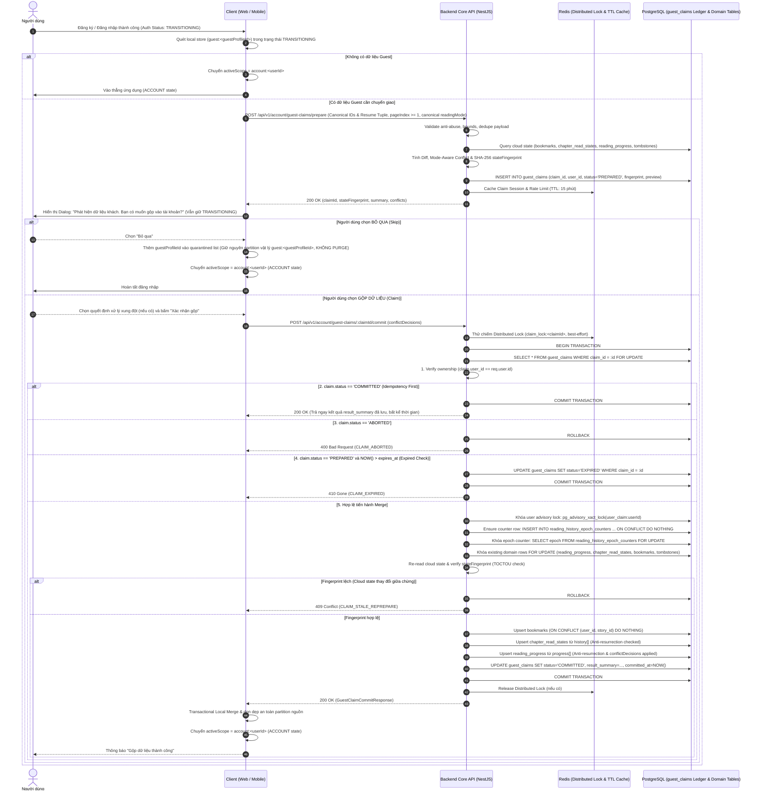

# 🤝 OmniNovel Architecture: Guest-to-Account Claim Protocol

> **Tài liệu Canonical SSoT số 2** thuộc **Phase 7.0 — Product Architecture & Data Ownership Design Gate** (Amended cho Phase 7B).  
> Thiết lập giao thức chuyển giao dữ liệu Khách sang Tài khoản (Claim Protocol) 2 bước xác định, đảm bảo tính bền vững (Durable Idempotency in PostgreSQL), chống xung đột dữ liệu (TOCTOU & State Fingerprint Protection với Domain Row Locking), kiểm soát quyền sở hữu nghiêm ngặt, bảo vệ kinh tế ảo và cung cấp cơ chế phục hồi lỗi (Crash Recovery).

---

## 1. Triết Lý Cốt Lõi: Claim Không Phải Là Sync

1. **Giao thức một lần (One-Time Handover):**
   - Chuyển giao dữ liệu từ Guest sang Account diễn ra khi người dùng định danh chính mình (Đăng ký mới hoặc Đăng nhập tài khoản cũ).
   - **Register Auto-Login Semantics (Khóa từ Phase 7B):** Endpoint `POST /api/v1/auth/register` được chuẩn hóa tự động đăng nhập sau khi tạo user thành công (cấp phát `familyId`, trả `accessToken` kèm claim `sid`, và gán `refreshToken` cookie tương tự `POST /login`). Nhờ đó, client ngay lập tức sở hữu phiên hợp lệ trong trạng thái `TRANSITIONING` để kích hoạt giao thức Guest Claim mà không bắt người dùng phải đăng nhập lại lần thứ hai.
   - Đây không phải là luồng đồng bộ định kỳ hay liên tục. Luồng đồng bộ liên tục đa thiết bị sẽ do **Phase 7C: Unified Sync Protocol** đảm nhiệm sau khi tài khoản đã được xác thực.
2. **Quyền quyết định thuộc về Người dùng (Explicit User Choice — Không Auto-Commit Ngầm):**
   - Sau khi đăng nhập/đăng ký thành công, client chuyển sang trạng thái `TRANSITIONING`. Client có thể tự động kiểm tra và chuẩn bị dữ liệu (`prepare`), nhưng **tuyệt đối không được tự ý commit ngầm**.
   - Trong suốt quá trình claim đang chờ xử lý (claim pending), client **bắt buộc phải giữ nguyên trạng thái `TRANSITIONING`**, tuyệt đối không cho phép các mutation của account hoạt động trước khi kết thúc claim/skip.
   - Người dùng phải được hiển thị hộp thoại xác nhận rõ ràng: **"Gộp dữ liệu vào tài khoản" (Claim)** hoặc **"Bỏ qua" (Skip)**.
   - Nếu người dùng chọn **Skip**: Dữ liệu khách được chuyển sang trạng thái **Quarantine** qua danh sách marker `quarantineGuestScope(guestProfileId)`. **Tuyệt đối không đổi tên partition vật lý** (vẫn giữ nguyên `guest:<guestProfileId>`) và **tuyệt đối không bị xóa (purge)**. Sau đó scope mới chuyển sang `ACCOUNT`.
   - Dữ liệu khách nguồn chỉ được phép purge và rebind sau khi máy chủ xác nhận trạng thái bền vững `COMMITTED`, sau đó scope mới chuyển sang `ACCOUNT`.
3. **Claim Source Identity là `guest:<guestProfileId>`, không phải `installationId`:**
   - `installationId` thuần túy là định danh thiết bị vật lý (`device:<installationId>`). Network DTO không bao giờ sử dụng `installationId` làm claim credential hay claim identity.
   - Nguồn claim duy nhất được định danh bằng `guestProfileId` (UUIDv4) thuộc về phiên khách cụ thể.
4. **Idempotency Bền Vững Trong PostgreSQL (Durable Ledger In DB):**
   - **PostgreSQL là Single Source of Truth và Correctness Authority duy nhất** cho trạng thái claim thông qua bảng sổ cái `guest_claims`.
   - Redis Distributed Lock (`claim_lock:<claimId>`) chỉ đóng vai trò **Best-Effort Concurrency Optimization** nhằm giảm tải tranh chấp ở tầng ứng dụng. Nếu Redis gặp sự cố, timeout hoặc restart, hệ thống **bắt buộc phải fallback mượt mà** tiếp tục xử lý an toàn bằng cơ chế khóa hàng PostgreSQL (`SELECT ... FOR UPDATE`).
   - Trạng thái `COMMITTED` và kết quả gộp dữ liệu (`result_summary`) bắt buộc phải được ghi nhận trong **cùng một Database Transaction** với toàn bộ thao tác gộp Bookmarks, Read States và Reading Progress.
   - Mọi sự cố sập ứng dụng (App Crash), mất mạng (Client Timeout) hoặc sự cố mất dữ liệu Redis (Redis Loss) sau khi DB transaction đã commit đều có thể được phục hồi an toàn tuyệt đối qua cơ chế tra cứu bền vững.
5. **Ràng Buộc Nghiêm Ngặt Quyền Sở Hữu Tài Khoản (Account Ownership Binding):**
   - Một Claim Session được prepare bởi `userId` nào thì **chỉ duy nhất `userId` đó** mới có quyền kiểm tra trạng thái (`GET /status`) hoặc thực thi commit (`POST /commit`).
   - Nếu User B cố gắng truy cập hoặc commit claim của User A (kể cả khi biết trước `claimId`), hệ thống lập tức từ chối với mã lỗi `403 Forbidden` (hoặc `404 Not Found`).
6. **Chống TOCTOU & Stale-Preview Dựa Trên State Fingerprint & Domain Row Locking:**
   - Không sử dụng `serverSnapshotRevision` khi chưa có hệ thống đánh số revision thật trong repository.
   - Tại bước `prepare`: Server chụp nhanh trạng thái các entity Cloud liên quan (`bookmarks`, `chapter_read_states`, `reading_progress`, `reading_history_tombstones`) và tính toán mã băm SHA-256 (`stateFingerprint`).
   - Tại bước `commit`: Để triệt tiêu hoàn toàn race window giữa fingerprint check và merge:
     1. Khóa hàng `guest_claims` bằng `SELECT ... FOR UPDATE`.
     2. Khóa transaction advisory lock mức người dùng: `SELECT pg_advisory_xact_lock(hashtext('user_claim:' || :userId))`.
     3. **Ensure row counter tồn tại trước khi khóa:** Thực thi `INSERT INTO reading_history_epoch_counters (user_id, epoch, updated_at) VALUES (:userId, 0, NOW()) ON CONFLICT (user_id) DO NOTHING;` rồi mới `SELECT epoch FROM reading_history_epoch_counters WHERE user_id = :userId FOR UPDATE;`.
     4. Khóa toàn bộ các domain rows hiện có của người dùng liên quan đến các story/chapter trong payload bằng `FOR UPDATE`:
        - `SELECT * FROM reading_progress WHERE user_id = :userId AND story_id = ANY(:storyIds) FOR UPDATE;`
        - `SELECT * FROM reading_history_tombstones WHERE user_id = :userId AND story_id = ANY(:storyIds) FOR UPDATE;`
        - `SELECT * FROM chapter_read_states WHERE user_id = :userId AND chapter_id = ANY(:chapterIds) FOR UPDATE;`
        - `SELECT * FROM bookmarks WHERE user_id = :userId AND story_id = ANY(:storyIds) FOR UPDATE;`
     5. Tính lại `currentFingerprint` trên dữ liệu đã khóa. Nếu phát hiện thay đổi so với `stateFingerprint` đã cấp tại prepare, Server ROLLBACK và trả về mã lỗi `409 Conflict` kèm mã `CLAIM_STALE_REPREPARE`.
     6. Nhờ việc giữ các khóa này đến khi transaction commit, không có khoảng hở (zero race gap) nào cho phép thiết bị khác ghi đè dữ liệu mới hơn.
7. **Bảo Tồn Đầy Đủ Resume Tuple Đã Khóa Ở Phase 7A — 1-based `pageIndex >= 1`:**
   - DTO tiến độ đọc bắt buộc phải giữ đủ bộ 7 trường vị trí: `chapterVersionId`, `readingMode`, `pageIndex`, `scrollPosition`, `progressPercentage`, `anchorBlockId`, `textOffset`.
   - **Chuẩn hóa `pageIndex`:** Toàn bộ API Network DTO, Database schema (`reading_progress.page_index`) và Shared Contracts phải tuân thủ chuẩn **1-based (`pageIndex >= 1`, minimum = 1)**.
   - Chỉ số 0-based của Flutter (`flutterPageIndex`) chỉ được phép tồn tại nội bộ trong UI/runtime của ứng dụng di động và phải được quy đổi (`pageIndex = flutterPageIndex + 1`) trước khi gửi lên mạng hoặc lưu offline database canonical.
8. **Quy Chuẩn Lịch Sử Đọc & Tiến Độ Đọc Khớp Schema Thực Tế Backend:**
   - Backend hiện tại **không có bảng `reading_history`**.
   - Cấu trúc bảng thực tế:
     * `reading_progress`: PK `(user_id, story_id)` — Điểm dừng đọc hiện tại của người dùng cho từng bộ truyện.
     * `chapter_read_states`: PK `(user_id, chapter_id)` — Lịch sử và trạng thái đọc chi tiết theo từng chương (`max_progress_percentage`, `completed_at`, `last_read_at`).
     * `reading_history_tombstones`: PK `(user_id, story_id)` — Dấu vết xóa lịch sử đọc của truyện kèm `epoch`.
     * `bookmarks`: PK `(user_id, story_id)` — Danh sách truyện đánh dấu theo dõi.
   - **Nguồn Dữ Liệu Read-State Duy Nhất:** `history[]` (với `progressPercentage` bắt buộc) là nguồn duy nhất để upsert vào `chapter_read_states`. Loại bỏ hoàn toàn mảng `readChapterIds` dư thừa khỏi `progress[]`.
   - **Tombstone Anti-Resurrection Bất Biến:** Nếu một bộ truyện đã có bản ghi tombstone trong `reading_history_tombstones` trên Cloud, **toàn bộ dữ liệu của truyện đó từ Guest (bao gồm Read States trong `chapter_read_states` và Resume Progress trong `reading_progress`) ĐỀU BỊ TỪ CHỐI AUTO-IMPORT** nhằm ngăn chặn hiện tượng zombie resurrection.
9. **Bảo Mật Kinh Tế Ảo (Gamification Hardening - Zero Side-Effects):**
   - **Tuyệt đối không cấp phát bất kỳ điểm thưởng nào (EXP, OmniCoin, Reading Streak)** thông qua luồng Guest Claim.
   - Mọi thao tác gộp dữ liệu khách chỉ cập nhật thư viện và tiến độ, hoàn toàn cách ly khỏi Gamification Engine.
   - Ma trận nghiệm thu phải kiểm chứng trực tiếp bảng thực tế `user_progression` (các trường `total_exp`, `omnicoin_balance`, `current_streak`), assert delta = 0.
10. **Phòng Chống Lạm Dụng Khắt Khe (Anti-Abuse Hardening Tại Prepare):**
    - Kiểm tra định dạng UUIDv4 chặt chẽ cho toàn bộ các trường ID.
    - Giới hạn kích thước payload: Tối đa 500 bookmarks, 1000 history items, 500 progress items, dung lượng body tối đa 2MB (cấu hình explicit `json({ limit: '2mb' })` trong NestJS server).
    - Canonical `readingMode`: Chỉ chấp nhận đúng 3 giá trị chuẩn `'WEBTOON' | 'PAGED' | 'NOVEL'`. Client chuẩn hóa `MANGA_PAGED` $\rightarrow$ `PAGED` trước khi gửi lên API.
    - Kiểm tra miền giá trị số hữu hạn (finite bounds): `progressPercentage` [0..100], `scrollPosition` >= 0, `pageIndex` >= 1 (integer, 1-based), `textOffset` >= 0 (integer).
    - Tự động khử trùng lặp (dedupe) payload gửi lên.
    - Kiểm tra tính hợp lệ của Foreign Key và quyền truy cập: `storyId` phải tồn tại và công khai, `chapterId` phải thuộc về `storyId`, `chapterVersionId` (nếu có) phải thuộc về `chapterId`, chương không thuộc loại khóa/trả phí mà khách không có quyền.
    - Giới hạn tần suất gọi API (Rate Limit): Tối đa 10 requests prepare / phút / user hoặc IP.

---

## 2. Giao Thức 3 Điểm Cuối (Three-Endpoint Claim Protocol)

Giao thức gồm 3 endpoint chính thức phục vụ vòng đời hoàn chỉnh:
1. `POST /api/v1/account/guest-claims/prepare`: Thẩm định, tính khác biệt (Diff), phát hiện xung đột và lưu ledger ở trạng thái `PREPARED`.
2. `POST /api/v1/account/guest-claims/:claimId/commit`: Thẩm định TOCTOU fingerprint, áp dụng merge nguyên tử trong DB transaction, chuyển trạng thái ledger sang `COMMITTED`.
3. `GET /api/v1/account/guest-claims/:claimId/status`: Truy vấn trạng thái ledger phục vụ crash recovery khi client gặp sự cố mạng hoặc tắt ứng dụng đột ngột sau khi commit.



---

## 3. Kiến Trúc CSDL Sổ Cái: Bảng `guest_claims` (PostgreSQL Durable Ledger)

Để đảm bảo Idempotency bền vững vượt qua cả các sự cố sập máy chủ, mất kết nối mạng và mất cache Redis, đồng thời tương thích hoàn hảo với chính sách ẩn danh hóa khi xóa tài khoản:

```sql
CREATE TYPE guest_claim_status AS ENUM ('PREPARED', 'COMMITTED', 'ABORTED', 'EXPIRED');

CREATE TABLE guest_claims (
    claim_id UUID PRIMARY KEY,
    user_id UUID NULL REFERENCES users(id) ON DELETE SET NULL,
    anonymized_subject_hash CHAR(64) NULL,
    guest_profile_id UUID NOT NULL,
    payload_hash VARCHAR(64) NOT NULL,
    state_fingerprint VARCHAR(64) NOT NULL,
    status guest_claim_status NOT NULL DEFAULT 'PREPARED',
    preview_data JSONB NOT NULL,
    conflict_decisions JSONB,
    result_summary JSONB,
    expires_at TIMESTAMPTZ NOT NULL,
    created_at TIMESTAMPTZ NOT NULL DEFAULT NOW(),
    committed_at TIMESTAMPTZ,
    updated_at TIMESTAMPTZ NOT NULL DEFAULT NOW()
);

CREATE INDEX idx_guest_claims_user_id_status ON guest_claims(user_id, status);
CREATE INDEX idx_guest_claims_expires_at ON guest_claims(expires_at) WHERE status = 'PREPARED';
```

> [!NOTE]
> Cột `user_id` là nullable với `ON DELETE SET NULL`.
> - **Tại Day 0 (Soft Delete):** `user_id` VẪN ĐƯỢC GIỮ NGUYÊN trong `guest_claims` để bảo đảm tính toàn vẹn nếu người dùng khôi phục tài khoản trong vòng 30 ngày qua `POST /api/v1/auth/reactivate-account`.
> - **Tại Day 30 (Final Purge):** Khi hết hạn 30 ngày grace period mà người dùng không khôi phục, scheduled worker tính `anonymized_subject_hash = crypto.createHash('sha256').update(userId).digest('hex')` ở tầng Node.js (không phụ thuộc extension `pgcrypto`), cập nhật vào `guest_claims` và đặt `user_id = NULL`. Bản ghi sổ cái được bảo toàn vĩnh viễn cho mục đích kiểm toán toàn vẹn hệ thống và chống gian lận kinh tế mà không lưu trữ bất kỳ PII nào.

### Thứ Tự Thực Thi & Quy Tắc Chuyển Trạng Thái Ledger:
Tại endpoint `POST /api/v1/account/guest-claims/:claimId/commit`, thứ tự kiểm tra bắt buộc phải tuân thủ nghiêm ngặt:
1. `SELECT * FROM guest_claims WHERE claim_id = :id FOR UPDATE`
2. **Kiểm tra quyền sở hữu:** Nếu `claim.user_id !== req.user.id` ➔ Rollback, trả `403 Forbidden`.
3. **Kiểm tra `COMMITTED` (Idempotency First):** Nếu `claim.status === 'COMMITTED'` ➔ Trả ngay kết quả `result_summary` với mã `200 OK`. Trạng thái `COMMITTED` có hiệu lực idempotent vĩnh viễn theo chính sách lưu trữ sổ cái (Ledger Retention Policy), **hoàn toàn không phụ thuộc vào TTL 15 phút của prepare**. Client retry sau 15 phút, 1 giờ hay 1 ngày đều nhận lại kết quả thành công.
4. **Kiểm tra `ABORTED`:** Nếu `claim.status === 'ABORTED'` ➔ Rollback, trả `400 Bad Request` hoặc `409 Conflict`.
5. **Kiểm tra `EXPIRED`:** Nếu `claim.status === 'PREPARED'` VÀ `NOW() > claim.expires_at` ➔ Cập nhật trạng thái `EXPIRED`, trả `410 Gone (CLAIM_EXPIRED)`.
6. **Bảo vệ TOCTOU:** Khi session còn hạn và ở trạng thái `PREPARED`, khóa domain rows, tính lại fingerprint và thực hiện merge.

---

## 4. Quy Tắc Hợp Nhất Chuyên Biệt Theo Từng Miền (Domain Merge Matrix)

| Miền Dữ Liệu (Domain) | Dữ Liệu Client Gửi Lên | Bảng CSDL Thực Tế Backend | Quy Tắc Hợp Nhất Vào Tài Khoản (Merge Semantics) | Cơ Chế Xử Lý Xung Đột (Conflict Handling) |
|---|---|---|---|---|
| **Bookmarks (Đánh dấu)** | Danh sách `storyId` active | `bookmarks` (PK: `user_id, story_id`) | **Additive Only (Cộng dồn):** Thêm các truyện Guest đánh dấu vào tài khoản (`ON CONFLICT (user_id, story_id) DO NOTHING`). | Khách **không được phép xóa** bookmark đã có trên Cloud. Xóa trên Cloud chỉ diễn ra qua Sync có tombstone ở Phase 7C. |
| **Reading History / Read States** | Danh sách `(storyId, chapterId, progressPercentage)` (từ `history[]`) | `chapter_read_states` (PK: `user_id, chapter_id`) | **Union & Dedupe:** Upsert vào `chapter_read_states` với `max_progress_percentage = GREATEST(...)`, `completed_at`, `last_read_at = NOW()`. | **Tombstone Anti-Resurrection:** Nếu `storyId` có trong `reading_history_tombstones`, **từ chối import toàn bộ chapters của truyện đó**. |
| **Reading Progress (Tiến độ đọc)** | Đầy đủ 7 trường Resume Tuple: `storyId, chapterId, chapterVersionId, readingMode, pageIndex (>= 1), scrollPosition, progressPercentage, anchorBlockId, textOffset` | `reading_progress` (PK: `user_id, story_id`) | Xem chi tiết mục 5 bên dưới (Mode-Aware Resolution). | **Tombstone Anti-Resurrection:** Nếu `storyId` có trong `reading_history_tombstones`, **từ chối import tiến độ đọc của truyện đó**. |
| **Reader Preferences** | `fontSize`, `theme`, `readingDirection` | Local / User settings | Ưu tiên cài đặt đã có của Cloud. Nếu Cloud chưa có, lấy của Guest. | Thiết lập cục bộ theo từng thiết bị (`device:*`) được ưu tiên áp dụng cho trải nghiệm nhìn. |
| **Recent Searches (Tìm kiếm)** | *Không gửi* | Local Storage / SQLite | **Strictly Local:** Giữ cục bộ trên thiết bị, không chuyển giao lên Cloud. | Loại trừ khỏi Claim Protocol để giảm thiểu bề mặt tấn công. |
| **Gamification / Rewards** | *Không gửi* | `user_progression` (`total_exp`, `omnicoin_balance`, `current_streak`) | **Strictly Server-Only:** Bỏ qua hoàn toàn. | Tuyệt đối cấm nhận thưởng (EXP, Coin, Streak = 0) từ dữ liệu nặc danh. |

---

## 5. Xử Lý Xung Đột Tiến Độ Đọc Theo Chế Độ (Mode-Aware Progress Conflict Resolution)

Để tránh trường hợp so sánh phần trăm đơn giản gây sai lệch vị trí đọc giữa các định dạng khác nhau, hệ thống áp dụng cơ chế so sánh nhận biết chế độ đọc (**Mode-Aware Comparator**):

```text
Tình huống A: Tài khoản chưa từng có bản ghi reading_progress cho truyện này (và không có tombstone)
└─► Toàn bộ tiến độ đọc của Guest (đầy đủ 7 trường resume tuple, pageIndex >= 1) được lưu thẳng vào reading_progress.

Tình huống B: Tài khoản đã có reading_progress cho truyện này, cùng chapterId và cùng readingMode
┌─► Chế độ PAGED (Manga, PDF, EPUB paged):
│   ├─ Nếu cloud.pageIndex === guest.pageIndex ➔ Trivial Match (giữ Cloud hoặc lấy tiến độ cao hơn).
│   └─ Nếu cloud.pageIndex !== guest.pageIndex ➔ CONFLICT!
├─► Chế độ WEBTOON (Cuộn dọc liên tục):
│   ├─ Nếu abs(cloud.scrollPosition - guest.scrollPosition) <= 50.0 VÀ abs(cloud.progressPercentage - guest.progressPercentage) <= 5.0%
│   │   ➔ Trivial Match.
│   └─ Nếu vượt ngưỡng trên ➔ CONFLICT!
└─► Chế độ NOVEL (Văn bản có điểm neo):
    ├─ Nếu cloud.anchorBlockId === guest.anchorBlockId VÀ abs((cloud.textOffset ?? 0) - (guest.textOffset ?? 0)) <= 100
    │   ➔ Trivial Match.
    └─ Nếu khác anchorBlockId hoặc lệch offset lớn ➔ CONFLICT!

Tình huống C: Khác chapterId, khác readingMode hoặc phát hiện CONFLICT ở trên
┌─► Mặc định Server giữ vị trí của Cloud làm CANONICAL POSITION (Tránh ghi đè ngoài ý muốn).
├─► Trả về Conflict trong ClaimPreview để người dùng xem so sánh:
│     {
│       storyId: "uuid",
│       readingMode: "PAGED",
│       cloudProgress: {
│         chapterId: "chap-uuid-cloud",
│         progressPercentage: 65,
│         pageIndex: 12, // 1-based >= 1
│         updatedAt: "2026-10-06T12:00:00Z"
│       },
│       guestProgress: {
│         chapterId: "chap-uuid-guest",
│         progressPercentage: 20,
│         pageIndex: 4 // 1-based >= 1
│       }
│     }
└─► Client hiển thị UI cho người dùng lựa chọn: "Dùng vị trí từ thiết bị này" (USE_GUEST) hoặc "Giữ vị trí tài khoản" (KEEP_CLOUD).
```

---

## 6. Đặc Tả DTO & API Endpoints Chi Tiết

### 6.1. Endpoint 1: Prepare Claim
- **Endpoint:** `POST /api/v1/account/guest-claims/prepare`
- **Headers:** `Authorization: Bearer <accessToken>`
- **Request Body (`PrepareGuestClaimDto`):**
```typescript
export interface PrepareGuestClaimDto {
  guestProfileId: string; // UUIDv4 - Định danh phiên khách nguồn
  installationId?: string; // Tùy chọn - Client device hint / telemetry, KHÔNG LÀ CREDENTIAL
  bookmarks: Array<{
    storyId: string; // UUIDv4
  }>;
  progress: Array<{
    storyId: string; // UUIDv4
    chapterId: string; // UUIDv4
    chapterVersionId?: string | null; // UUIDv4 hoặc null
    readingMode?: 'WEBTOON' | 'PAGED' | 'NOVEL'; // Canonical Enum duy nhất, không dùng string tùy ý
    pageIndex?: number | null; // Số nguyên 1-based >= 1 (bắt buộc cho Manga/PDF paged mode)
    scrollPosition: number; // Số thực hữu hạn >= 0
    progressPercentage: number; // Số thực hữu hạn từ 0.0 đến 100.0
    anchorBlockId?: string | null; // Khóa neo đoạn văn cho Light Novel
    textOffset?: number | null; // Số nguyên >= 0
  }>;
  history: Array<{
    storyId: string; // UUIDv4
    chapterId: string; // UUIDv4
    progressPercentage: number; // Số thực [0..100], REQUIRED - Nguồn duy nhất cho chapter_read_states
    readAtClient?: string; // ISO 8601 string - Chỉ là diagnostic hint
  }>;
  preferences?: {
    readingDirection?: 'LTR' | 'RTL' | 'VERTICAL';
    theme?: 'DARK' | 'LIGHT' | 'SEPIA' | 'AMOLED';
  };
}
```

- **Response Body (`200 OK` - `GuestClaimPreviewResponse`):**
```typescript
export interface GuestClaimPreviewResponse {
  claimId: string; // UUIDv4 - Định danh của Claim Session
  stateFingerprint: string; // SHA-256 fingerprint của cloud state tại thời điểm prepare
  expiresAt: string; // ISO 8601 - Hạn chót thực hiện commit (15 phút)
  summary: {
    bookmarksToAddCount: number;
    bookmarksIgnoredCount: number; // Đã có trên Cloud
    readStatesToAddCount: number;
    readStatesIgnoredAntiResurrectionCount: number; // Bị chặn do tombstone
    progressAcceptedCount: number;
    progressConflictsCount: number;
  };
  conflicts: Array<{
    storyId: string;
    readingMode?: 'WEBTOON' | 'PAGED' | 'NOVEL';
    cloudProgress: {
      chapterId: string;
      chapterTitle?: string;
      progressPercentage: number;
      pageIndex?: number | null; // 1-based >= 1
      updatedAt: string;
    };
    guestProgress: {
      chapterId: string;
      progressPercentage: number;
      pageIndex?: number | null; // 1-based >= 1
    };
  }>;
}
```

- **Mã Lỗi Trả Về:**
  - `400 Bad Request`: Payload không hợp lệ (sai UUID, vượt giới hạn số lượng, `pageIndex < 1`, sai `readingMode` enum, số âm hoặc NaN).
  - `401 Unauthorized`: Thiếu hoặc sai JWT token.
  - `429 Too Many Requests`: Vượt quá giới hạn rate limit (10 requests/phút).

---

## 6.2. Endpoint 2: Commit Claim
- **Endpoint:** `POST /api/v1/account/guest-claims/:claimId/commit`
- **Headers:** `Authorization: Bearer <accessToken>`
- **Request Body (`CommitGuestClaimDto`):**
```typescript
export interface CommitGuestClaimDto {
  expectedStateFingerprint: string; // SHA-256 fingerprint nhận được từ bước prepare
  conflictDecisions?: Array<{
    storyId: string; // UUIDv4
    resolution: 'KEEP_CLOUD' | 'USE_GUEST';
  }>;
}
```

- **Response Body (`200 OK` - `GuestClaimCommitResponse`):**
```typescript
export interface GuestClaimCommitResponse {
  claimId: string;
  status: 'COMMITTED';
  committedAt: string;
  appliedStats: {
    bookmarksAdded: number;
    readStatesMerged: number;
    progressSaved: number;
  };
}
```

- **Mã Lỗi Trả Về:**
  - `403 Forbidden`: `claim.user_id !== req.user.id` (User B cố commit claim của User A).
  - `404 Not Found`: Không tìm thấy `claimId`.
  - `409 Conflict` (`CLAIM_STALE_REPREPARE`): Trạng thái Cloud đã thay đổi kể từ lúc prepare, fingerprint không khớp. Client phải gọi prepare lại.
  - `410 Gone` (`CLAIM_EXPIRED`): Claim session chưa commit nhưng đã hết hạn 15 phút.

---

## 6.3. Endpoint 3: Check Claim Status (Crash Recovery)
- **Endpoint:** `GET /api/v1/account/guest-claims/:claimId/status`
- **Headers:** `Authorization: Bearer <accessToken>`
- **Response Body (`200 OK` - `GuestClaimStatusResponse`):**
```typescript
export interface GuestClaimStatusResponse {
  claimId: string;
  userId: string;
  guestProfileId: string;
  status: 'PREPARED' | 'COMMITTED' | 'ABORTED' | 'EXPIRED';
  createdAt: string;
  expiresAt: string;
  committedAt?: string | null;
  appliedStats?: {
    bookmarksAdded: number;
    readStatesMerged: number;
    progressSaved: number;
  } | null;
}
```

---

## 7. Tính Bất Biến Idempotency & Phục Hồi Lỗi (Failure Recovery)

1. **Khắc Phục Rớt Mạng Sau Khi Server Commit (Network Timeout / Double Submit):**
   - Khi client gửi commit nhưng bị đứt kết nối mạng trước khi nhận được phản hồi: Client gửi lại chính xác `POST /api/v1/account/guest-claims/:claimId/commit` với cùng `expectedStateFingerprint`.
   - Backend kiểm tra bản ghi trong bảng `guest_claims`: Nếu trạng thái đã là `COMMITTED`, Backend trả về ngay `GuestClaimCommitResponse` đã lưu trong `result_summary` với mã `200 OK`, tuyệt đối không thực hiện merge lần 2. Hiệu lực idempotent là vĩnh viễn trong thời hạn lưu trữ sổ cái.
2. **Khắc Phục Ứng Dụng Đột Tử (App Crash Sau Commit):**
   - Khi người dùng mở lại ứng dụng: Client kiểm tra partition khách cục bộ `guest:<guestProfileId>`. Nếu phát hiện có `pendingClaimId` chưa hoàn tất:
     - Client gửi truy vấn `GET /api/v1/account/guest-claims/:pendingClaimId/status`.
     - Nếu máy chủ trả về `status: 'COMMITTED'`: Client lập tức kích hoạt dọn dẹp partition nguồn qua Transactional Local Merge và chuyển `activeScope = account:<userId>`.
     - Nếu máy chủ trả về `PREPARED`: Client tiếp tục quy trình hiển thị xác nhận cho người dùng (giữ `TRANSITIONING`).
     - Nếu máy chủ trả về `EXPIRED` hoặc `404`: Client xóa `pendingClaimId` và đưa `guestProfileId` vào danh sách Quarantine để đảm bảo không mất dữ liệu, rồi chuyển sang `ACCOUNT`.
3. **Mất Dữ Liệu Cache Redis (Redis Loss / Flush / Restart):**
   - Bảng `guest_claims` trong PostgreSQL là Single Source of Truth bền vững.
   - Redis Lock chỉ là tầng tối ưu phụ trợ. Nếu Redis restart hoặc mất kết nối, hệ thống vẫn hoàn tất commit an toàn 100% nhờ khóa hàng PostgreSQL `FOR UPDATE`.
4. **Phục Hồi Dữ Liệu Cục Bộ Phía Client (Client Local Merge Contract):**
   - **Không rename partition vật lý:** Khi người dùng chọn Skip, client chỉ thêm `guestProfileId` vào danh sách `omninovel_quarantined_guest_profiles`. Partition vật lý vẫn là `guest:<guestProfileId>`.
   - **Transactional Rebind trên Mobile SQLite:** Không chạy câu lệnh `UPDATE ... SET owner_scope = 'account:<userId>'` (tránh xung đột Primary Key). Thay vào đó, thực hiện Transactional Merge: `INSERT OR IGNORE` cho bookmarks, merge read states và progress, sau đó mới xóa dữ liệu thuộc partition nguồn khách.

---

## 8. Ma Trận Chấp Nhận & Kiểm Thử Trường Hợp Sự Cố (Crash & Replay Acceptance Matrix)

| Kịch Bản Kiểm Thử | Điều Kiện Đầu Vào | Hành Vi Hệ Thống Kỳ Vọng | Tiêu Chuẩn Xác Minh (Verification) |
|---|---|---|---|
| **1. Duplicate Commit** | Client gửi lại `POST /commit` sau khi đã commit thành công | Trả về `200 OK` kèm `appliedStats` gốc, không merge lại | Không tăng số bản ghi DB, idempotent 100% |
| **2. Concurrent Commit Race** | 2 request commit cùng lúc cho 1 `claimId` | Redis Lock + DB row-lock (`FOR UPDATE`) xử lý tuần tự, request 2 nhận kết quả committed | Không có dead-lock, không bị duplicate insert |
| **3. Client Timeout Recovery** | Server commit thành công nhưng client bị ngắt mạng | Client gọi `GET /status` nhận `COMMITTED`, dọn dẹp local | Dữ liệu cloud đầy đủ, local partition được dọn an toàn |
| **4. Redis Loss / Restart** | Redis flush toàn bộ keys hoặc rớt kết nối giữa prepare và commit | Hệ thống fallback về đọc PostgreSQL `guest_claims`, commit vẫn thành công | Không làm gián đoạn luồng nghiệp vụ của người dùng |
| **5. Stale Cloud State (TOCTOU)** | User bookmark/xóa truyện trên Web trong khi App đang chờ commit | `currentFingerprint !== stateFingerprint` ➔ Rollback DB, trả `409 CLAIM_STALE_REPREPARE` | Ngăn chặn ô nhiễm trạng thái và dữ liệu ma |
| **6. Cross-Account Claim Replay** | User B dùng JWT của mình gọi commit `claimId` của User A | Core API so khớp `claim.user_id !== req.user.id` ➔ Trả `403 Forbidden` | Không bao giờ gộp nhầm dữ liệu sang tài khoản khác |
| **7. Expired Claim Session** | Client gửi commit sau khi quá hạn 15 phút (trạng thái đang `PREPARED`) | Server kiểm tra `NOW() > expires_at` ➔ Cập nhật `EXPIRED`, trả `410 Gone / CLAIM_EXPIRED` | Không cho phép commit dữ liệu đã quá cũ |
| **8. Committed Replay Sau 15 Phút** | Client retry commit của một claim đã `COMMITTED` trước đó sau 20 phút | Server kiểm tra `status === 'COMMITTED'` TRƯỚC HẠN TTL ➔ Trả ngay `200 OK` | Đảm bảo tính Idempotent vĩnh viễn của commit thành công |
| **9. Tombstone Resurrection Prevention** | Guest gửi lịch sử và tiến độ của một truyện đã có tombstone trên Cloud | Server loại bỏ toàn bộ dữ liệu của truyện đó (`chapter_read_states`, `reading_progress`) | 0 bản ghi của truyện tombstone được chèn vào Cloud |
| **10. Zero Gamification Check** | Guest import 500 chapters trong lịch sử đọc | Snapshot bảng thực tế `user_progression` trước và sau commit (`total_exp`, `omnicoin_balance`, `current_streak`) | **Delta = 0 trên toàn bộ các trường** |
| **11. Phase 7A Regression Gate** | Chạy toàn bộ test suites của Phase 7A | Toàn bộ 48 test files Web, unit test Dart Mobile, and API guards pass 100% | Đảm bảo tính liên tục và không thoái lui mã nguồn |
