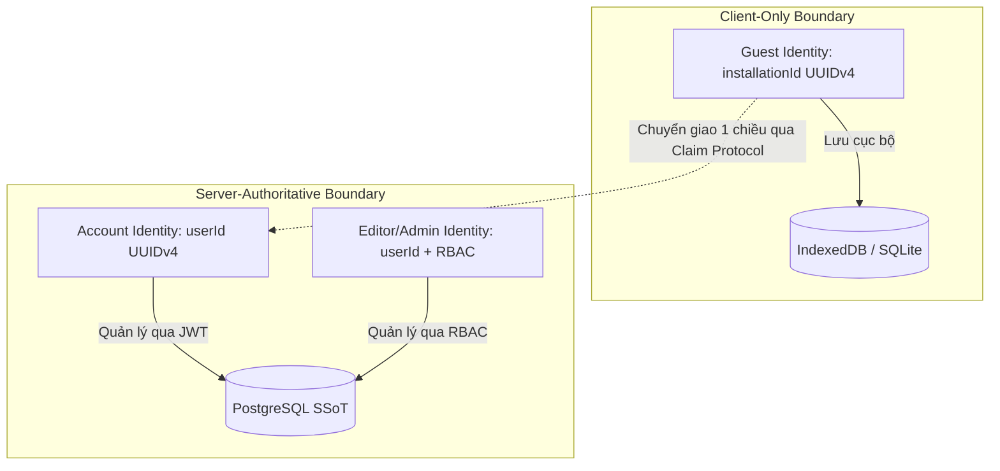
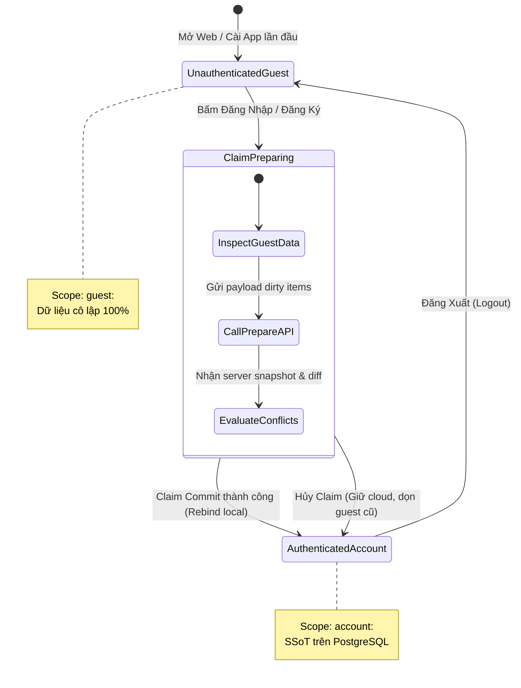

# 🛡️ OmniNovel Architecture: Identity & Ownership Model

> **Tài liệu Canonical SSoT số 1** thuộc **Phase 7.0 — Product Architecture & Data Ownership Design Gate**.  
> Thiết lập ranh giới định danh, sở hữu dữ liệu, cô lập bộ nhớ đệm (Namespace Isolation) và mô hình vòng đời đa tài khoản cho toàn bộ hệ sinh thái OmniNovel (Web, Mobile, Backend).

---

## 1. Bản Chất Định Danh & 3 Tầng Quyền Sử Dụng

OmniNovel phân tách rành mạch 3 loại thực thể định danh trong hệ thống:



### 1.1. Guest Identity (`guest:<installationId>`)
- **Định danh:** Mỗi thiết bị / profile trình duyệt tự sinh một chuỗi ngẫu nhiên duy nhất `installationId` (chuẩn UUIDv4) khi mở app lần đầu.
- **Ranh giới:** `installationId` **CHỈ TỒN TẠI TẠI CLIENT**.
- **Quy tắc tuyệt đối (P0 Security Invariant):**
  - **Không tạo bản ghi trong bảng `users` của PostgreSQL** khi có khách vãng lai, bot tìm kiếm hay tab ẩn danh truy cập.
  - `installationId` **không phải là credential xác thực** và không được gửi lên các API yêu cầu xác thực (`JwtAuthGuard`).
  - Web và Mobile của cùng một người dùng khi chưa đăng nhập là 2 Guest riêng biệt, **hoàn toàn không đồng bộ chéo**.

### 1.2. Account Identity (`account:<userId>`)
- **Định danh:** `userId` (UUIDv4) do PostgreSQL cấp phát thông qua đăng ký (`POST /auth/register`).
- **Xác thực:** JWT Access Token (ngắn hạn) + Refresh Token (httpOnly Cookie an toàn trên Web hoặc SecureStorage trên Mobile).
- **Quyền hạn:** Là Single Source of Truth (SSoT) cho thư viện, đồng bộ đa thiết bị, tham gia bình luận (Community) và tích luỹ điểm thưởng (Gamification).

### 1.3. Editor / Admin Identity
- Mở rộng từ `AccountIdentity` với các claims RBAC (`GlobalRole.TRANSLATOR`, `GlobalRole.ADMIN`, hoặc `StoryMemberRole`).
- Cho phép truy cập Studio dịch truyện AI, quản lý thuật ngữ (Glossary), duyệt bản dịch và quản trị hệ thống.

---

## 2. Quy Chuẩn Không Gian Tên Bộ Nhớ (Namespace Partitioning)

Để đảm bảo không bao giờ xảy ra ô nhiễm dữ liệu chéo (cross-account contamination) giữa các người dùng hoặc giữa Khách và Tài khoản trên cùng một máy, mọi kho lưu trữ client bắt buộc phải chia namespace theo mẫu sau:

### 2.1. Phân Vùng Lưu Trữ
| Tầng Lưu Trữ | Định Dạng Khóa / Scope | Phạm Vi Dữ Liệu | Cơ Chế Dọn Dẹp / Cô Lập |
|---|---|---|---|
| **Guest Scope** | `guest:<installationId>` | Bookmarks, Reading Progress, Reading History, Local Preferences | Duy trì cho đến khi người dùng chủ động xóa app / clear site data hoặc được rebind sau claim. |
| **Account Scope** | `account:<userId>` | Bản sao đồng bộ (local replica) của dữ liệu Cloud | Khi Logout: **Lập tức detach và ẩn hoàn toàn**. Tuyệt đối không tái sinh (resurrect) thành Guest data. |
| **Device Scope** | `device:<installationId>` | Theme preference, audio/haptic toggles, UI density | Không phụ thuộc người dùng đăng nhập, gắn liền với phần cứng thiết bị. |

### 2.2. Chi Tiết Thực Thi Trên Từng Nền Tảng

#### Web Client (`apps/web`):
- **Kho lưu trữ chính (Primary Store):** **IndexedDB** (sử dụng Dexie.js hoặc IDB wrapper chuẩn).
  - Database: `omninovel_local_v2`
  - Object Stores:
    - `guest_bookmarks` & `account_bookmarks` (hoặc store `bookmarks` có composite key `[ownerScope, storyId]`).
    - `guest_progress` & `account_progress` (composite key `[ownerScope, storyId]`).
    - `guest_history` & `account_history` (composite key `[ownerScope, storyId, chapterId]`).
- **Kho lưu trữ phụ (Auxiliary):** `localStorage` **chỉ dùng cho `device:*` preferences cực nhỏ** (ví dụ: `theme_mode: 'DARK'`). Tuyệt đối không lưu dữ liệu tiến độ hay thư viện vào `localStorage` do giới hạn 5MB, tính đồng bộ chặn (synchronous blocking) và thiếu tính toàn vẹn transaction.

#### Mobile Client (`apps/mobile`):
- **Kho lưu trữ chính:** **Hạ tầng SQLite hiện hữu** (Floor / sqflite).
- **Cơ chế Adapter Scope:** Thêm cột `owner_scope TEXT NOT NULL` vào các bảng hiện tại (`bookmarks`, `reading_progress`, `reading_history`, `downloaded_chapters`).
- Mọi câu truy vấn DAO bắt buộc phải có điều kiện `WHERE owner_scope = :activeScope`.
- Không dựng thêm file DB mới để tránh phân mảnh tài nguyên I/O.

---

## 3. Máy Trạng Thái Định Danh & Ma Trận Chuyển Đổi (State Transitions)



### 3.1. Các Kịch Bản Chuyển Trạng Thái Chi Tiết

#### Kịch bản 1: Người dùng mới mở Web/App (Guest Mode)
- Client kiểm tra: nếu chưa có `installationId` trong SecureStorage/LocalStorage -> tạo mới `UUIDv4`.
- `activeScope` được gán = `guest:<installationId>`.
- Mọi hoạt động đọc, đánh dấu trang, lưu tiến độ chỉ ghi vào partition này.

#### Kịch bản 2: Guest đăng nhập / tạo tài khoản mới (Guest → Account Claim)
- Người dùng thực hiện `login()` hoặc `register()`.
- Client tạm giữ session mới, kích hoạt luồng **Two-Step Guest Claim Protocol** (đặc tả tại [guest_to_account_claim_protocol.md](file:///e:/Workspace%202/Doctruyen_project/plans/product/guest_to_account_claim_protocol.md)).
- Sau khi Claim Commit thành công:
  - Đánh dấu trạng thái `guest:<installationId>` là `CLAIMED_AND_PURGED`.
  - Rebind các file offline hợp lệ sang `account:<userId>`.
  - `activeScope` chuyển sang `account:<userId>`.

#### Kịch bản 3: Người dùng đăng xuất (Account → Guest) — *P0 Invariant: Chống Ô Nhiễm Chéo*
- Người dùng bấm Đăng Xuất (`POST /auth/logout`).
- Client thực hiện các bước sau theo thứ tự bắt buộc:
  1. Xóa toàn bộ token (`accessToken`, clear cookie `refreshToken`).
  2. **Detach và đóng hoàn toàn scope `account:<userId>`**. Dữ liệu cache của tài khoản này được khóa lại (lock/purge khỏi active memory).
  3. **TUYỆT ĐỐI KHÔNG copy hoặc chuyển đổi dữ liệu của `account:<userId>` thành `guest:<installationId>`.**
  4. Khởi tạo một `guest:<newInstallationId>` tinh khiết (hoặc khôi phục guest scope rỗng).
  5. UI chuyển về trạng thái Guest với thư viện rỗng, không chứa bất kỳ dấu vết nào của tài khoản vừa đăng xuất.

#### Kịch bản 4: User A đăng xuất, User B đăng nhập trên cùng máy
- Khi User A đăng xuất: cache của A bị cô lập hoàn toàn.
- Khi User B đăng nhập: Client nhận `userId = B`. Scope chuyển thành `account:B`.
- B chỉ thấy dữ liệu từ server của chính B và cache của chính B (nếu có từ trước).
- **Tỉ lệ ô nhiễm dữ liệu từ A sang B: 0.00%**.

---

## 4. Mô Hình Sở Hữu Nội Dung Tải Ngoại Tuyến (Offline Content Ownership)

Mobile và Web (Cache API/IndexedDB) cho phép tải nội dung để đọc khi mất mạng. Mô hình sở hữu tệp tin vật lý được quy định như sau:

```text
/storage/offline/
  ├── payloads/                  <-- Chứa dữ liệu ảnh truyện, HTML chương (Content-Addressable by SHA256)
  │     ├── sha256_e3b0c442...
  │     └── sha256_8f43a12b...
  │
  └── manifests/                 <-- Metadata phân định quyền sở hữu
        ├── guest_inst123_chapter_99.json  (ownerScope: "guest:inst123")
        └── user_456_chapter_99.json       (ownerScope: "account:user_456")
```

### 4.1. Quy Tắc Sở Hữu & Tái Liên Kết (Rebinding Invariants)
1. **Chương Truyện Miễn Phí (Public Chapters):**
   - Guest tải chương public: file ảnh lưu vào `payloads/` dựa trên mã băm SHA256, manifest ghi nhận `ownerScope: guest:<installationId>`.
   - Khi Guest claim tài khoản thành công:
     - Hệ thống thực hiện **Metadata Rebind**: cập nhật manifest sang `ownerScope: account:<userId>`.
     - **Không cần tải lại tệp tin** nếu mã băm SHA256 vẫn khớp với bản ghi trên server.
2. **Chương Truyện Khóa / Trả Phí / Quyền Đặc Biệt (Protected Content):**
   - Guest không được phép tải.
   - Khi tài khoản tải: manifest được ký điện tử và gán cứng với `account:<userId>`.
   - Khi tài khoản đăng xuất: các tệp tin payload có thể lưu tạm trên đĩa nhưng **Guest tuyệt đối không thể đọc được** (bị chặn bởi tầng Reader Access Filter). Nếu User đăng nhập lại, quyền đọc lập tức mở lại.

---

## 5. Danh Mục Bất Biến An Toàn (Security & Integrity Invariants)

1. **Client Metadata Là Bất Khả Tín (Zero Trust for Client Metadata):**
   - Client gửi claim hoặc sync chỉ được gửi canonical IDs (`storyId`, `chapterId`, `chapterVersionId`).
   - Mọi thông tin tiêu đề (`title`), ảnh bìa (`coverUrl`), tên chương (`chapterTitle`) đều do Backend tự truy vấn từ PostgreSQL. Nghiêm cấm client tự truyền text để ghi vào DB.
2. **Phân Quyền Rành Mạch (Enforced Scope Gates):**
   - Mọi API truy cập `/library/*`, `/account/*`, `/sync/*` bắt buộc phải có `JwtAuthGuard`.
   - Khách vãng lai chỉ có quyền gọi các endpoint public (`/stories`, `/chapters/:id`, `/search`).
3. **Chống Tái Sinh (Anti-Resurrection):**
   - Một thực thể đã bị xóa trên Cloud (có tombstone) không bao giờ được phép tái sinh thông qua việc import dữ liệu cũ từ bất kỳ Guest nào.
