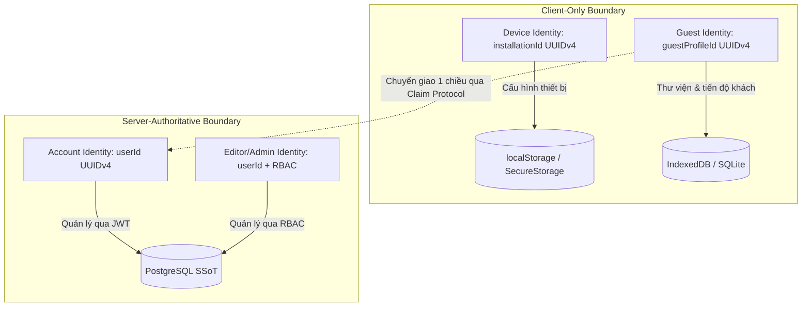
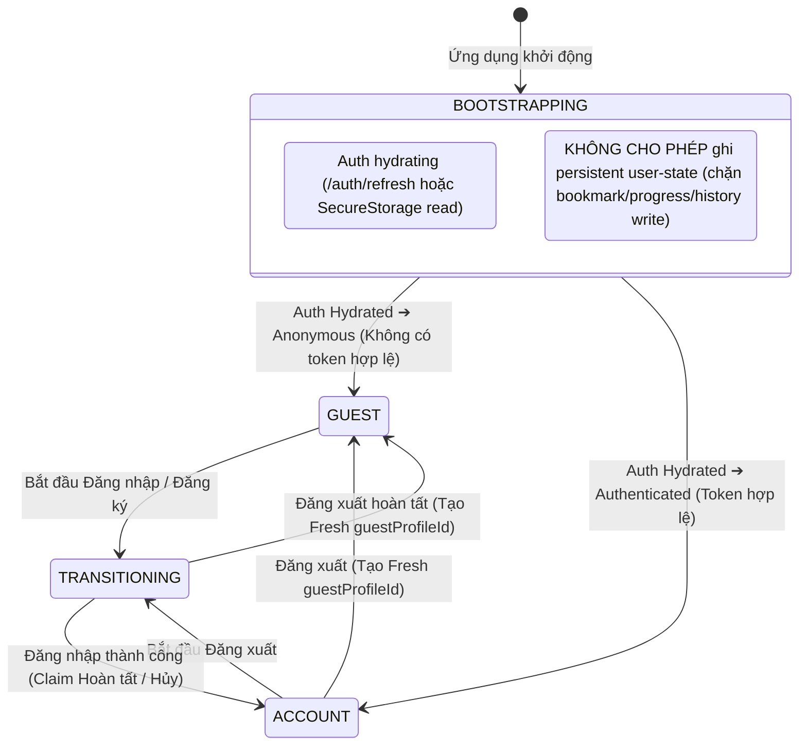

# 🛡️ OmniNovel Architecture: Identity & Ownership Model

> **Tài liệu Canonical SSoT số 1** thuộc **Phase 7.0 — Product Architecture & Data Ownership Design Gate**.  
> Thiết lập ranh giới định danh, sở hữu dữ liệu, cô lập bộ nhớ đệm (Namespace Isolation) và mô hình vòng đời đa tài khoản cho toàn bộ hệ sinh thái OmniNovel (Web, Mobile, Backend).

---

## 1. Bản Chất Định Danh & 3 Tầng Quyền Sử Dụng

OmniNovel phân tách rành mạch 3 loại thực thể định danh trong hệ thống:



### 1.1. Thiết Bị & Khách Vãng Lai (Device & Guest Identity Separation)

Để tránh mâu thuẫn giữa việc định danh thiết bị ổn định và việc tạo phiên khách sạch (fresh guest), hệ thống phân tách thành **hai mã định danh độc lập**:

```text
installationId (Bền vững - Stable)
│
├── Đại diện cho cài đặt thiết bị / browser profile vật lý
├── Tồn tại vĩnh viễn đến khi xóa ứng dụng hoặc clear site data
├── KHÔNG BAO GIỜ bị thay đổi hay reset khi người dùng đăng xuất
└── Gắn với scope thiết bị: device:<installationId>

guestProfileId (Có thể luân chuyển - Rotatable)
│
├── Đại diện cho một phiên hồ sơ Khách (Guest Local Profile) cụ thể
├── Có thể tạo mới (rotate) khi người dùng đăng xuất để tạo Fresh Guest
├── Được quản lý vòng đời độc lập, hỗ trợ lưu trữ cách ly (Quarantine)
└── Gắn với scope thư viện khách: guest:<guestProfileId>
```

- **Ranh giới:** Cả `installationId` và `guestProfileId` **CHỈ TỒN TẠI TẠI CLIENT**.
- **Quy tắc tuyệt đối (P0 Security Invariant):**
  - **Không tạo bản ghi trong bảng `users` của PostgreSQL** khi có khách vãng lai, bot tìm kiếm hay tab ẩn danh truy cập.
  - `installationId` và `guestProfileId` **không phải là credential xác thực** và không được gửi lên các API yêu cầu xác thực (`JwtAuthGuard`).
  - Web và Mobile của cùng một người dùng khi chưa đăng nhập là 2 Guest profiles riêng biệt, **hoàn toàn không đồng bộ chéo**.

### 1.2. Account Identity (`account:<userId>`)
- **Định danh:** `userId` (UUIDv4) do PostgreSQL cấp phát thông qua đăng ký (`POST /auth/register`).
- **Xác thực:** JWT Access Token (ngắn hạn) + Refresh Token (httpOnly Cookie an toàn trên Web hoặc SecureStorage trên Mobile).
- **Quyền hạn:** Là Single Source of Truth (SSoT) cho thư viện, đồng bộ đa thiết bị, tham gia bình luận (Community) và tích luỹ điểm thưởng (Gamification).

### 1.3. Editor / Admin Identity
- Mở rộng từ `AccountIdentity` với các claims RBAC (`GlobalRole.TRANSLATOR`, `GlobalRole.ADMIN`, hoặc `StoryMemberRole`).
- Cho phép truy cập Studio dịch truyện AI, quản lý thuật ngữ (Glossary), duyệt bản dịch và quản trị hệ thống.

---

## 2. Quy Chuẩn Không Gian Tên Bộ Nhớ (Namespace Partitioning)

Để đảm bảo không bao giờ xảy ra ô nhiễm dữ liệu chéo (cross-account contamination) giữa các người dùng hoặc giữa Khách và Tài khoản trên cùng một máy, mọi kho lưu trữ client bắt buộc phải chia namespace theo mẫu sau:

### 2.1. Phân Vùng Lưu Trữ
| Tầng Lưu Trữ | Định Dạng Khóa / Scope | Phạm Vi Dữ Liệu | Cơ Chế Dọn Dẹp / Cô Lập |
|---|---|---|---|
| **Device Scope** | `device:<installationId>` | Theme preference, audio/haptic toggles, UI density, Sync Client Identity | **Bền vững:** Gắn liền với thiết bị, KHÔNG reset khi đăng xuất. |
| **Guest Scope** | `guest:<guestProfileId>` | Bookmarks, Reading Progress, Reading History, Local Presentation Cache | **Luân chuyển:** Có thể chuyển sang Quarantine khi đăng nhập, hoặc tạo mới khi đăng xuất. |
| **Account Scope** | `account:<userId>` | Bản sao đồng bộ (local replica) của dữ liệu Cloud | Khi Logout: **Lập tức detach và ẩn hoàn toàn**. Tuyệt đối không tái sinh (resurrect) thành Guest data. |

### 2.2. Chi Tiết Thực Thi Trên Từng Nền Tảng

#### Web Client (`apps/web`):
- **Kho lưu trữ chính (Primary Store):** **IndexedDB** (`omninovel_local_v2`, version 1).
  - Object Stores:
    - `bookmarks` (composite key `[ownerScope, storyId]`).
    - `progress` (composite key `[ownerScope, storyId]`).
    - `history` (composite key `[ownerScope, storyId, chapterId]`).
- **Kho lưu trữ phụ (Auxiliary):** `localStorage` **chỉ dùng cho `device:<installationId>` preferences cực nhỏ** (ví dụ: `theme_mode: 'DARK'`) và lưu `installationId`, `activeGuestProfileId`. Tuyệt đối không lưu dữ liệu tiến độ hay thư viện vào `localStorage`.

#### Mobile Client (`apps/mobile`):
- **Kho lưu trữ chính:** **Hạ tầng SQLite hiện hữu mở rộng v3** (`omninovel_offline.db`).
- **Phân định bảng:** Thêm 3 bảng `local_library_bookmarks`, `local_reading_progress`, `local_reading_history` với cột `owner_scope TEXT NOT NULL`.
- Mọi câu truy vấn Local Library DAO bắt buộc phải có điều kiện `WHERE owner_scope = :activeScope`.
- Các bảng offline v2 (`offline_chapters`, `download_tasks`, `offline_deletion_tombstones`) giữ nguyên cột `user_id` hiện tại để bảo toàn Phase 5D.

---

## 3. Máy Trạng Thái Định Danh & Ma Trận Chuyển Đổi (State Transitions)

### 3.0. ActiveScopeCoordinator State Machine (P0 Anti-Race Invariant)

Nhằm ngăn chặn triệt để **Auth Bootstrap Race** (khi trang vừa tải, auth đang refresh mà reader ghi nhầm tiến độ của User vào Guest store), `ActiveScopeCoordinator` quản lý 4 trạng thái rành mạch:



> [!CRITICAL]
> **P0 Invariant — Không đồng nhất `not authenticated` với `guest`:**
> Coordinator tiêu thụ trực tiếp `AuthStatus` (`initializing` | `authenticated` | `anonymous`), **TUYỆT ĐỐI KHÔNG tiêu thụ riêng cờ `isAuthenticated: boolean`**.
> Trong trạng thái `BOOTSTRAPPING`, reader có thể tải nội dung public nhưng mọi hành động ghi tiến độ đọc, bookmark hay history bắt buộc phải đợi Active Scope chuyển sang `GUEST` hoặc `ACCOUNT`.

### 3.1. Các Kịch Bản Chuyển Trạng Thái Chi Tiết

#### Kịch bản 1: Người dùng mới mở Web/App (Guest Mode)
- Client kiểm tra: nếu chưa có `installationId` -> tạo mới UUIDv4 (bền vững).
- Nếu chưa có `guestProfileId` -> tạo mới UUIDv4.
- Sau khi Auth Bootstrap xác nhận `anonymous`: `activeScope` được gán = `guest:<guestProfileId>`.
- Mọi hoạt động đọc, đánh dấu trang, lưu tiến độ chỉ ghi vào partition này.

#### Kịch bản 2: Guest đăng nhập / tạo tài khoản mới (Guest → Account Claim)
- Người dùng thực hiện `login()` hoặc `register()`. Scope chuyển sang `TRANSITIONING`.
- Client tạm giữ session mới, kích hoạt luồng **Two-Step Guest Claim Protocol** (đặc tả tại [guest_to_account_claim_protocol.md](guest_to_account_claim_protocol.md)).
- **Trường hợp A: Claim Commit thành công (HTTP 200 từ commit endpoint):**
  - Đánh dấu trạng thái `guest:<guestProfileId>` là `CLAIMED_AND_PURGED`.
  - Rebind các file offline hợp lệ sang `account:<userId>`.
  - `activeScope` chuyển sang `account:<userId>`.
- **Trường hợp B: Người dùng HỦY Claim (Cancel Claim / Skip):**
  - **TUYỆT ĐỐI KHÔNG MUTATE GUEST DATA.** Không tự ý xóa guest bookmarks/progress/history.
  - Chuyển `guest:<guestProfileId>` vào danh sách **Quarantine / Retained Storage** để bảo toàn dữ liệu.
  - `activeScope` chuyển sang `account:<userId>`.

#### Kịch bản 3: Người dùng đăng xuất (Account → Fresh Guest) — *P0 Invariant: Chống Ô Nhiễm Chéo*
- Người dùng bấm Đăng Xuất (`POST /auth/logout`). Scope chuyển sang `TRANSITIONING`.
- Client thực hiện các bước sau theo thứ tự bắt buộc:
  1. Xóa toàn bộ token (`accessToken`, clear cookie `refreshToken`).
  2. **Detach và đóng hoàn toàn scope `account:<userId>`**. Dữ liệu cache của tài khoản này được khóa lại (lock/purge khỏi active memory).
  3. **TUYỆT ĐỐI KHÔNG copy hoặc chuyển đổi dữ liệu của `account:<userId>` thành `guest:*`.**
  4. **Giữ nguyên `installationId` ổn định**, gọi `rotateGuestProfileId()` để sinh ra một `guestProfileId` mới tinh.
  5. `activeScope` chuyển sang `guest:<newGuestProfileId>` (GUEST state).
  6. UI hiển thị Thư viện rỗng sạch sẽ, không chứa bất kỳ dấu vết nào của tài khoản vừa đăng xuất.
  7. **Chính sách đối với Guest Scope trước login:** Nếu trước đó guest scope đã được claim thành công, nó đã bị purge/rebind; nếu claim bị cancel/abort, guest scope đó vẫn được giữ trong storage dạng quarantined/archived theo retention policy có kiểm soát (TTL hoặc dọn dẹp thủ công), tuyệt đối không bị destroy âm thầm ngay khi logout.

#### Kịch bản 4: User A đăng xuất, User B đăng nhập trên cùng máy
- Khi User A đăng xuất: cache của A bị cô lập hoàn toàn, fresh guest profile được khởi tạo.
- Khi User B đăng nhập: Client nhận `userId = B`. Scope chuyển thành `account:B`.
- B chỉ thấy dữ liệu từ server của chính B và cache của chính B (nếu có từ trước).
- **Tỉ lệ ô nhiễm dữ liệu từ A sang B: 0.00%**.

---

## 4. Mô Hình Sở Hữu Nội Dung Tải Ngoại Tuyến (Offline Content Ownership)

Mobile và Web (Cache API/IndexedDB) cho phép tải nội dung để đọc khi mất mạng. Mô hình sở hữu tệp tin vật lý được quy định như sau:

```text
/storage/offline/
  ├── payloads/                  <-- Chứa dữ liệu ảnh truyện, HTML chương (Content-Addressable by SHA256)
  │     ├── sha256_e3b0c442...
  │     └── sha256_8f43a12b...
  │
  └── manifests/                 <-- Metadata phân định quyền sở hữu
        ├── guest_gp123_chapter_99.json    (ownerScope: "guest:gp123")
        └── user_456_chapter_99.json       (ownerScope: "account:user_456")
```

### 4.1. Quy Tắc Sở Hữu & Tái Liên Kết (Rebinding Invariants)
1. **Chương Truyện Miễn Phí (Public Chapters):**
   - Guest tải chương public: file ảnh lưu vào `payloads/` dựa trên mã băm SHA256, manifest ghi nhận `ownerScope: guest:<guestProfileId>`.
   - Khi Guest claim tài khoản thành công:
     - Hệ thống thực hiện **Metadata Rebind**: cập nhật manifest sang `ownerScope: account:<userId>`.
     - **Không cần tải lại tệp tin** nếu mã băm SHA256 vẫn khớp với bản ghi trên server.
2. **Chương Truyện Khóa / Trả Phí / Quyền Đặc Biệt (Protected Content):**
   - Guest không được phép tải.
   - Khi tài khoản tải: manifest được ký điện tử và gán cứng với `account:<userId>`.
   - Khi tài khoản đăng xuất: các tệp tin payload có thể lưu tạm trên đĩa nhưng **Guest tuyệt đối không thể đọc được** (bị chặn bởi tầng Reader Access Filter). Nếu User đăng nhập lại, quyền đọc lập tức mở lại.

---

## 5. Danh Mục Bất Biến An Toàn (Security & Integrity Invariants)

1. **Client Metadata Là Bất Khả Tín (Zero Trust for Client Metadata):**
   - Client gửi claim hoặc sync chỉ được gửi canonical IDs (`storyId`, `chapterId`, `chapterVersionId`).
   - Mọi thông tin tiêu đề (`title`), ảnh bìa (`coverUrl`), tên chương (`chapterTitle`) đều do Backend tự truy vấn từ PostgreSQL. Nghiêm cấm client tự truyền text để ghi vào DB.
2. **Phân Quyền Rành Mạch (Enforced Scope Gates):**
   - Mọi API truy cập `/library/*`, `/account/*`, `/sync/*` bắt buộc phải có `JwtAuthGuard`.
   - Khách vãng lai chỉ có quyền gọi các endpoint public (`/stories`, `/chapters/:id`, `/search`).
3. **Chống Tái Sinh (Anti-Resurrection):**
   - Một thực thể đã bị xóa trên Cloud (có tombstone) không bao giờ được phép tái sinh thông qua việc import dữ liệu cũ từ bất kỳ Guest nào.
