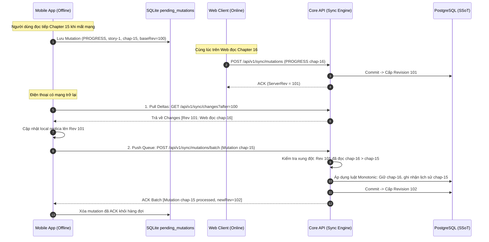

# 🔄 OmniNovel Architecture: Unified Sync Protocol (Web ↔ Server ↔ Mobile)

> **Tài liệu Canonical SSoT số 3** thuộc **Phase 7.0 — Product Architecture & Data Ownership Design Gate**.  
> Thiết lập giao thức đồng bộ hóa đa thiết bị dựa trên Server Revisions, Mutations Queue, Tombstones và Anti-Resurrection, áp dụng thống nhất cho cả Web Client và Mobile App.

---

## 1. Triết Lý Thiết Kế Đồng Bộ Đa Thiết Bị

```text
                  ┌────────────────────────┐
                  │    Core API Backend    │
                  │    PostgreSQL SSoT     │
                  │ Server Revisions: 10425│
                  └───────────┬────────────┘
                              │
               Sync Protocol (Revisions & Deltas)
               ┌──────────────┴──────────────┐
               ↓                             ↓
        Next.js Web Client           Flutter Mobile App
       Local IndexedDB Replica       Local SQLite Replica
         lastRevision: 10425           lastRevision: 10425
```

### Các Nguyên Tắc Bắt Buộc:
1. **Không Phụ Thuộc Đồng Hồ Client (No Wall-Clock Consistency):**
   - Không dùng `timestamp` để quyết định dữ liệu nào mới hơn khi đồng bộ đa thiết bị.
   - Sử dụng **Server Revisions (Số phiên bản tuần tự đơn điệu tăng dần)** làm thước đo thời gian logic duy nhất.
2. **Mô Hình Mutation-Based (Đồng bộ từng biến đổi thay vì gửi cả snapshot):**
   - Thay vì gửi toàn bộ danh sách 100 bookmark mỗi lần thay đổi, client chỉ gửi một `Mutation` nhỏ (ví dụ: `Bookmark story-123 DELETE`).
3. **Idempotency Là Tiêu Chuẩn Mặc Định (Mọi thao tác phải chống lặp):**
   - Khóa duy nhất xác thực: `(userId, clientId, mutationId)`. Khi mạng chập chờn gây retry, server nhận diện và trả kết quả cũ, không thực hiện lặp thao tác.
4. **Bảo Toàn Lệnh Xóa (Tombstones & Anti-Resurrection):**
   - Khi một thiết bị xóa truyện/tiến độ, server lưu một bản ghi Tombstone kèm `revision`.
   - Một thiết bị ngoại tuyến (stale client) khi kết nối lại không bao giờ được phép làm hồi sinh dữ liệu đã bị xóa.

---

## 2. Cấu Trúc Bản Ghi Biến Đổi (Client Mutation Structure)

Mọi thao tác người dùng thực hiện khi đã đăng nhập (đánh dấu trang, đọc tiếp, đổi cài đặt đọc) đều được chuyển thành một `ClientMutation`:

```typescript
export interface ClientMutation {
  clientId: string;        // UUID định danh phiên client (vd: thiết bị di động X hoặc tab Web Y)
  mutationId: string;      // UUIDv4 sinh tại client cho từng thao tác
  domain: 'BOOKMARK' | 'PROGRESS' | 'HISTORY' | 'PREFERENCE' | 'FOLLOW';
  entityId: string;        // ID của đối tượng (vd: storyId hoặc storyId:chapterId)
  operation: 'UPSERT' | 'DELETE';
  baseServerRevision: number; // Server revision mới nhất mà client biết trước khi tạo mutation
  payload: Record<string, any>; // Dữ liệu chi tiết của thay đổi
  clientCreatedAt: string; // ISO String (chỉ để hiển thị / audit, không làm trọng tài)
}
```

---

## 3. Lược Đồ CSDL Nhật Ký Đồng Bộ (Sync Change Log Table)

Tại PostgreSQL, bảng `sync_change_log` lưu vết toàn bộ các thay đổi có phân vùng theo từng tài khoản:

```sql
CREATE TABLE sync_change_log (
    id BIGSERIAL PRIMARY KEY,
    user_id UUID NOT NULL REFERENCES users(id) ON DELETE CASCADE,
    revision BIGINT NOT NULL,
    client_id VARCHAR(64) NOT NULL,
    mutation_id UUID NOT NULL,
    domain VARCHAR(32) NOT NULL,
    entity_id VARCHAR(128) NOT NULL,
    operation VARCHAR(16) NOT NULL, -- 'UPSERT' | 'DELETE'
    payload JSONB NOT NULL DEFAULT '{}'::jsonb,
    created_at TIMESTAMP WITH TIME ZONE DEFAULT CURRENT_TIMESTAMP,
    CONSTRAINT uq_user_revision UNIQUE (user_id, revision),
    CONSTRAINT uq_user_mutation UNIQUE (user_id, client_id, mutation_id)
);

CREATE INDEX idx_sync_user_revision ON sync_change_log(user_id, revision ASC);
```

Ngoài ra, mỗi user có một counter `current_sync_revision BIGINT` lưu trong bảng `user_sync_state`.

---

## 4. Quy Trình Đồng Bộ 2 Chiều (Bi-Directional Sync Flow)



---

## 5. Đặc Tả Chi Tiết API Endpoints

### 5.1. Kéo Thay Đổi Mới Nhất (Pull Delta Changes)
- **Endpoint:** `GET /api/v1/sync/changes`
- **Query Params:**
  - `after`: `number` (Revision client đang có, ví dụ `10421`)
  - `limit`: `number` (Mặc định `100`, tối đa `500`)
- **Response (`200 OK`):**
```typescript
export interface SyncChangesResponse {
  currentServerRevision: number;
  hasMore: boolean;
  changes: Array<{
    revision: number;
    domain: 'BOOKMARK' | 'PROGRESS' | 'HISTORY' | 'PREFERENCE' | 'FOLLOW';
    entityId: string;
    operation: 'UPSERT' | 'DELETE';
    payload: any;
    createdAt: string;
  }>;
}
```

### 5.2. Đẩy Các Biến Đổi Lên Server (Push Mutations Batch)
- **Endpoint:** `POST /api/v1/sync/mutations/batch`
- **Request Body:**
```typescript
export interface PushMutationsBatchDto {
  mutations: ClientMutation[];
}
```
- **Response (`200 OK`):**
```typescript
export interface PushMutationsBatchResponse {
  processedCount: number;
  newServerRevision: number;
  results: Array<{
    mutationId: string;
    status: 'APPLIED' | 'DEDUPLICATED' | 'REJECTED_TOMBSTONE' | 'CONFLICT_MERGED';
    assignedRevision: number;
  }>;
}
```

---

## 6. Cơ Chế Chống Tái Sinh (Anti-Resurrection with Tombstones)

### Kịch Bản Lỗi Cổ Điển Cần Triệt Tiêu:
1. Người dùng có truyện "One Piece" trong Bookmark.
2. Thiết bị di động mất kết nối mạng.
3. Người dùng vào Web xóa "One Piece" khỏi Bookmark. Server tạo Tombstone tại `revision = 205`.
4. Một tuần sau, thiết bị di động bật mạng trở lại. Nếu thiết bị gửi toàn bộ danh sách bookmark cũ lên, truyện "One Piece" sẽ bị tái sinh (resurrect) ngoài ý muốn.

### Giải Pháp Triệt Để Của OmniNovel:
- Khi nhận mutation `UPSERT Bookmark story-one-piece` từ thiết bị di động:
  - Server kiểm tra `baseServerRevision` của client gửi lên (ví dụ: `200`).
  - Server tra cứu lịch sử tombstone: phát hiện có `DELETE` tại `revision = 205` (`205 > 200`).
  - Server **lập tức từ chối tái sinh** (`status: REJECTED_TOMBSTONE`).
  - Thiết bị di động nhận phản hồi, tự động xóa bản ghi "One Piece" khỏi bộ nhớ đệm cục bộ mà không làm ô nhiễm Cloud.

---

## 7. Khả Năng Ngoại Tuyến (Offline Resilience & Queue Persistence)

- **Web:** Hàng đợi mutation được lưu trữ trong bảng `pending_mutations` của IndexedDB. Tự động lắng nghe sự kiện `window.addEventListener('online', ...)` và Service Worker Background Sync để flush hàng đợi.
- **Mobile:** Hàng đợi được lưu trữ trong bảng SQLite `pending_sync_mutations`. Một `SyncWorker` độc lập chạy ngầm đảm bảo tự động gửi lại khi có kết nối Wi-Fi/4G và áp dụng thuật toán Exponential Backoff khi gặp sự cố mạng.
